## ISS-00 - Entorno y proyecto Django

En este ISS preparé el entorno aislado y creé el proyecto Django `config`, sin modelos todavía. Los pasos siguen la guía de Django del curso (ISS-00 · Entorno y proyecto Django).

### Paso 1 - Verificación de requisitos

Verifiqué que tengo Python 3.12 y que el directorio del proyecto está vacío antes de crear el entorno.

``` bash
python3 --version
ls -la
```

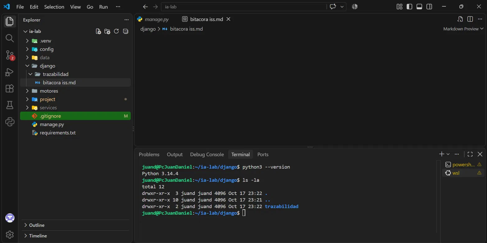

**Retroalimentación de la evidencia:** En la captura observé la versión `[3.12.x]` impresa por `python3 --version` y el directorio sin archivos previos [o con solo los archivos de carpeta oculta].

**Conclusión y aprendizaje:** Aprendí que el ISS exige una versión concreta de Python, porque Django 5.2 y sus dependencias se prueban sobre esa versión. Verificar el requisito antes de instalar evita errores difíciles de diagnosticar más adelante.

### Paso 2 - Creación del entorno virtual e instalación de Django

Creé el entorno virtual `.venv`, lo activé, instalé Django 5.2.17 con `python -m pip` y guardé las dependencias en `requirements.txt`. Uso `python -m pip` para asegurar que la instalación va al entorno activo.

``` bash
python3 -m venv .venv
source .venv/bin/activate
python -m pip install "Django==5.2.17"
python -m pip freeze > requirements.txt
python -m django --version
```

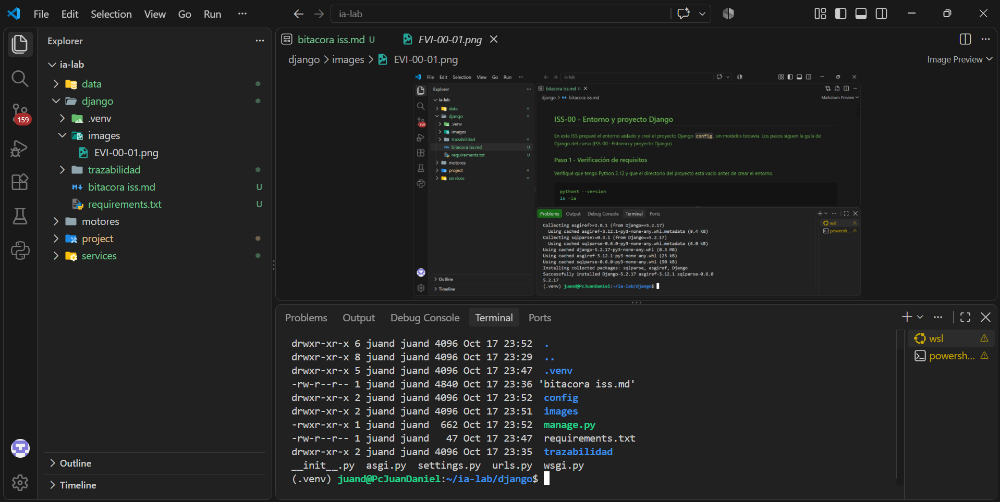

**Retroalimentación de la evidencia:** En la captura observé el prompt con `(.venv)` activo, la instalación de Django 5.2.17 sin errores y la versión `5.2.17` impresa al final.

**Conclusión y aprendizaje:** Aprendí que `.venv` aísla las dependencias del proyecto del Python del sistema. `requirements.txt` permite reproducir el mismo entorno en otra máquina.

### Paso 3 - Creación del proyecto `config`

Generé el proyecto con la CLI de Django en el directorio actual, para que `manage.py` quede en la raíz y el paquete de configuración se llame `config`.

``` bash
django-admin startproject config .
ls config
```

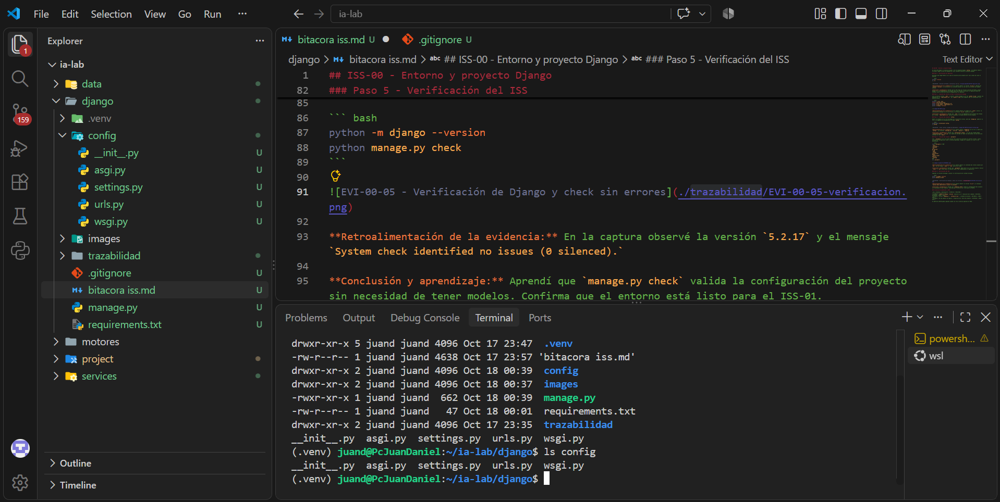

**Retroalimentación de la evidencia:** En la captura observé `manage.py` en la raíz y, dentro de `config/`, los archivos `settings.py`, `urls.py`, `wsgi.py` y h`asgi.py`.

**Conclusión y aprendizaje:** Aprendí que `startproject config .` no crea una carpeta doble `proyecto/proyecto/`. `urls.py` es el punto de entrada de todas las peticiones; en este ISS solo contiene la ruta `admin/`.

### Paso 4 - Creación del archivo `.gitignore`

Creé `.gitignore` en la raíz para excluir del control de versiones el entorno virtual, cachés, archivos de configuración local y archivos generados. Django no lo genera, así que lo creé manualmente.

``` bash
cat > .gitignore <<'EOF'
.venv/
__pycache__/
*.py[cod]
.env
db.sqlite3
*.log
.idea/
.vscode/
staticfiles/
media/
.pytest_cache/
htmlcov/
.coverage
EOF
cat .gitignore
```

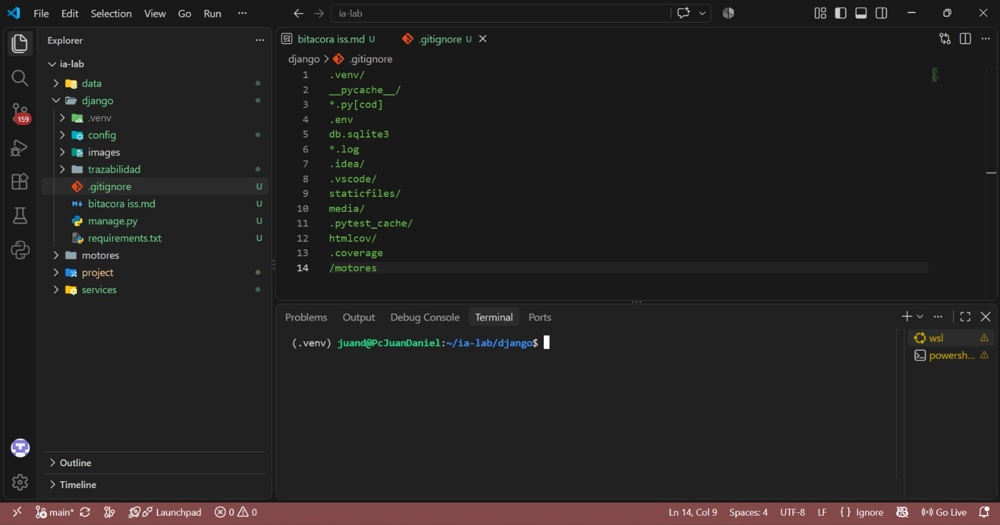

**Retroalimentación de la evidencia:** En la captura observé el contenido del archivo impreso por `cat`, con las reglas `.venv/` y `.env` entre las líneas.

**Conclusión y aprendizaje:** Aprendí que `.gitignore` debe estar en la raíz del proyecto. Excluir `.venv/` y `.env` evita subir el entorno local y las credenciales al repositorio.

### Paso 5 - Verificación del ISS

Comprobé la versión de Django y ejecuté la verificación del sistema de Django.

``` bash
python -m django --version
python manage.py check
```

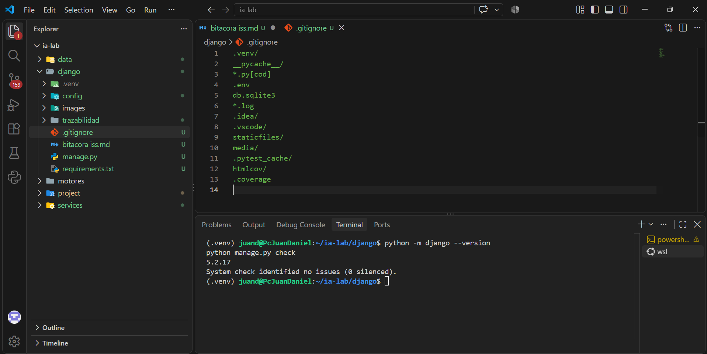

**Retroalimentación de la evidencia:** En la captura observé la versión `5.2.17` y el mensaje `System check identified no issues (0 silenced).`

**Conclusión y aprendizaje:** Aprendí que `manage.py check` valida la configuración del proyecto sin necesidad de tener modelos. Confirma que el entorno está listo para el ISS-01.

## ISS-01 - Settings y selección del motor

En este ISS separé la configuración en el paquete `config/settings/`, instalé los drivers de los cuatro motores de base de datos (PostgreSQL, MySQL, SQL Server y Oracle) y elegí el motor activo desde `.env` mediante `DB_ENGINE`. No escribí SQL: el ORM recibe un único alias `default` por ejecución. Las pruebas con cada motor se realizan a partir del ISS-03, cuando se aplican migraciones.

### Paso 1 - Confirmación del entorno y dependencias del sistema

Verifiqué que `python` apunta al intérprete de `.venv` y que las herramientas de compilación están instaladas para `mysqlclient`.

```bash
source .venv/bin/activate
which python
python --version
sudo apt update
sudo apt install -y build-essential pkg-config default-libmysqlclient-dev python3.14-dev
```

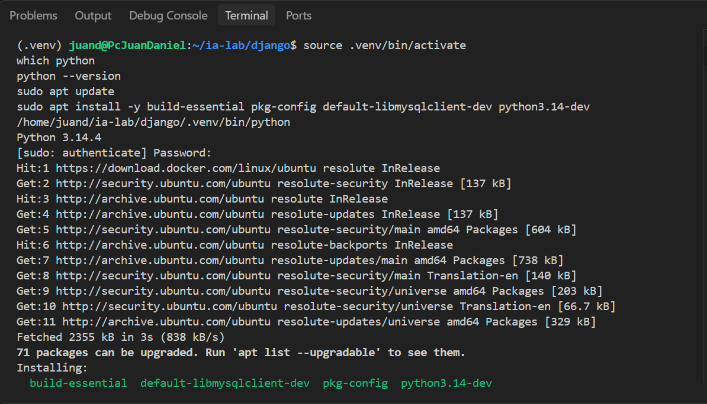

**Retroalimentación de la evidencia:** En la captura observé el prompt con `(.venv)`, la ruta `[ruta exacta]/.venv/bin/python`, la versión `Python [3.14.x]` y la instalación de las dependencias del sistema sin errores.

**Conclusión y aprendizaje:** Aprendí que `pip` y `python` deben apuntar al mismo entorno; de lo contrario, los drivers quedan instalados fuera del proyecto y `manage.py` no los encuentra.

### Paso 2 - Instalación de los drivers de los cuatro motores

Instalé `python-dotenv` para leer `.env` y un driver por motor. Django no incluye drivers, así que sin ellos la conexión a cualquier base de datos falla al importar el backend.

```bash
python -m pip install "python-dotenv==1.2.3"
python -m pip install "psycopg[binary]==3.3.6"
python -m pip install "mysqlclient==2.3.0"
python -m pip install "mssql-django==2.0.0"
python -m pip install "oracledb==26.0.1"
python -m pip freeze > requirements.txt
cat requirements.txt
```

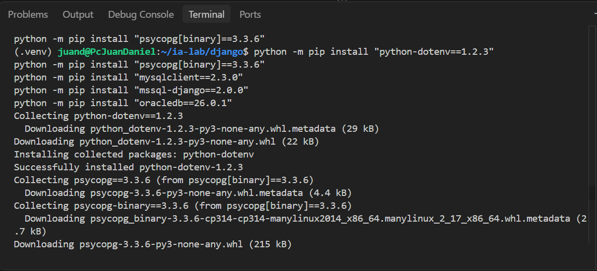

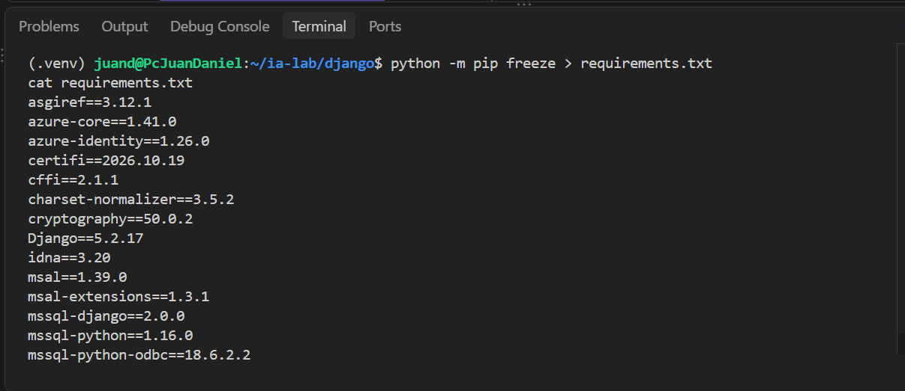

**Retroalimentación de las evidencias:** En la primera captura observé [la última línea de la instalación de `oracledb 26.0.1` sin errores]. En la segunda observé [las versiones registradas: python-dotenv 1.2.3, psycopg 3.3.6, mysqlclient 2.3.0, mssql-django 2.0.0 y oracledb 26.0.1].

**Conclusión y aprendizaje:** Aprendí que cada motor necesita su propio driver. `psycopg` sirve a PostgreSQL, `mysqlclient` a MySQL, `mssql-django` registra el motor `mssql` y necesita pyodbc y el driver ODBC del sistema para conectarse, y `oracledb` en modo thin conecta a Oracle sin Instant Client. `requirements.txt` deja constancia de las versiones exactas para reproducir el entorno.

### Paso 3 - Conversión de settings.py en paquete

`startproject` generó `config/settings.py`. Lo eliminé y creé la carpeta `config/settings/`, que se convierte en el único punto de configuración.

```bash
rm config/settings.py
mkdir -p config/settings
ls config
```

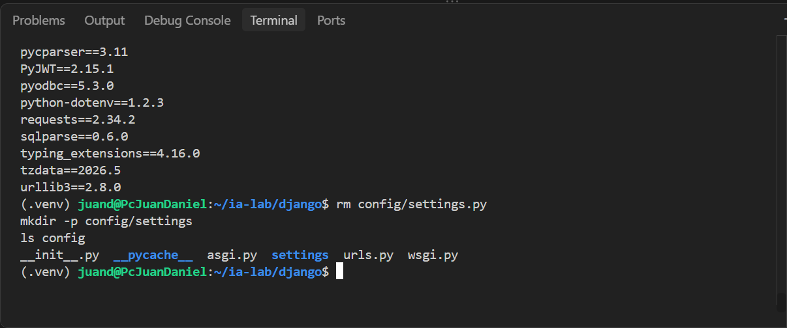
**Retroalimentación de la evidencia:** En la captura observé [el listado de `config/` con `settings/` y sin `settings.py`].

**Conclusión y aprendizaje:** Aprendí que la configuración debe vivir en un solo lugar. Tener `settings.py` y un paquete `settings/` a la vez generaría dudas sobre cuál se carga.

### Paso 4 - Plantilla `.env.example` y archivo `.env`

Creé `.env.example` como plantilla sin secretos, con las variables de los cuatro motores, y copié la plantilla a `.env`. `.env` contiene credenciales, así que debe estar en `.gitignore`.

```bash
cat > .env.example <<'EOF'
# Copie este archivo a .env y complete los valores.
# .env no se versiona.

DJANGO_SECRET_KEY=
DJANGO_DEBUG=True
DJANGO_ALLOWED_HOSTS=localhost,127.0.0.1,testserver

# Motor activo. Uno solo por ejecución: postgresql | mysql | mssql | oracle
DB_ENGINE=postgresql

POSTGRES_DB=
POSTGRES_USER=
POSTGRES_PASSWORD=
POSTGRES_HOST=127.0.0.1
POSTGRES_PORT=5432

MYSQL_DB=
MYSQL_USER=
MYSQL_PASSWORD=
MYSQL_HOST=127.0.0.1
MYSQL_PORT=3306

MSSQL_DB=
MSSQL_USER=
MSSQL_PASSWORD=
MSSQL_HOST=127.0.0.1
MSSQL_PORT=1433

ORACLE_DB=
ORACLE_USER=
ORACLE_PASSWORD=
ORACLE_HOST=127.0.0.1
ORACLE_PORT=1521
ORACLE_SERVICE_NAME=

CORS_ALLOW_ALL_ORIGINS=True
EOF

cp .env.example .env
```

Para generar la clave secreta usé:

```bash
python -c "import secrets; print(secrets.token_urlsafe(50))"
```

y la pegué en `DJANGO_SECRET_KEY` dentro de `.env`.

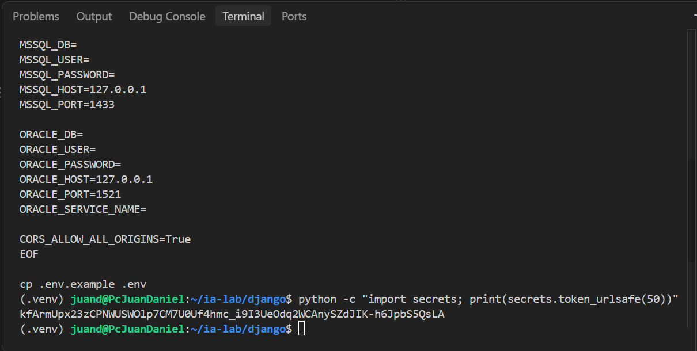
**Retroalimentación de la evidencia:** En la captura observé [los dos archivos en el listado] y el contenido de `.env.example`, que solo tiene nombres de variables y valores vacíos. Los valores reales de `.env` no aparecen en la captura.

**Conclusión y aprendizaje:** Aprendí a separar la plantilla, que sí se versiona, del archivo con credenciales reales, que no se versiona. Así el repositorio documenta qué variables se necesitan sin exponer contraseñas.

### Paso 5 - Selector de motor en `config/database.py`

Creé `config/database.py`. No es una aplicación: traduce `DB_ENGINE` a un único diccionario `DATABASES["default"]`. Cada motor exige sus variables y define su `ENGINE`. Para Oracle armo el DSN con `SERVICE_NAME` y dejo `PORT` vacío porque Django lo toma del DSN.

```bash
cat > config/database.py <<'EOF'
"""Selección del motor de base de datos a partir del entorno.

Un solo alias, default, queda activo en cada ejecución.
"""

from django.core.exceptions import ImproperlyConfigured

ALLOWED_ENGINES = ("postgresql", "mysql", "mssql", "oracle")


def database_from_environ(env):
    engine = str(env.get("DB_ENGINE", "postgresql")).strip().lower()
    if engine not in ALLOWED_ENGINES:
        allowed = ", ".join(ALLOWED_ENGINES)
        raise ImproperlyConfigured(
            f"DB_ENGINE='{engine}' no es válido. Valores permitidos: {allowed}."
        )
    builders = {
        "postgresql": _postgresql,
        "mysql": _mysql,
        "mssql": _mssql,
        "oracle": _oracle,
    }
    return {"default": builders[engine](env)}


def _required(env, key):
    value = env.get(key)
    if value is None or str(value).strip() == "":
        raise ImproperlyConfigured(
            f"Falta la variable de entorno {key} para DB_ENGINE={env.get('DB_ENGINE')}."
        )
    return str(value).strip()


def _postgresql(env):
    return {
        "ENGINE": "django.db.backends.postgresql",
        "NAME": _required(env, "POSTGRES_DB"),
        "USER": _required(env, "POSTGRES_USER"),
        "PASSWORD": _required(env, "POSTGRES_PASSWORD"),
        "HOST": _required(env, "POSTGRES_HOST"),
        "PORT": _required(env, "POSTGRES_PORT"),
    }


def _mysql(env):
    return {
        "ENGINE": "django.db.backends.mysql",
        "NAME": _required(env, "MYSQL_DB"),
        "USER": _required(env, "MYSQL_USER"),
        "PASSWORD": _required(env, "MYSQL_PASSWORD"),
        "HOST": _required(env, "MYSQL_HOST"),
        "PORT": _required(env, "MYSQL_PORT"),
        "OPTIONS": {"charset": "utf8mb4"},
    }


def _mssql(env):
    return {
        "ENGINE": "mssql",
        "NAME": _required(env, "MSSQL_DB"),
        "USER": _required(env, "MSSQL_USER"),
        "PASSWORD": _required(env, "MSSQL_PASSWORD"),
        "HOST": _required(env, "MSSQL_HOST"),
        "PORT": _required(env, "MSSQL_PORT"),
        "OPTIONS": {
            "driver": "ODBC Driver 18 for SQL Server",
            "extra_params": "TrustServerCertificate=yes",
        },
    }


def _oracle(env):
    host = _required(env, "ORACLE_HOST")
    port = _required(env, "ORACLE_PORT")
    service = _required(env, "ORACLE_SERVICE_NAME")
    dsn = (
        f"(DESCRIPTION=(ADDRESS=(PROTOCOL=TCP)(HOST={host})(PORT={port}))"
        f"(CONNECT_DATA=(SERVICE_NAME={service})))"
    )
    return {
        "ENGINE": "django.db.backends.oracle",
        "NAME": dsn,
        "USER": _required(env, "ORACLE_USER"),
        "PASSWORD": _required(env, "ORACLE_PASSWORD"),
        "HOST": host,
        "PORT": "",
    }
EOF
```

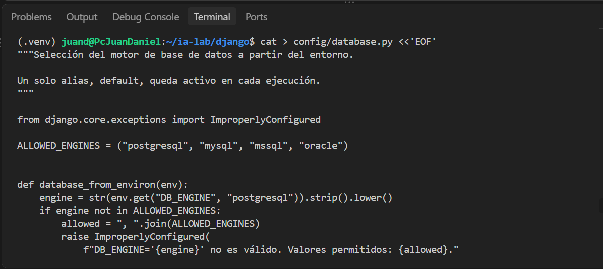

**Retroalimentación de la evidencia:** En la captura observé [la función `database_from_environ` y la lista `ALLOWED_ENGINES` con los cuatro motores].

**Conclusión y aprendizaje:** Aprendí que el ORM no conoce el motor real: solo ve el alias `default`. La elección ocurre antes, con una función que puedo probar sin conectarme a ningún servidor.

### Paso 6 - Configuración principal en `config/settings/__init__.py`

Este archivo reemplaza al `settings.py` generado. Carga `.env` antes de leer la clave secreta y la base de datos, y define idioma, zona horaria y el modelo de llave primaria. Las aplicaciones de negocio y el usuario personalizado se agregan en los ISS siguientes.

```bash
cat > config/settings/__init__.py <<'EOF'
"""Configuración del proyecto PuntoStock.

El paquete sustituye al settings.py generado por startproject.
DJANGO_SETTINGS_MODULE sigue siendo config.settings.
"""

import os
from pathlib import Path

from dotenv import load_dotenv
from django.core.exceptions import ImproperlyConfigured

from config.database import database_from_environ

BASE_DIR = Path(__file__).resolve().parent.parent.parent
load_dotenv(BASE_DIR / ".env")

SECRET_KEY = os.environ.get("DJANGO_SECRET_KEY", "").strip()
if not SECRET_KEY:
    raise ImproperlyConfigured("Defina DJANGO_SECRET_KEY en el archivo .env.")

DEBUG = os.environ.get("DJANGO_DEBUG", "False").strip().lower() in {"1", "true", "yes", "on"}

ALLOWED_HOSTS = [
    host.strip()
    for host in os.environ.get("DJANGO_ALLOWED_HOSTS", "localhost,127.0.0.1").split(",")
    if host.strip()
]

INSTALLED_APPS = [
    "django.contrib.admin",
    "django.contrib.auth",
    "django.contrib.contenttypes",
    "django.contrib.sessions",
    "django.contrib.messages",
    "django.contrib.staticfiles",
]

MIDDLEWARE = [
    "django.middleware.security.SecurityMiddleware",
    "django.contrib.sessions.middleware.SessionMiddleware",
    "django.middleware.common.CommonMiddleware",
    "django.middleware.csrf.CsrfViewMiddleware",
    "django.contrib.auth.middleware.AuthenticationMiddleware",
    "django.contrib.messages.middleware.MessageMiddleware",
    "django.middleware.clickjacking.XFrameOptionsMiddleware",
]

ROOT_URLCONF = "config.urls"

TEMPLATES = [
    {
        "BACKEND": "django.template.backends.django.DjangoTemplates",
        "DIRS": [],
        "APP_DIRS": True,
        "OPTIONS": {
            "context_processors": [
                "django.template.context_processors.request",
                "django.contrib.auth.context_processors.auth",
                "django.contrib.messages.context_processors.messages",
            ],
        },
    },
]

WSGI_APPLICATION = "config.wsgi.application"
ASGI_APPLICATION = "config.asgi.application"

DATABASES = database_from_environ(os.environ)

AUTH_PASSWORD_VALIDATORS = [
    {"NAME": "django.contrib.auth.password_validation.UserAttributeSimilarityValidator"},
    {"NAME": "django.contrib.auth.password_validation.MinimumLengthValidator"},
    {"NAME": "django.contrib.auth.password_validation.CommonPasswordValidator"},
    {"NAME": "django.contrib.auth.password_validation.NumericPasswordValidator"},
]

LANGUAGE_CODE = "es"
TIME_ZONE = "America/Bogota"
USE_I18N = True
USE_TZ = True

STATIC_URL = "static/"
DEFAULT_AUTO_FIELD = "django.db.models.BigAutoField"
EOF
```

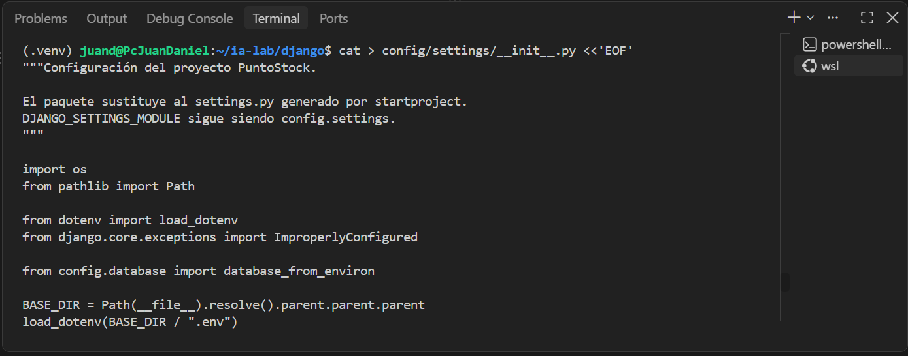

**Retroalimentación de la evidencia:** En la captura observé [los imports de `dotenv` y `database_from_environ`, y la línea `DATABASES = database_from_environ(os.environ)`].

**Conclusión y aprendizaje:** Aprendí que el orden importa: `load_dotenv` debe ejecutarse antes de leer `SECRET_KEY` y `DATABASES`. Si no, Django arranca con valores vacíos.

### Paso 7 - Intérprete del proyecto en `config/project_python.py`

Este módulo usa solo la biblioteca estándar. Si `manage.py` arranca con el Python del sistema, vuelve a lanzar el mismo comando con `.venv/bin/python`, donde están Django y los drivers.

```bash
cat > config/project_python.py <<'EOF'
"""Intérprete del proyecto.

Los paquetes se instalan dentro de .venv. Si python3 manage.py usa el
Python del sistema, no ve esos paquetes. use_project_python() vuelve a
lanzar el mismo comando con .venv/bin/python.
"""

import os
import sys
from pathlib import Path

PROJECT_ROOT = Path(__file__).resolve().parent.parent


def use_project_python():
    """Reejecuta el proceso con el Python de .venv si aún no es ese intérprete."""
    venv_root = PROJECT_ROOT / ".venv"
    venv_python = venv_root / "bin" / "python"
    if not venv_python.is_file():
        return
    try:
        if Path(sys.prefix).resolve() == venv_root.resolve():
            return
    except OSError:
        return
    os.execv(venv_python, [str(venv_python), *sys.argv])
EOF
```

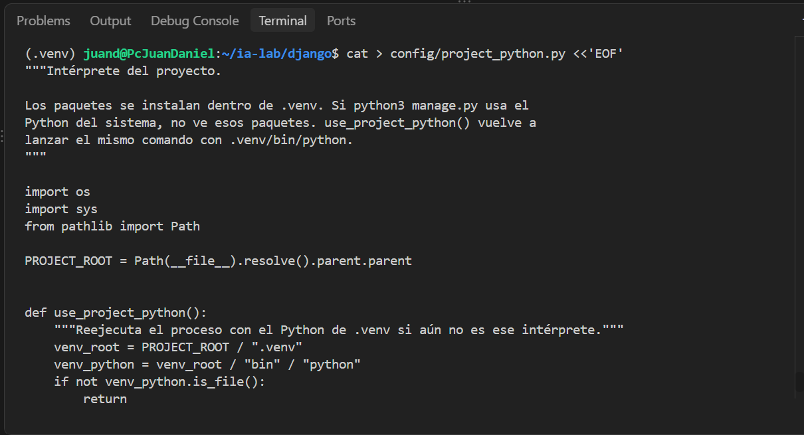

**Retroalimentación de la evidencia:** En la captura observé [el archivo creado y la función `use_project_python`].

**Conclusión y aprendizaje:** Aprendí que `sys.prefix` identifica el entorno activo. Por eso comparo esa ruta y no la del ejecutable, que en `.venv` es un enlace al Python del sistema.

### Paso 8 - Reescritura de `manage.py`, `wsgi.py` y `asgi.py`

Reescribí estos tres archivos completos con `cat`, para que carguen `.env` y usen el intérprete del proyecto antes de que Django lea la configuración. Los archivos generados por `startproject` se sustituyeron; no se editaron línea por línea.

**`manage.py`**

```bash
cat > manage.py <<'EOF'
#!/usr/bin/env python
"""Run administrative tasks."""

import sys
from pathlib import Path

_ROOT = Path(__file__).resolve().parent
if str(_ROOT) not in sys.path:
    sys.path.insert(0, str(_ROOT))

from config.project_python import use_project_python

use_project_python()

import os

from dotenv import load_dotenv


def main():
    """Run administrative tasks."""
    load_dotenv()
    os.environ.setdefault("DJANGO_SETTINGS_MODULE", "config.settings")
    try:
        from django.core.management import execute_from_command_line
    except ImportError as exc:
        raise ImportError(
            "No se pudo importar Django. ¿Está activado el entorno virtual?"
        ) from exc
    execute_from_command_line(sys.argv)


if __name__ == "__main__":
    main()
EOF
```

**`config/wsgi.py`**

```bash
cat > config/wsgi.py <<'EOF'
import os

from dotenv import load_dotenv

from django.core.wsgi import get_wsgi_application

load_dotenv()
os.environ.setdefault("DJANGO_SETTINGS_MODULE", "config.settings")

application = get_wsgi_application()
EOF
```

**`config/asgi.py`**

```bash
cat > config/asgi.py <<'EOF'
import os

from dotenv import load_dotenv

from django.core.asgi import get_asgi_application

load_dotenv()
os.environ.setdefault("DJANGO_SETTINGS_MODULE", "config.settings")

application = get_asgi_application()
EOF
```

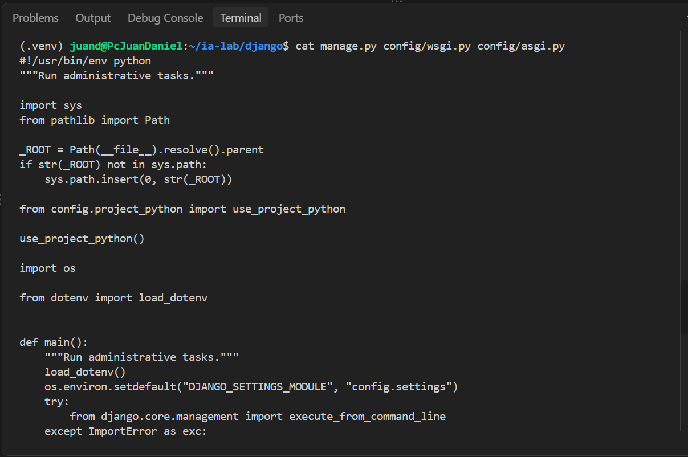

**Retroalimentación de la evidencia:** En la captura observé [`use_project_python()` y `load_dotenv()` en `manage.py`, y `load_dotenv()` antes de `get_wsgi_application()` y `get_asgi_application()`].

**Conclusión y aprendizaje:** Aprendí que `load_dotenv()` debe ejecutarse antes de que Django lea la configuración. Reescribir los archivos completos evita dejar restos de código generado que no coincidan con el resto del proyecto.

### Paso 9 - Verificación del ISS

Ejecuté la verificación del sistema de Django:

```bash
python manage.py check
```

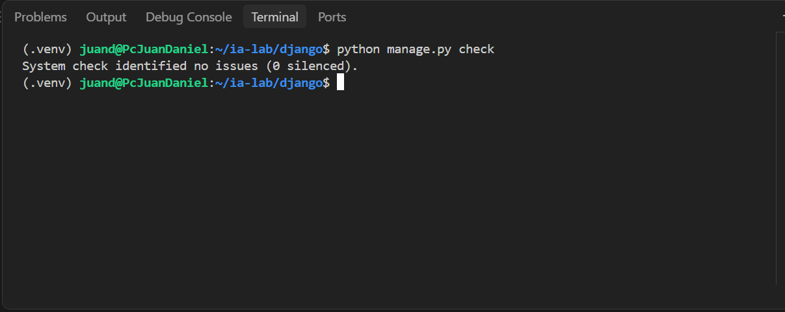
**Retroalimentación de la evidencia:** En la captura observé `System check identified no issues (0 silenced).`

Como el test automatizado de selección de motor llega en ISS-03, comprobé los errores esperados con dos ejecuciones. Primero, un motor inválido:

```bash
DB_ENGINE=motor_falso python manage.py check
```

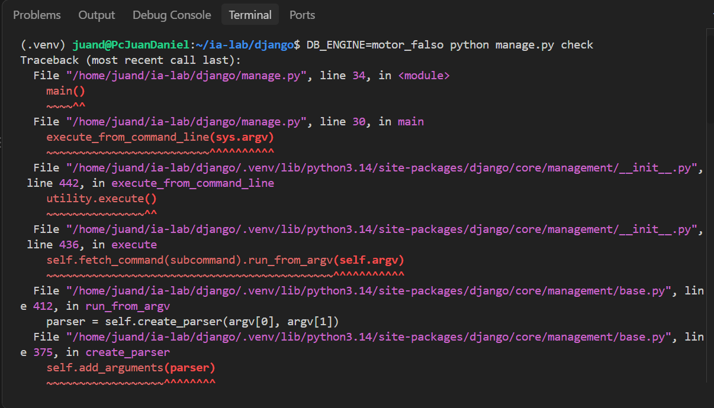
Después, una variable obligatoria vacía. La variable del entorno tiene prioridad sobre `.env`, así que la vacía reemplaza el valor del archivo:

```bash
DB_ENGINE=mysql MYSQL_DB= python manage.py check
```

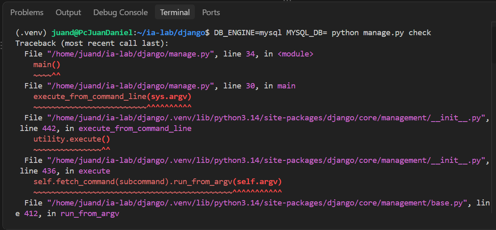
**Retroalimentación de las evidencias:** En la primera captura observé el `ImproperlyConfigured` con el mensaje `DB_ENGINE='motor_falso' no es válido`. En la segunda observé el mensaje `Falta la variable de entorno MYSQL_DB`.

**Conclusión y aprendizaje:** Aprendí que la configuración falla al arrancar, antes de intentar conectarse a una base de datos. Así el error aparece de inmediato y no durante una petición.

### Criterios de aceptación y GATE

| AC | Criterio | Verificación | Evidencia | Resultado |
|:---|:---|:---|:---|:---|
| AC-01-01 | Cada motor produce su `ENGINE` documentado | Inspección de `database.py`; prueba automatizada desde ISS-03 | EVI-01-06 | [PASS ] |
| AC-01-02 | Un motor desconocido falla con `ImproperlyConfigured` | `DB_ENGINE=motor_falso python manage.py check` | EVI-01-11 | [PASS] |
| AC-01-03 | Una variable obligatoria vacía falla antes de conectar | `DB_ENGINE=mysql MYSQL_DB= python manage.py check` | EVI-01-12 | [PASS] |
| AC-01-04 | El DSN de Oracle contiene `SERVICE_NAME` | Inspección de `_oracle` en `database.py` | EVI-01-06 | [PASS] |

El GATE del ISS-01 queda cumplido cuando `python manage.py check` pasa con el motor activo y las dos pruebas negativas producen el error esperado.