## ISS-00 - Entorno y proyecto Django

En este ISS preparé el entorno aislado y creé el proyecto Django `config`, sin modelos todavía. Los pasos siguen la guía de Django del curso (ISS-00 · Entorno y proyecto Django).

### Paso 1 - Verificación de requisitos

Verifiqué que tengo Python 3.12 y que el directorio del proyecto está vacío antes de crear el entorno.

``` bash
python3 --version
ls -la
```


**Retroalimentación de la evidencia:** En la captura observé la versión `[3.12.x]` impresa por `python3 --version` y el directorio sin archivos previos [o con solo los archivos de carpeta oculta].

**Conclusión y aprendizaje:** Aprendí que el ISS exige una versión concreta de Python, porque Django 5.2 y sus dependencias se prueban sobre esa versión. Verificar el requisito antes de instalar evita errores difíciles de diagnosticar más adelante.

### Paso 2 - Creación del entorno virtual e instalación de Django

Creé el entorno virtual `.venv`, lo activé, instalé Django 5.2.17 con `python -m pip` y guardé las dependencias en `requirements.txt`. Uso `python -m pip` para asegurar que la instalación va al entorno activo.

``` bash
python3 -m venv .venv
source .venv/bin/activate
python -m pip install "Django==5.2.17"
python -m pip freeze > requirements.txt
python -m django --version
```


**Retroalimentación de la evidencia:** En la captura observé el prompt con `(.venv)` activo, la instalación de Django 5.2.17 sin errores y la versión `5.2.17` impresa al final.

**Conclusión y aprendizaje:** Aprendí que `.venv` aísla las dependencias del proyecto del Python del sistema. `requirements.txt` permite reproducir el mismo entorno en otra máquina.

### Paso 3 - Creación del proyecto `config`

Generé el proyecto con la CLI de Django en el directorio actual, para que `manage.py` quede en la raíz y el paquete de configuración se llame `config`.

``` bash
django-admin startproject config .
ls config
```


**Retroalimentación de la evidencia:** En la captura observé `manage.py` en la raíz y, dentro de `config/`, los archivos `settings.py`, `urls.py`, `wsgi.py` y h`asgi.py`.

**Conclusión y aprendizaje:** Aprendí que `startproject config .` no crea una carpeta doble `proyecto/proyecto/`. `urls.py` es el punto de entrada de todas las peticiones; en este ISS solo contiene la ruta `admin/`.

### Paso 4 - Creación del archivo `.gitignore`

Creé `.gitignore` en la raíz para excluir del control de versiones el entorno virtual, cachés, archivos de configuración local y archivos generados. Django no lo genera, así que lo creé manualmente.

``` bash
cat > .gitignore <<'EOF'
.venv/
__pycache__/
*.py[cod]
.env
db.sqlite3
*.log
.idea/
.vscode/
staticfiles/
media/
.pytest_cache/
htmlcov/
.coverage
EOF
cat .gitignore
```


**Retroalimentación de la evidencia:** En la captura observé el contenido del archivo impreso por `cat`, con las reglas `.venv/` y `.env` entre las líneas.

**Conclusión y aprendizaje:** Aprendí que `.gitignore` debe estar en la raíz del proyecto. Excluir `.venv/` y `.env` evita subir el entorno local y las credenciales al repositorio.

### Paso 5 - Verificación del ISS

Comprobé la versión de Django y ejecuté la verificación del sistema de Django.

``` bash
python -m django --version
python manage.py check
```


**Retroalimentación de la evidencia:** En la captura observé la versión `5.2.17` y el mensaje `System check identified no issues (0 silenced).`

**Conclusión y aprendizaje:** Aprendí que `manage.py check` valida la configuración del proyecto sin necesidad de tener modelos. Confirma que el entorno está listo para el ISS-01.

## ISS-01 - Settings y selección del motor

En este ISS separé la configuración en el paquete `config/settings/`, instalé los drivers de los cuatro motores de base de datos (PostgreSQL, MySQL, SQL Server y Oracle) y elegí el motor activo desde `.env` mediante `DB_ENGINE`. No escribí SQL: el ORM recibe un único alias `default` por ejecución. Las pruebas con cada motor se realizan a partir del ISS-03, cuando se aplican migraciones.

### Paso 1 - Confirmación del entorno y dependencias del sistema

Verifiqué que `python` apunta al intérprete de `.venv` y que las herramientas de compilación están instaladas para `mysqlclient`.

```bash
source .venv/bin/activate
which python
python --version
sudo apt update
sudo apt install -y build-essential pkg-config default-libmysqlclient-dev python3.14-dev
```


**Retroalimentación de la evidencia:** En la captura observé el prompt con `(.venv)`, la ruta `[ruta exacta]/.venv/bin/python`, la versión `Python [3.14.x]` y la instalación de las dependencias del sistema sin errores.

**Conclusión y aprendizaje:** Aprendí que `pip` y `python` deben apuntar al mismo entorno; de lo contrario, los drivers quedan instalados fuera del proyecto y `manage.py` no los encuentra.

### Paso 2 - Instalación de los drivers de los cuatro motores

Instalé `python-dotenv` para leer `.env` y un driver por motor. Django no incluye drivers, así que sin ellos la conexión a cualquier base de datos falla al importar el backend.

```bash
python -m pip install "python-dotenv==1.2.3"
python -m pip install "psycopg[binary]==3.3.6"
python -m pip install "mysqlclient==2.3.0"
python -m pip install "mssql-django==2.0.0"
python -m pip install "oracledb==26.0.1"
python -m pip freeze > requirements.txt
cat requirements.txt
```


**Retroalimentación de las evidencias:** En la primera captura observé [la última línea de la instalación de `oracledb 26.0.1` sin errores]. En la segunda observé [las versiones registradas: python-dotenv 1.2.3, psycopg 3.3.6, mysqlclient 2.3.0, mssql-django 2.0.0 y oracledb 26.0.1].

**Conclusión y aprendizaje:** Aprendí que cada motor necesita su propio driver. `psycopg` sirve a PostgreSQL, `mysqlclient` a MySQL, `mssql-django` registra el motor `mssql` y necesita pyodbc y el driver ODBC del sistema para conectarse, y `oracledb` en modo thin conecta a Oracle sin Instant Client. `requirements.txt` deja constancia de las versiones exactas para reproducir el entorno.

### Paso 3 - Conversión de settings.py en paquete

`startproject` generó `config/settings.py`. Lo eliminé y creé la carpeta `config/settings/`, que se convierte en el único punto de configuración.

```bash
rm config/settings.py
mkdir -p config/settings
ls config
```


**Retroalimentación de la evidencia:** En la captura observé [el listado de `config/` con `settings/` y sin `settings.py`].

**Conclusión y aprendizaje:** Aprendí que la configuración debe vivir en un solo lugar. Tener `settings.py` y un paquete `settings/` a la vez generaría dudas sobre cuál se carga.

### Paso 4 - Plantilla `.env.example` y archivo `.env`

Creé `.env.example` como plantilla sin secretos, con las variables de los cuatro motores, y copié la plantilla a `.env`. `.env` contiene credenciales, así que debe estar en `.gitignore`.

```bash
cat > .env.example <<'EOF'
# Copie este archivo a .env y complete los valores.
# .env no se versiona.

DJANGO_SECRET_KEY=
DJANGO_DEBUG=True
DJANGO_ALLOWED_HOSTS=localhost,127.0.0.1,testserver

# Motor activo. Uno solo por ejecución: postgresql | mysql | mssql | oracle
DB_ENGINE=postgresql

POSTGRES_DB=
POSTGRES_USER=
POSTGRES_PASSWORD=
POSTGRES_HOST=127.0.0.1
POSTGRES_PORT=5432

MYSQL_DB=
MYSQL_USER=
MYSQL_PASSWORD=
MYSQL_HOST=127.0.0.1
MYSQL_PORT=3306

MSSQL_DB=
MSSQL_USER=
MSSQL_PASSWORD=
MSSQL_HOST=127.0.0.1
MSSQL_PORT=1433

ORACLE_DB=
ORACLE_USER=
ORACLE_PASSWORD=
ORACLE_HOST=127.0.0.1
ORACLE_PORT=1521
ORACLE_SERVICE_NAME=

CORS_ALLOW_ALL_ORIGINS=True
EOF

cp .env.example .env
```

Para generar la clave secreta usé:

```bash
python -c "import secrets; print(secrets.token_urlsafe(50))"
```

y la pegué en `DJANGO_SECRET_KEY` dentro de `.env`.


**Retroalimentación de la evidencia:** En la captura observé [los dos archivos en el listado] y el contenido de `.env.example`, que solo tiene nombres de variables y valores vacíos. Los valores reales de `.env` no aparecen en la captura.

**Conclusión y aprendizaje:** Aprendí a separar la plantilla, que sí se versiona, del archivo con credenciales reales, que no se versiona. Así el repositorio documenta qué variables se necesitan sin exponer contraseñas.

### Paso 5 - Selector de motor en `config/database.py`

Creé `config/database.py`. No es una aplicación: traduce `DB_ENGINE` a un único diccionario `DATABASES["default"]`. Cada motor exige sus variables y define su `ENGINE`. Para Oracle armo el DSN con `SERVICE_NAME` y dejo `PORT` vacío porque Django lo toma del DSN.

```bash
cat > config/database.py <<'EOF'
"""Selección del motor de base de datos a partir del entorno.

Un solo alias, default, queda activo en cada ejecución.
"""

from django.core.exceptions import ImproperlyConfigured

ALLOWED_ENGINES = ("postgresql", "mysql", "mssql", "oracle")


def database_from_environ(env):
    engine = str(env.get("DB_ENGINE", "postgresql")).strip().lower()
    if engine not in ALLOWED_ENGINES:
        allowed = ", ".join(ALLOWED_ENGINES)
        raise ImproperlyConfigured(
            f"DB_ENGINE='{engine}' no es válido. Valores permitidos: {allowed}."
        )
    builders = {
        "postgresql": _postgresql,
        "mysql": _mysql,
        "mssql": _mssql,
        "oracle": _oracle,
    }
    return {"default": builders[engine](env)}


def _required(env, key):
    value = env.get(key)
    if value is None or str(value).strip() == "":
        raise ImproperlyConfigured(
            f"Falta la variable de entorno {key} para DB_ENGINE={env.get('DB_ENGINE')}."
        )
    return str(value).strip()


def _postgresql(env):
    return {
        "ENGINE": "django.db.backends.postgresql",
        "NAME": _required(env, "POSTGRES_DB"),
        "USER": _required(env, "POSTGRES_USER"),
        "PASSWORD": _required(env, "POSTGRES_PASSWORD"),
        "HOST": _required(env, "POSTGRES_HOST"),
        "PORT": _required(env, "POSTGRES_PORT"),
    }


def _mysql(env):
    return {
        "ENGINE": "django.db.backends.mysql",
        "NAME": _required(env, "MYSQL_DB"),
        "USER": _required(env, "MYSQL_USER"),
        "PASSWORD": _required(env, "MYSQL_PASSWORD"),
        "HOST": _required(env, "MYSQL_HOST"),
        "PORT": _required(env, "MYSQL_PORT"),
        "OPTIONS": {"charset": "utf8mb4"},
    }


def _mssql(env):
    return {
        "ENGINE": "mssql",
        "NAME": _required(env, "MSSQL_DB"),
        "USER": _required(env, "MSSQL_USER"),
        "PASSWORD": _required(env, "MSSQL_PASSWORD"),
        "HOST": _required(env, "MSSQL_HOST"),
        "PORT": _required(env, "MSSQL_PORT"),
        "OPTIONS": {
            "driver": "ODBC Driver 18 for SQL Server",
            "extra_params": "TrustServerCertificate=yes",
        },
    }


def _oracle(env):
    host = _required(env, "ORACLE_HOST")
    port = _required(env, "ORACLE_PORT")
    service = _required(env, "ORACLE_SERVICE_NAME")
    dsn = (
        f"(DESCRIPTION=(ADDRESS=(PROTOCOL=TCP)(HOST={host})(PORT={port}))"
        f"(CONNECT_DATA=(SERVICE_NAME={service})))"
    )
    return {
        "ENGINE": "django.db.backends.oracle",
        "NAME": dsn,
        "USER": _required(env, "ORACLE_USER"),
        "PASSWORD": _required(env, "ORACLE_PASSWORD"),
        "HOST": host,
        "PORT": "",
    }
EOF
```


**Retroalimentación de la evidencia:** En la captura observé [la función `database_from_environ` y la lista `ALLOWED_ENGINES` con los cuatro motores].

**Conclusión y aprendizaje:** Aprendí que el ORM no conoce el motor real: solo ve el alias `default`. La elección ocurre antes, con una función que puedo probar sin conectarme a ningún servidor.

### Paso 6 - Configuración principal en `config/settings/__init__.py`

Este archivo reemplaza al `settings.py` generado. Carga `.env` antes de leer la clave secreta y la base de datos, y define idioma, zona horaria y el modelo de llave primaria. Las aplicaciones de negocio y el usuario personalizado se agregan en los ISS siguientes.

```bash
cat > config/settings/__init__.py <<'EOF'
"""Configuración del proyecto PuntoStock.

El paquete sustituye al settings.py generado por startproject.
DJANGO_SETTINGS_MODULE sigue siendo config.settings.
"""

import os
from pathlib import Path

from dotenv import load_dotenv
from django.core.exceptions import ImproperlyConfigured

from config.database import database_from_environ

BASE_DIR = Path(__file__).resolve().parent.parent.parent
load_dotenv(BASE_DIR / ".env")

SECRET_KEY = os.environ.get("DJANGO_SECRET_KEY", "").strip()
if not SECRET_KEY:
    raise ImproperlyConfigured("Defina DJANGO_SECRET_KEY en el archivo .env.")

DEBUG = os.environ.get("DJANGO_DEBUG", "False").strip().lower() in {"1", "true", "yes", "on"}

ALLOWED_HOSTS = [
    host.strip()
    for host in os.environ.get("DJANGO_ALLOWED_HOSTS", "localhost,127.0.0.1").split(",")
    if host.strip()
]

INSTALLED_APPS = [
    "django.contrib.admin",
    "django.contrib.auth",
    "django.contrib.contenttypes",
    "django.contrib.sessions",
    "django.contrib.messages",
    "django.contrib.staticfiles",
]

MIDDLEWARE = [
    "django.middleware.security.SecurityMiddleware",
    "django.contrib.sessions.middleware.SessionMiddleware",
    "django.middleware.common.CommonMiddleware",
    "django.middleware.csrf.CsrfViewMiddleware",
    "django.contrib.auth.middleware.AuthenticationMiddleware",
    "django.contrib.messages.middleware.MessageMiddleware",
    "django.middleware.clickjacking.XFrameOptionsMiddleware",
]

ROOT_URLCONF = "config.urls"

TEMPLATES = [
    {
        "BACKEND": "django.template.backends.django.DjangoTemplates",
        "DIRS": [],
        "APP_DIRS": True,
        "OPTIONS": {
            "context_processors": [
                "django.template.context_processors.request",
                "django.contrib.auth.context_processors.auth",
                "django.contrib.messages.context_processors.messages",
            ],
        },
    },
]

WSGI_APPLICATION = "config.wsgi.application"
ASGI_APPLICATION = "config.asgi.application"

DATABASES = database_from_environ(os.environ)

AUTH_PASSWORD_VALIDATORS = [
    {"NAME": "django.contrib.auth.password_validation.UserAttributeSimilarityValidator"},
    {"NAME": "django.contrib.auth.password_validation.MinimumLengthValidator"},
    {"NAME": "django.contrib.auth.password_validation.CommonPasswordValidator"},
    {"NAME": "django.contrib.auth.password_validation.NumericPasswordValidator"},
]

LANGUAGE_CODE = "es"
TIME_ZONE = "America/Bogota"
USE_I18N = True
USE_TZ = True

STATIC_URL = "static/"
DEFAULT_AUTO_FIELD = "django.db.models.BigAutoField"
EOF
```


**Retroalimentación de la evidencia:** En la captura observé [los imports de `dotenv` y `database_from_environ`, y la línea `DATABASES = database_from_environ(os.environ)`].

**Conclusión y aprendizaje:** Aprendí que el orden importa: `load_dotenv` debe ejecutarse antes de leer `SECRET_KEY` y `DATABASES`. Si no, Django arranca con valores vacíos.

### Paso 7 - Intérprete del proyecto en `config/project_python.py`

Este módulo usa solo la biblioteca estándar. Si `manage.py` arranca con el Python del sistema, vuelve a lanzar el mismo comando con `.venv/bin/python`, donde están Django y los drivers.

```bash
cat > config/project_python.py <<'EOF'
"""Intérprete del proyecto.

Los paquetes se instalan dentro de .venv. Si python3 manage.py usa el
Python del sistema, no ve esos paquetes. use_project_python() vuelve a
lanzar el mismo comando con .venv/bin/python.
"""

import os
import sys
from pathlib import Path

PROJECT_ROOT = Path(__file__).resolve().parent.parent


def use_project_python():
    """Reejecuta el proceso con el Python de .venv si aún no es ese intérprete."""
    venv_root = PROJECT_ROOT / ".venv"
    venv_python = venv_root / "bin" / "python"
    if not venv_python.is_file():
        return
    try:
        if Path(sys.prefix).resolve() == venv_root.resolve():
            return
    except OSError:
        return
    os.execv(venv_python, [str(venv_python), *sys.argv])
EOF
```


**Retroalimentación de la evidencia:** En la captura observé [el archivo creado y la función `use_project_python`].

**Conclusión y aprendizaje:** Aprendí que `sys.prefix` identifica el entorno activo. Por eso comparo esa ruta y no la del ejecutable, que en `.venv` es un enlace al Python del sistema.

### Paso 8 - Reescritura de `manage.py`, `wsgi.py` y `asgi.py`

Reescribí estos tres archivos completos con `cat`, para que carguen `.env` y usen el intérprete del proyecto antes de que Django lea la configuración. Los archivos generados por `startproject` se sustituyeron; no se editaron línea por línea.

**`manage.py`**

```bash
cat > manage.py <<'EOF'
#!/usr/bin/env python
"""Run administrative tasks."""

import sys
from pathlib import Path

_ROOT = Path(__file__).resolve().parent
if str(_ROOT) not in sys.path:
    sys.path.insert(0, str(_ROOT))

from config.project_python import use_project_python

use_project_python()

import os

from dotenv import load_dotenv


def main():
    """Run administrative tasks."""
    load_dotenv()
    os.environ.setdefault("DJANGO_SETTINGS_MODULE", "config.settings")
    try:
        from django.core.management import execute_from_command_line
    except ImportError as exc:
        raise ImportError(
            "No se pudo importar Django. ¿Está activado el entorno virtual?"
        ) from exc
    execute_from_command_line(sys.argv)


if __name__ == "__main__":
    main()
EOF
```

**`config/wsgi.py`**

```bash
cat > config/wsgi.py <<'EOF'
import os

from dotenv import load_dotenv

from django.core.wsgi import get_wsgi_application

load_dotenv()
os.environ.setdefault("DJANGO_SETTINGS_MODULE", "config.settings")

application = get_wsgi_application()
EOF
```

**`config/asgi.py`**

```bash
cat > config/asgi.py <<'EOF'
import os

from dotenv import load_dotenv

from django.core.asgi import get_asgi_application

load_dotenv()
os.environ.setdefault("DJANGO_SETTINGS_MODULE", "config.settings")

application = get_asgi_application()
EOF
```


**Retroalimentación de la evidencia:** En la captura observé [`use_project_python()` y `load_dotenv()` en `manage.py`, y `load_dotenv()` antes de `get_wsgi_application()` y `get_asgi_application()`].

**Conclusión y aprendizaje:** Aprendí que `load_dotenv()` debe ejecutarse antes de que Django lea la configuración. Reescribir los archivos completos evita dejar restos de código generado que no coincidan con el resto del proyecto.

### Paso 9 - Verificación del ISS

Ejecuté la verificación del sistema de Django:

```bash
python manage.py check
```


**Retroalimentación de la evidencia:** En la captura observé `System check identified no issues (0 silenced).`

Como el test automatizado de selección de motor llega en ISS-03, comprobé los errores esperados con dos ejecuciones. Primero, un motor inválido:

```bash
DB_ENGINE=motor_falso python manage.py check
```


Después, una variable obligatoria vacía. La variable del entorno tiene prioridad sobre `.env`, así que la vacía reemplaza el valor del archivo:

```bash
DB_ENGINE=mysql MYSQL_DB= python manage.py check
```


**Retroalimentación de las evidencias:** En la primera captura observé el `ImproperlyConfigured` con el mensaje `DB_ENGINE='motor_falso' no es válido`. En la segunda observé el mensaje `Falta la variable de entorno MYSQL_DB`.

**Conclusión y aprendizaje:** Aprendí que la configuración falla al arrancar, antes de intentar conectarse a una base de datos. Así el error aparece de inmediato y no durante una petición.

### Criterios de aceptación y GATE

| AC | Criterio | Verificación | Evidencia | Resultado |
|:---|:---|:---|:---|:---|
| AC-01-01 | Cada motor produce su `ENGINE` documentado | Inspección de `database.py`; prueba automatizada desde ISS-03 | EVI-01-06 | [PASS ] |
| AC-01-02 | Un motor desconocido falla con `ImproperlyConfigured` | `DB_ENGINE=motor_falso python manage.py check` | EVI-01-11 | [PASS] |
| AC-01-03 | Una variable obligatoria vacía falla antes de conectar | `DB_ENGINE=mysql MYSQL_DB= python manage.py check` | EVI-01-12 | [PASS] |
| AC-01-04 | El DSN de Oracle contiene `SERVICE_NAME` | Inspección de `_oracle` en `database.py` | EVI-01-06 | [PASS] |

El GATE del ISS-01 queda cumplido cuando `python manage.py check` pasa con el motor activo y las dos pruebas negativas producen el error esperado.

## ISS-02 - Apps client, product y sale

En este ISS creé las tres aplicaciones de negocio base (`client`, `product` y `sale`) dentro del paquete `apps/`, con su `AppConfig` apuntando a `apps.<nombre>` y su etiqueta corta, y las registré en `INSTALLED_APPS`. Todavía no escribí modelos ni ejecuté migraciones: eso corresponde a los ISS siguientes, después del usuario personalizado del ISS-03.

### Paso 1 - Creación de las aplicaciones con la CLI

Creé los directorios de destino y generé las tres aplicaciones con `startapp`. `startapp` exige que el directorio exista antes de ejecutarse.

```bash

mkdir -p apps/client apps/product apps/sale
python manage.py startapp client apps/client
python manage.py startapp product apps/product
python manage.py startapp sale apps/sale
ls apps
```

Después creé `apps/__init__.py` vacío para que `apps` sea un paquete:

```bash
mkdir -p apps
cat > apps/__init__.py <<'EOF'
EOF
```


**Retroalimentación de la evidencia:** En la captura observé [los directorios `client`, `product` y `sale` dentro de `apps/`, con `__init__.py`, `apps.py`, `models.py`, `admin.py` y `views.py`].

**Conclusión y aprendizaje:** Aprendí que `startapp` genera el esqueleto de cada aplicación. `urls.py` no aparece porque todavía no hay endpoints.

### Paso 2 - Parche de `name` y `label` en cada `apps.py`

`startapp` genera `name = "client"`, pero como las apps viven dentro de `apps/`, Django necesita el nombre completo del paquete. Reemplacé esa línea en cada archivo y agregué `label` para que las migraciones usen solo el nombre corto. El nombre de la clase no cambia.

```text
ARCHIVO: apps/client/apps.py

UBICAR:
    name = "client"

REEMPLAZAR POR:
    name = "apps.client"
    label = "client"
```

El mismo parche se aplica a `apps/product/apps.py` (`name = "apps.product"`, `label = "product"`) y a `apps/sale/apps.py` (`name = "apps.sale"`, `label = "sale"`).

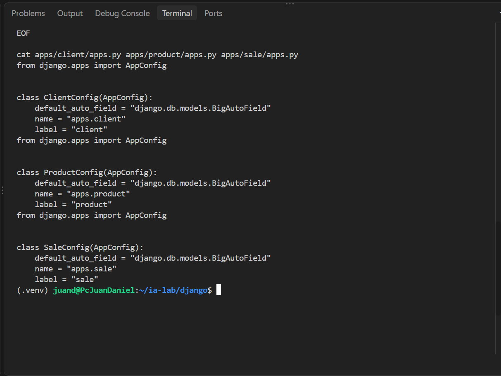
**Retroalimentación de la evidencia:** En la captura observé `name = "apps.<nombre>"` y `label = "<nombre>"` en cada `apps.py`.

**Conclusión y aprendizaje:** Aprendí que, sin `name = "apps.client"`, Django busca `client` en la raíz del proyecto y no encuentra la aplicación.

### Paso 3 - Registro en INSTALLED_APPS

En `config/settings/__init__.py` agregué las tres aplicaciones al final de `INSTALLED_APPS`, sin tocar las de Django. No agregué `security` todavía: esa app llega en el ISS-03.

```text
ARCHIVO: config/settings/__init__.py

DEBAJO DE:
    "django.contrib.staticfiles",

AGREGAR:
    "apps.client.apps.ClientConfig",
    "apps.product.apps.ProductConfig",
    "apps.sale.apps.SaleConfig",
```

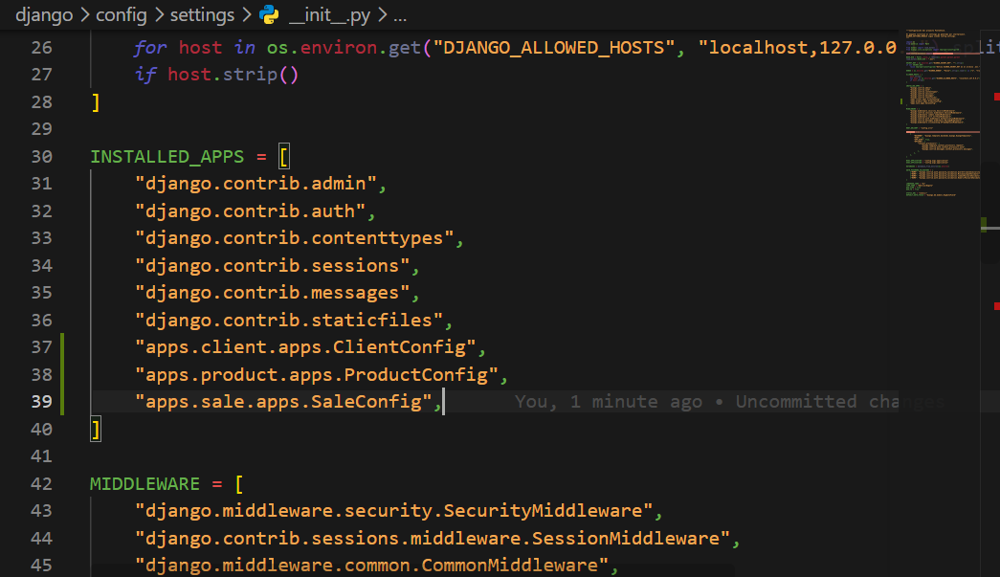

**Retroalimentación de la evidencia:** En la captura observé las tres entradas `apps.client.apps.ClientConfig`, `apps.product.apps.ProductConfig` y `apps.sale.apps.SaleConfig` debajo de `django.contrib.staticfiles`.

**Conclusión y aprendizaje:** Aprendí que crear la carpeta de una aplicación no basta: Django solo carga las aplicaciones listadas en `INSTALLED_APPS`.

### Paso 4 - Verificación del ISS

```bash
python manage.py check
```

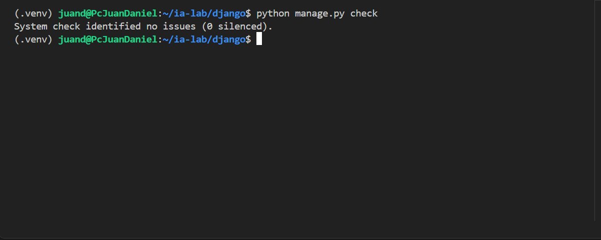
**Retroalimentación de la evidencia:** En la captura observé `System check identified no issues (0 silenced).`

**Conclusión y aprendizaje:** Aprendí que `check` detecta errores de registro, como una ruta de `name` incorrecta, antes de que se intente crear cualquier tabla.

### Criterios de aceptación y GATE

| AC | Criterio | Verificación | Evidencia | Resultado |
|:---|:---|:---|:---|:---|
| AC-02-01 | Las tres apps fueron creadas con `startapp` | Árbol de `apps/` | EVI-02-02 | [PASS] |
| AC-02-02 | `check` no reporta apps mal registradas | `python manage.py check` | EVI-02-01 | [PASS] |
| AC-02-03 | En este ISS no hay modelos de negocio | Revisión de `models.py` (vacíos) | EVI-02-02 | [PASS] |

El GATE del ISS-02 queda cumplido cuando las tres apps existen, están registradas y `check` pasa sin errores.

## ISS-03 - Custom User antes de la primera migración

En este ISS definí el usuario del proyecto sobre `django.contrib.auth` con `AbstractUser`, y fijé `AUTH_USER_MODEL = "security.User"` antes de ejecutar cualquier migración. Así Django crea la tabla de usuarios con el modelo propio desde el principio. También escribí las pruebas de selección de motor que quedaron pendientes en el ISS-01.

### Paso 1 - Paquete `apps/common` y `RecordStatus`

`apps/common` no es una aplicación: no se registra en `INSTALLED_APPS` ni se crea con `startapp`. Contiene `RecordStatus`, que usa el usuario y, desde el ISS-04, el negocio.

```bash
mkdir -p apps/common
cat > apps/common/__init__.py <<'EOF'
EOF
cat > apps/common/status.py <<'EOF'
from django.db import models


class RecordStatus(models.TextChoices):
    ACTIVE = "active", "Active"
    INACTIVE = "inactive", "Inactive"
EOF
```

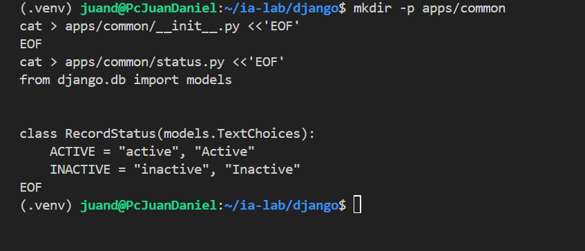

**Retroalimentación de la evidencia:** En la captura observé [el contenido de `status.py` con las clases `ACTIVE` e `INACTIVE`].

**Conclusión y aprendizaje:** Aprendí que `TextChoices` guarda el valor en la base de datos y el nombre legible en el formulario, así `status` tiene valores controlados desde el principio.

### Paso 2 - Aplicación `security`

Creé la aplicación con la CLI y reescribí `apps.py` para que su `name` sea `apps.security`, como en las demás apps del ISS-02.

```bash
mkdir -p apps/security
python manage.py startapp security apps/security
cat > apps/security/apps.py <<'EOF'
from django.apps import AppConfig


class SecurityConfig(AppConfig):
    default_auto_field = "django.db.models.BigAutoField"
    name = "apps.security"
    label = "security"
EOF
```
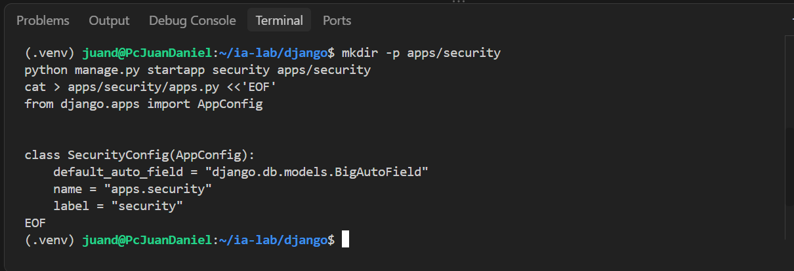
**Retroalimentación de la evidencia:** En la captura observé [`name = "apps.security"` y `label = "security"` en `apps.py`].

**Conclusión y aprendizaje:** Aprendí que el `label` es el nombre que usa `AUTH_USER_MODEL` (`security.User`), así que debe coincidir.

### Paso 3 - Modelo `User`

Escribí `apps/security/models.py` con `StoreUserManager` y `User`. `User` hereda de `AbstractUser`, que ya trae el hash de contraseñas, los validadores, `set_password()`, `check_password()` y el admin. Agregué `email` único, `status`, las marcas de tiempo y una restricción de base de datos sobre `status`.

```bash
cat > apps/security/models.py <<'EOF'
from django.contrib.auth.models import AbstractUser, UserManager
from django.db import models

from apps.common.status import RecordStatus


class StoreUserManager(UserManager):
    def create_user(self, username, email=None, password=None, **extra_fields):
        extra_fields.setdefault("status", RecordStatus.INACTIVE)
        return super().create_user(username, email, password, **extra_fields)

    def create_superuser(self, username, email=None, password=None, **extra_fields):
        extra_fields.setdefault("status", RecordStatus.ACTIVE)
        extra_fields.setdefault("is_staff", True)
        extra_fields.setdefault("is_superuser", True)
        return super().create_superuser(username, email, password, **extra_fields)


class User(AbstractUser):
    email = models.EmailField("correo electrónico", max_length=150, unique=True)
    status = models.CharField(
        max_length=8,
        choices=RecordStatus.choices,
        default=RecordStatus.INACTIVE,
    )
    created_at = models.DateTimeField(auto_now_add=True)
    updated_at = models.DateTimeField(auto_now=True)

    objects = StoreUserManager()

    class Meta:
        db_table = "users"
        verbose_name = "usuario"
        verbose_name_plural = "usuarios"
        constraints = [
            models.CheckConstraint(
                condition=models.Q(status__in=RecordStatus.values),
                name="users_status_valid",
            )
        ]

    def save(self, *args, **kwargs):
        if self.email:
            self.email = self.email.strip().lower()
        self.is_active = self.status == RecordStatus.ACTIVE
        super().save(*args, **kwargs)
EOF
```

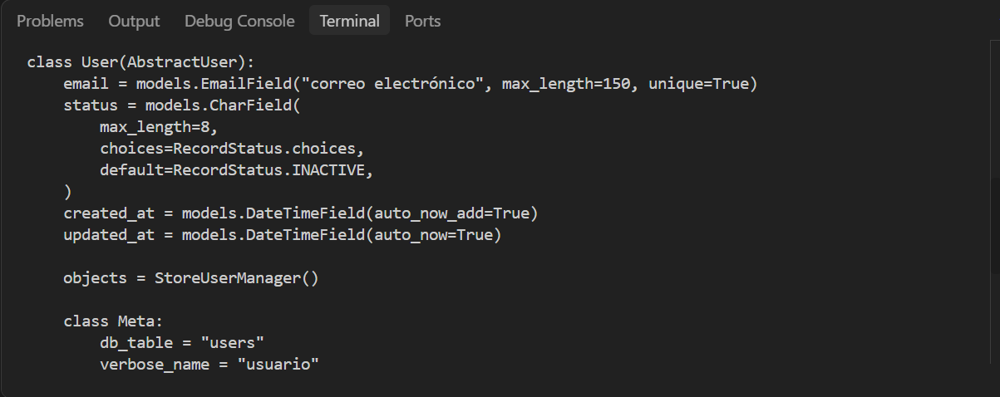
**Retroalimentación de la evidencia:** En la captura observé [la clase `User(AbstractUser)`, `email` con `unique=True` y el `save()` que sincroniza `is_active` con `status`].

**Conclusión y aprendizaje:** Aprendí que `status` manda sobre `is_active`. Mantengo `is_active` porque Django y las autenticaciones lo consultan para decidir si una cuenta puede entrar. `create_superuser` fuerza `status = active` para que `save()` no desactive al superusuario.

### Paso 4 - Settings: registro de la app y `AUTH_USER_MODEL`

Agregué `apps.security` encima de las apps de negocio en `INSTALLED_APPS` y declaré `AUTH_USER_MODEL` después de `DATABASES`.

```text
ARCHIVO: config/settings/__init__.py

ENCIMA DE:
    "apps.client.apps.ClientConfig",

AGREGAR:
    "apps.security.apps.SecurityConfig",

DEBAJO DE:
DATABASES = database_from_environ(os.environ)

AGREGAR:

AUTH_USER_MODEL = "security.User"
```

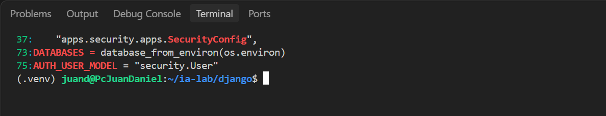
**Retroalimentación de la evidencia:** En la captura observé [`apps.security.apps.SecurityConfig` en `INSTALLED_APPS` y `AUTH_USER_MODEL = "security.User"` debajo de `DATABASES`].

**Conclusión y aprendizaje:** Aprendí que `AUTH_USER_MODEL` debe declararse antes de la primera migración. Si se cambia después, Django no puede reemplazar la tabla de usuarios sin rehacer la base.

### Paso 5 - Pruebas de selección de motor

Escribí `apps/security/tests.py` con las pruebas de selección de motor que el ISS-01 dejó pendientes. Usan `SimpleTestCase`, así que no abren ninguna conexión.

```bash
cat > apps/security/tests.py <<'EOF'
from django.core.exceptions import ImproperlyConfigured
from django.test import SimpleTestCase

from config.database import database_from_environ


class DatabaseSelectionTests(SimpleTestCase):
    def _env(self, engine):
        return {
            "DB_ENGINE": engine,
            "POSTGRES_DB": "storelab",
            "POSTGRES_USER": "storelab",
            "POSTGRES_PASSWORD": "storelab",
            "POSTGRES_HOST": "127.0.0.1",
            "POSTGRES_PORT": "5432",
            "MYSQL_DB": "storelab",
            "MYSQL_USER": "storelab",
            "MYSQL_PASSWORD": "storelab",
            "MYSQL_HOST": "127.0.0.1",
            "MYSQL_PORT": "3306",
            "MSSQL_DB": "storelab",
            "MSSQL_USER": "storelab",
            "MSSQL_PASSWORD": "storelab",
            "MSSQL_HOST": "127.0.0.1",
            "MSSQL_PORT": "1433",
            "ORACLE_DB": "storelab",
            "ORACLE_USER": "storelab",
            "ORACLE_PASSWORD": "storelab",
            "ORACLE_HOST": "127.0.0.1",
            "ORACLE_PORT": "1521",
            "ORACLE_SERVICE_NAME": "FREEPDB1",
        }

    def test_postgresql_engine(self):
        config = database_from_environ(self._env("postgresql"))
        self.assertEqual(config["default"]["ENGINE"], "django.db.backends.postgresql")

    def test_mysql_engine(self):
        config = database_from_environ(self._env("mysql"))
        self.assertEqual(config["default"]["ENGINE"], "django.db.backends.mysql")
        self.assertEqual(config["default"]["OPTIONS"]["charset"], "utf8mb4")

    def test_mssql_engine(self):
        config = database_from_environ(self._env("mssql"))
        self.assertEqual(config["default"]["ENGINE"], "mssql")

    def test_oracle_uses_service_name(self):
        config = database_from_environ(self._env("oracle"))
        self.assertIn("SERVICE_NAME=FREEPDB1", config["default"]["NAME"])
        self.assertEqual(config["default"]["PORT"], "")

    def test_invalid_engine(self):
        with self.assertRaises(ImproperlyConfigured):
            database_from_environ({"DB_ENGINE": "sqlite"})

    def test_missing_variable(self):
        env = self._env("postgresql")
        env["POSTGRES_DB"] = ""
        with self.assertRaises(ImproperlyConfigured):
            database_from_environ(env)
EOF
```
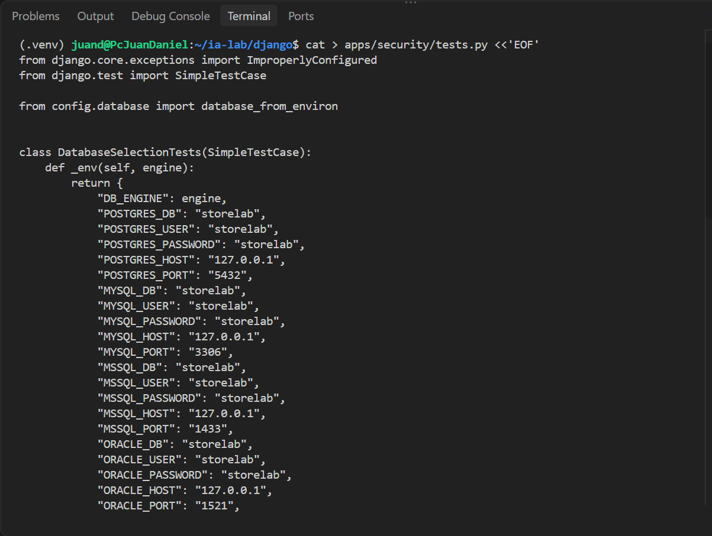
**Retroalimentación de la evidencia:** Aún no hay captura de esta prueba; la EVI-03-02 corresponde a la ejecución del paso 6.

**Conclusión y aprendizaje:** Aprendí que una prueba de configuración puede verificar cada motor sin abrir una conexión. Por eso `SimpleTestCase` basta.

### Paso 6 - Migración inicial y ejecución de pruebas

Generé la migración con la CLI, la apliqué y ejecuté las pruebas de selección de motor.

```bash
python manage.py makemigrations security
python manage.py migrate
python manage.py test apps.security.tests.DatabaseSelectionTests
```

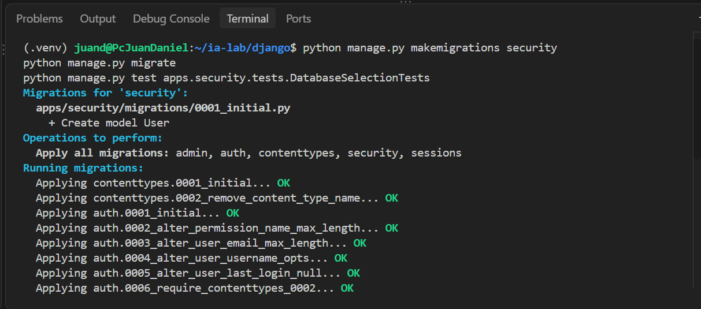

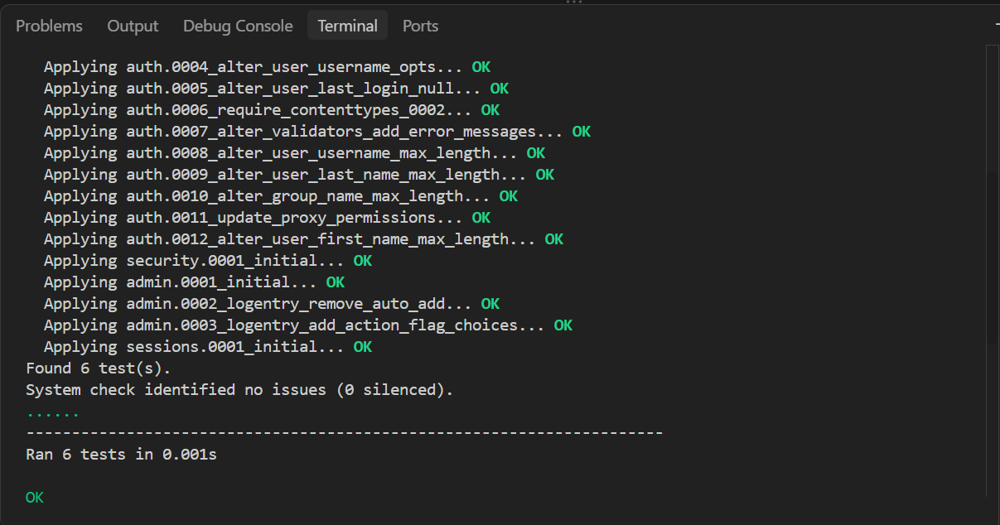
**Retroalimentación de las evidencias:** En la primera captura observé [`Create model User` y la aplicación de `security.0001_initial`]. En la segunda observé [`Ran 6 tests` y `OK`].

**Conclusión y aprendizaje:** Aprendí que la migración la genera Django a partir del modelo, así que el archivo refleja `AUTH_USER_MODEL`. Si hubiera migrado antes de fijar `AUTH_USER_MODEL`, esta tabla no habría sido la del usuario personalizado.

### Criterios de aceptación y GATE

| AC | Criterio | Verificación | Evidencia | Resultado |
|:---|:---|:---|:---|:---|
| AC-03-01 | `AUTH_USER_MODEL` apunta a `security.User` antes de migrar | Inspección de settings y orden de comandos | EVI-03-03, EVI-03-04 | [PASS] |
| AC-03-02 | `Client` no tiene campo de contraseña | Revisión de `models.py` | EVI-03-02 | [PASS] |
| AC-03-03 | Un usuario `inactive` no puede iniciar sesión | Prueba de login (pendiente) | — | [PENDIENTE] |
| AC-03-04 | Una clave incorrecta no autentica | `check_password` (pendiente) | — | [PENDIENTE] |

Los criterios AC-03-03 y AC-03-04 requieren pruebas de autenticación que la guía del ISS-03 menciona pero no incluye. Se verifican cuando se implemente el login.

El GATE del ISS-03 queda cumplido cuando AC-03-01 y AC-03-02 están en PASS y las pruebas de selección de motor pasan.

## ISS-04 - Modelo Client (Cliente de PuntoStock)

En este ISS creé el modelo base con marcas de tiempo y el modelo `Client`, que corresponde a la entidad Cliente de PuntoStock: `tipo_documento`, `numero_documento` único, `nombre`, `telefono`, `email` e `is_active`.

### Paso 1 - Modelo base con marcas de tiempo

`TimeStampedModel` agrega `created_at` y `updated_at`. Es abstracto, así que no crea tabla.

```bash
cat > apps/common/models.py <<'EOF'
from django.db import models


class TimeStampedModel(models.Model):
    created_at = models.DateTimeField(auto_now_add=True)
    updated_at = models.DateTimeField(auto_now=True)

    class Meta:
        abstract = True
EOF
```

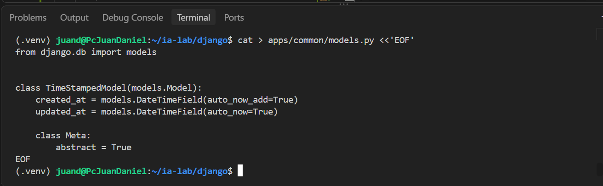
**Retroalimentación de la evidencia:** En la captura observé [`TimeStampedModel` con `created_at`, `updated_at` y `abstract = True`].

**Conclusión y aprendizaje:** Aprendí que un modelo abstracto sirve para repetir campos comunes sin crear una tabla propia.

### Paso 2 - Modelo `Client`

`startapp` generó `apps/client/models.py` vacío. Lo reescribí completo con los campos de la especificación.

```bash
cat > apps/client/models.py <<'EOF'
from django.core.validators import MinLengthValidator
from django.db import models

from apps.common.models import TimeStampedModel


class Client(TimeStampedModel):
    class DocumentType(models.TextChoices):
        CC = "CC", "Cédula de ciudadanía"
        NIT = "NIT", "NIT"
        CE = "CE", "Cédula de extranjería"
        PASAPORTE = "PASAPORTE", "Pasaporte"

    tipo_documento = models.CharField(max_length=10, choices=DocumentType.choices)
    numero_documento = models.CharField(max_length=30, unique=True)
    nombre = models.CharField(max_length=150, validators=[MinLengthValidator(2)])
    telefono = models.CharField(max_length=30, blank=True)
    email = models.EmailField(max_length=150, blank=True)
    is_active = models.BooleanField(default=True)

    class Meta:
        db_table = "clientes"
        verbose_name = "cliente"
        verbose_name_plural = "clientes"
        ordering = ["nombre", "id"]

    def __str__(self):
        return f"{self.nombre} ({self.numero_documento})"

    def save(self, *args, **kwargs):
        self.numero_documento = self.numero_documento.strip()
        if self.email:
            self.email = self.email.strip().lower()
        super().save(*args, **kwargs)
EOF
```

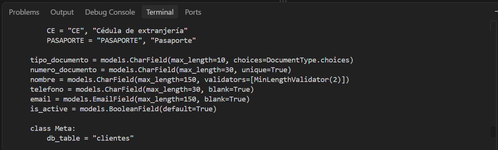
**Retroalimentación de la evidencia:** En la captura observé [los campos de la especificación, `numero_documento` con `unique=True` y `db_table = "clientes"`].

**Conclusión y aprendizaje:** Aprendí que `choices` restringe los valores permitidos en Django y que la unicidad de `numero_documento` la impone la base de datos.

### Paso 3 - Migración de `client`

```bash
python manage.py makemigrations client
python manage.py migrate client
```

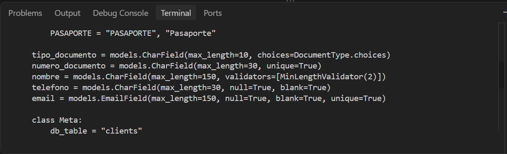

**Retroalimentación de la evidencia:** En la captura observé [`Create model Client` y `Applying client.0001_initial... OK`].

**Conclusión y aprendizaje:** Aprendí que la migración la genera Django a partir del modelo, así que el archivo refleja los campos y el nombre de tabla definidos.

### Paso 4 - Verificación en el shell

```bash
python manage.py shell
```

Bloque 1: crear un cliente sin enviar `is_active`.

```python
from django.db import IntegrityError
from apps.client.models import Client
c = Client.objects.create(tipo_documento="CC", numero_documento="1001", nombre="Ana", email="ANA@EJEMPLO.COM")
print(c.is_active, c.created_at, c.email)
```

Bloque 2: intentar crear otro cliente con el mismo número de documento.

```python
try:
    Client.objects.create(tipo_documento="CC", numero_documento="1001", nombre="Luis")
except IntegrityError as e:
    print("rechazado:", e)
```

Escribe `exit()` al terminar.

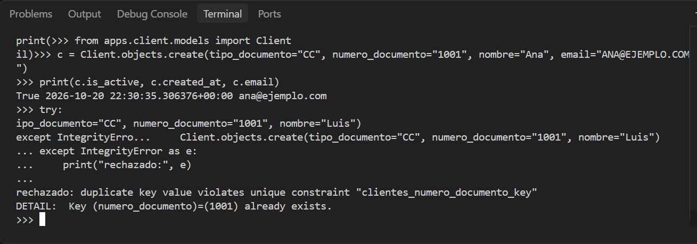
**Retroalimentación de la evidencia:** En la captura observé [`True`, la fecha de creación y `ana@ejemplo.com` en el bloque 1; `rechazado:` con la violación de unicidad de `numero_documento` en el bloque 2].

**Conclusión y aprendizaje:** Aprendí que `is_active` toma `True` por defecto y que `save()` normaliza el email antes de guardarlo.

### Criterios de aceptación y GATE

| AC | Criterio | Verificación | Evidencia | Resultado |
|:---|:---|:---|:---|:---|
| AC-04-01 | La tabla física es `clientes` | Migración aplicada | EVI-04-03 | [PASS] |
| AC-04-02 | `numero_documento` es único | Bloque 2 del shell | EVI-04-04 | [PASS] |
| AC-04-03 | `is_active` vale `True` por defecto y `created_at` se genera | Bloque 1 del shell | EVI-04-04 | [PASS] |
| AC-04-04 | `tipo_documento` acepta solo los valores de la especificación | Revisión de `choices` | EVI-04-02 | [PASS] |

El GATE del ISS-04 queda cumplido cuando AC-04-01 a AC-04-03 están en PASS.

## ISS-05 - Modelo Product (Producto de PuntoStock)

En este ISS creé el modelo `Product`, que corresponde a la entidad Producto de PuntoStock: `sku` único, `nombre`, `descripcion`, `precio` no negativo e `is_active`. No incluí `ProductType` ni `stock`, porque la especificación no los define. El stock se modela en la entidad Inventario, que llega en un ISS posterior.

### Paso 1 - Modelo `Product`

`startapp` generó `apps/product/models.py` vacío. Lo reescribí completo.

```bash
cat > apps/product/models.py <<'EOF'
from decimal import Decimal

from django.core.validators import MinLengthValidator, MinValueValidator
from django.db import models

from apps.common.models import TimeStampedModel


class Product(TimeStampedModel):
    sku = models.CharField(max_length=50, unique=True)
    nombre = models.CharField(max_length=120, validators=[MinLengthValidator(2)])
    descripcion = models.CharField(max_length=255, blank=True)
    precio = models.DecimalField(
        max_digits=12,
        decimal_places=2,
        validators=[MinValueValidator(Decimal("0"))],
    )
    is_active = models.BooleanField(default=True)

    class Meta:
        db_table = "productos"
        verbose_name = "producto"
        verbose_name_plural = "productos"
        ordering = ["nombre", "id"]
        constraints = [
            models.CheckConstraint(
                condition=models.Q(precio__gte=0),
                name="producto_precio_no_negativo",
            ),
        ]

    def __str__(self):
        return f"{self.sku} - {self.nombre}"

    def save(self, *args, **kwargs):
        self.sku = self.sku.strip().upper()
        super().save(*args, **kwargs)
EOF
```

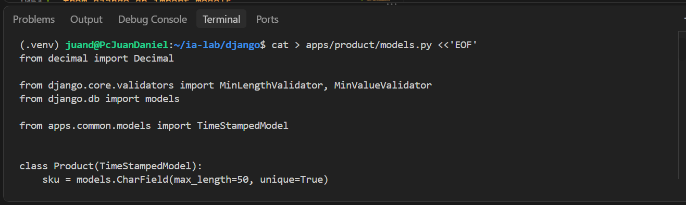

**Retroalimentación de la evidencia:** En la captura observé [el campo `sku` con `unique=True`, `precio` con `MinValueValidator` y la restricción `producto_precio_no_negativo`].

**Conclusión y aprendizaje:** Aprendí que la validación de Python protege los formularios, y la `CheckConstraint` impide precios negativos aunque alguien escriba directo en la base.

### Paso 2 - Migración de `product`

```bash
python manage.py makemigrations product
python manage.py migrate product
```

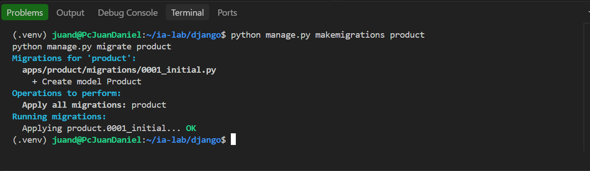

**Retroalimentación de la evidencia:** En la captura observé [`Create model Product` y `Applying product.0001_initial... OK`].

**Conclusión y aprendizaje:** Aprendí que el nombre de la tabla `productos` queda definido en `Meta`, no en el nombre de la clase.

### Paso 3 - Verificación en el shell

```bash
python manage.py shell
```

Bloque 1: crear un producto sin enviar `is_active` y con el SKU en minúsculas.

```python
from django.db import IntegrityError
from apps.product.models import Product
p = Product.objects.create(sku="agua-600", nombre="Agua 600ml", precio=1500)
print(p.sku, p.is_active)
```

Bloque 2: intentar crear otro producto con el mismo SKU.

```python
try:
    Product.objects.create(sku="AGUA-600", nombre="Agua repetida", precio=1500)
except IntegrityError as e:
    print("sku duplicado:", e)
```

Bloque 3: intentar crear un producto con precio negativo.

```python
try:
    Product.objects.create(sku="JUGO-1", nombre="Jugo", precio=-5)
except IntegrityError as e:
    print("precio negativo:", e)
```

Escribe `exit()` al terminar.

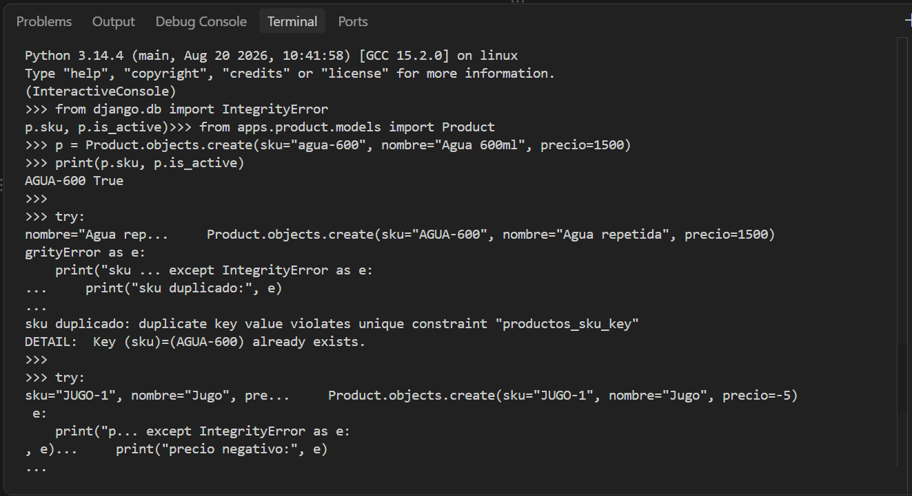
**Retroalimentación de la evidencia:** En la captura observé [`AGUA-600 True` en el bloque 1, `sku duplicado:` en el bloque 2 y `precio negativo:` en el bloque 3].

**Conclusión y aprendizaje:** Aprendí que `save()` normaliza el SKU, que la unicidad y la restricción de precio las aplica la base de datos.

Si repites la prueba, borra primero los registros de prueba con `Product.objects.all().delete()`.

### Criterios de aceptación y GATE

| AC | Criterio | Verificación | Evidencia | Resultado |
|:---|:---|:---|:---|:---|
| AC-05-01 | La tabla física es `productos` | Migración aplicada | EVI-05-02 | [PASS] |
| AC-05-02 | `sku` es único y se guarda en mayúsculas | Bloques 1 y 2 del shell | EVI-05-03 | [PASS] |
| AC-05-03 | `precio` no admite valores negativos | Bloque 3 del shell | EVI-05-03 | [PASS] |
| AC-05-04 | `is_active` vale `True` por defecto | Bloque 1 del shell | EVI-05-03 | [PASS] |

El GATE del ISS-05 queda cumplido cuando AC-05-01 a AC-05-03 están en PASS.

## ISS-06 - Sucursal, Inventario, Venta y VentaDetalle

En este ISS creé la base de ventas de PuntoStock en cuatro partes: la aplicación `branch` con la entidad Sucursal, la aplicación `inventory` con la relación Sucursal N:M Producto, y los modelos `Venta` y `VentaDetalle`. `VentaDetalle` guarda el valor unitario al momento de la venta, así que un cambio posterior en el precio del producto no altera las ventas anteriores. Venta no usa `ManyToManyField`: la relación con los productos pasa por `VentaDetalle`.

### Paso 1 - Aplicación `branch` y entidad Sucursal

Creé la aplicación `branch` con su `AppConfig` completo y el modelo `Sucursal`, que hereda de `TimeStampedModel` y tiene `nombre`, `descripcion` e `is_active`. Si la carpeta `apps/branch` ya existe, omite `startapp`.

```bash
mkdir -p apps/branch
python manage.py startapp branch apps/branch
cat > apps/branch/apps.py <<'EOF'
from django.apps import AppConfig


class BranchConfig(AppConfig):
    default_auto_field = "django.db.models.BigAutoField"
    name = "apps.branch"
    label = "branch"
EOF
cat > apps/branch/models.py <<'EOF'
from django.core.validators import MinLengthValidator
from django.db import models

from apps.common.models import TimeStampedModel


class Sucursal(TimeStampedModel):
    nombre = models.CharField(max_length=120, validators=[MinLengthValidator(2)])
    descripcion = models.CharField(max_length=255, blank=True)
    is_active = models.BooleanField(default=True)

    class Meta:
        db_table = "sucursales"
        verbose_name = "sucursal"
        verbose_name_plural = "sucursales"
        ordering = ["nombre", "id"]

    def __str__(self):
        return self.nombre

    def save(self, *args, **kwargs):
        self.nombre = self.nombre.strip()
        super().save(*args, **kwargs)
EOF
ls apps/branch
```

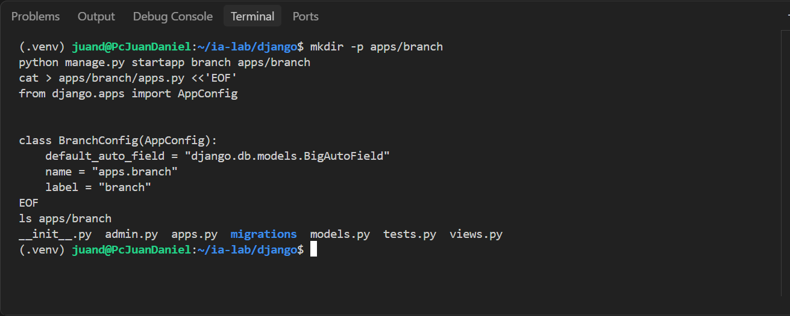

**Retroalimentación de la evidencia:** En la captura observé [`name = "apps.branch"`, `label = "branch"` y la clase `Sucursal` con `db_table = "sucursales"`].

**Conclusión y aprendizaje:** Aprendí que el `label` corto es el que usan las migraciones, mientras que el `name` completo es el que Django necesita para localizar el paquete.

### Paso 2 - Aplicación `inventory` y registro en `INSTALLED_APPS`

Creé la aplicación `inventory` para la relación Sucursal N:M Producto. Su modelo `Inventario` tiene una restricción única sobre sucursal y producto, y una restricción de cantidad no negativa. Después registré `branch` e `inventory`, en ese orden, después de `apps.sale`. Si las líneas ya existen en `settings`, no las repitas.

```bash
mkdir -p apps/inventory
python manage.py startapp inventory apps/inventory
cat > apps/inventory/apps.py <<'EOF'
from django.apps import AppConfig


class InventoryConfig(AppConfig):
    default_auto_field = "django.db.models.BigAutoField"
    name = "apps.inventory"
    label = "inventory"
EOF
cat > apps/inventory/models.py <<'EOF'
from django.db import models

from apps.branch.models import Sucursal
from apps.product.models import Product


class Inventario(models.Model):
    sucursal = models.ForeignKey(
        Sucursal,
        on_delete=models.RESTRICT,
        related_name="inventario",
        db_column="sucursal_id",
    )
    producto = models.ForeignKey(
        Product,
        on_delete=models.RESTRICT,
        related_name="inventario",
        db_column="producto_id",
    )
    cantidad = models.PositiveIntegerField(default=0)
    stock_minimo = models.PositiveIntegerField(default=0)
    updated_at = models.DateTimeField(auto_now=True)

    class Meta:
        db_table = "inventarios"
        verbose_name = "inventario"
        verbose_name_plural = "inventarios"
        ordering = ["sucursal_id", "producto_id"]
        constraints = [
            models.UniqueConstraint(
                fields=["sucursal", "producto"],
                name="inventario_sucursal_producto_uq",
            ),
        ]

    def __str__(self):
        return f"{self.sucursal} - {self.producto}: {self.cantidad}"
EOF
grep -q '"apps.branch.apps.BranchConfig"' config/settings/__init__.py || sed -i '/"apps.sale.apps.SaleConfig",/a\    "apps.branch.apps.BranchConfig",' config/settings/__init__.py
grep -q '"apps.inventory.apps.InventoryConfig"' config/settings/__init__.py || sed -i '/"apps.branch.apps.BranchConfig",/a\    "apps.inventory.apps.InventoryConfig",' config/settings/__init__.py
grep -n "apps\." config/settings/__init__.py
python manage.py check
```

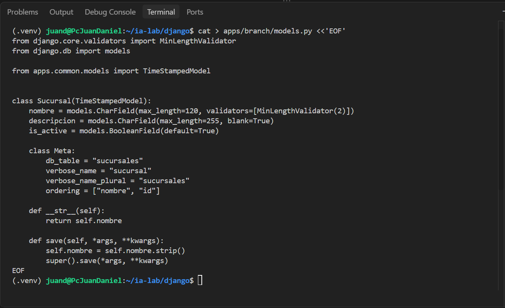

**Retroalimentación de la evidencia:** En la captura observé [`apps.branch.apps.BranchConfig` y `apps.inventory.apps.InventoryConfig` en `INSTALLED_APPS`, y `System check identified no issues (0 silenced).`].

**Conclusión y aprendizaje:** Aprendí que `Inventario` depende de `Sucursal` y de `Product`, así que las aplicaciones deben existir antes de la migración.

### Paso 3 - Managers, Venta y VentaDetalle

Creé `apps/sale/managers.py` con el queryset y el manager vacíos. El método de registro de venta llega en el ISS-11. Reescribí `apps/sale/models.py` con dos modelos. `Venta` tiene cliente, sucursal, fecha, importes y `estado` (`ACTIVA` o `ANULADA`). `VentaDetalle` guarda la cantidad y el valor unitario congelado, y calcula `total` en `save()`. El método `void()` bloquea la venta y sus líneas, devuelve las cantidades al inventario de la sucursal en orden de producto para evitar interbloqueos, y marca la venta como anulada, todo en una transacción.

```bash
cat > apps/sale/managers.py <<'EOF'
from django.db import models


class VentaQuerySet(models.QuerySet):
    pass


class VentaManager(models.Manager.from_queryset(VentaQuerySet)):
    pass
EOF

cat > apps/sale/models.py <<'EOF'
from decimal import Decimal

from django.core.validators import MinValueValidator
from django.db import models, transaction

from apps.branch.models import Sucursal
from apps.client.models import Client
from apps.common.models import TimeStampedModel
from apps.inventory.models import Inventario
from apps.product.models import Product
from apps.sale.managers import VentaManager


class Venta(TimeStampedModel):
    class Estado(models.TextChoices):
        ACTIVA = "ACTIVA", "Activa"
        ANULADA = "ANULADA", "Anulada"

    cliente = models.ForeignKey(
        Client,
        on_delete=models.RESTRICT,
        related_name="ventas",
        db_column="cliente_id",
    )
    sucursal = models.ForeignKey(
        Sucursal,
        on_delete=models.RESTRICT,
        related_name="ventas",
        db_column="sucursal_id",
    )
    fecha = models.DateTimeField()
    subtotal = models.DecimalField(max_digits=12, decimal_places=2, default=Decimal("0.00"))
    impuestos = models.DecimalField(max_digits=12, decimal_places=2, default=Decimal("0.00"))
    total = models.DecimalField(max_digits=12, decimal_places=2, default=Decimal("0.00"))
    estado = models.CharField(max_length=8, choices=Estado.choices, default=Estado.ACTIVA)

    objects = VentaManager()

    class Meta:
        db_table = "ventas"
        verbose_name = "venta"
        verbose_name_plural = "ventas"
        ordering = ["-fecha", "-id"]
        constraints = [
            models.CheckConstraint(
                condition=models.Q(subtotal__gte=0)
                & models.Q(impuestos__gte=0)
                & models.Q(total__gte=0),
                name="venta_montos_no_negativos",
            ),
        ]

    def __str__(self):
        return f"Venta {self.pk}"

    def void(self):
        with transaction.atomic():
            venta = Venta.objects.select_for_update().get(pk=self.pk)
            if venta.estado == Venta.Estado.ANULADA:
                return venta
            detalles = venta.detalles.select_for_update().order_by("producto_id")
            for detalle in detalles:
                inventario = Inventario.objects.select_for_update().get(
                    sucursal_id=venta.sucursal_id,
                    producto_id=detalle.producto_id,
                )
                inventario.cantidad += detalle.cantidad
                inventario.save(update_fields=["cantidad", "updated_at"])
            venta.estado = Venta.Estado.ANULADA
            venta.save(update_fields=["estado", "updated_at"])
            return venta


class VentaDetalle(TimeStampedModel):
    venta = models.ForeignKey(
        Venta,
        on_delete=models.RESTRICT,
        related_name="detalles",
        db_column="venta_id",
    )
    producto = models.ForeignKey(
        Product,
        on_delete=models.RESTRICT,
        related_name="lineas_venta",
        db_column="producto_id",
    )
    cantidad = models.PositiveIntegerField(validators=[MinValueValidator(1)])
    valor_unitario = models.DecimalField(max_digits=12, decimal_places=2)
    total = models.DecimalField(max_digits=12, decimal_places=2)
    observaciones = models.CharField(max_length=255, blank=True)

    class Meta:
        db_table = "venta_detalles"
        verbose_name = "detalle de venta"
        verbose_name_plural = "detalles de venta"
        ordering = ["id"]
        constraints = [
            models.CheckConstraint(
                condition=models.Q(cantidad__gte=1)
                & models.Q(valor_unitario__gte=0)
                & models.Q(total__gte=0),
                name="venta_detalle_montos_validos",
            ),
        ]

    def __str__(self):
        return f"{self.producto} x {self.cantidad}"

    def save(self, *args, **kwargs):
        self.total = (self.valor_unitario * self.cantidad).quantize(Decimal("0.01"))
        super().save(*args, **kwargs)
EOF
```

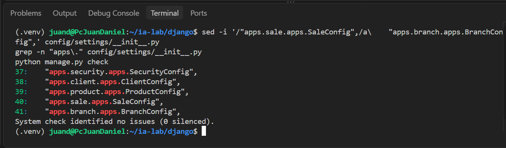

**Retroalimentación de la evidencia:** En la captura observé [`Venta` con `estado` y `void()`, `VentaDetalle` con `valor_unitario` y el `save()` que calcula `total`].

**Conclusión y aprendizaje:** Aprendí que el precio se congela en la línea, y que la anulación cambia el inventario y el estado dentro de una sola transacción.

### Paso 4 - Migraciones

Creé las migraciones de las cuatro aplicaciones implicadas y las apliqué.

```bash
python manage.py makemigrations branch inventory sale
python manage.py migrate
python manage.py showmigrations branch inventory sale
```

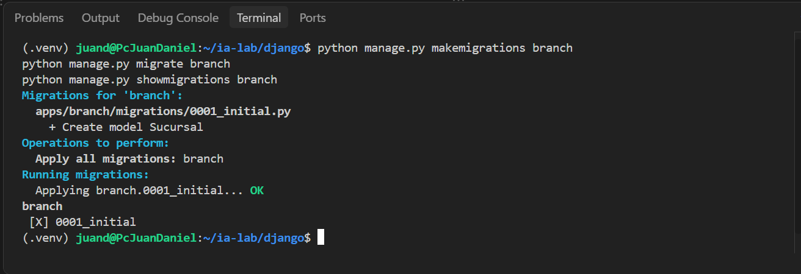

**Retroalimentación de la evidencia:** En la captura observé [`Create model Sucursal`, `Create model Inventario`, `Create model Venta`, `Create model VentaDetalle` y `[X] 0001_initial` en `branch`, `inventory` y `sale`].

**Conclusión y aprendizaje:** Aprendí que `sale` depende de `inventory` y de `branch`, y Django ordena las migraciones por esas dependencias.

### Paso 5 - Pruebas de Sucursal, precio histórico y anulación

Escribí las pruebas en `apps/branch/tests.py` y `apps/sale/tests.py`. Verifican la validación de Sucursal, el total de la línea, el precio congelado y la devolución del inventario al anular.

```bash
cat > apps/branch/tests.py <<'EOF'
from django.core.exceptions import ValidationError
from django.test import TestCase

from apps.branch.models import Sucursal


class SucursalTests(TestCase):
    def test_default_is_active_and_name_is_trimmed(self):
        sucursal = Sucursal.objects.create(nombre="  Centro  ")
        self.assertTrue(sucursal.is_active)
        self.assertEqual(sucursal.nombre, "Centro")

    def test_short_name_is_rejected(self):
        with self.assertRaises(ValidationError):
            Sucursal(nombre="C").full_clean()
EOF

cat > apps/sale/tests.py <<'EOF'
from django.utils import timezone
from rest_framework.test import APITestCase

from apps.branch.models import Sucursal
from apps.client.models import Client
from apps.inventory.models import Inventario
from apps.product.models import Product
from apps.sale.models import Venta, VentaDetalle


class VentaTests(APITestCase):
    def setUp(self):
        self.sucursal = Sucursal.objects.create(nombre="Centro")
        self.cliente = Client.objects.create(tipo_documento="CC", numero_documento="5001", nombre="Ana")
        self.producto = Product.objects.create(sku="AGUA-TEST", nombre="Agua", precio=1500)
        self.inventario = Inventario.objects.create(sucursal=self.sucursal, producto=self.producto, cantidad=10)

    def _venta(self, cantidad):
        venta = Venta.objects.create(cliente=self.cliente, sucursal=self.sucursal, fecha=timezone.now())
        detalle = VentaDetalle.objects.create(
            venta=venta,
            producto=self.producto,
            cantidad=cantidad,
            valor_unitario=self.producto.precio,
        )
        return venta, detalle

    def test_total_and_historical_price(self):
        _, detalle = self._venta(3)
        self.assertEqual(str(detalle.total), "4500.00")
        Product.objects.filter(pk=self.producto.pk).update(precio=9999)
        detalle.refresh_from_db()
        self.assertEqual(str(detalle.valor_unitario), "1500.00")

    def test_void_restores_inventory(self):
        venta, _ = self._venta(4)
        self.inventario.refresh_from_db()
        self.assertEqual(self.inventario.cantidad, 6)
        venta.void()
        self.inventario.refresh_from_db()
        venta.refresh_from_db()
        self.assertEqual(self.inventario.cantidad, 10)
        self.assertEqual(venta.estado, Venta.Estado.ANULADA)
EOF

python manage.py test apps.branch apps.sale -v 2
```

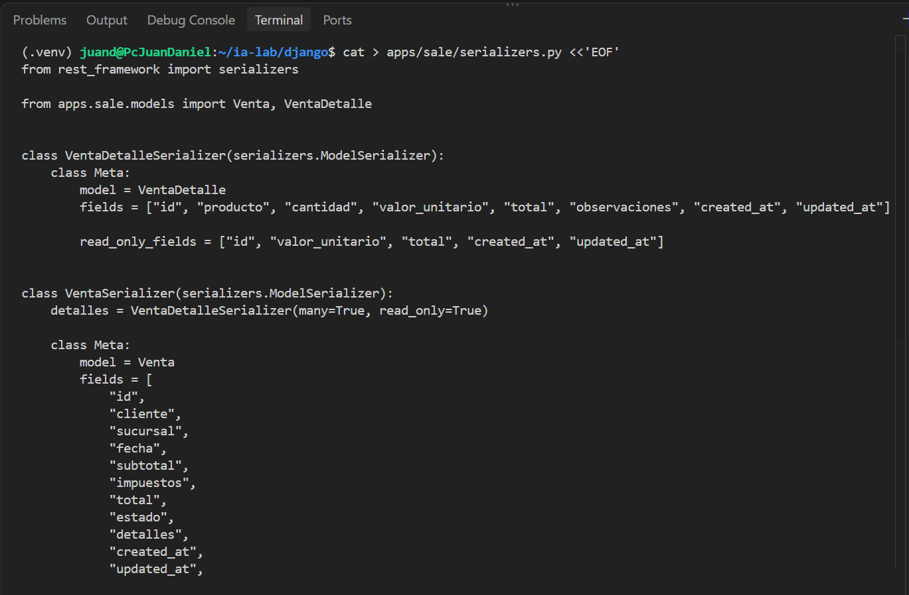
**Retroalimentación de la evidencia:** En la captura observé [`Ran 4 tests` y `OK`, con las pruebas de `SucursalTests` y `VentaTests` listadas como `ok`].

**Conclusión y aprendizaje:** Aprendí que una sola prueba puede demostrar dos decisiones de diseño: el precio congelado y la restitución del inventario al anular.

### Criterios de aceptación y GATE

| AC | Criterio | Verificación | Evidencia | Resultado |
|:---|:---|:---|:---|:---|
| AC-06-01 | Existen las tablas `sucursales`, `inventarios`, `ventas` y `venta_detalles` | Migraciones aplicadas | EVI-06-04 | [PASS] |
| AC-06-02 | Sucursal queda activa por defecto y su nombre de menos de 2 caracteres se rechaza | Test `SucursalTests` | EVI-06-05 | [PASS] |
| AC-06-03 | El total de la línea es cantidad por valor unitario | Test `test_total_and_historical_price` | EVI-06-05 | [PASS] |
| AC-06-04 | Cambiar el precio del producto no altera el valor unitario de la venta | Test `test_total_and_historical_price` | EVI-06-05 | [PASS] |
| AC-06-05 | Anular la venta devuelve el inventario y marca la venta como `ANULADA` | Test `test_void_restores_inventory` | EVI-06-05 | [PASS] |
| AC-06-06 | Venta no usa `ManyToManyField` hacia `Product` | Revisión de `apps/sale/models.py` | EVI-06-03 | [PASS] |

El GATE del ISS-06 queda cumplido cuando AC-06-01 a AC-06-06 están en PASS.

## ISS-07 - Serializers y JSON camelCase

En este ISS incorporé Django REST Framework, `djangorestframework-camel-case` y `django-cors-headers`, y creé los serializers de Cliente, Sucursal, Producto, Venta y VentaDetalle. Los campos Python conservan `snake_case`; el renderizador convierte la salida JSON a `camelCase` y el parser hace la conversión inversa. El modelo no cambia.

### Paso 1 - Instalación de paquetes

Instalé los tres paquetes de la API y regeneré `requirements.txt`.

```bash
source .venv/bin/activate
python -m pip install "djangorestframework==3.17.2" "djangorestframework-camel-case==1.4.2" "django-cors-headers==4.9.0"
python -m pip freeze > requirements.txt
cat requirements.txt
```

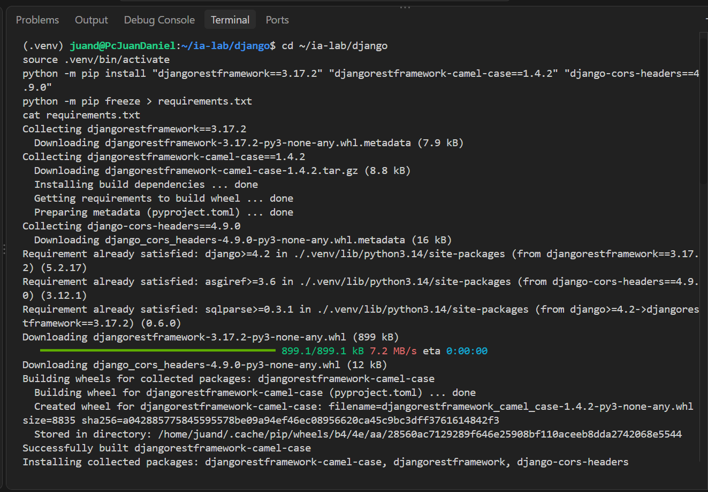

**Retroalimentación de la evidencia:** En la captura observé [`djangorestframework==3.17.2`, `djangorestframework-camel-case==1.4.2` y `django-cors-headers==4.9.0` en `requirements.txt`].

**Conclusión y aprendizaje:** Aprendí que `djangorestframework-camel-case` solo actúa en el borde HTTP: el ORM sigue usando `created_at`, y la API envía `createdAt`.

### Paso 2 - Configuración de DRF, CORS y camelCase en settings

Registré `rest_framework` y `corsheaders` en `INSTALLED_APPS`, agregué `CorsMiddleware` como primer elemento de `MIDDLEWARE` y declaré `REST_FRAMEWORK` con renderizadores y parsers camelCase. El permiso por defecto es `AllowAny`: la autenticación llega en la fase de seguridad. Dejé `CORS_ALLOW_ALL_ORIGINS` leído desde `.env`.

```bash
sed -i '/"apps.security.apps.SecurityConfig",/a\    "rest_framework",\n    "corsheaders",' config/settings/__init__.py
sed -i '/"django.middleware.security.SecurityMiddleware",/i\    "corsheaders.middleware.CorsMiddleware",' config/settings/__init__.py
cat >> config/settings/__init__.py <<'EOF'

CORS_ALLOW_ALL_ORIGINS = os.environ.get("CORS_ALLOW_ALL_ORIGINS", "True").strip().lower() in {
    "1",
    "true",
    "yes",
    "on",
}

REST_FRAMEWORK = {
    "DEFAULT_PERMISSION_CLASSES": [
        "rest_framework.permissions.AllowAny",
    ],
    "DEFAULT_RENDERER_CLASSES": [
        "djangorestframework_camel_case.render.CamelCaseJSONRenderer",
        "djangorestframework_camel_case.render.CamelCaseBrowsableAPIRenderer",
    ],
    "DEFAULT_PARSER_CLASSES": [
        "djangorestframework_camel_case.parser.CamelCaseJSONParser",
        "djangorestframework_camel_case.parser.CamelCaseFormParser",
        "djangorestframework_camel_case.parser.CamelCaseMultiPartParser",
    ],
    "DEFAULT_PAGINATION_CLASS": None,
}
EOF
grep -n "rest_framework\|corsheaders\|CorsMiddleware\|REST_FRAMEWORK\|CORS_ALLOW" config/settings/__init__.py
python manage.py check
```

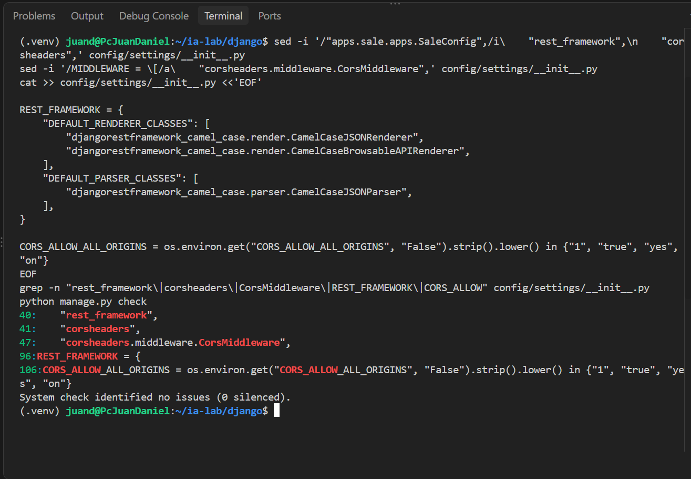

**Retroalimentación de la evidencia:** En la captura observé [`rest_framework` y `corsheaders` en `INSTALLED_APPS`, `CorsMiddleware` antes de `SecurityMiddleware`, `REST_FRAMEWORK` con los renderizadores camelCase y `System check identified no issues (0 silenced).`].

**Conclusión y aprendizaje:** Aprendí que `CorsMiddleware` debe ir antes de `CommonMiddleware` y de las respuestas de vistas, para que el navegador reciba los encabezados de CORS también en las peticiones de preflight.

### Paso 3 - Serializer de Cliente

Reescribí `apps/client/serializers.py` con los campos de la especificación. `numero_documento` se limpia de espacios, y `email` se guarda en minúsculas; un email vacío queda como cadena vacía, igual que en el modelo.

```bash
cat > apps/client/serializers.py <<'EOF'
from rest_framework import serializers

from apps.client.models import Client


class ClientSerializer(serializers.ModelSerializer):
    class Meta:
        model = Client
        fields = [
            "id",
            "tipo_documento",
            "numero_documento",
            "nombre",
            "telefono",
            "email",
            "is_active",
            "created_at",
            "updated_at",
        ]
        read_only_fields = ["id", "created_at", "updated_at"]

    def validate_numero_documento(self, value):
        return value.strip()

    def validate_email(self, value):
        if value is None or str(value).strip() == "":
            return ""
        return value.strip().lower()
EOF
```

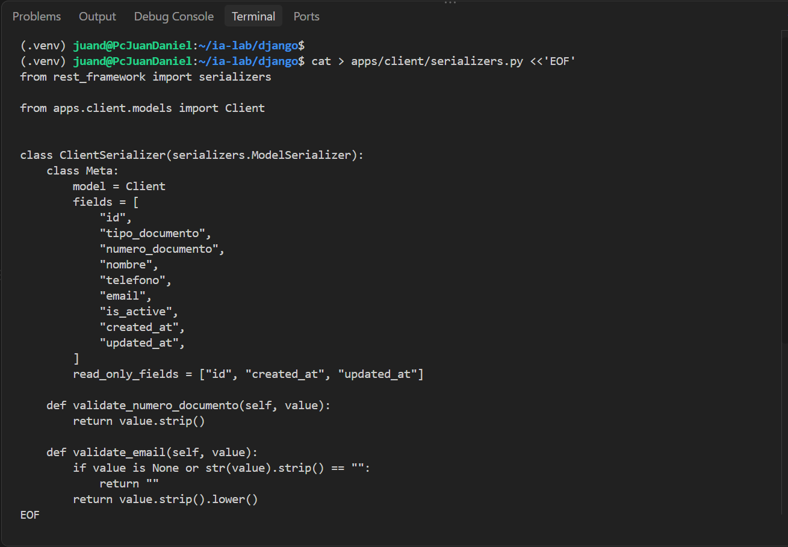

**Retroalimentación de la evidencia:** En la captura observé [los campos de la especificación en `fields`, `read_only_fields` con `id`, `created_at` y `updated_at`, y los métodos de validación de documento y email].

**Conclusión y aprendizaje:** Aprendí que `read_only_fields` impide que un cliente envíe `id` o marcas de tiempo, y que la validación del serializer ocurre antes de tocar la base.

### Paso 4 - Serializers de Sucursal y Producto

Creé `SucursalSerializer` y `ProductSerializer`. El SKU se normaliza en mayúsculas en el serializer, igual que en el modelo, para que la respuesta de la API y el valor guardado coincidan.

```bash
cat > apps/branch/serializers.py <<'EOF'
from rest_framework import serializers

from apps.branch.models import Sucursal


class SucursalSerializer(serializers.ModelSerializer):
    class Meta:
        model = Sucursal
        fields = ["id", "nombre", "descripcion", "is_active", "created_at", "updated_at"]
        read_only_fields = ["id", "created_at", "updated_at"]
EOF

cat > apps/product/serializers.py <<'EOF'
from rest_framework import serializers

from apps.product.models import Product


class ProductSerializer(serializers.ModelSerializer):
    class Meta:
        model = Product
        fields = [
            "id",
            "sku",
            "nombre",
            "descripcion",
            "precio",
            "is_active",
            "created_at",
            "updated_at",
        ]
        read_only_fields = ["id", "created_at", "updated_at"]

    def validate_sku(self, value):
        return value.strip().upper()
EOF
```

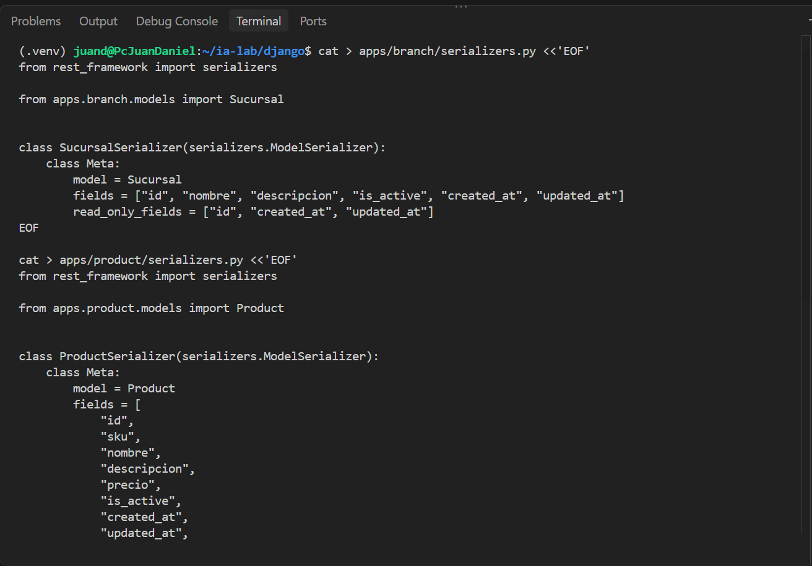

**Retroalimentación de la evidencia:** En la captura observé [`SucursalSerializer` y `ProductSerializer` con sus campos, y `validate_sku` que devuelve el valor en mayúsculas].

**Conclusión y aprendizaje:** Aprendí que el serializer es el lugar para reglas de presentación y normalización del contrato de la API, mientras que el modelo protege la integridad de los datos.

### Paso 5 - Serializers de Venta y VentaDetalle

Creé `apps/sale/serializers.py`. Los importes y `estado` son de solo lectura: el cliente no puede fijar el total ni el valor unitario. El alta de ventas con validación transaccional llega en el ISS-11.

```bash
cat > apps/sale/serializers.py <<'EOF'
from rest_framework import serializers

from apps.sale.models import Venta, VentaDetalle


class VentaDetalleSerializer(serializers.ModelSerializer):
    class Meta:
        model = VentaDetalle
        fields = ["id", "producto", "cantidad", "valor_unitario", "total", "observaciones", "created_at", "updated_at"]
        read_only_fields = ["id", "valor_unitario", "total", "created_at", "updated_at"]


class VentaSerializer(serializers.ModelSerializer):
    detalles = VentaDetalleSerializer(many=True, read_only=True)

    class Meta:
        model = Venta
        fields = [
            "id",
            "cliente",
            "sucursal",
            "fecha",
            "subtotal",
            "impuestos",
            "total",
            "estado",
            "detalles",
            "created_at",
            "updated_at",
        ]
        read_only_fields = ["id", "subtotal", "impuestos", "total", "estado", "created_at", "updated_at"]
EOF
```

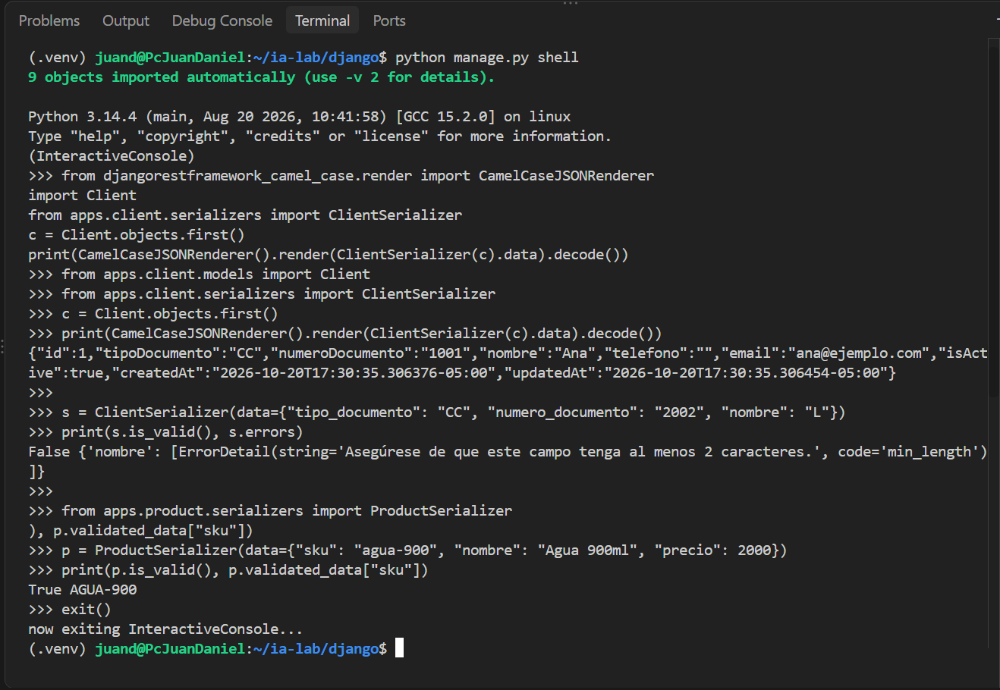

**Retroalimentación de la evidencia:** En la captura observé [`VentaDetalleSerializer` con `valor_unitario` y `total` de solo lectura, y `VentaSerializer` con `detalles` anidados de solo lectura].

**Conclusión y aprendizaje:** Aprendí que el precio histórico no puede venir del cliente: el serializer lo expone, pero no lo acepta como entrada.

### Paso 6 - Verificación del contrato JSON

Comprobé que la salida de un cliente se convierte a camelCase al renderizarla, sin cambiar el nombre del campo en Python.

```bash
python manage.py shell
```

Bloque 1: renderizar un cliente existente.

```python
from djangorestframework_camel_case.render import CamelCaseJSONRenderer
from apps.client.models import Client
from apps.client.serializers import ClientSerializer
c = Client.objects.first()
print(CamelCaseJSONRenderer().render(ClientSerializer(c).data).decode())
```

Bloque 2: validar un cliente con nombre demasiado corto, sin guardar.

```python
s = ClientSerializer(data={"tipo_documento": "CC", "numero_documento": "7001", "nombre": "L"})
print(s.is_valid(), s.errors)
```

Escribe `exit()` al terminar.

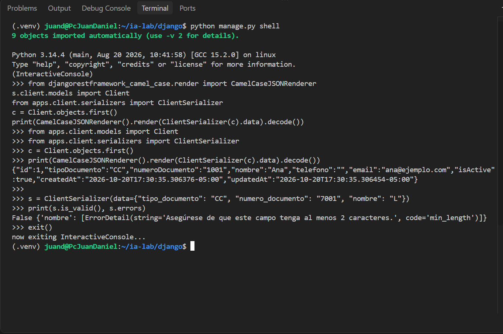

**Retroalimentación de la evidencia:** En la captura observé [las claves `createdAt`, `numeroDocumento` e `isActive` en el JSON del bloque 1, y `False` con el error de `nombre` en el bloque 2].

**Conclusión y aprendizaje:** Aprendí que `serializer.data` tiene `snake_case` y que la conversión a `camelCase` ocurre al renderizar la respuesta HTTP.

### Criterios de aceptación y GATE

| AC | Criterio | Verificación | Evidencia | Resultado |
|:---|:---|:---|:---|:---|
| AC-07-01 | Los paquetes de API están en `requirements.txt` | Revisión del archivo | EVI-07-01 | [PASS] |
| AC-07-02 | DRF, CORS y camelCase están configurados y `check` pasa | Paso 2 | EVI-07-02 | [PASS] |
| AC-07-03 | La salida JSON usa `createdAt` y no `created_at` | Bloque 1 del shell | EVI-07-06 | [PASS] |
| AC-07-04 | Un nombre de menos de 2 caracteres se rechaza | Bloque 2 del shell | EVI-07-06 | [PASS] |
| AC-07-05 | El total y el valor unitario de Venta son de solo lectura | Paso 5 | EVI-07-05 | [PASS] |

El GATE del ISS-07 queda cumplido cuando AC-07-01 a AC-07-05 están en PASS.

## ISS-08 - Cliente con ModelViewSet

En este ISS publiqué el CRUD de Cliente en `/api/clientes/` con `ModelViewSet`. El borrado es lógico: marca `is_active = False` y conserva la fila, porque las ventas de ISS-06 referencian al cliente. El acceso es abierto (`AllowAny`) porque la autenticación llega en la fase de seguridad.

### Paso 1 - ViewSet de Cliente

Reescribí `apps/client/views.py`. `ClientViewSet` acepta el filtro `?is_active=true|false` y sobrescribe `perform_destroy` para aplicar la baja lógica.

```bash
cat > apps/client/views.py <<'EOF'
from rest_framework import viewsets
from rest_framework.permissions import AllowAny

from apps.client.models import Client
from apps.client.serializers import ClientSerializer


class ClientViewSet(viewsets.ModelViewSet):
    queryset = Client.objects.all()
    serializer_class = ClientSerializer
    permission_classes = [AllowAny]

    def get_queryset(self):
        queryset = super().get_queryset()
        activo = self.request.query_params.get("is_active")
        if activo is not None:
            queryset = queryset.filter(is_active=activo.strip().lower() in {"1", "true", "yes", "on"})
        return queryset

    def perform_destroy(self, instance):
        instance.is_active = False
        instance.save(update_fields=["is_active", "updated_at"])
EOF
cat apps/client/views.py
```

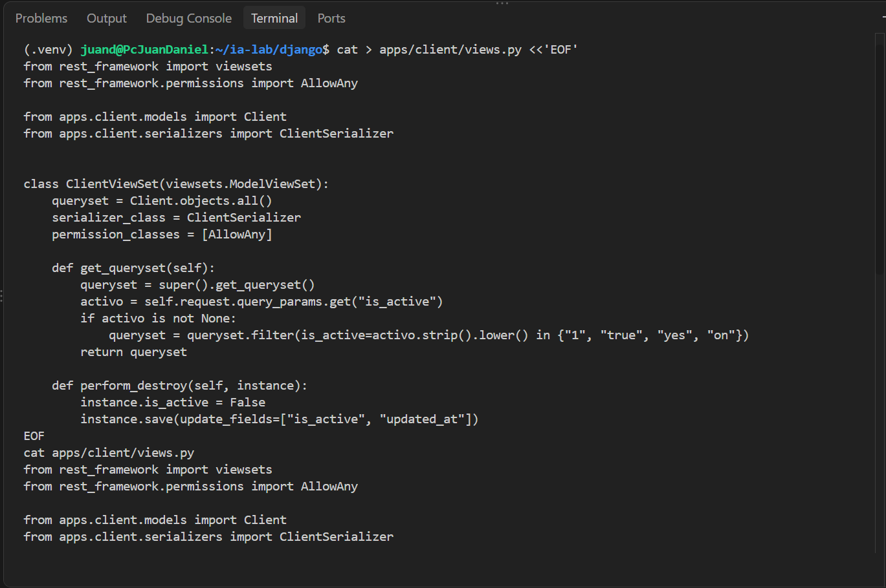

**Retroalimentación de la evidencia:** En la captura observé [`ClientViewSet` con `AllowAny`, el filtro `is_active` en `get_queryset` y `perform_destroy` que cambia `is_active` a `False`].

**Conclusión y aprendizaje:** Aprendí que `ModelViewSet` genera list, create, retrieve, update, partial_update y destroy a partir del serializer. Sobrescribir `perform_destroy` cambia el borrado sin tocar la ruta.

### Paso 2 - Ruta del recurso

Registré el ViewSet en el router de `config/urls.py`. Como las rutas de Producto llegan en el ISS-09, aquí solo está `clientes`.

```bash
cat > config/urls.py <<'EOF'
from django.contrib import admin
from django.urls import include, path
from rest_framework.routers import SimpleRouter

from apps.client.views import ClientViewSet

router = SimpleRouter(use_regex_path=False)
router.register("clientes", ClientViewSet, basename="cliente")

urlpatterns = [
    path("admin/", admin.site.urls),
    path("api/", include(router.urls)),
]
EOF
cat config/urls.py
python manage.py check
```

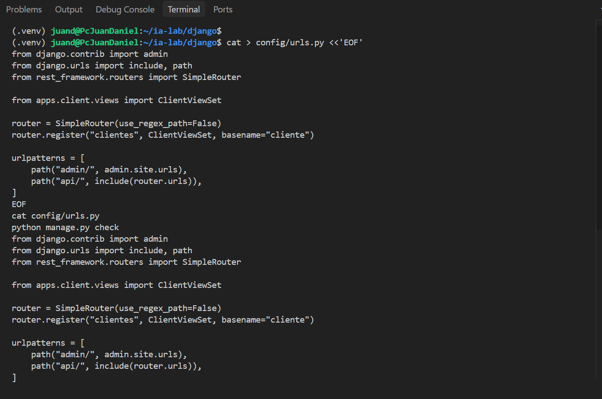

**Retroalimentación de la evidencia:** En la captura observé [`router.register("clientes", ...)`, `include(router.urls)` bajo `api/` y `System check identified no issues (0 silenced).`].

**Conclusión y aprendizaje:** Aprendí que `SimpleRouter` genera `clientes/` y `clientes/<int:pk>/` a partir del ViewSet, sin escribir cada ruta a mano.

### Paso 3 - Pruebas de la API

Escribí cuatro pruebas en `apps/client/tests.py`. Envían y reciben JSON en camelCase, como lo configuró el ISS-07. Como `email` no es único en la especificación, el duplicado se comprueba con `numero_documento`.

```bash
cat > apps/client/tests.py <<'EOF'
import json

from rest_framework import status
from rest_framework.test import APITestCase

from apps.client.models import Client


class ClientApiTests(APITestCase):
    def test_create_returns_camel_case_and_normalizes_email(self):
        response = self.client.post(
            "/api/clientes/",
            {
                "tipoDocumento": "CC",
                "numeroDocumento": "3001",
                "nombre": "María García",
                "email": "Maria@Example.com",
                "telefono": "3001234567",
            },
            format="json",
        )
        self.assertEqual(response.status_code, status.HTTP_201_CREATED)
        self.assertTrue(response.data["is_active"])
        wire = json.loads(response.content)
        self.assertIn("numeroDocumento", wire)
        self.assertNotIn("numero_documento", wire)
        stored = Client.objects.get(pk=response.data["id"])
        self.assertEqual(stored.email, "maria@example.com")

    def test_invalid_name_is_rejected(self):
        response = self.client.post(
            "/api/clientes/",
            {"tipoDocumento": "CC", "numeroDocumento": "3002", "nombre": "A"},
            format="json",
        )
        self.assertEqual(response.status_code, status.HTTP_400_BAD_REQUEST)

    def test_duplicate_document_is_rejected(self):
        payload = {"tipoDocumento": "CC", "numeroDocumento": "3003", "nombre": "Luis Mora"}
        self.assertEqual(self.client.post("/api/clientes/", payload, format="json").status_code, 201)
        self.assertEqual(self.client.post("/api/clientes/", payload, format="json").status_code, 400)

    def test_delete_is_soft_and_list_filters_active(self):
        cliente = Client.objects.create(tipo_documento="CC", numero_documento="3004", nombre="Pedro León")
        Client.objects.create(tipo_documento="CC", numero_documento="3005", nombre="Inactivo", is_active=False)
        response = self.client.delete(f"/api/clientes/{cliente.pk}/")
        self.assertEqual(response.status_code, status.HTTP_204_NO_CONTENT)
        cliente.refresh_from_db()
        self.assertFalse(cliente.is_active)
        activos = self.client.get("/api/clientes/?is_active=true")
        self.assertEqual(activos.status_code, status.HTTP_200_OK)
        self.assertEqual(activos.data, [])
EOF
python manage.py test apps.client -v 2
```

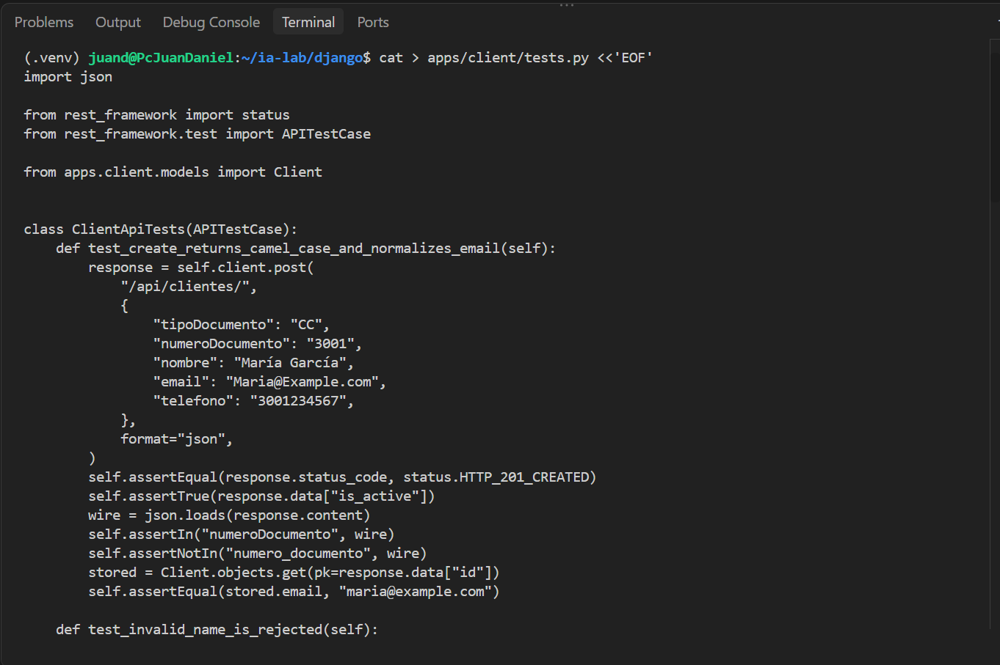

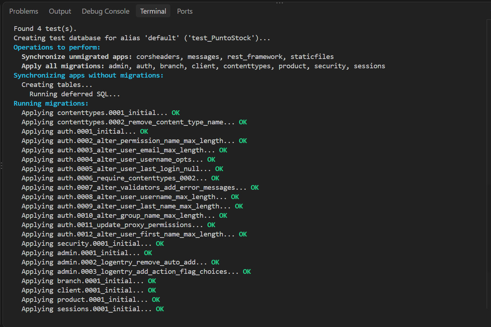

**Retroalimentación de las evidencias:** En la primera captura observé [las cuatro pruebas de `ClientApiTests`]. En la segunda observé [`Ran 4 tests` y `OK`, con cada prueba listada como `ok`].

**Conclusión y aprendizaje:** Aprendí que `APITestCase` ejecuta las peticiones contra la misma pila que usa el servidor, así que valida el parser, el renderizador, las validaciones y el router juntos.

### Criterios de aceptación y GATE

| AC | Criterio | Verificación | Evidencia | Resultado |
|:---|:---|:---|:---|:---|
| AC-08-01 | `POST /api/clientes/` crea el cliente, responde 201 y devuelve JSON en camelCase | Test `test_create_returns_camel_case_and_normalizes_email` | EVI-08-03, EVI-08-04 | [PASS] |
| AC-08-02 | Un nombre de menos de 2 caracteres responde 400 | Test `test_invalid_name_is_rejected` | EVI-08-04 | [PASS] |
| AC-08-03 | Un documento repetido responde 400 | Test `test_duplicate_document_is_rejected` | EVI-08-04 | [PASS] |
| AC-08-04 | `DELETE` aplica baja lógica con 204 y `?is_active=true` excluye al inactivo | Test `test_delete_is_soft_and_list_filters_active` | EVI-08-04 | [PASS] |

El GATE del ISS-08 queda cumplido cuando AC-08-01 a AC-08-04 están en PASS.

## ISS-09 - Producto con ModelViewSet

En este ISS publiqué el CRUD de Producto en `/api/productos/` con `ModelViewSet`. El SKU se normaliza en mayúsculas y no se repite. El borrado es lógico: marca `is_active = False` y conserva la fila, porque las líneas de venta de ISS-06 referencian al producto. El acceso es abierto (`AllowAny`) porque la autenticación llega en la fase de seguridad.

### Paso 1 - ViewSet de Producto

Reescribí `apps/product/views.py` con `ProductoViewSet`. Acepta el filtro `?is_active=` y sobrescribe `perform_destroy` para aplicar la baja lógica.

```bash
cat > apps/product/views.py <<'EOF'
from rest_framework import viewsets
from rest_framework.permissions import AllowAny

from apps.product.models import Product
from apps.product.serializers import ProductSerializer


class ProductoViewSet(viewsets.ModelViewSet):
    queryset = Product.objects.all()
    serializer_class = ProductSerializer
    permission_classes = [AllowAny]

    def get_queryset(self):
        queryset = super().get_queryset()
        activo = self.request.query_params.get("is_active")
        if activo is not None:
            queryset = queryset.filter(is_active=activo.strip().lower() in {"1", "true", "yes", "on"})
        return queryset

    def perform_destroy(self, instance):
        instance.is_active = False
        instance.save(update_fields=["is_active", "updated_at"])
EOF
cat apps/product/views.py
```

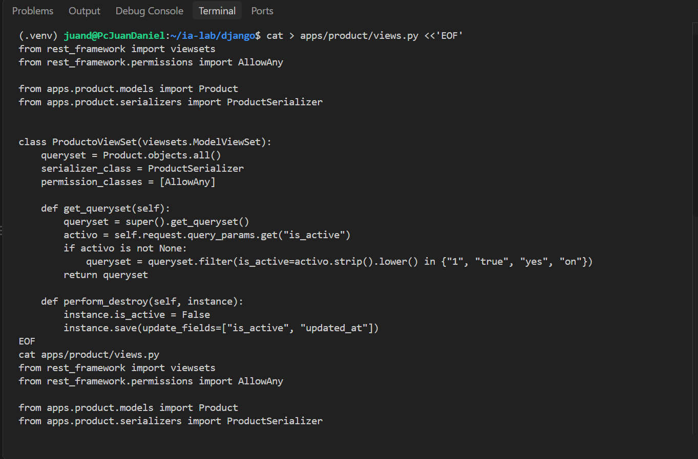

**Retroalimentación de la evidencia:** En la captura observé [`ProductoViewSet` con `AllowAny`, el filtro `is_active` en `get_queryset` y `perform_destroy` que desactiva el registro].

**Conclusión y aprendizaje:** Aprendí que el mismo patrón sirve para Cliente y Producto: cambian el queryset y el serializer, pero la regla de baja lógica se conserva.

### Paso 2 - Ruta de productos

Registré `productos` en el router de `config/urls.py`, junto a `clientes`. Un solo router evita que `config/urls.py` dependa de rutas repartidas en cada aplicación.

```bash
cat > config/urls.py <<'EOF'
from django.contrib import admin
from django.urls import include, path
from rest_framework.routers import SimpleRouter

from apps.client.views import ClientViewSet
from apps.product.views import ProductoViewSet

router = SimpleRouter(use_regex_path=False)
router.register("clientes", ClientViewSet, basename="cliente")
router.register("productos", ProductoViewSet, basename="producto")

urlpatterns = [
    path("admin/", admin.site.urls),
    path("api/", include(router.urls)),
]
EOF
cat config/urls.py
python manage.py check
```

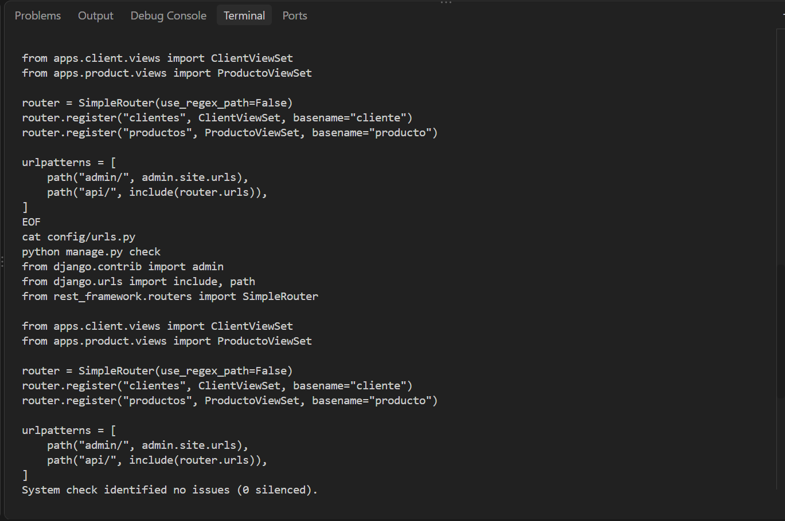

**Retroalimentación de la evidencia:** En la captura observé [los dos `register` (`clientes` y `productos`) y `System check identified no issues (0 silenced).`].

**Conclusión y aprendizaje:** Aprendí que `SimpleRouter` produce `productos/` y `productos/<int:pk>/`, y que `basename` nombra las rutas aunque el queryset cambie.

### Paso 3 - Pruebas del catálogo

Escribí cuatro pruebas en `apps/product/tests.py`. Usan JSON en camelCase, igual que las de Cliente.

```bash
cat > apps/product/tests.py <<'EOF'
from decimal import Decimal

from rest_framework import status
from rest_framework.test import APITestCase

from apps.product.models import Product


class ProductoApiTests(APITestCase):
    def test_create_normalizes_sku_and_is_active_by_default(self):
        response = self.client.post(
            "/api/productos/",
            {"sku": "agua-600", "nombre": "Agua 600ml", "precio": "1500.00"},
            format="json",
        )
        self.assertEqual(response.status_code, status.HTTP_201_CREATED)
        self.assertEqual(response.data["sku"], "AGUA-600")
        self.assertTrue(response.data["is_active"])

    def test_duplicate_sku_is_rejected(self):
        payload = {"sku": "CAFE-1", "nombre": "Café", "precio": "3000.00"}
        self.assertEqual(self.client.post("/api/productos/", payload, format="json").status_code, 201)
        self.assertEqual(self.client.post("/api/productos/", payload, format="json").status_code, 400)

    def test_negative_price_is_rejected(self):
        response = self.client.post(
            "/api/productos/",
            {"sku": "JUGO-1", "nombre": "Jugo", "precio": "-5.00"},
            format="json",
        )
        self.assertEqual(response.status_code, status.HTTP_400_BAD_REQUEST)

    def test_update_and_soft_delete(self):
        producto = Product.objects.create(sku="LECHE-1", nombre="Leche", precio=Decimal("3200.00"))
        patch = self.client.patch(f"/api/productos/{producto.pk}/", {"precio": "3500.00"}, format="json")
        self.assertEqual(patch.status_code, status.HTTP_200_OK)
        delete = self.client.delete(f"/api/productos/{producto.pk}/")
        self.assertEqual(delete.status_code, status.HTTP_204_NO_CONTENT)
        producto.refresh_from_db()
        self.assertFalse(producto.is_active)
        self.assertEqual(Product.objects.count(), 1)
EOF
python manage.py test apps.product -v 2
```

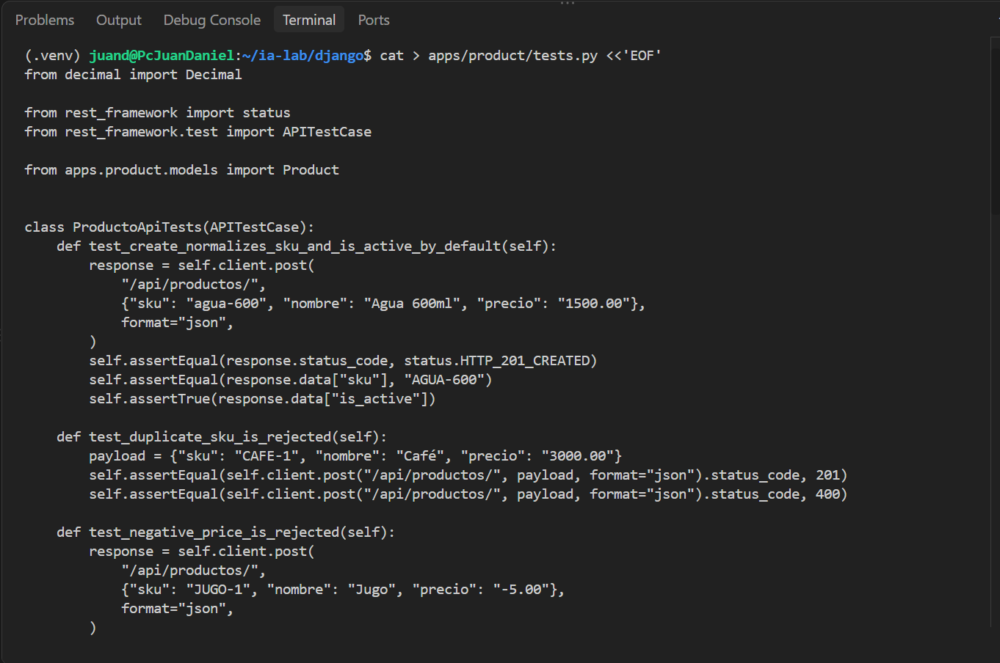

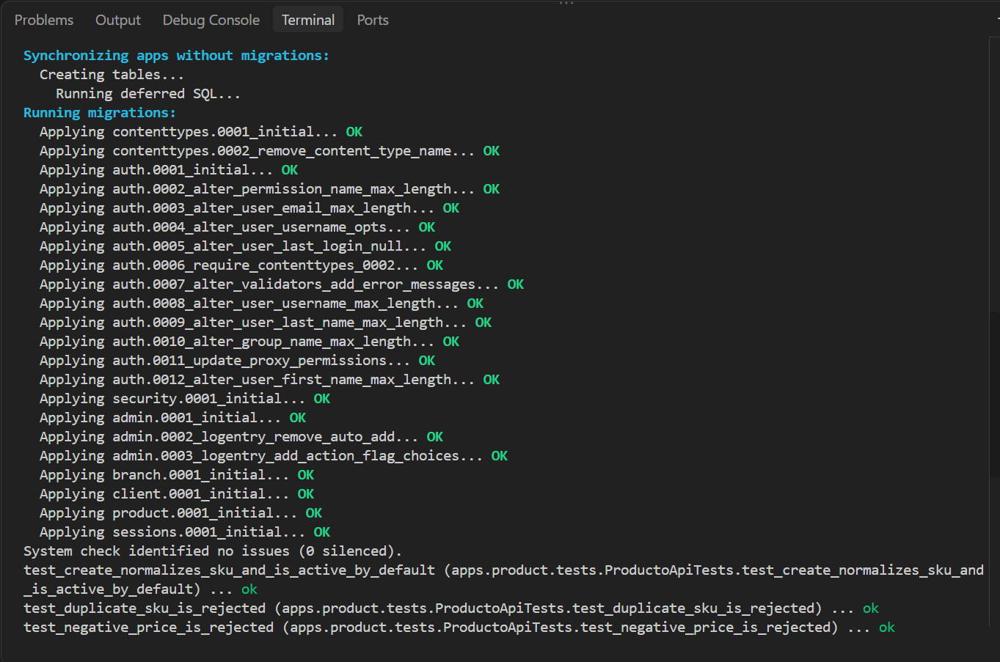

**Retroalimentación de las evidencias:** En la primera captura observé [las cuatro pruebas de `ProductoApiTests`]. En la segunda observé [`Ran 4 tests` y `OK`, con cada prueba listada como `ok`].

**Conclusión y aprendizaje:** Aprendí que la normalización del SKU ocurre en el serializer y que la restricción de precio protege la API antes de llegar a la base.

### Criterios de aceptación y GATE

| AC | Criterio | Verificación | Evidencia | Resultado |
|:---|:---|:---|:---|:---|
| AC-09-01 | `POST /api/productos/` crea el producto, normaliza el SKU y responde 201 | Test `test_create_normalizes_sku_and_is_active_by_default` | EVI-09-03, EVI-09-04 | [PASS] |
| AC-09-02 | Un SKU repetido responde 400 | Test `test_duplicate_sku_is_rejected` | EVI-09-04 | [PASS] |
| AC-09-03 | Un precio negativo responde 400 | Test `test_negative_price_is_rejected` | EVI-09-04 | [PASS] |
| AC-09-04 | `DELETE` aplica baja lógica con 204 y la fila sigue en la tabla | Test `test_update_and_soft_delete` | EVI-09-04 | [PASS] |

El GATE del ISS-09 queda cumplido cuando AC-09-01 a AC-09-04 están en PASS.

## ISS-10 - Productos disponibles con ListAPIView

En este ISS publiqué `/api/productos/disponibles/?sucursal=<id>`, una lectura filtrada que no es el CRUD del producto. Devuelve los productos activos con cantidad mayor que cero en la sucursal indicada. Como el stock vive en `Inventario` por sucursal, un mismo producto puede estar disponible en una sucursal y agotado en otra. El endpoint usa `ListAPIView` porque solo lee: no expone POST, PUT ni DELETE.

### Paso 1 - Vista de disponibles

Agregué `ProductoDisponibleListAPIView` al final de `apps/product/views.py`. Exige el parámetro `sucursal`: sin él responde 400, porque no hay una respuesta única sin sucursal.

```bash
cat >> apps/product/views.py <<'EOF'


class ProductoDisponibleListAPIView(ListAPIView):
    serializer_class = ProductSerializer
    permission_classes = [AllowAny]

    def get_queryset(self):
        sucursal_id = self.request.query_params.get("sucursal")
        if not sucursal_id:
            raise ValidationError({"sucursal": "Este parámetro es obligatorio."})
        return Product.objects.filter(
            is_active=True,
            inventario__sucursal_id=sucursal_id,
            inventario__cantidad__gt=0,
        ).distinct()
EOF
python - <<'EOF'
from pathlib import Path
p = Path("apps/product/views.py")
text = p.read_text()
text = text.replace(
    "from rest_framework import viewsets\n",
    "from rest_framework import viewsets\nfrom rest_framework.exceptions import ValidationError\nfrom rest_framework.generics import ListAPIView\n",
    1,
)
p.write_text(text)
EOF
cat apps/product/views.py
python manage.py check
```

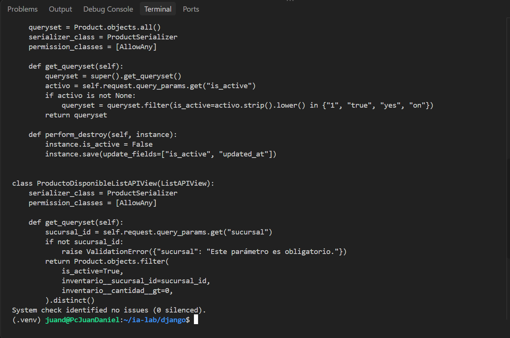

**Retroalimentación de la evidencia:** En la captura observé [los imports de `ListAPIView` y `ValidationError`, y la clase con el filtro sobre `inventario__cantidad__gt=0` y `System check identified no issues (0 silenced).`].

**Conclusión y aprendizaje:** Aprendí que `ListAPIView` ofrece solo el método GET sobre un queryset, así que no hay un camino de escritura en esta ruta.

### Paso 2 - Ruta literal antes del router

Agregué la ruta `api/productos/disponibles/` antes de `include(router.urls)`. Django evalúa las rutas en orden: si el router va primero, `disponibles` se interpretaría como un identificador de producto.

```bash
cat > config/urls.py <<'EOF'
from django.contrib import admin
from django.urls import include, path
from rest_framework.routers import SimpleRouter

from apps.client.views import ClientViewSet
from apps.product.views import ProductoDisponibleListAPIView, ProductoViewSet

router = SimpleRouter(use_regex_path=False)
router.register("clientes", ClientViewSet, basename="cliente")
router.register("productos", ProductoViewSet, basename="producto")

urlpatterns = [
    path("admin/", admin.site.urls),
    path("api/productos/disponibles/", ProductoDisponibleListAPIView.as_view(), name="producto-disponibles"),
    path("api/", include(router.urls)),
]
EOF
cat config/urls.py
python manage.py check
```

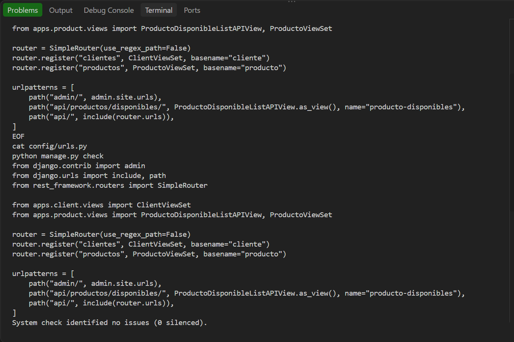

**Retroalimentación de la evidencia:** En la captura observé [`api/productos/disponibles/` antes de `include(router.urls)`, y `System check identified no issues (0 silenced).`].

**Conclusión y aprendizaje:** Aprendí que el orden de `urlpatterns` decide qué vista atiende una URL, y que una ruta literal debe ir antes que una ruta con convertidor.

### Paso 3 - Pruebas de disponibles

Escribí tres pruebas en `apps/product/tests.py`. Crean la sucursal y el inventario en el ORM, y consultan la API en acceso abierto.

```bash
cat >> apps/product/tests.py <<'EOF'


class ProductoDisponibleTests(APITestCase):
    def setUp(self):
        from apps.branch.models import Sucursal
        from apps.inventory.models import Inventario

        self.sucursal = Sucursal.objects.create(nombre="Norte")
        self.producto = Product.objects.create(sku="PAN-1", nombre="Pan", precio=Decimal("800.00"))
        self.inventario = Inventario.objects.create(
            sucursal=self.sucursal, producto=self.producto, cantidad=4
        )

    def test_lists_products_with_stock_in_branch(self):
        response = self.client.get(f"/api/productos/disponibles/?sucursal={self.sucursal.pk}")
        self.assertEqual(response.status_code, status.HTTP_200_OK)
        self.assertEqual(len(response.data), 1)

    def test_empty_when_stock_is_zero(self):
        self.inventario.cantidad = 0
        self.inventario.save(update_fields=["cantidad", "updated_at"])
        response = self.client.get(f"/api/productos/disponibles/?sucursal={self.sucursal.pk}")
        self.assertEqual(response.data, [])

    def test_sucursal_is_required(self):
        response = self.client.get("/api/productos/disponibles/")
        self.assertEqual(response.status_code, status.HTTP_400_BAD_REQUEST)
EOF
python manage.py test apps.product -v 2
```

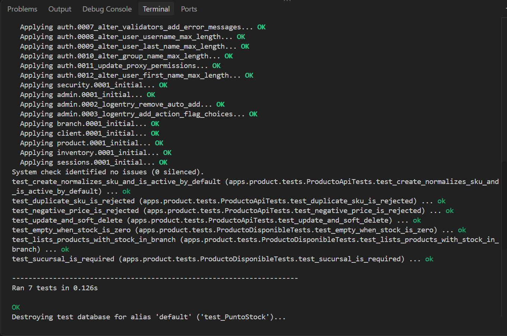

**Retroalimentación de la evidencia:** En la captura observé [`Ran 7 tests` y `OK`, con las tres pruebas de `ProductoDisponibleTests` listadas como `ok`].

**Conclusión y aprendizaje:** Aprendí que la disponibilidad depende de la sucursal: la misma consulta devuelve resultados distintos según el parámetro.

### Criterios de aceptación y GATE

| AC | Criterio | Verificación | Evidencia | Resultado |
|:---|:---|:---|:---|:---|
| AC-10-01 | Un producto activo con stock en la sucursal aparece | Test `test_lists_products_with_stock_in_branch` | EVI-10-03 | [PASS] |
| AC-10-02 | Con cantidad cero la lista queda vacía sin borrar el producto | Test `test_empty_when_stock_is_zero` | EVI-10-03 | [PASS] |
| AC-10-03 | Sin `sucursal` la API responde 400 | Test `test_sucursal_is_required` | EVI-10-03 | [PASS] |
| AC-10-04 | La ruta de disponibles no es capturada por el router | Paso 2 | EVI-10-02 | [PASS] |

El GATE del ISS-10 queda cumplido cuando AC-10-01 a AC-10-04 están en PASS.

## ISS-11 - Registro de venta con APIView

En este ISS publiqué `POST /api/ventas/` para registrar una venta completa en una sola transacción: cliente, sucursal, líneas con el precio vigente del producto, totales y descuento del inventario de la sucursal. Si cualquier paso falla, no queda ni la venta ni sus líneas, y el inventario no cambia. Uso `APIView` porque la operación toca varias tablas y tiene reglas de negocio que no encajan en un CRUD genérico.

### Paso 1 - Operación de registro en el manager

Reescribí `apps/sale/managers.py`. `VentaQuerySet.register` valida cliente, sucursal, productos y existencias, bloquea las filas de inventario en orden de producto, crea la venta y sus líneas, calcula totales y descuenta el inventario. Todo ocurre dentro de `transaction.atomic()`.

```bash
cat > apps/sale/managers.py <<'EOF'
from decimal import Decimal

from django.core.exceptions import ValidationError
from django.db import models, transaction

from apps.inventory.models import Inventario
from apps.product.models import Product


class VentaQuerySet(models.QuerySet):
    def register(self, *, cliente, sucursal, fecha, items, impuestos=Decimal("0.00")):
        if not items:
            raise ValidationError({"items": ["La venta requiere al menos un producto."]})
        impuestos = Decimal(impuestos).quantize(Decimal("0.01"))
        if impuestos < 0:
            raise ValidationError({"impuestos": ["Los impuestos no pueden ser negativos."]})

        cantidades = {}
        for item in items:
            cantidad = int(item["cantidad"])
            if cantidad < 1:
                raise ValidationError({"items": ["La cantidad debe ser al menos 1."]})
            cantidades[item["producto_id"]] = cantidades.get(item["producto_id"], 0) + cantidad

        with transaction.atomic():
            if not cliente.is_active:
                raise ValidationError({"clienteId": ["El cliente no está activo."]})
            if not sucursal.is_active:
                raise ValidationError({"sucursalId": ["La sucursal no está activa."]})

            productos = Product.objects.in_bulk(list(cantidades))
            inventarios = {
                inv.producto_id: inv
                for inv in Inventario.objects.select_for_update()
                .filter(sucursal=sucursal, producto_id__in=cantidades)
                .order_by("producto_id")
            }

            for producto_id, cantidad in cantidades.items():
                producto = productos.get(producto_id)
                if producto is None:
                    raise ValidationError({"items": ["Hay productos que no existen."]})
                if not producto.is_active:
                    raise ValidationError({"items": [f"El producto {producto.nombre} no está activo."]})
                inventario = inventarios.get(producto_id)
                if inventario is None or inventario.cantidad < cantidad:
                    raise ValidationError({"items": [f"Stock insuficiente para {producto.nombre}."]})

            venta = self.model(
                cliente=cliente,
                sucursal=sucursal,
                fecha=fecha,
                impuestos=impuestos,
                estado=self.model.Estado.ACTIVA,
            )
            venta.save()

            for item in items:
                producto = productos[item["producto_id"]]
                venta.detalles.create(
                    producto=producto,
                    cantidad=int(item["cantidad"]),
                    valor_unitario=producto.precio,
                    observaciones=item.get("observaciones", ""),
                )

            subtotal = sum((detalle.total for detalle in venta.detalles.all()), Decimal("0.00"))
            venta.subtotal = subtotal.quantize(Decimal("0.01"))
            venta.total = (venta.subtotal + impuestos).quantize(Decimal("0.01"))
            venta.save(update_fields=["subtotal", "total", "updated_at"])

            for producto_id, cantidad in cantidades.items():
                inventario = inventarios[producto_id]
                inventario.cantidad -= cantidad
                inventario.save(update_fields=["cantidad", "updated_at"])

            return venta


class VentaManager(models.Manager.from_queryset(VentaQuerySet)):
    pass
EOF
```

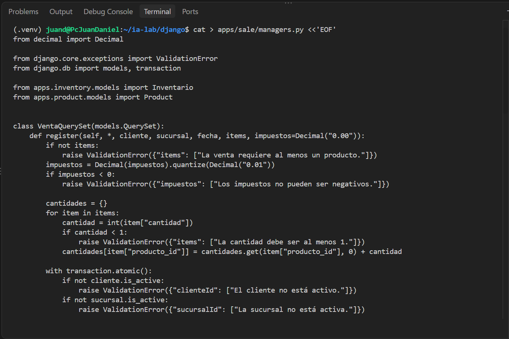

**Retroalimentación de la evidencia:** En la captura observé [`register` con `transaction.atomic()`, `select_for_update()` sobre `Inventario` ordenado por producto, la creación de líneas con `valor_unitario=producto.precio` y el descuento de inventario].

**Conclusión y aprendizaje:** Aprendí que la invariante vive en el manager: cualquier vista o comando que llame `Venta.objects.register` obtiene las mismas reglas. Si una validación o un `save` falla, la excepción revierte todo el bloque.

### Paso 2 - Serializers de entrada y salida

Reescribí `apps/sale/serializers.py`. Mantengo los serializers de lectura del ISS-07 y agrego el de registro. `impuestos` es opcional y nunca negativo; `valor_unitario` y `total` siguen siendo de solo lectura.

```bash
cat > apps/sale/serializers.py <<'EOF'
from decimal import Decimal

from django.core.exceptions import ValidationError as DjangoValidationError
from rest_framework import serializers

from apps.branch.models import Sucursal
from apps.client.models import Client
from apps.product.models import Product
from apps.sale.models import Venta, VentaDetalle


class VentaDetalleSerializer(serializers.ModelSerializer):
    class Meta:
        model = VentaDetalle
        fields = ["id", "producto", "cantidad", "valor_unitario", "total", "observaciones", "created_at", "updated_at"]
        read_only_fields = ["id", "valor_unitario", "total", "created_at", "updated_at"]


class VentaSerializer(serializers.ModelSerializer):
    detalles = VentaDetalleSerializer(many=True, read_only=True)

    class Meta:
        model = Venta
        fields = [
            "id",
            "cliente",
            "sucursal",
            "fecha",
            "subtotal",
            "impuestos",
            "total",
            "estado",
            "detalles",
            "created_at",
            "updated_at",
        ]
        read_only_fields = ["id", "subtotal", "impuestos", "total", "estado", "created_at", "updated_at"]


class VentaItemSerializer(serializers.Serializer):
    producto_id = serializers.PrimaryKeyRelatedField(queryset=Product.objects.all(), source="producto")
    cantidad = serializers.IntegerField(min_value=1)
    observaciones = serializers.CharField(max_length=255, required=False, allow_blank=True, default="")


class VentaRegistroSerializer(serializers.Serializer):
    cliente_id = serializers.PrimaryKeyRelatedField(queryset=Client.objects.all(), source="cliente")
    sucursal_id = serializers.PrimaryKeyRelatedField(queryset=Sucursal.objects.all(), source="sucursal")
    fecha = serializers.DateTimeField()
    impuestos = serializers.DecimalField(
        max_digits=12,
        decimal_places=2,
        min_value=Decimal("0.00"),
        required=False,
        default=Decimal("0.00"),
    )
    items = VentaItemSerializer(many=True, allow_empty=False)

    def create(self, validated_data):
        items = [
            {
                "producto_id": item["producto"].id,
                "cantidad": item["cantidad"],
                "observaciones": item["observaciones"],
            }
            for item in validated_data["items"]
        ]
        try:
            return Venta.objects.register(
                cliente=validated_data["cliente"],
                sucursal=validated_data["sucursal"],
                fecha=validated_data["fecha"],
                impuestos=validated_data["impuestos"],
                items=items,
            )
        except DjangoValidationError as exc:
            raise serializers.ValidationError(
                exc.message_dict if hasattr(exc, "error_dict") else exc.messages
            ) from exc
EOF
python manage.py check
```

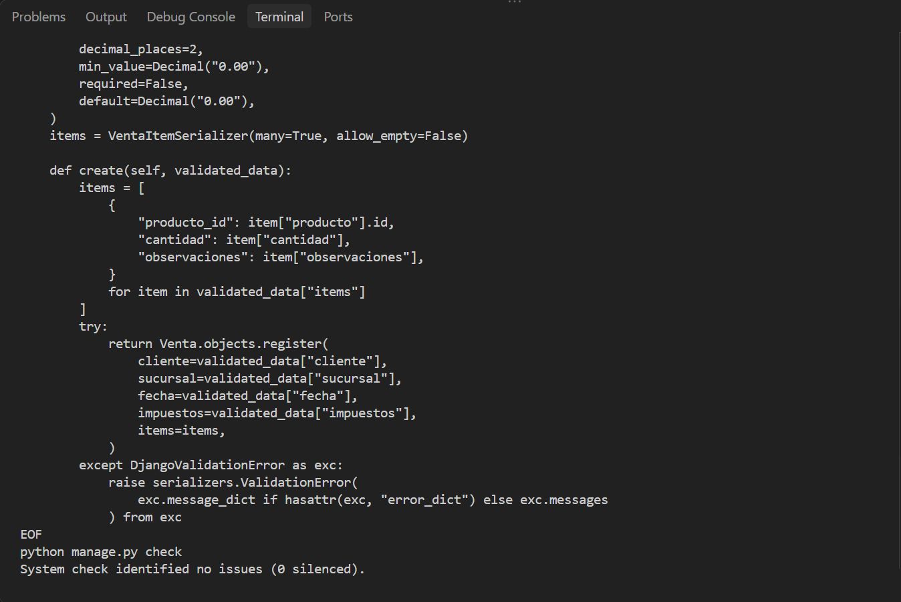

**Retroalimentación de la evidencia:** En la captura observé [`VentaRegistroSerializer` con `items` no vacío, `impuestos` no negativo, y la conversión de `ValidationError` del manager a respuesta 400; y `System check identified no issues (0 silenced).`].

**Conclusión y aprendizaje:** Aprendí que el serializer valida la forma de la petición y el manager valida la regla de negocio. Así la misma validación protege también a otros llamadores.

### Paso 3 - Vista y ruta del registro

Creé `apps/sale/views.py` con `VentaRegistroAPIView`. Solo define `post`: es el único verbo de esta ruta. Registré la ruta literal `api/ventas/` en `config/urls.py`, antes del router.

```bash
cat > apps/sale/views.py <<'EOF'
from rest_framework import status
from rest_framework.permissions import AllowAny
from rest_framework.response import Response
from rest_framework.views import APIView

from apps.sale.serializers import VentaRegistroSerializer, VentaSerializer


class VentaRegistroAPIView(APIView):
    permission_classes = [AllowAny]

    def post(self, request):
        serializer = VentaRegistroSerializer(data=request.data)
        serializer.is_valid(raise_exception=True)
        venta = serializer.save()
        return Response(VentaSerializer(venta).data, status=status.HTTP_201_CREATED)
EOF
cat > config/urls.py <<'EOF'
from django.contrib import admin
from django.urls import include, path
from rest_framework.routers import SimpleRouter

from apps.client.views import ClientViewSet
from apps.product.views import ProductoDisponibleListAPIView, ProductoViewSet
from apps.sale.views import VentaRegistroAPIView

router = SimpleRouter(use_regex_path=False)
router.register("clientes", ClientViewSet, basename="cliente")
router.register("productos", ProductoViewSet, basename="producto")

urlpatterns = [
    path("admin/", admin.site.urls),
    path("api/productos/disponibles/", ProductoDisponibleListAPIView.as_view(), name="producto-disponibles"),
    path("api/ventas/", VentaRegistroAPIView.as_view(), name="venta-registro"),
    path("api/", include(router.urls)),
]
EOF
python manage.py check
```

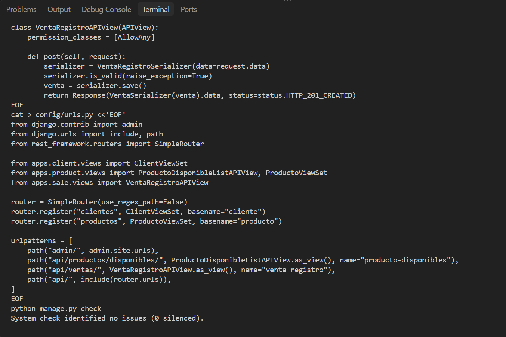

**Retroalimentación de la evidencia:** En la captura observé [`VentaRegistroAPIView` con solo `post`, y `api/ventas/` registrada antes de `include(router.urls)`; y `System check identified no issues (0 silenced).`].

**Conclusión y aprendizaje:** Aprendí que una `APIView` que solo define `post` responde 405 a cualquier otro verbo. La ruta literal no entra en conflicto con el router porque `ventas` no está registrado en él.

### Paso 4 - Pruebas de la transacción

Escribí cinco pruebas en `apps/sale/tests.py`. Usan JSON en camelCase, como las de los ISS anteriores.

```bash
cat > apps/sale/tests.py <<'EOF'
from decimal import Decimal
from unittest.mock import patch

from django.utils import timezone
from rest_framework import status
from rest_framework.test import APITestCase

from apps.branch.models import Sucursal
from apps.client.models import Client
from apps.inventory.models import Inventario
from apps.product.models import Product
from apps.sale.models import Venta, VentaDetalle


class VentaRegistroTests(APITestCase):
    def setUp(self):
        self.sucursal = Sucursal.objects.create(nombre="Centro")
        self.cliente = Client.objects.create(tipo_documento="CC", numero_documento="8001", nombre="Ana")
        self.agua = Product.objects.create(sku="AGUA-11", nombre="Agua", precio=Decimal("10.00"))
        self.pan = Product.objects.create(sku="PAN-11", nombre="Pan", precio=Decimal("4.50"))
        self.inv_agua = Inventario.objects.create(sucursal=self.sucursal, producto=self.agua, cantidad=5)
        self.inv_pan = Inventario.objects.create(sucursal=self.sucursal, producto=self.pan, cantidad=2)

    def _payload(self, items, impuestos="0.00"):
        return {
            "clienteId": self.cliente.id,
            "sucursalId": self.sucursal.id,
            "fecha": timezone.now().isoformat(),
            "impuestos": impuestos,
            "items": items,
        }

    def test_register_computes_totals_and_discounts_stock(self):
        response = self.client.post(
            "/api/ventas/",
            self._payload(
                [
                    {"productoId": self.agua.id, "cantidad": 2},
                    {"productoId": self.pan.id, "cantidad": 1},
                ],
                impuestos="1.00",
            ),
            format="json",
        )
        self.assertEqual(response.status_code, status.HTTP_201_CREATED, response.data)
        self.assertEqual(response.data["subtotal"], "24.50")
        self.assertEqual(response.data["total"], "25.50")
        self.assertEqual(response.data["estado"], "ACTIVA")
        self.inv_agua.refresh_from_db()
        self.inv_pan.refresh_from_db()
        self.assertEqual(self.inv_agua.cantidad, 3)
        self.assertEqual(self.inv_pan.cantidad, 1)

    def test_detail_keeps_price_when_catalog_changes(self):
        response = self.client.post(
            "/api/ventas/",
            self._payload([{"productoId": self.agua.id, "cantidad": 1}]),
            format="json",
        )
        Product.objects.filter(pk=self.agua.pk).update(precio=Decimal("99.00"))
        detalle = VentaDetalle.objects.get(venta_id=response.data["id"])
        self.assertEqual(detalle.valor_unitario, Decimal("10.00"))

    def test_insufficient_stock_is_rejected_without_rows(self):
        response = self.client.post(
            "/api/ventas/",
            self._payload([{"productoId": self.pan.id, "cantidad": 3}]),
            format="json",
        )
        self.assertEqual(response.status_code, status.HTTP_400_BAD_REQUEST)
        self.assertEqual(Venta.objects.count(), 0)
        self.inv_pan.refresh_from_db()
        self.assertEqual(self.inv_pan.cantidad, 2)

    def test_failure_during_stock_update_rolls_back_everything(self):
        original = Inventario.save

        def fail_on_stock(inventario, *args, **kwargs):
            if "cantidad" in (kwargs.get("update_fields") or []):
                raise RuntimeError("fallo al descontar inventario")
            return original(inventario, *args, **kwargs)

        with patch.object(Inventario, "save", fail_on_stock):
            with self.assertRaises(RuntimeError):
                self.client.post(
                    "/api/ventas/",
                    self._payload([{"productoId": self.agua.id, "cantidad": 1}]),
                    format="json",
                )
        self.assertEqual(Venta.objects.count(), 0)
        self.assertEqual(VentaDetalle.objects.count(), 0)
        self.inv_agua.refresh_from_db()
        self.assertEqual(self.inv_agua.cantidad, 5)

    def test_inactive_product_is_rejected(self):
        self.pan.is_active = False
        self.pan.save(update_fields=["is_active", "updated_at"])
        response = self.client.post(
            "/api/ventas/",
            self._payload([{"productoId": self.pan.id, "cantidad": 1}]),
            format="json",
        )
        self.assertEqual(response.status_code, status.HTTP_400_BAD_REQUEST)
        self.assertEqual(Venta.objects.count(), 0)
EOF
python manage.py test apps.sale -v 2
```

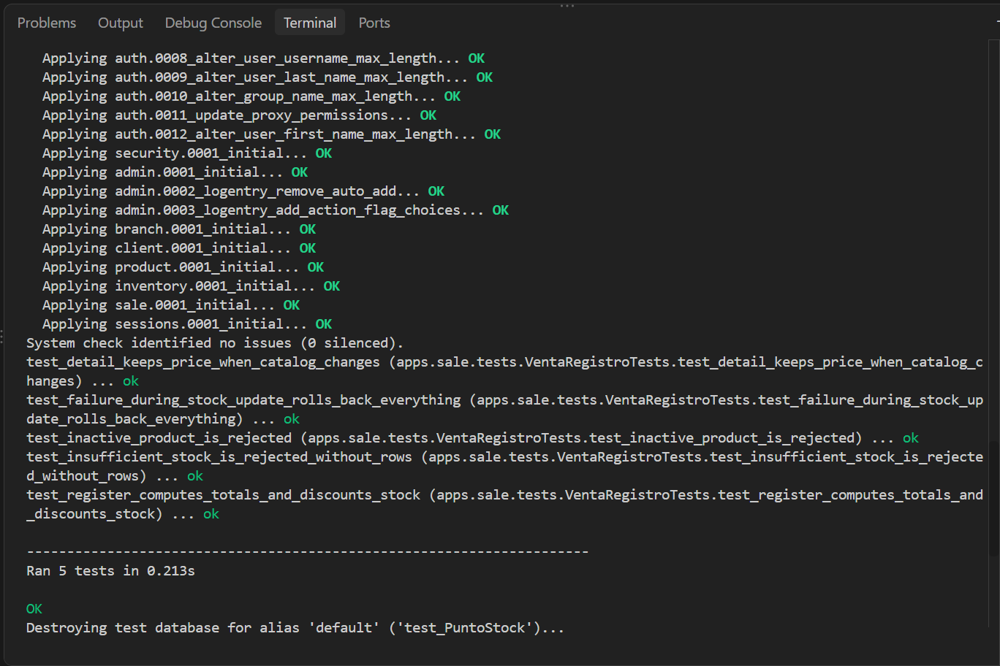

**Retroalimentación de la evidencia:** En la captura observé [`Ran 5 tests` y `OK`, con las cinco pruebas de `VentaRegistroTests` listadas como `ok`].

**Conclusión y aprendizaje:** Aprendí que la prueba de rollback confirma la atomicidad real: el fallo ocurre después de crear la venta y de crear dos líneas, y la base queda sin nada.

### Criterios de aceptación y GATE

| AC | Criterio | Verificación | Evidencia | Resultado |
|:---|:---|:---|:---|:---|
| AC-11-01 | El subtotal es la suma de las líneas y el total suma los impuestos | Test `test_register_computes_totals_and_discounts_stock` | EVI-11-04 | [PASS] |
| AC-11-02 | El precio de la línea no cambia al modificar el catálogo | Test `test_detail_keeps_price_when_catalog_changes` | EVI-11-04 | [PASS] |
| AC-11-03 | Stock insuficiente responde 400 y no crea venta ni líneas | Test `test_insufficient_stock_is_rejected_without_rows` | EVI-11-04 | [PASS] |
| AC-11-04 | Un fallo al descontar inventario revierte venta, líneas e inventario | Test `test_failure_during_stock_update_rolls_back_everything` | EVI-11-04 | [PASS] |
| AC-11-05 | Un producto inactivo es rechazado | Test `test_inactive_product_is_rejected` | EVI-11-04 | [PASS] |

El GATE del ISS-11 queda cumplido cuando AC-11-01 a AC-11-05 están en PASS.

## ISS-12 - Consulta y anulación de ventas

En este ISS agregué la lectura de ventas y su anulación. `GET /api/ventas/` lista las ventas con sus líneas, `GET /api/ventas/<id>/` muestra una venta, y `DELETE /api/ventas/<id>/` la anula. La anulación no borra nada: llama a `Venta.void()`, que devuelve al inventario de la sucursal la cantidad de cada línea y marca la venta como `ANULADA`. Una segunda anulación no vuelve a sumar stock.

### Paso 1 - Vistas de lectura y anulación

Reescribí `apps/sale/views.py`. `VentaRegistroAPIView` conserva el `POST` del ISS-11 y agrega el `GET` de la lista. `VentaReadViewSet` atiende el detalle y el DELETE, y su `perform_destroy` llama a `void()`.

```bash
cat > apps/sale/views.py <<'EOF'
from rest_framework import mixins, status, viewsets
from rest_framework.permissions import AllowAny
from rest_framework.response import Response
from rest_framework.views import APIView

from apps.sale.models import Venta
from apps.sale.serializers import VentaRegistroSerializer, VentaSerializer


def _ventas_con_lineas():
    return Venta.objects.select_related("cliente", "sucursal").prefetch_related("detalles__producto")


class VentaRegistroAPIView(APIView):
    permission_classes = [AllowAny]

    def get(self, request):
        return Response(VentaSerializer(_ventas_con_lineas(), many=True).data)

    def post(self, request):
        serializer = VentaRegistroSerializer(data=request.data)
        serializer.is_valid(raise_exception=True)
        venta = serializer.save()
        return Response(VentaSerializer(venta).data, status=status.HTTP_201_CREATED)


class VentaReadViewSet(mixins.RetrieveModelMixin, mixins.DestroyModelMixin, viewsets.GenericViewSet):
    queryset = _ventas_con_lineas()
    serializer_class = VentaSerializer
    permission_classes = [AllowAny]

    def perform_destroy(self, instance):
        instance.void()
EOF
cat apps/sale/views.py
```

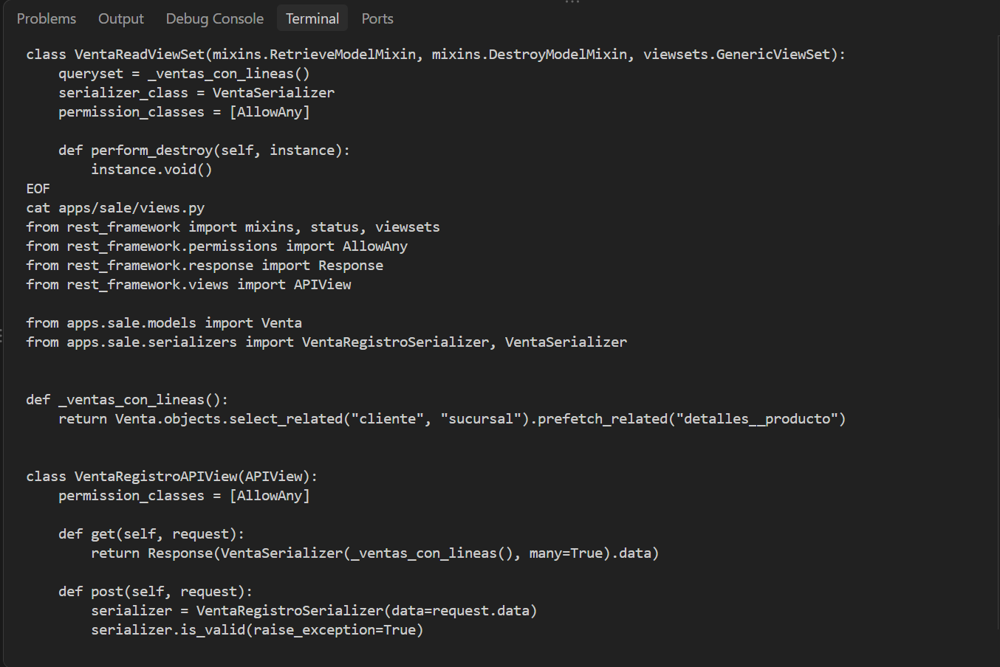

**Retroalimentación de la evidencia:** En la captura observé [`VentaRegistroAPIView` con `get` y `post`, `VentaReadViewSet` sin create ni update, y `perform_destroy` que llama a `instance.void()`].

**Conclusión y aprendizaje:** Aprendí que `DELETE` no ejecuta `QuerySet.delete()`. La venta es evidencia contable, así que la anulación es un cambio de estado con reposición de inventario, no un borrado.

### Paso 2 - Ruta del detalle

Agregué `api/ventas/<int:pk>/` en `config/urls.py`. Solo se enlazan `get` y `delete`: el detalle no se edita, porque los totales se fijan al registrar.

```bash
cat > config/urls.py <<'EOF'
from django.contrib import admin
from django.urls import include, path
from rest_framework.routers import SimpleRouter

from apps.client.views import ClientViewSet
from apps.product.views import ProductoDisponibleListAPIView, ProductoViewSet
from apps.sale.views import VentaReadViewSet, VentaRegistroAPIView

router = SimpleRouter(use_regex_path=False)
router.register("clientes", ClientViewSet, basename="cliente")
router.register("productos", ProductoViewSet, basename="producto")

urlpatterns = [
    path("admin/", admin.site.urls),
    path("api/productos/disponibles/", ProductoDisponibleListAPIView.as_view(), name="producto-disponibles"),
    path("api/ventas/", VentaRegistroAPIView.as_view(), name="venta-registro"),
    path(
        "api/ventas/<int:pk>/",
        VentaReadViewSet.as_view({"get": "retrieve", "delete": "destroy"}),
        name="venta-detalle",
    ),
    path("api/", include(router.urls)),
]
EOF
cat config/urls.py
python manage.py check
```

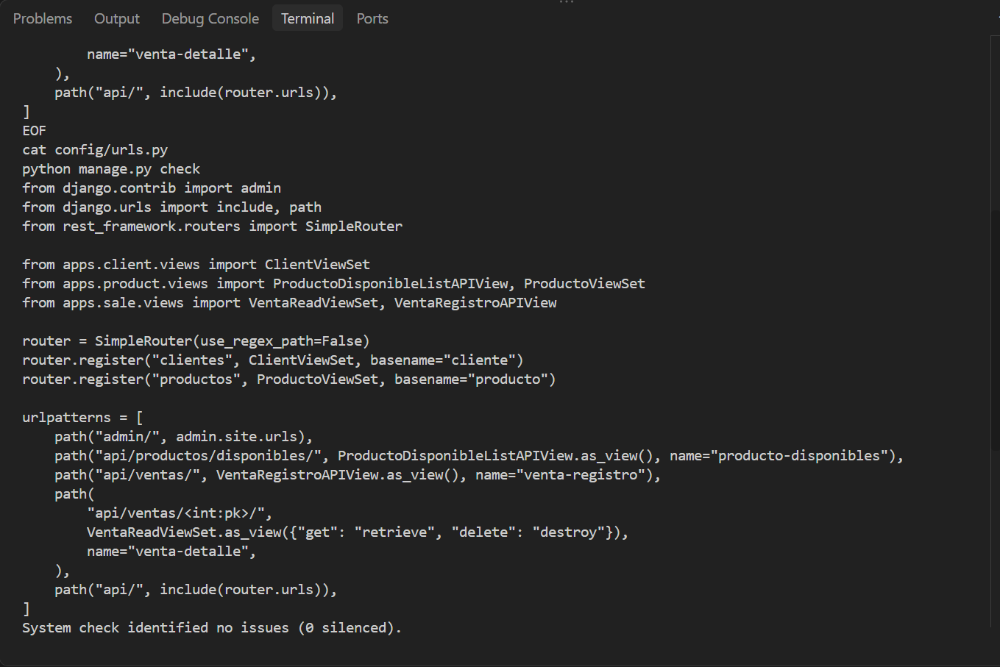

**Retroalimentación de la evidencia:** En la captura observé [`api/ventas/<int:pk>/` con `get` y `delete`, y `System check identified no issues (0 silenced).`].

**Conclusión y aprendizaje:** Aprendí que `as_view` con un diccionario fija qué método HTTP llama a qué acción. Sin ese diccionario, el viewset no sabría qué responder a cada verbo.

### Paso 3 - Pruebas de consulta y anulación

Agregué tres pruebas en `apps/sale/tests.py`. Crean la venta por la API, para que la lectura y la anulación usen el mismo camino que un cliente real.

```bash
cat >> apps/sale/tests.py <<'EOF'


class VentaLecturaTests(APITestCase):
    def setUp(self):
        self.sucursal = Sucursal.objects.create(nombre="Sur")
        self.cliente = Client.objects.create(tipo_documento="CC", numero_documento="8101", nombre="Luis")
        self.agua = Product.objects.create(sku="AGUA-12", nombre="Agua", precio=Decimal("10.00"))
        self.inventario = Inventario.objects.create(sucursal=self.sucursal, producto=self.agua, cantidad=5)

    def _crear_venta(self, cantidad):
        response = self.client.post(
            "/api/ventas/",
            {
                "clienteId": self.cliente.id,
                "sucursalId": self.sucursal.id,
                "fecha": timezone.now().isoformat(),
                "impuestos": "0.00",
                "items": [{"productoId": self.agua.id, "cantidad": cantidad}],
            },
            format="json",
        )
        self.assertEqual(response.status_code, status.HTTP_201_CREATED, response.data)
        return response.data["id"]

    def test_list_returns_the_registered_sale(self):
        venta_id = self._crear_venta(1)
        listed = self.client.get("/api/ventas/")
        self.assertEqual(listed.status_code, status.HTTP_200_OK)
        self.assertTrue(any(row["id"] == venta_id for row in listed.data))

    def test_detail_keeps_historical_price(self):
        venta_id = self._crear_venta(1)
        Product.objects.filter(pk=self.agua.pk).update(precio=Decimal("99.00"))
        detail = self.client.get(f"/api/ventas/{venta_id}/")
        self.assertEqual(detail.status_code, status.HTTP_200_OK)
        self.assertEqual(detail.data["detalles"][0]["valor_unitario"], "10.00")

    def test_void_restores_inventory_once(self):
        venta_id = self._crear_venta(2)
        self.inventario.refresh_from_db()
        self.assertEqual(self.inventario.cantidad, 3)
        first = self.client.delete(f"/api/ventas/{venta_id}/")
        second = self.client.delete(f"/api/ventas/{venta_id}/")
        self.assertEqual(first.status_code, status.HTTP_204_NO_CONTENT)
        self.assertEqual(second.status_code, status.HTTP_204_NO_CONTENT)
        self.inventario.refresh_from_db()
        self.assertEqual(self.inventario.cantidad, 5)
        self.assertEqual(Venta.objects.get(pk=venta_id).estado, Venta.Estado.ANULADA)
EOF
python manage.py test apps.sale -v 2
```

Antes de ejecutar, agrega los imports que usan estas pruebas en la cabecera de `apps/sale/tests.py` si no están: `from rest_framework import status`, `from apps.inventory.models import Inventario` y `from apps.sale.models import Venta`. Las otras clases de ese archivo ya los usan.

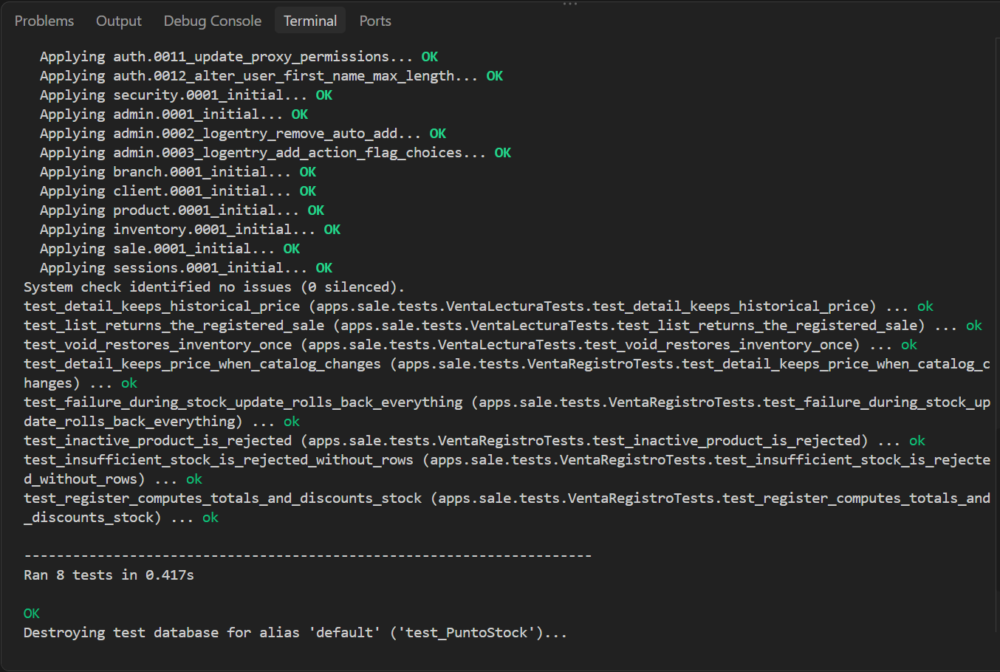

**Retroalimentación de la evidencia:** En la captura observé [`Ran 8 tests` y `OK`, con las tres pruebas de `VentaLecturaTests` listadas como `ok`].

**Conclusión y aprendizaje:** Aprendí que anular dos veces produce el mismo estado: la segunda llamada encuentra la venta `ANULADA` y `void()` regresa sin tocar el inventario.

### Criterios de aceptación y GATE

| AC | Criterio | Verificación | Evidencia | Resultado |
|:---|:---|:---|:---|:---|
| AC-12-01 | `GET /api/ventas/` lista la venta registrada | Test `test_list_returns_the_registered_sale` | EVI-12-03 | [PASS] |
| AC-12-02 | El detalle conserva `valor_unitario` aunque el precio del producto cambie | Test `test_detail_keeps_historical_price` | EVI-12-03 | [PASS] |
| AC-12-03 | `DELETE` responde 204 y deja la venta en `ANULADA` | Test `test_void_restores_inventory_once` | EVI-12-03 | [PASS] |
| AC-12-04 | Anular dos veces no suma inventario de más | Test `test_void_restores_inventory_once` | EVI-12-03 | [PASS] |

El GATE del ISS-12 queda cumplido cuando AC-12-01 a AC-12-04 están en PASS.

## ISS-13 - Django Admin

En este ISS registré en el admin de Django los modelos de PuntoStock: Cliente, Sucursal, Producto, Inventario y Venta. Cada lista tiene filtros, búsqueda y orden. El admin sirve para consultar y corregir datos de catálogo y clientes; no reemplaza la API. Las ventas no se modifican desde el admin: su única vía de cambio es `POST` para registrar y `DELETE` para anular, porque así se mantienen el precio histórico y el inventario.

### Paso 1 - Superusuario

Creé el superusuario con el modelo de usuario de ISS-03. `create_superuser` deja el estado en `active`, así que `is_active` queda en `True` y el admin permite el acceso.

```bash
source .venv/bin/activate
python manage.py createsuperuser
```

Django pide usuario, correo y contraseña dos veces. Los validadores rechazan una contraseña común o solo numérica.

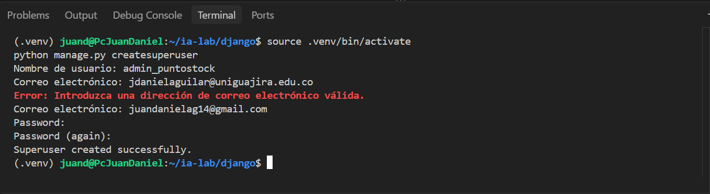

**Retroalimentación de la evidencia:** En la captura observé [`Superuser created successfully.` y el usuario que escribí, sin mostrar la contraseña].

**Conclusión y aprendizaje:** Aprendí que el admin usa sesión y CSRF, no JWT. Por eso el superusuario no pasa por la autenticación de la API.

### Paso 2 - Registro de los modelos

Reescribí los `admin.py` de cada aplicación. `startapp` los creó vacíos o con un comentario inicial, y `cat >` reemplaza ese contenido.

```bash
cat > apps/client/admin.py <<'EOF'
from django.contrib import admin

from apps.client.models import Client


@admin.register(Client)
class ClientAdmin(admin.ModelAdmin):
    list_display = ("nombre", "numero_documento", "tipo_documento", "email", "telefono", "is_active", "created_at")
    list_filter = ("is_active", "tipo_documento")
    search_fields = ("nombre", "numero_documento", "email", "telefono")
    list_editable = ("is_active",)
    ordering = ("nombre", "id")
    readonly_fields = ("created_at", "updated_at")
    fieldsets = (
        ("Documento", {"fields": ("tipo_documento", "numero_documento")}),
        ("Contacto", {"fields": ("nombre", "telefono", "email")}),
        ("Estado", {"fields": ("is_active",)}),
        ("Auditoría", {"fields": ("created_at", "updated_at"), "classes": ("collapse",)}),
    )
EOF

cat > apps/branch/admin.py <<'EOF'
from django.contrib import admin

from apps.branch.models import Sucursal


@admin.register(Sucursal)
class SucursalAdmin(admin.ModelAdmin):
    list_display = ("nombre", "descripcion", "is_active", "created_at")
    list_filter = ("is_active",)
    search_fields = ("nombre", "descripcion")
    list_editable = ("is_active",)
    ordering = ("nombre", "id")
    readonly_fields = ("created_at", "updated_at")
    fieldsets = (
        ("Información", {"fields": ("nombre", "descripcion")}),
        ("Estado", {"fields": ("is_active",)}),
        ("Auditoría", {"fields": ("created_at", "updated_at"), "classes": ("collapse",)}),
    )
EOF

cat > apps/product/admin.py <<'EOF'
from django.contrib import admin

from apps.product.models import Product


@admin.register(Product)
class ProductAdmin(admin.ModelAdmin):
    list_display = ("sku", "nombre", "precio", "is_active", "created_at")
    list_filter = ("is_active",)
    search_fields = ("sku", "nombre", "descripcion")
    list_editable = ("precio", "is_active")
    ordering = ("nombre", "id")
    readonly_fields = ("created_at", "updated_at")
    fieldsets = (
        ("Información", {"fields": ("sku", "nombre", "descripcion")}),
        ("Precio y estado", {"fields": ("precio", "is_active")}),
        ("Auditoría", {"fields": ("created_at", "updated_at"), "classes": ("collapse",)}),
    )
EOF

cat > apps/inventory/admin.py <<'EOF'
from django.contrib import admin

from apps.inventory.models import Inventario


@admin.register(Inventario)
class InventarioAdmin(admin.ModelAdmin):
    list_display = ("sucursal", "producto", "cantidad", "stock_minimo", "updated_at")
    list_filter = ("sucursal",)
    search_fields = ("producto__sku", "producto__nombre", "sucursal__nombre")
    list_editable = ("stock_minimo",)
    ordering = ("sucursal", "producto")
    readonly_fields = ("cantidad", "updated_at")
    fieldsets = (
        ("Ubicación", {"fields": ("sucursal", "producto")}),
        ("Existencias", {"fields": ("cantidad", "stock_minimo")}),
        ("Auditoría", {"fields": ("updated_at",), "classes": ("collapse",)}),
    )
EOF

cat > apps/sale/admin.py <<'EOF'
from django.contrib import admin

from apps.sale.models import Venta, VentaDetalle


class VentaDetalleInline(admin.TabularInline):
    model = VentaDetalle
    extra = 0
    can_delete = False
    fields = ("producto", "cantidad", "valor_unitario", "total", "observaciones")
    readonly_fields = ("producto", "cantidad", "valor_unitario", "total", "observaciones")

    def has_add_permission(self, request, obj=None):
        return False


@admin.register(Venta)
class VentaAdmin(admin.ModelAdmin):
    list_display = ("id", "cliente", "sucursal", "fecha", "subtotal", "impuestos", "total", "estado")
    list_filter = ("estado", "sucursal")
    search_fields = ("cliente__nombre", "cliente__numero_documento")
    ordering = ("-fecha", "-id")
    date_hierarchy = "fecha"
    readonly_fields = ("cliente", "sucursal", "fecha", "subtotal", "impuestos", "total", "estado", "created_at", "updated_at")
    fieldsets = (
        ("Venta", {"fields": ("cliente", "sucursal", "fecha", "estado")}),
        ("Totales", {"fields": ("subtotal", "impuestos", "total")}),
        ("Auditoría", {"fields": ("created_at", "updated_at"), "classes": ("collapse",)}),
    )
    inlines = (VentaDetalleInline,)

    def has_add_permission(self, request):
        return False

    def has_delete_permission(self, request, obj=None):
        return False

    def get_queryset(self, request):
        return super().get_queryset(request).select_related("cliente", "sucursal")
EOF
python manage.py check
```

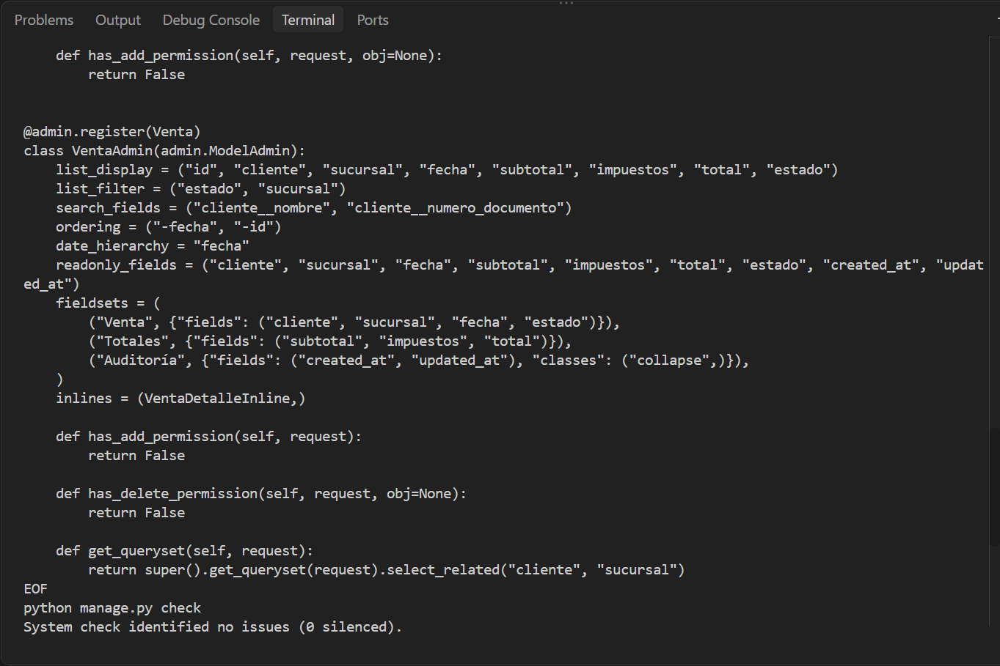

**Retroalimentación de la evidencia:** En la captura observé [los cinco `@admin.register` y `System check identified no issues (0 silenced).`].

**Conclusión y aprendizaje:** Aprendí que `@admin.register` deja el modelo en el registro del admin, y que `check` valida los campos listados antes de arrancar el servidor.

### Paso 3 - Reglas de integridad en el admin

- En **Inventario**, `cantidad` es de solo lectura: un ajuste manual no pasa por la transacción de ventas y podría descuadrar el stock. Si hace falta un ajuste, se registra como movimiento en un ISS posterior.
- En **Venta**, todos los campos son de solo lectura, no se puede agregar ni borrar, y las líneas aparecen como inline de solo lectura. El precio histórico y el descuento de inventario solo cambian por la API.
- En **Cliente**, **Sucursal** y **Producto**, las altas y ediciones sí se permiten, porque son datos maestros.

### Paso 4 - Verificación de registro y navegación

Verifiqué que los cinco modelos están en el registro del admin y abrí el admin en el navegador.

```bash
python manage.py shell -c "from django.contrib import admin; print(sorted(m._meta.label for m in admin.site._registry))"
python manage.py runserver
```

En el navegador, entra a `http://127.0.0.1:8000/admin/`, inicia sesión y abre Clientes, Sucursales, Productos, Inventarios y Ventas.

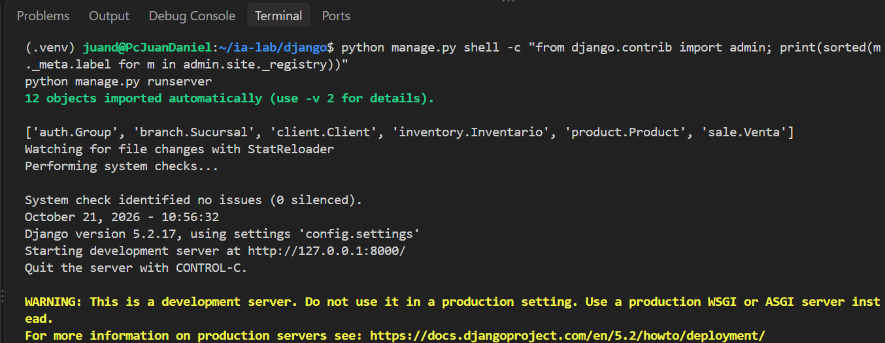

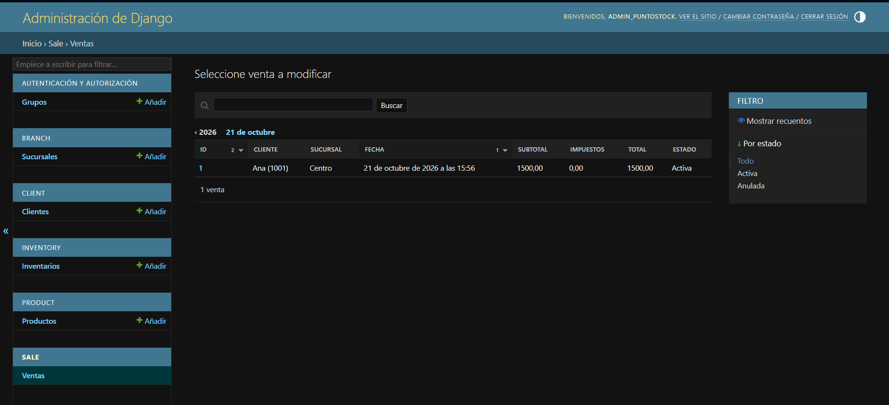

**Retroalimentación de las evidencias:** En la primera captura observé [`client.Client`, `branch.Sucursal`, `product.Product`, `inventory.Inventario` y `sale.Venta` en la lista]. En la segunda observé [la lista de ventas con el filtro por estado, y la ficha de una venta sin botones de guardar ni eliminar].

**Conclusión y aprendizaje:** Aprendí que el registro del admin confirma qué modelos están expuestos, y que la ficha de solo lectura confirma la regla de integridad en la interfaz.

### Criterios de aceptación y GATE

| AC | Criterio | Verificación | Evidencia | Resultado |
|:---|:---|:---|:---|:---|
| AC-13-01 | Los cinco modelos están registrados con lista, filtros y búsqueda | Paso 4 (registro) | EVI-13-02, EVI-13-03 | [PASS] |
| AC-13-02 | `cantidad` de Inventario es de solo lectura | Paso 2 y Paso 3 | EVI-13-02 | [PASS] |
| AC-13-03 | Una venta no se crea, no se edita y no se borra desde el admin | Ficha de solo lectura | EVI-13-04 | [PASS] |
| AC-13-04 | `check` pasa sin errores con los cinco `admin.py` | Paso 2 | EVI-13-02 | [PASS] |

El GATE del ISS-13 queda cumplido cuando AC-13-01 a AC-13-04 están en PASS.

## ISS-14 - OpenAPI

En este ISS publiqué el contrato de la API de PuntoStock como esquema OpenAPI generado desde las vistas, no escrito a mano. Usé `drf-spectacular` fijado en `0.30.0`, porque sin el pin `pip` puede instalar una versión que no cubre DRF 3.17. El esquema describe los campos en camelCase, igual que la respuesta real. La autenticación JWT no existe todavía en este proyecto: llega en la fase de seguridad, así que aquí la documentación queda abierta, como la API.

### Paso 1 - Instalación de `drf-spectacular`

```bash
source .venv/bin/activate
python -m pip install "drf-spectacular==0.30.0"
python -m pip freeze > requirements.txt
cat requirements.txt
```


**Retroalimentación de la evidencia:** En la captura observé [`drf-spectacular==0.30.0` en `requirements.txt`].

**Conclusión y aprendizaje:** Aprendí que el nombre en pip es `drf-spectacular` con guion, pero en Python se importa como `drf_spectacular` con guion bajo.

### Paso 2 - Registro en settings

Registré la aplicación, indiqué a DRF la clase de esquema y definí los metadatos del documento. El hook `camelize_serializer_fields` convierte los nombres del esquema a camelCase, igual que el JSON.

```bash
sed -i '/"corsheaders",/a\    "drf_spectacular",' config/settings/__init__.py
sed -i '/"DEFAULT_PAGINATION_CLASS": None,/i\    "DEFAULT_SCHEMA_CLASS": "drf_spectacular.openapi.AutoSchema",' config/settings/__init__.py
cat >> config/settings/__init__.py <<'EOF'

SPECTACULAR_SETTINGS = {
    "TITLE": "PuntoStock API",
    "DESCRIPTION": "API REST de PuntoStock: clientes, productos, inventario y ventas.",
    "VERSION": "1.0.0",
    "SERVE_INCLUDE_SCHEMA": False,
    "COMPONENT_SPLIT_REQUEST": True,
    "POSTPROCESSING_HOOKS": [
        "drf_spectacular.hooks.postprocess_schema_enums",
        "drf_spectacular.contrib.djangorestframework_camel_case.camelize_serializer_fields",
    ],
    "SERVE_PERMISSIONS": ["rest_framework.permissions.AllowAny"],
    "SWAGGER_UI_SETTINGS": {"persistAuthorization": True},
}
EOF
grep -n "drf_spectacular\|DEFAULT_SCHEMA_CLASS\|SPECTACULAR_SETTINGS" config/settings/__init__.py
python manage.py check
```


**Retroalimentación de la evidencia:** En la captura observé [`"drf_spectacular"` en `INSTALLED_APPS`, `DEFAULT_SCHEMA_CLASS` dentro de `REST_FRAMEWORK`, `SPECTACULAR_SETTINGS` al final y `System check identified no issues (0 silenced).`].

**Conclusión y aprendizaje:** Aprendí que `DEFAULT_SCHEMA_CLASS` le dice a DRF qué generador usar para cada vista, y que `SERVE_PERMISSIONS` controla quién puede abrir el esquema, no quién puede usar la API.

### Paso 3 - Rutas del esquema

Reescribí `config/urls.py` para agregar las rutas del esquema. Las pongo antes de las rutas de la API para que documenten el proyecto completo y no un recurso.

```bash
cat > config/urls.py <<'EOF'
from django.contrib import admin
from django.urls import include, path
from drf_spectacular.views import SpectacularAPIView, SpectacularRedocView, SpectacularSwaggerView
from rest_framework.routers import SimpleRouter

from apps.client.views import ClientViewSet
from apps.product.views import ProductoDisponibleListAPIView, ProductoViewSet
from apps.sale.views import VentaReadViewSet, VentaRegistroAPIView

router = SimpleRouter(use_regex_path=False)
router.register("clientes", ClientViewSet, basename="cliente")
router.register("productos", ProductoViewSet, basename="producto")

urlpatterns = [
    path("admin/", admin.site.urls),
    path("api/schema/", SpectacularAPIView.as_view(), name="schema"),
    path("api/schema/swagger-ui/", SpectacularSwaggerView.as_view(url_name="schema"), name="swagger-ui"),
    path("api/schema/redoc/", SpectacularRedocView.as_view(url_name="schema"), name="redoc"),
    path("api/productos/disponibles/", ProductoDisponibleListAPIView.as_view(), name="producto-disponibles"),
    path("api/ventas/", VentaRegistroAPIView.as_view(), name="venta-registro"),
    path(
        "api/ventas/<int:pk>/",
        VentaReadViewSet.as_view({"get": "retrieve", "delete": "destroy"}),
        name="venta-detalle",
    ),
    path("api/", include(router.urls)),
]
EOF
cat config/urls.py
python manage.py check
```


**Retroalimentación de la evidencia:** En la captura observé [`api/schema/`, `api/schema/swagger-ui/` y `api/schema/redoc/` antes de las rutas de negocio, y `System check identified no issues (0 silenced).`].

**Conclusión y aprendizaje:** Aprendí que las rutas del esquema pertenecen al proyecto, no a una aplicación, porque describen la API completa.

### Paso 4 - Anotaciones para el esquema

Las vistas que no son un `ModelViewSet` necesitan indicar su entrada y su salida, porque el generador no puede deducirlas. Anoté el registro de venta, el listado de ventas y el parámetro obligatorio de disponibles.

```bash
cat > apps/product/views.py <<'EOF'
from rest_framework import viewsets
from rest_framework.exceptions import ValidationError
from rest_framework.generics import ListAPIView
from rest_framework.permissions import AllowAny
from drf_spectacular.utils import OpenApiParameter, extend_schema

from apps.product.models import Product
from apps.product.serializers import ProductSerializer


class ProductoViewSet(viewsets.ModelViewSet):
    queryset = Product.objects.all()
    serializer_class = ProductSerializer
    permission_classes = [AllowAny]

    def get_queryset(self):
        queryset = super().get_queryset()
        activo = self.request.query_params.get("is_active")
        if activo is not None:
            queryset = queryset.filter(is_active=activo.strip().lower() in {"1", "true", "yes", "on"})
        return queryset

    def perform_destroy(self, instance):
        instance.is_active = False
        instance.save(update_fields=["is_active", "updated_at"])


class ProductoDisponibleListAPIView(ListAPIView):
    serializer_class = ProductSerializer
    permission_classes = [AllowAny]

    @extend_schema(
        parameters=[OpenApiParameter("sucursal", int, required=True, description="ID de la sucursal")],
        responses=ProductSerializer(many=True),
    )
    def get(self, request, *args, **kwargs):
        return super().get(request, *args, **kwargs)

    def get_queryset(self):
        sucursal_id = self.request.query_params.get("sucursal")
        if not sucursal_id:
            raise ValidationError({"sucursal": "Este parámetro es obligatorio."})
        return Product.objects.filter(
            is_active=True,
            inventario__sucursal_id=sucursal_id,
            inventario__cantidad__gt=0,
        ).distinct()
EOF

cat > apps/sale/views.py <<'EOF'
from rest_framework import mixins, status, viewsets
from rest_framework.permissions import AllowAny
from rest_framework.response import Response
from rest_framework.views import APIView
from drf_spectacular.utils import extend_schema

from apps.sale.models import Venta
from apps.sale.serializers import VentaRegistroSerializer, VentaSerializer


def _ventas_con_lineas():
    return Venta.objects.select_related("cliente", "sucursal").prefetch_related("detalles__producto")


class VentaRegistroAPIView(APIView):
    permission_classes = [AllowAny]

    @extend_schema(responses=VentaSerializer(many=True))
    def get(self, request):
        return Response(VentaSerializer(_ventas_con_lineas(), many=True).data)

    @extend_schema(request=VentaRegistroSerializer, responses={201: VentaSerializer})
    def post(self, request):
        serializer = VentaRegistroSerializer(data=request.data)
        serializer.is_valid(raise_exception=True)
        venta = serializer.save()
        return Response(VentaSerializer(venta).data, status=status.HTTP_201_CREATED)


class VentaReadViewSet(mixins.RetrieveModelMixin, mixins.DestroyModelMixin, viewsets.GenericViewSet):
    queryset = _ventas_con_lineas()
    serializer_class = VentaSerializer
    permission_classes = [AllowAny]

    def perform_destroy(self, instance):
        instance.void()
EOF
grep -n "extend_schema" apps/product/views.py apps/sale/views.py
python manage.py check
```


**Retroalimentación de la evidencia:** En la captura observé [`extend_schema` en `ProductoDisponibleListAPIView.get`, `VentaRegistroAPIView.get` y `VentaRegistroAPIView.post`, y `System check identified no issues (0 silenced).`].

**Conclusión y aprendizaje:** Aprendí que `responses` describe la salida y `request` describe la entrada. Sin ellas, el esquema de `POST /api/ventas/` quedaría sin cuerpo.

### Paso 5 - Validación del esquema

Generé el esquema y lo validé con la herramienta de `drf-spectacular`.

```bash
python manage.py spectacular --file /tmp/puntostock-schema.yml --validate
echo "exit=$?"
```


**Retroalimentación de la evidencia:** En la captura observé [la salida sin mensajes de error y `exit=0`]. Si aparecen advertencias como `unable to guess serializer`, anótalas y resuélvelas antes de tomar la captura.

**Conclusión y aprendizaje:** Aprendí que `--validate` detecta esquemas que no se pueden generar, aunque la API funcione en el navegador.

### Paso 6 - Swagger en el navegador

Levanté el servidor y abrí Swagger sin iniciar sesión, porque el acceso a la documentación es abierto.

```bash
python manage.py runserver
```

Abre `http://127.0.0.1:8000/api/schema/swagger-ui/`. Deben aparecer los grupos `clientes`, `productos`, `ventas` y el de disponibles. No uses el botón Authorize: no hay token todavía.


**Retroalimentación de la evidencia:** En la captura observé [la interfaz de Swagger con los endpoints de clientes, productos, disponibles y ventas, sin pedir token].

**Conclusión y aprendizaje:** Aprendí que Swagger es una vista del esquema, no un cliente de la API: lo que muestra depende de las anotaciones y de la configuración del paso 2.

### Criterios de aceptación y GATE

| AC | Criterio | Verificación | Evidencia | Resultado |
|:---|:---|:---|:---|:---|
| AC-14-01 | `drf-spectacular==0.30.0` está fijado en `requirements.txt` | Paso 1 | EVI-14-01 | [PASS] |
| AC-14-02 | `spectacular --validate` termina con `exit=0` | Paso 5 | EVI-14-05 | [PASS] |
| AC-14-03 | El esquema es accesible sin token y describe los campos en camelCase | Paso 6 y hook `camelize_serializer_fields` | EVI-14-02, EVI-14-06 | [PASS] |
| AC-14-04 | `POST /api/ventas/` y `GET /api/productos/disponibles/` tienen cuerpo y parámetros en el esquema | Paso 4 | EVI-14-04, EVI-14-06 | [PASS] |

El GATE del ISS-14 queda cumplido cuando AC-14-01 a AC-14-04 están en PASS.

## Cierre de la Fase I - Business

Esta fase cubre solo el negocio: clientes, productos, sucursales, inventario y ventas. No incluye login, JWT ni roles; esos llegan en la fase de seguridad. Antes de avanzar, ejecuta la verificación integral:

```bash
python manage.py check
python manage.py showmigrations
python manage.py test apps.branch apps.inventory apps.client apps.product apps.sale -v 2
python manage.py spectacular --file /tmp/puntostock-schema.yml --validate
```

| Pieza | Evidencia | Resultado |
|:---|:---|:---|
| Clientes: CRUD y baja lógica | ISS-08 | [PASS] |
| Productos: CRUD, SKU único, precio no negativo | ISS-09 | [PASS] |
| Disponibles por sucursal | ISS-10 | [PASS] |
| Venta: precio histórico, rollback y anulación | ISS-06, ISS-11, ISS-12 | [PASS] |
| Admin de inspección | ISS-13 | [PASS] |
| Esquema OpenAPI | ISS-14 | [PASS] |
| Oracle: conexión y migraciones reales | Pendiente | [PENDIENTE] |

Oracle solo se marca PASS cuando corras las migraciones y la suite contra tu instancia real. Si no lo has hecho, déjalo como PENDIENTE: no lo declares verificado por tener la configuración en `.env`.

El GATE de la Fase I se considera superado cuando todas las filas de la tabla están en PASS, salvo Oracle, que puede quedar PENDIENTE si lo declaras explícitamente en el informe.

## ISS-15 - RefreshToken

En este ISS creé la tabla `refresh_tokens` para persistir las sesiones de refresh sin guardar el valor en claro. El valor que recibe el cliente se genera con `secrets.token_urlsafe` y en la base solo se guarda su SHA-256. Así, la tabla no sirve para reconstruir una sesión si alguien la lee. El access token sigue siendo un JWT verificado por firma y expiración, sin fila en la base. No instalé la blacklist de SimpleJWT: la rotación y la revocación se controlan con esta tabla.

### Paso 1 - Generación y hash del token

Creé `apps/security/tokens.py`. `generate_refresh_value` produce el valor que se entrega al cliente y `hash_token` produce el que se guarda.

```bash
cat > apps/security/tokens.py <<'EOF'
import hashlib
import secrets


def generate_refresh_value():
    return secrets.token_urlsafe(48)


def hash_token(raw_token):
    return hashlib.sha256(raw_token.encode("utf-8")).hexdigest()
EOF
python -c "from apps.security.tokens import generate_refresh_value, hash_token; r = generate_refresh_value(); print(len(r), len(hash_token(r)))"
```


**Retroalimentación de la evidencia:** En la captura observé [`apps/security/tokens.py` con las dos funciones, y la salida de longitudes con un valor de más de 60 caracteres y un hash de `64`].

**Conclusión y aprendizaje:** Aprendí que SHA-256 da siempre 64 caracteres hexadecimales, sin importar la longitud del token original.

### Paso 2 - Dependencia de SimpleJWT y configuración

Instalé `djangorestframework-simplejwt` fijado en `5.5.1`, registré `rest_framework_simplejwt` y declaré `SIMPLE_JWT`. Desactivé la rotación y la blacklist de la librería, porque la rotación de este proyecto usa la tabla `refresh_tokens`.

```bash
source .venv/bin/activate
python -m pip install "djangorestframework-simplejwt==5.5.1"
python -m pip freeze > requirements.txt
sed -i '/"rest_framework",/a\    "rest_framework_simplejwt",' config/settings/__init__.py
cat >> config/settings/__init__.py <<'EOF'

from datetime import timedelta

SIMPLE_JWT = {
    "ACCESS_TOKEN_LIFETIME": timedelta(minutes=60),
    "REFRESH_TOKEN_LIFETIME": timedelta(days=1),
    "ROTATE_REFRESH_TOKENS": False,
    "BLACKLIST_AFTER_ROTATION": False,
    "UPDATE_LAST_LOGIN": True,
    "ALGORITHM": "HS256",
    "SIGNING_KEY": SECRET_KEY,
    "AUTH_HEADER_TYPES": ("Bearer",),
    "USER_ID_FIELD": "id",
    "USER_ID_CLAIM": "user_id",
}
EOF
grep -n "simplejwt\|SIMPLE_JWT\|ROTATE" config/settings/__init__.py requirements.txt
python manage.py check
```


**Retroalimentación de la evidencia:** En la captura observé [`rest_framework_simplejwt` en `INSTALLED_APPS`, `SIMPLE_JWT` con `ROTATE_REFRESH_TOKENS` en `False` y `System check identified no issues (0 silenced).`].

**Conclusión y aprendizaje:** Aprendí que el nombre de instalación es `djangorestframework-simplejwt` y el de la aplicación es `rest_framework_simplejwt`. Desactivar la blacklist evita que la librería guarde una segunda tabla de tokens.

### Paso 3 - Modelo `RefreshToken`

Reescribí `apps/security/models.py` completo, con `User` sin cambios y `RefreshToken` al final. El estado por defecto es `active`, a diferencia del resto de entidades, porque el token nace de un login válido.

```bash
cat > apps/security/models.py <<'EOF'
import uuid
from datetime import timedelta

from django.conf import settings
from django.contrib.auth.models import AbstractUser, UserManager
from django.core.validators import MinLengthValidator
from django.db import models
from django.utils import timezone

from apps.common.status import RecordStatus


class StoreUserManager(UserManager):
    def create_user(self, username, email=None, password=None, **extra_fields):
        extra_fields.setdefault("status", RecordStatus.INACTIVE)
        return super().create_user(username, email, password, **extra_fields)

    def create_superuser(self, username, email=None, password=None, **extra_fields):
        extra_fields.setdefault("status", RecordStatus.ACTIVE)
        extra_fields.setdefault("is_staff", True)
        extra_fields.setdefault("is_superuser", True)
        return super().create_superuser(username, email, password, **extra_fields)


class User(AbstractUser):
    email = models.EmailField("correo electrónico", max_length=150, unique=True)
    status = models.CharField(max_length=8, choices=RecordStatus.choices, default=RecordStatus.INACTIVE)
    created_at = models.DateTimeField(auto_now_add=True)
    updated_at = models.DateTimeField(auto_now=True)

    objects = StoreUserManager()

    class Meta:
        db_table = "users"
        verbose_name = "usuario"
        verbose_name_plural = "usuarios"
        constraints = [
            models.CheckConstraint(
                condition=models.Q(status__in=RecordStatus.values),
                name="users_status_valid",
            )
        ]

    def save(self, *args, **kwargs):
        if self.email:
            self.email = self.email.strip().lower()
        self.is_active = self.status == RecordStatus.ACTIVE
        super().save(*args, **kwargs)


class RefreshToken(models.Model):
    user = models.ForeignKey(
        settings.AUTH_USER_MODEL,
        on_delete=models.RESTRICT,
        related_name="refresh_tokens",
        db_column="user_id",
    )
    token_hash = models.CharField(max_length=64, unique=True)
    family_id = models.UUIDField(default=uuid.uuid4, editable=False, db_index=True)
    expires_at = models.DateTimeField()
    revoked_at = models.DateTimeField(null=True, blank=True)
    replaced_by = models.ForeignKey(
        "self",
        null=True,
        blank=True,
        on_delete=models.SET_NULL,
        related_name="replacements",
    )
    status = models.CharField(max_length=8, choices=RecordStatus.choices, default=RecordStatus.ACTIVE)
    created_at = models.DateTimeField(auto_now_add=True)
    updated_at = models.DateTimeField(auto_now=True)

    class Meta:
        db_table = "refresh_tokens"
        ordering = ["-created_at"]
        constraints = [
            models.CheckConstraint(
                condition=models.Q(status__in=RecordStatus.values),
                name="refresh_tokens_status_valid",
            )
        ]

    def __str__(self):
        return f"{self.user} {self.family_id}"

    @property
    def is_usable(self):
        return (
            self.status == RecordStatus.ACTIVE
            and self.revoked_at is None
            and self.replaced_by_id is None
            and self.expires_at > timezone.now()
        )

    @classmethod
    def default_expiry(cls):
        return timezone.now() + settings.SIMPLE_JWT["REFRESH_TOKEN_LIFETIME"]
EOF
python manage.py check
```


**Retroalimentación de la evidencia:** En la captura observé [`class RefreshToken` con `token_hash` único, `family_id`, `expires_at`, `revoked_at`, `replaced_by` y `db_table = "refresh_tokens"`; y `System check identified no issues (0 silenced).`].

**Conclusión y aprendizaje:** Aprendí que `family_id` agrupa los tokens de una misma sesión, así que, si un refresh ya usado vuelve a aparecer, se puede revocar toda la familia. `is_usable` centraliza las condiciones que hacen válido un token.

### Paso 4 - Migración

```bash
python manage.py makemigrations security
python manage.py migrate security
python manage.py showmigrations security
```


**Retroalimentación de la evidencia:** En la captura observé [`Create model RefreshToken` y `[X] 0002_refreshtoken` bajo `security`].

**Conclusión y aprendizaje:** Aprendí que la migración de `security` solo agrega una tabla, sin tocar `users`, porque el modelo de usuario ya estaba aplicado desde ISS-03.

### Paso 5 - Pruebas del hash y del estado

Escribí las pruebas en `apps/security/test_refresh.py`. Verifican que el valor en claro no se guarda, que el hash coincide con SHA-256 y que un token revocado o expirado no es usable.

```bash
cat > apps/security/test_refresh.py <<'EOF'
import hashlib
from datetime import timedelta

from django.test import TestCase
from django.utils import timezone

from apps.common.status import RecordStatus
from apps.security.models import RefreshToken, User
from apps.security.tokens import generate_refresh_value, hash_token


class RefreshTokenTests(TestCase):
    def setUp(self):
        self.user = User.objects.create_user(
            username="ana",
            email="ana@ejemplo.com",
            password="ClaveSegura-2026",
            status=RecordStatus.ACTIVE,
        )

    def _crear(self, raw, **extra):
        return RefreshToken.objects.create(
            user=self.user,
            token_hash=hash_token(raw),
            expires_at=RefreshToken.default_expiry(),
            **extra,
        )

    def test_stored_hash_is_not_the_raw_token(self):
        raw = generate_refresh_value()
        token = self._crear(raw)
        self.assertNotEqual(token.token_hash, raw)
        self.assertNotIn(raw, token.token_hash)

    def test_hash_matches_sha256(self):
        raw = generate_refresh_value()
        token = self._crear(raw)
        self.assertEqual(token.token_hash, hashlib.sha256(raw.encode("utf-8")).hexdigest())

    def test_revoked_or_expired_token_is_not_usable(self):
        revocado = self._crear(generate_refresh_value(), revoked_at=timezone.now())
        expirado = RefreshToken.objects.create(
            user=self.user,
            token_hash=hash_token(generate_refresh_value()),
            expires_at=timezone.now() - timedelta(minutes=1),
        )
        self.assertFalse(revocado.is_usable)
        self.assertFalse(expirado.is_usable)
EOF
python manage.py test apps.security.test_refresh -v 2
```


**Retroalimentación de la evidencia:** En la captura observé [`Ran 3 tests` y `OK`, con las tres pruebas de `RefreshTokenTests` listadas como `ok`].

**Conclusión y aprendizaje:** Aprendí que probar el hash directamente, sin pasar por una API, confirma la regla de seguridad antes de que exista el login que la usa.

### Criterios de aceptación y GATE

| AC | Criterio | Verificación | Evidencia | Resultado |
|:---|:---|:---|:---|:---|
| AC-15-01 | El valor guardado en `token_hash` es distinto del token en claro | Test `test_stored_hash_is_not_the_raw_token` | EVI-15-05 | [PASS] |
| AC-15-02 | El hash coincide con SHA-256 del valor entregado | Test `test_hash_matches_sha256` | EVI-15-05 | [PASS] |
| AC-15-03 | La respuesta de login no contiene `password` | Se verifica en el login del ISS-17 | — | [PENDIENTE] |

El GATE del ISS-15 queda cumplido cuando AC-15-01 y AC-15-02 están en PASS. AC-15-03 se completa en el ISS-17, cuando exista el endpoint de login.

## ISS-16 - Role, RoleUser, Resource y ResourceRole

En este ISS modelé la matriz de autorización de PuntoStock: `Role` (ADMIN, COMPRAS, CAJA, BODEGA, AUDITOR), la asignación de roles a usuarios (`RoleUser`), los recursos como pares método-ruta (`Resource`) y la concesión de cada recurso a un rol (`ResourceRole`). La decisión es explícita: no uso los `Group` ni los `Permission` de Django para autorizar la API. Todas las tablas nacen con `status = inactive`, porque una concesión sin confirmar no debe autorizar nada. La semilla de roles y recursos llega en el ISS-24.

### Paso 1 - Modelos de autorización

Agregué `HttpMethod`, `Role`, `RoleUser`, `Resource` y `ResourceRole` al final de `apps/security/models.py`. No reescribí `User` ni `RefreshToken`. `Role` no choca con ningún nombre de ISS-03, porque el usuario ya no define un `TextChoices` de roles.

```bash
cat >> apps/security/models.py <<'EOF'


class HttpMethod(models.TextChoices):
    GET = "GET", "GET"
    POST = "POST", "POST"
    PUT = "PUT", "PUT"
    PATCH = "PATCH", "PATCH"
    DELETE = "DELETE", "DELETE"


class Role(models.Model):
    name = models.CharField(max_length=100, unique=True)
    description = models.CharField(max_length=255, null=True, blank=True)
    status = models.CharField(max_length=8, choices=RecordStatus.choices, default=RecordStatus.INACTIVE)
    created_at = models.DateTimeField(auto_now_add=True)
    updated_at = models.DateTimeField(auto_now=True)

    class Meta:
        db_table = "roles"
        ordering = ["name"]
        constraints = [
            models.CheckConstraint(condition=models.Q(status__in=RecordStatus.values), name="roles_status_valid"),
        ]

    def __str__(self):
        return self.name


class RoleUser(models.Model):
    role = models.ForeignKey(Role, on_delete=models.RESTRICT, related_name="assignments", db_column="role_id")
    user = models.ForeignKey(
        settings.AUTH_USER_MODEL,
        on_delete=models.RESTRICT,
        related_name="role_links",
        db_column="user_id",
    )
    status = models.CharField(max_length=8, choices=RecordStatus.choices, default=RecordStatus.INACTIVE)
    created_at = models.DateTimeField(auto_now_add=True)
    updated_at = models.DateTimeField(auto_now=True)

    class Meta:
        db_table = "role_users"
        constraints = [
            models.UniqueConstraint(fields=["role", "user"], name="role_user_unique"),
            models.CheckConstraint(condition=models.Q(status__in=RecordStatus.values), name="role_users_status_valid"),
        ]


class Resource(models.Model):
    name = models.CharField(max_length=150)
    method = models.CharField(max_length=10, choices=HttpMethod.choices)
    route = models.CharField(max_length=255)
    status = models.CharField(max_length=8, choices=RecordStatus.choices, default=RecordStatus.INACTIVE)
    created_at = models.DateTimeField(auto_now_add=True)
    updated_at = models.DateTimeField(auto_now=True)

    class Meta:
        db_table = "resources"
        ordering = ["route", "method"]
        constraints = [
            models.UniqueConstraint(fields=["method", "route"], name="resource_method_route_uniq"),
            models.CheckConstraint(condition=models.Q(status__in=RecordStatus.values), name="resources_status_valid"),
        ]

    def __str__(self):
        return f"{self.method} {self.route}"


class ResourceRole(models.Model):
    resource = models.ForeignKey(Resource, on_delete=models.RESTRICT, related_name="grants", db_column="resource_id")
    role = models.ForeignKey(Role, on_delete=models.RESTRICT, related_name="grants", db_column="role_id")
    status = models.CharField(max_length=8, choices=RecordStatus.choices, default=RecordStatus.INACTIVE)
    created_at = models.DateTimeField(auto_now_add=True)
    updated_at = models.DateTimeField(auto_now=True)

    class Meta:
        db_table = "resource_roles"
        constraints = [
            models.UniqueConstraint(fields=["resource", "role"], name="resource_role_unique"),
            models.CheckConstraint(condition=models.Q(status__in=RecordStatus.values), name="resource_roles_status_valid"),
        ]

    def __str__(self):
        return f"{self.role} -> {self.resource}"
EOF
python manage.py check
```


**Retroalimentación de la evidencia:** En la captura observé [las clases `HttpMethod`, `Role`, `RoleUser`, `Resource` y `ResourceRole`, con sus `UniqueConstraint` y el `status` por defecto `inactive`; y `System check identified no issues (0 silenced).`].

**Conclusión y aprendizaje:** Aprendí que `ForeignKey` con `RESTRICT` impide borrar un rol o un recurso que tenga concesiones, así que la matriz no puede quedar con referencias huérfanas.

### Paso 2 - Migración

```bash
python manage.py makemigrations security
python manage.py migrate security
python manage.py showmigrations security
```


**Retroalimentación de la evidencia:** En la captura observé [`Create model Role`, `Create model RoleUser`, `Create model Resource`, `Create model ResourceRole` y `[X]` en la última migración de `security`].

**Conclusión y aprendizaje:** Aprendí que las cuatro tablas dependen de `users` y de sí mismas, así que su migración va después de la de `security` que ya existe.

### Paso 3 - Pruebas de restricciones y de la ruta

Escribí las pruebas en `apps/security/test_rbac_models.py`. Verifican que no se repiten las parejas únicas, que el estado por defecto es `inactive`, y que el patrón de ruta se obtiene de `resolve()`, no del ejemplo con el id ya escrito.

```bash
cat > apps/security/test_rbac_models.py <<'EOF'
from django.db import IntegrityError, transaction
from django.test import TestCase
from django.urls import resolve

from apps.common.status import RecordStatus
from apps.security.models import Resource, ResourceRole, Role, RoleUser, User


class RbacModelTests(TestCase):
    def setUp(self):
        self.user = User.objects.create_user(username="ana", email="ana@ejemplo.com", password="ClaveSegura-2026")
        self.role = Role.objects.create(name="CAJA")
        self.resource = Resource.objects.create(name="Crear venta", method="POST", route="api/ventas/")

    def test_default_status_is_inactive(self):
        self.assertEqual(self.role.status, RecordStatus.INACTIVE)
        self.assertEqual(RoleUser.objects.create(role=self.role, user=self.user).status, RecordStatus.INACTIVE)

    def test_role_user_pair_is_unique(self):
        RoleUser.objects.create(role=self.role, user=self.user)
        with self.assertRaises(IntegrityError), transaction.atomic():
            RoleUser.objects.create(role=self.role, user=self.user)

    def test_method_and_route_are_unique(self):
        with self.assertRaises(IntegrityError), transaction.atomic():
            Resource.objects.create(name="Otra", method="POST", route="api/ventas/")

    def test_resource_role_pair_is_unique(self):
        ResourceRole.objects.create(resource=self.resource, role=self.role)
        with self.assertRaises(IntegrityError), transaction.atomic():
            ResourceRole.objects.create(resource=self.resource, role=self.role)

    def test_route_pattern_comes_from_resolve(self):
        match = resolve("/api/clientes/1/")
        self.assertEqual(match.route, "api/clientes/<str:pk>/")
EOF
python manage.py test apps.security.test_rbac_models -v 2
```


**Retroalimentación de la evidencia:** En la captura observé [`Ran 5 tests` y `OK`, con las cinco pruebas de `RbacModelTests` listadas como `ok`].

**Conclusión y aprendizaje:** Aprendí que `transaction.atomic()` dentro de `assertRaises` permite seguir usando la misma prueba después de un `IntegrityError`, porque la transacción se revierte solo en ese bloque.

### Paso 4 - Patrón de ruta real

Confirmé en el shell que el patrón de cada ruta sale de `resolve()` y que la parte variable queda como `<str:pk>`.

```bash
python manage.py shell -c "from django.urls import resolve; print(resolve('/api/clientes/1/').route); print(resolve('/api/productos/disponibles/').route)"
```


**Retroalimentación de la evidencia:** En la captura observé [`api/clientes/<str:pk>/` y `api/productos/disponibles/`, sin ningún id escrito en el patrón].

**Conclusión y aprendizaje:** Aprendí que `Resource.route` debe guardar el patrón. Si guardara `api/clientes/1/`, el permiso solo valdría para ese registro y nunca para los demás.

### Criterios de aceptación y GATE

| AC | Criterio | Verificación | Evidencia | Resultado |
|:---|:---|:---|:---|:---|
| AC-16-01 | Existen las tablas `roles`, `role_users`, `resources` y `resource_roles` | Migración aplicada | EVI-16-02 | [PASS] |
| AC-16-02 | No se repiten las parejas rol-usuario, método-ruta ni recurso-rol | Pruebas de unicidad | EVI-16-03 | [PASS] |
| AC-16-03 | `Resource.route` guarda el patrón (`<str:pk>`), no el id concreto | Paso 4 | EVI-16-04 | [PASS] |
| AC-16-04 | Un rol, una asignación o un recurso nacen `inactive` | Test `test_default_status_is_inactive` | EVI-16-03 | [PASS] |

El GATE del ISS-16 queda cumplido cuando AC-16-01 a AC-16-04 están en PASS. Los roles y los recursos de PuntoStock se cargan en el ISS-24.

## ISS-17 - Login OPEN

En este ISS creé `POST /api/auth/login/`. Acepta `username` o `email` junto con `password`, comprueba que el usuario esté `active` y que la clave sea correcta, y responde con un access token de SimpleJWT y un refresh token opaco. El refresh se guarda en `refresh_tokens` solo como hash. El acceso es **OPEN**: el login no exige token, porque todavía no existe. Refresh, logout y perfil llegan en los ISS 18 a 20.

### Paso 1 - Serializers de entrada y salida

Creé los serializers del login. `LoginSerializer` exige `username` o `email`, además de `password`, y `TokenPairSerializer` describe la respuesta para Swagger.

```bash
cat > apps/security/serializers.py <<'EOF'
from rest_framework import serializers


class LoginSerializer(serializers.Serializer):
    username = serializers.CharField(required=False, allow_blank=False)
    email = serializers.EmailField(required=False)
    password = serializers.CharField(write_only=True)

    def validate(self, attrs):
        if not attrs.get("username") and not attrs.get("email"):
            raise serializers.ValidationError("Informe username o email junto con password.")
        return attrs


class TokenPairSerializer(serializers.Serializer):
    access = serializers.CharField()
    refresh = serializers.CharField()
    token_type = serializers.CharField()
    access_expires_in = serializers.IntegerField()
EOF
python manage.py check
```


**Retroalimentación de la evidencia:** En la captura observé [`LoginSerializer` con `username` o `email` más `password` de solo escritura, `TokenPairSerializer` con los cuatro campos de respuesta, y `System check identified no issues (0 silenced).`].

**Conclusión y aprendizaje:** Aprendí que `write_only=True` impide que la contraseña vuelva en la respuesta, y que `validate` exige una de las dos claves de identidad antes de consultar la base.

### Paso 2 - Vista de login

Creé `apps/security/auth_views.py`. La vista no usa autenticación previa, porque un Bearer vencido no debe impedir el login. Un usuario inexistente, inactivo o con clave incorrecta recibe el mismo 401, para no revelar cuál condición falló.

```bash
cat > apps/security/auth_views.py <<'EOF'
import uuid

from django.conf import settings
from django.contrib.auth import get_user_model
from drf_spectacular.utils import extend_schema
from rest_framework import status
from rest_framework.permissions import AllowAny
from rest_framework.response import Response
from rest_framework.views import APIView
from rest_framework_simplejwt.tokens import AccessToken

from apps.common.status import RecordStatus
from apps.security.models import RefreshToken
from apps.security.serializers import LoginSerializer, TokenPairSerializer
from apps.security.tokens import generate_refresh_value, hash_token

User = get_user_model()


def token_payload(user, raw_refresh):
    access = AccessToken.for_user(user)
    lifetime = int(settings.SIMPLE_JWT["ACCESS_TOKEN_LIFETIME"].total_seconds())
    return {
        "access": str(access),
        "refresh": raw_refresh,
        "token_type": "Bearer",
        "access_expires_in": lifetime,
    }


def issue_refresh(user, family_id=None):
    raw_refresh = generate_refresh_value()
    stored = RefreshToken.objects.create(
        user=user,
        token_hash=hash_token(raw_refresh),
        family_id=family_id or uuid.uuid4(),
        expires_at=RefreshToken.default_expiry(),
        status=RecordStatus.ACTIVE,
    )
    return stored, raw_refresh


def _find_user(username, email):
    if username:
        return User.objects.filter(username=username).first()
    return User.objects.filter(email__iexact=email).first()


class LoginAPIView(APIView):
    authentication_classes = []
    permission_classes = [AllowAny]

    @extend_schema(request=LoginSerializer, responses={200: TokenPairSerializer})
    def post(self, request):
        serializer = LoginSerializer(data=request.data)
        serializer.is_valid(raise_exception=True)
        data = serializer.validated_data
        user = _find_user(data.get("username"), data.get("email"))
        if user is None or user.status != RecordStatus.ACTIVE or not user.check_password(data["password"]):
            return Response({"detail": "Credenciales inválidas."}, status=status.HTTP_401_UNAUTHORIZED)
        _stored, raw_refresh = issue_refresh(user)
        return Response(token_payload(user, raw_refresh), status=status.HTTP_200_OK)
EOF
python manage.py check
```


**Retroalimentación de la evidencia:** En la captura observé [`authentication_classes = []` y `permission_classes = [AllowAny]` en `LoginAPIView`, la búsqueda por username o email, y la condición que devuelve el mismo 401 para los tres casos fallidos; y `System check identified no issues (0 silenced).`].

**Conclusión y aprendizaje:** Aprendí que `issue_refresh` guarda el hash y devuelve el valor en claro una sola vez, y que el access token de SimpleJWT no se persiste porque se verifica por firma.

### Paso 3 - Ruta del login

Agregué `api/auth/login/` en `config/urls.py`, antes del router. Como no hay `urls.py` por aplicación en este proyecto, el login se registra en el mismo archivo que las demás rutas.

```bash
cat > config/urls.py <<'EOF'
from django.contrib import admin
from django.urls import include, path
from drf_spectacular.views import SpectacularAPIView, SpectacularRedocView, SpectacularSwaggerView
from rest_framework.routers import SimpleRouter

from apps.client.views import ClientViewSet
from apps.product.views import ProductoDisponibleListAPIView, ProductoViewSet
from apps.sale.views import VentaReadViewSet, VentaRegistroAPIView
from apps.security.auth_views import LoginAPIView

router = SimpleRouter(use_regex_path=False)
router.register("clientes", ClientViewSet, basename="cliente")
router.register("productos", ProductoViewSet, basename="producto")

urlpatterns = [
    path("admin/", admin.site.urls),
    path("api/schema/", SpectacularAPIView.as_view(), name="schema"),
    path("api/schema/swagger-ui/", SpectacularSwaggerView.as_view(url_name="schema"), name="swagger-ui"),
    path("api/schema/redoc/", SpectacularRedocView.as_view(url_name="schema"), name="redoc"),
    path("api/auth/login/", LoginAPIView.as_view(), name="auth-login"),
    path("api/productos/disponibles/", ProductoDisponibleListAPIView.as_view(), name="producto-disponibles"),
    path("api/ventas/", VentaRegistroAPIView.as_view(), name="venta-registro"),
    path(
        "api/ventas/<int:pk>/",
        VentaReadViewSet.as_view({"get": "retrieve", "delete": "destroy"}),
        name="venta-detalle",
    ),
    path("api/", include(router.urls)),
]
EOF
python manage.py check
```


**Retroalimentación de la evidencia:** En la captura observé [la ruta `api/auth/login/` antes de `include(router.urls)`, y `System check identified no issues (0 silenced).`].

**Conclusión y aprendizaje:** Aprendí que el orden de `urlpatterns` decide qué vista atiende cada ruta, y que la ruta del login no choca con el router porque `auth` no está registrado en él.

### Paso 4 - Pruebas del login

Creé el helper de pruebas `apps/common/testing.py` con un usuario activo y su clave. Escribí las pruebas en `apps/security/test_auth.py`. El login se llama sin `force_authenticate`, así que es una prueba real del flujo OPEN.

```bash
cat > apps/common/testing.py <<'EOF'
from apps.common.status import RecordStatus
from apps.security.models import User

PASSWORD = "PuntoStock-Test-1"


def create_active_user(username="ana", email="ana@puntostock.test", password=PASSWORD):
    return User.objects.create_user(
        username=username,
        email=email,
        password=password,
        status=RecordStatus.ACTIVE,
    )
EOF

cat > apps/security/test_auth.py <<'EOF'
from rest_framework import status
from rest_framework.test import APITestCase

from apps.common.status import RecordStatus
from apps.common.testing import PASSWORD, create_active_user
from apps.security.models import RefreshToken
from apps.security.tokens import hash_token


class AuthFlowTests(APITestCase):
    def setUp(self):
        self.user = create_active_user()

    def test_login_with_username_returns_tokens_and_stores_hash(self):
        response = self.client.post(
            "/api/auth/login/",
            {"username": "ana", "password": PASSWORD},
            format="json",
        )
        self.assertEqual(response.status_code, status.HTTP_200_OK)
        self.assertIn("access", response.data)
        self.assertIn("refresh", response.data)
        self.assertNotIn("password", response.data)
        stored = RefreshToken.objects.get()
        self.assertEqual(stored.token_hash, hash_token(response.data["refresh"]))

    def test_login_with_email_is_case_insensitive(self):
        response = self.client.post(
            "/api/auth/login/",
            {"email": "ANA@PUNTOSTOCK.TEST", "password": PASSWORD},
            format="json",
        )
        self.assertEqual(response.status_code, status.HTTP_200_OK)

    def test_inactive_user_gets_401(self):
        self.user.status = RecordStatus.INACTIVE
        self.user.save()
        response = self.client.post(
            "/api/auth/login/",
            {"username": "ana", "password": PASSWORD},
            format="json",
        )
        self.assertEqual(response.status_code, status.HTTP_401_UNAUTHORIZED)

    def test_wrong_password_gets_same_401(self):
        response = self.client.post(
            "/api/auth/login/",
            {"username": "ana", "password": "otra-clave"},
            format="json",
        )
        self.assertEqual(response.status_code, status.HTTP_401_UNAUTHORIZED)
        self.assertEqual(response.data["detail"], "Credenciales inválidas.")
EOF
python manage.py test apps.security.test_auth -v 2
```


**Retroalimentación de la evidencia:** En la captura observé [`Ran 4 tests` y `OK`, con las cuatro pruebas de `AuthFlowTests` listadas como `ok`].

**Conclusión y aprendizaje:** Aprendí que la prueba del hash compara el refresh devuelto con lo guardado: la base no contiene el valor en claro, pero sí permite verificarlo con el mismo algoritmo.

### Criterios de aceptación y GATE

| AC | Criterio | Verificación | Evidencia | Resultado |
|:---|:---|:---|:---|:---|
| AC-17-01 | Username y clave correctos responden 200 con `access` y `refresh` | Test `test_login_with_username_returns_tokens_and_stores_hash` | EVI-17-04 | [PASS] |
| AC-17-02 | El email entra sin distinguir mayúsculas | Test `test_login_with_email_is_case_insensitive` | EVI-17-04 | [PASS] |
| AC-17-03 | Usuario inactivo responde 401 | Test `test_inactive_user_gets_401` | EVI-17-04 | [PASS] |
| AC-17-04 | Clave incorrecta responde 401 con el mismo mensaje | Test `test_wrong_password_gets_same_401` | EVI-17-04 | [PASS] |
| AC-17-05 | La respuesta no incluye `password` | Test `test_login_with_username_returns_tokens_and_stores_hash` | EVI-17-04 | [PASS] |

El GATE del ISS-17 queda cumplido cuando AC-17-01 a AC-17-05 están en PASS.

## ISS-18 - Refresh con rotación

En este ISS agregué `POST /api/auth/refresh/`. Cada refresh válido se cambia por uno nuevo de la misma familia: el token anterior queda marcado como reemplazado y no vuelve a servir. Si alguien presenta un refresh ya rotado, asumo que el token se copió y revoco toda la familia, incluido el token que se acaba de emitir. El acceso sigue siendo **OPEN**: el refresh no exige access token.

### Paso 1 - Vista de refresh con rotación

Reescribí `apps/security/auth_views.py` completo. Mantengo el login del ISS-17 y agrego `RefreshAPIView`. La búsqueda se hace por hash dentro de `select_for_update()`, para que dos refresh simultáneos del mismo token no emitan dos pares.

```bash
cat > apps/security/auth_views.py <<'EOF'
import uuid

from django.conf import settings
from django.contrib.auth import get_user_model
from django.db import transaction
from django.utils import timezone
from drf_spectacular.utils import extend_schema
from rest_framework import status
from rest_framework.permissions import AllowAny
from rest_framework.response import Response
from rest_framework.views import APIView
from rest_framework_simplejwt.tokens import AccessToken

from apps.common.status import RecordStatus
from apps.security.models import RefreshToken
from apps.security.serializers import LoginSerializer, RefreshSerializer, TokenPairSerializer
from apps.security.tokens import generate_refresh_value, hash_token

User = get_user_model()


def token_payload(user, raw_refresh):
    access = AccessToken.for_user(user)
    lifetime = int(settings.SIMPLE_JWT["ACCESS_TOKEN_LIFETIME"].total_seconds())
    return {
        "access": str(access),
        "refresh": raw_refresh,
        "token_type": "Bearer",
        "access_expires_in": lifetime,
    }


def issue_refresh(user, family_id=None):
    raw_refresh = generate_refresh_value()
    stored = RefreshToken.objects.create(
        user=user,
        token_hash=hash_token(raw_refresh),
        family_id=family_id or uuid.uuid4(),
        expires_at=RefreshToken.default_expiry(),
        status=RecordStatus.ACTIVE,
    )
    return stored, raw_refresh


def _find_user(username, email):
    if username:
        return User.objects.filter(username=username).first()
    return User.objects.filter(email__iexact=email).first()


def _unauthorized(detail="Credenciales inválidas."):
    return Response({"detail": detail}, status=status.HTTP_401_UNAUTHORIZED)


def _revoke_family(family_id):
    now = timezone.now()
    RefreshToken.objects.filter(family_id=family_id).update(
        status=RecordStatus.INACTIVE,
        revoked_at=now,
        updated_at=now,
    )


class LoginAPIView(APIView):
    authentication_classes = []
    permission_classes = [AllowAny]

    @extend_schema(request=LoginSerializer, responses={200: TokenPairSerializer})
    def post(self, request):
        serializer = LoginSerializer(data=request.data)
        serializer.is_valid(raise_exception=True)
        data = serializer.validated_data
        user = _find_user(data.get("username"), data.get("email"))
        if user is None or user.status != RecordStatus.ACTIVE or not user.check_password(data["password"]):
            return _unauthorized()
        _stored, raw_refresh = issue_refresh(user)
        return Response(token_payload(user, raw_refresh), status=status.HTTP_200_OK)


class RefreshAPIView(APIView):
    authentication_classes = []
    permission_classes = [AllowAny]

    @extend_schema(request=RefreshSerializer, responses={200: TokenPairSerializer})
    def post(self, request):
        serializer = RefreshSerializer(data=request.data)
        serializer.is_valid(raise_exception=True)
        raw = serializer.validated_data["refresh"]
        with transaction.atomic():
            token = (
                RefreshToken.objects.select_for_update()
                .select_related("user")
                .filter(token_hash=hash_token(raw))
                .first()
            )
            if token is None:
                return _unauthorized()
            if token.replaced_by_id is not None or token.revoked_at is not None:
                _revoke_family(token.family_id)
                return _unauthorized("Refresh reutilizado. Inicie sesión de nuevo.")
            if token.expires_at <= timezone.now() or token.user.status != RecordStatus.ACTIVE:
                token.status = RecordStatus.INACTIVE
                token.save(update_fields=["status", "updated_at"])
                return _unauthorized()
            nuevo, raw_nuevo = issue_refresh(token.user, family_id=token.family_id)
            token.replaced_by = nuevo
            token.status = RecordStatus.INACTIVE
            token.save(update_fields=["replaced_by", "status", "updated_at"])
            return Response(token_payload(token.user, raw_nuevo), status=status.HTTP_200_OK)
EOF
python manage.py check
```


**Retroalimentación de la evidencia:** En la captura observé [`RefreshAPIView` con `select_for_update()`, la rama `replaced_by_id` que llama a `_revoke_family`, la rama de vencimiento que solo inactiva el token, y `token.replaced_by = nuevo` al rotar; y `System check identified no issues (0 silenced).`].

**Conclusión y aprendizaje:** Aprendí que el token viejo no se borra sino que queda marcado con `replaced_by`. Así, la presentación posterior sabe que es un reuso y no un token desconocido.

### Paso 2 - Ruta del refresh

Agregué `api/auth/refresh/` en `config/urls.py`, después del login.

```bash
cat > config/urls.py <<'EOF'
from django.contrib import admin
from django.urls import include, path
from drf_spectacular.views import SpectacularAPIView, SpectacularRedocView, SpectacularSwaggerView
from rest_framework.routers import SimpleRouter

from apps.client.views import ClientViewSet
from apps.product.views import ProductoDisponibleListAPIView, ProductoViewSet
from apps.sale.views import VentaReadViewSet, VentaRegistroAPIView
from apps.security.auth_views import LoginAPIView, RefreshAPIView

router = SimpleRouter(use_regex_path=False)
router.register("clientes", ClientViewSet, basename="cliente")
router.register("productos", ProductoViewSet, basename="producto")

urlpatterns = [
    path("admin/", admin.site.urls),
    path("api/schema/", SpectacularAPIView.as_view(), name="schema"),
    path("api/schema/swagger-ui/", SpectacularSwaggerView.as_view(url_name="schema"), name="swagger-ui"),
    path("api/schema/redoc/", SpectacularRedocView.as_view(url_name="schema"), name="redoc"),
    path("api/auth/login/", LoginAPIView.as_view(), name="auth-login"),
    path("api/auth/refresh/", RefreshAPIView.as_view(), name="auth-refresh"),
    path("api/productos/disponibles/", ProductoDisponibleListAPIView.as_view(), name="producto-disponibles"),
    path("api/ventas/", VentaRegistroAPIView.as_view(), name="venta-registro"),
    path(
        "api/ventas/<int:pk>/",
        VentaReadViewSet.as_view({"get": "retrieve", "delete": "destroy"}),
        name="venta-detalle",
    ),
    path("api/", include(router.urls)),
]
EOF
cat config/urls.py
python manage.py check
```


**Retroalimentación de la evidencia:** En la captura observé [`api/auth/refresh/` después de `api/auth/login/`, y `System check identified no issues (0 silenced).`].

**Conclusión y aprendizaje:** Aprendí que el refresh es otro endpoint abierto. Su seguridad no depende de la ruta, sino de que el valor solo lo conoce quien hizo login.

### Paso 3 - Pruebas de rotación y reuso

Escribí las pruebas en `apps/security/test_refresh_rotation.py`. Verifican que el refresh rota, que el reuso revoca la familia y que un token vencido se rechaza.

```bash
cat > apps/security/test_refresh_rotation.py <<'EOF'
from datetime import timedelta

from django.utils import timezone
from rest_framework import status
from rest_framework.test import APITestCase

from apps.common.testing import PASSWORD, create_active_user
from apps.security.models import RefreshToken
from apps.security.tokens import hash_token


class RefreshRotationTests(APITestCase):
    def setUp(self):
        create_active_user()

    def _login(self):
        response = self.client.post(
            "/api/auth/login/",
            {"username": "ana", "password": PASSWORD},
            format="json",
        )
        self.assertEqual(response.status_code, status.HTTP_200_OK)
        return response.data["refresh"]

    def _refresh(self, raw):
        return self.client.post("/api/auth/refresh/", {"refresh": raw}, format="json")

    def test_refresh_rotates_the_token(self):
        first = self._login()
        rotated = self._refresh(first)
        self.assertEqual(rotated.status_code, status.HTTP_200_OK)
        self.assertNotEqual(first, rotated.data["refresh"])

    def test_reuse_revokes_the_whole_family(self):
        first = self._login()
        second = self._refresh(first).data["refresh"]
        reused = self._refresh(first)
        self.assertEqual(reused.status_code, status.HTTP_401_UNAUTHORIZED)
        after_reuse = self._refresh(second)
        self.assertEqual(after_reuse.status_code, status.HTTP_401_UNAUTHORIZED)

    def test_expired_token_is_rejected_without_revoking_family(self):
        raw = self._login()
        RefreshToken.objects.filter(token_hash=hash_token(raw)).update(
            expires_at=timezone.now() - timedelta(minutes=1)
        )
        response = self._refresh(raw)
        self.assertEqual(response.status_code, status.HTTP_401_UNAUTHORIZED)
        self.assertFalse(RefreshToken.objects.get(token_hash=hash_token(raw)).revoked_at)
EOF
python manage.py test apps.security.test_refresh_rotation -v 2
```


**Retroalimentación de la evidencia:** En la captura observé [`Ran 3 tests` y `OK`, con las tres pruebas de `RefreshRotationTests` listadas como `ok`].

**Conclusión y aprendizaje:** Aprendí que el vencimiento es distinto del reuso: un token vencido solo deja de servir, mientras que un token ya rotado indica que alguien más lo tiene.

### Criterios de aceptación y GATE

| AC | Criterio | Verificación | Evidencia | Resultado |
|:---|:---|:---|:---|:---|
| AC-18-01 | El refresh válido responde 200 con un refresh distinto | Test `test_refresh_rotates_the_token` | EVI-18-03 | [PASS] |
| AC-18-02 | Reusar un refresh ya rotado responde 401 | Test `test_reuse_revokes_the_whole_family` | EVI-18-03 | [PASS] |
| AC-18-03 | El reuso revoca también el refresh emitido en la rotación | Test `test_reuse_revokes_the_whole_family` | EVI-18-03 | [PASS] |
| AC-18-04 | Un refresh vencido responde 401 sin revocar la familia | Test `test_expired_token_is_rejected_without_revoking_family` | EVI-18-03 | [PASS] |

El GATE del ISS-18 queda cumplido cuando AC-18-01 a AC-18-04 están en PASS.

## ISS-19 - Logout

En este ISS agregué `POST /api/auth/logout/`. Recibe el refresh de la sesión, lo marca como inactivo y registra `revoked_at`. Responde 204 sin cuerpo. Después de logout, ese refresh ya no renueva: el siguiente intento responde 401. No se necesita access token: la sesión persistida es el refresh, y el access de SimpleJWT vence solo. El acceso sigue siendo **OPEN**.

### Paso 1 - Vista de logout

Agregué `LogoutAPIView` al final de `apps/security/auth_views.py`. Reuso `RefreshSerializer` de ISS-18, porque logout recibe la misma forma: un campo `refresh`. Si el hash no existe, responde 401. Si el token ya fue reemplazado por una rotación, revoca toda la familia y responde 401. En cualquier otro caso lo deja inactivo, registra `revoked_at` y responde 204.

```bash
cat >> apps/security/auth_views.py <<'EOF'


class LogoutAPIView(APIView):
    authentication_classes = []
    permission_classes = [AllowAny]

    @extend_schema(request=RefreshSerializer, responses={204: None, 401: None})
    def post(self, request):
        serializer = RefreshSerializer(data=request.data)
        serializer.is_valid(raise_exception=True)
        raw = serializer.validated_data["refresh"]
        with transaction.atomic():
            token = (
                RefreshToken.objects.select_for_update()
                .filter(token_hash=hash_token(raw))
                .first()
            )
            if token is None:
                return _unauthorized()
            if token.replaced_by_id is not None:
                _revoke_family(token.family_id)
                return _unauthorized("Refresh reutilizado. Inicie sesión de nuevo.")
            token.status = RecordStatus.INACTIVE
            token.revoked_at = timezone.now()
            token.save(update_fields=["status", "revoked_at", "updated_at"])
        return Response(status=status.HTTP_204_NO_CONTENT)
EOF
python manage.py check
```


**Retroalimentación de la evidencia:** En la captura observé [`LogoutAPIView` con `authentication_classes = []`, la rama de token reemplazado que revoca la familia, la escritura de `status` y `revoked_at` en el resto de casos, y `System check identified no issues (0 silenced).`].

**Conclusión y aprendizaje:** Aprendí que logout no borra la fila. La conserva inactiva para que un intento posterior con ese mismo valor se pueda reconocer y rechazar.

### Paso 2 - Ruta de logout

Agregué `api/auth/logout/` en `config/urls.py`, después del refresh. El import de la vista se actualiza en la misma línea.

```bash
sed -i 's/from apps.security.auth_views import LoginAPIView, RefreshAPIView/from apps.security.auth_views import LoginAPIView, LogoutAPIView, RefreshAPIView/' config/urls.py
sed -i '/name="auth-refresh"),/a\    path("api/auth/logout/", LogoutAPIView.as_view(), name="auth-logout"),' config/urls.py
grep -n "auth/" config/urls.py
python manage.py check
```


**Retroalimentación de la evidencia:** En la captura observé [el import de `LogoutAPIView` y la ruta `api/auth/logout/` después de `api/auth/refresh/`, y `System check identified no issues (0 silenced).`].

**Conclusión y aprendizaje:** Aprendí que un `sed` con ancla sobre el nombre de la ruta evita reescribir `config/urls.py` completo cada vez que se agrega un endpoint.

### Paso 3 - Pruebas de logout

Escribí las pruebas en `apps/security/test_logout.py`. Verifican que logout responde 204 sin Bearer y que el refresh cerrado ya no renueva.

```bash
cat > apps/security/test_logout.py <<'EOF'
from rest_framework import status
from rest_framework.test import APITestCase

from apps.common.testing import PASSWORD, create_active_user


class LogoutTests(APITestCase):
    def setUp(self):
        create_active_user()

    def _login(self):
        response = self.client.post(
            "/api/auth/login/",
            {"username": "ana", "password": PASSWORD},
            format="json",
        )
        return response.data["refresh"]

    def test_logout_returns_204_without_bearer(self):
        raw = self._login()
        response = self.client.post("/api/auth/logout/", {"refresh": raw}, format="json")
        self.assertEqual(response.status_code, status.HTTP_204_NO_CONTENT)

    def test_refresh_after_logout_is_rejected(self):
        raw = self._login()
        self.client.post("/api/auth/logout/", {"refresh": raw}, format="json")
        again = self.client.post("/api/auth/refresh/", {"refresh": raw}, format="json")
        self.assertEqual(again.status_code, status.HTTP_401_UNAUTHORIZED)
EOF
python manage.py test apps.security.test_logout -v 2
```


**Retroalimentación de la evidencia:** En la captura observé [`Ran 2 tests` y `OK`, con las dos pruebas de `LogoutTests` listadas como `ok`].

**Conclusión y aprendizaje:** Aprendí que el logout no depende del access token: la prueba no envía ningún encabezado `Authorization` y aun así cierra la sesión.

### Criterios de aceptación y GATE

| AC | Criterio | Verificación | Evidencia | Resultado |
|:---|:---|:---|:---|:---|
| AC-19-01 | Logout con refresh válido responde 204 sin Bearer | Test `test_logout_returns_204_without_bearer` | EVI-19-03 | [PASS] |
| AC-19-02 | El refresh cerrado no renueva: responde 401 | Test `test_refresh_after_logout_is_rejected` | EVI-19-03 | [PASS] |

El GATE del ISS-19 queda cumplido cuando AC-19-01 y AC-19-02 están en PASS.

## ISS-20 - Perfil JWT con token

En este ISS agregué `GET` y `PATCH /api/auth/profile/`, protegidos por un access token válido. Este es el acceso **JWT con token**: el llamador se identifica por firma y vigencia del JWT, y el usuario debe estar `active`. No se consulta la matriz de roles: eso llega en el ISS-21. Un usuario que pasa a `inactive` queda bloqueado aunque su JWT siga firmado y vigente.

### Paso 1 - Backend de autenticación

Creé `apps/security/authentication.py`. Hereda de `JWTAuthentication` de SimpleJWT y, después de verificar la firma, rechaza el acceso si `status` no es `active`.

```bash
cat > apps/security/authentication.py <<'EOF'
from rest_framework_simplejwt.authentication import JWTAuthentication
from rest_framework_simplejwt.exceptions import AuthenticationFailed

from apps.common.status import RecordStatus


class PuntoStockJWTAuthentication(JWTAuthentication):
    def get_user(self, validated_token):
        user = super().get_user(validated_token)
        if user.status != RecordStatus.ACTIVE or not user.is_active:
            raise AuthenticationFailed("El usuario no está activo.", code="user_inactive")
        return user
EOF
python manage.py check
```


**Retroalimentación de la evidencia:** En la captura observé [`PuntoStockJWTAuthentication` heredando de `JWTAuthentication`, y `get_user` que lanza `AuthenticationFailed` cuando `status` no es `active`; y `System check identified no issues (0 silenced).`].

**Conclusión y aprendizaje:** Aprendí que la firma del JWT no basta: el usuario puede haber sido desactivado después de emitir el token, y esa revisión solo ocurre si la consulta la base en cada petición.

### Paso 2 - Autenticación por defecto en settings

Registré la clase en `DEFAULT_AUTHENTICATION_CLASSES`, dentro de `REST_FRAMEWORK` y antes de los permisos. Los permisos siguen en `AllowAny` por ahora: los endpoints de negocio no cambian hasta el ISS-22.

```bash
sed -i '/"DEFAULT_PERMISSION_CLASSES": \[/i\    "DEFAULT_AUTHENTICATION_CLASSES": ["apps.security.authentication.PuntoStockJWTAuthentication"],' config/settings/__init__.py
grep -n "DEFAULT_AUTHENTICATION_CLASSES\|DEFAULT_PERMISSION_CLASSES" config/settings/__init__.py
python manage.py check
```


**Retroalimentación de la evidencia:** En la captura observé [`DEFAULT_AUTHENTICATION_CLASSES` apuntando a `PuntoStockJWTAuthentication`, y `DEFAULT_PERMISSION_CLASSES` todavía en `AllowAny`; y `System check identified no issues (0 silenced).`].

**Conclusión y aprendizaje:** Aprendí que separar autenticación y permisos permite cambiar quién entra sin cambiar qué se permite. Como efecto, un Bearer vencido enviado a un endpoint abierto responde 401, aunque el endpoint no lo exija.

### Paso 3 - Serializer y vista del perfil

Agregué `ProfileSerializer` a `apps/security/serializers.py`. Primero inserté el import del modelo `User` después de la línea de DRF, y luego agregué la clase al final del archivo. `ProfileAPIView` es un `RetrieveUpdateAPIView`: solo permite leer y modificar el objeto del request, sin POST ni DELETE, y no tiene `pk` en la URL.

```bash
sed -i '/^from rest_framework import serializers$/a from apps.security.models import User' apps/security/serializers.py
cat >> apps/security/serializers.py <<'EOF'


class ProfileSerializer(serializers.ModelSerializer):
    class Meta:
        model = User
        fields = ["id", "username", "email", "first_name", "last_name", "status"]
        read_only_fields = ["id", "username", "status"]
EOF
cat > apps/security/rbac_views.py <<'EOF'
from rest_framework.generics import RetrieveUpdateAPIView
from rest_framework.permissions import IsAuthenticated

from apps.security.serializers import ProfileSerializer


class ProfileAPIView(RetrieveUpdateAPIView):
    serializer_class = ProfileSerializer
    permission_classes = [IsAuthenticated]
    http_method_names = ["get", "patch", "head", "options"]

    def get_object(self):
        return self.request.user
EOF
grep -n "class ProfileSerializer" apps/security/serializers.py
python manage.py check
```


**Retroalimentación de la evidencia:** En la captura observé [`ProfileSerializer` sin `password`, con `username` y `status` de solo lectura, y `ProfileAPIView` con `IsAuthenticated` que devuelve `request.user`; `grep` muestra una sola definición de `ProfileSerializer`; y `System check identified no issues (0 silenced).`].

**Conclusión y aprendizaje:** Aprendí que `http_method_names` cierra los verbos que el perfil no necesita. Un `ModelViewSet` de usuarios expondría `/api/users/<pk>/`, que es otro recurso con reglas de acceso propias.

### Paso 4 - Ruta del perfil

Registré `api/auth/profile/` en `config/urls.py`, después del logout, con su import en la línea de las vistas de autenticación.

```bash
sed -i '/^from apps.security.auth_views import/a from apps.security.rbac_views import ProfileAPIView' config/urls.py
sed -i '/name="auth-logout"),/a\    path("api/auth/profile/", ProfileAPIView.as_view(), name="auth-profile"),' config/urls.py
grep -n "auth/\|rbac_views" config/urls.py
python manage.py check
```


**Retroalimentación de la evidencia:** En la captura observé [el import de `ProfileAPIView` y la ruta `api/auth/profile/` después de `api/auth/logout/`; y `System check identified no issues (0 silenced).`].

**Conclusión y aprendizaje:** Aprendí que las rutas de autenticación quedan en un solo archivo, lo que permite revisar el orden de los endpoints de un vistazo.

### Paso 5 - Pruebas del perfil

Escribí las pruebas en `apps/security/test_profile.py`. Verifican que sin token hay 401, que con token hay 200 sin `password`, que el PATCH guarda `firstName` y que un usuario desactivado queda bloqueado con el mismo token.

```bash
cat > apps/security/test_profile.py <<'EOF'
from rest_framework import status
from rest_framework.test import APITestCase

from apps.common.status import RecordStatus
from apps.common.testing import PASSWORD, create_active_user


class ProfileTests(APITestCase):
    def setUp(self):
        self.user = create_active_user()

    def _access(self):
        login = self.client.post(
            "/api/auth/login/",
            {"username": "ana", "password": PASSWORD},
            format="json",
        )
        return login.data["access"]

    def test_profile_requires_token(self):
        response = self.client.get("/api/auth/profile/")
        self.assertEqual(response.status_code, status.HTTP_401_UNAUTHORIZED)

    def test_profile_returns_user_without_password(self):
        self.client.credentials(HTTP_AUTHORIZATION=f"Bearer {self._access()}")
        response = self.client.get("/api/auth/profile/")
        self.assertEqual(response.status_code, status.HTTP_200_OK)
        self.assertEqual(response.data["username"], "ana")
        self.assertNotIn("password", response.data)

    def test_patch_updates_first_name(self):
        self.client.credentials(HTTP_AUTHORIZATION=f"Bearer {self._access()}")
        response = self.client.patch("/api/auth/profile/", {"firstName": "Ana"}, format="json")
        self.assertEqual(response.status_code, status.HTTP_200_OK)
        self.user.refresh_from_db()
        self.assertEqual(self.user.first_name, "Ana")

    def test_inactive_user_loses_access_with_same_token(self):
        access = self._access()
        self.user.status = RecordStatus.INACTIVE
        self.user.save()
        self.client.credentials(HTTP_AUTHORIZATION=f"Bearer {access}")
        response = self.client.get("/api/auth/profile/")
        self.assertEqual(response.status_code, status.HTTP_401_UNAUTHORIZED)
EOF
python manage.py test apps.security.test_profile -v 2
```


**Retroalimentación de la evidencia:** En la captura observé [`Ran 4 tests` y `OK`, con las cuatro pruebas de `ProfileTests` listadas como `ok`].

**Conclusión y aprendizaje:** Aprendí que la última prueba usa el mismo access token antes y después de desactivar al usuario: el token sigue siendo válido criptográficamente, pero el backend de autenticación lo rechaza.

### Criterios de aceptación y GATE

| AC | Criterio | Verificación | Evidencia | Resultado |
|:---|:---|:---|:---|:---|
| AC-20-01 | Sin header, `GET /api/auth/profile/` responde 401 | Test `test_profile_requires_token` | EVI-20-05 | [PASS] |
| AC-20-02 | Con access válido responde 200 y no incluye `password` | Test `test_profile_returns_user_without_password` | EVI-20-05 | [PASS] |
| AC-20-03 | El PATCH de `firstName` se guarda | Test `test_patch_updates_first_name` | EVI-20-05 | [PASS] |
| AC-20-04 | Usuario `inactive` responde 401 con el mismo access | Test `test_inactive_user_loses_access_with_same_token` | EVI-20-05 | [PASS] |

El GATE del ISS-20 queda cumplido cuando AC-20-01 a AC-20-04 están en PASS.

## ISS-21 - HasResourceAccess

En este ISS creé `HasResourceAccess`, el permiso que decide si un usuario autenticado puede ejecutar una operación concreta. La decisión se toma por el método HTTP y el patrón de ruta real (`resolver_match.route`), y exige que todos los eslabones de la cadena estén `active`: usuario, asignación de rol, rol, concesión del recurso y recurso. Si falta cualquiera, el permiso es falso. Esta clase solo autoriza; la identidad ya la estableció el JWT del ISS-20. Todavía no la aplico a ninguna vista: eso ocurre en el ISS-22.

### Paso 1 - Permiso de recurso

Creé `apps/security/permissions.py`. `HEAD` se evalúa como `GET`. `OPTIONS` con usuario autenticado no busca recurso, porque es el preflight de CORS y no una operación de negocio.

```bash
cat > apps/security/permissions.py <<'EOF'
from rest_framework.permissions import BasePermission

from apps.common.status import RecordStatus
from apps.security.models import ResourceRole


class HasResourceAccess(BasePermission):
    message = "No tiene autorización para ejecutar esta operación."

    def has_permission(self, request, view):
        user = request.user
        if not user or not user.is_authenticated:
            return False
        if getattr(user, "status", None) != RecordStatus.ACTIVE:
            return False
        if request.method.upper() == "OPTIONS":
            return True

        match = getattr(request, "resolver_match", None)
        if match is None:
            return False
        method = "GET" if request.method.upper() == "HEAD" else request.method.upper()
        return ResourceRole.objects.filter(
            status=RecordStatus.ACTIVE,
            resource__status=RecordStatus.ACTIVE,
            resource__method=method,
            resource__route=match.route,
            role__status=RecordStatus.ACTIVE,
            role__assignments__user=user,
            role__assignments__status=RecordStatus.ACTIVE,
        ).exists()
EOF
python manage.py check
```


**Retroalimentación de la evidencia:** En la captura observé [la clase `HasResourceAccess` con la comprobación de `status` del usuario, el filtro sobre `ResourceRole` que exige activo cada eslabón, y la comparación con `match.route`; y `System check identified no issues (0 silenced).`].

**Conclusión y aprendizaje:** Aprendí que la comparación con `match.route` usa el patrón declarado en la URL (`api/clientes/<pk>/`) y no el valor concreto del id. Por eso una concesión sirve para todos los registros del recurso.

### Paso 2 - Pruebas de la cadena de autorización

Escribí las pruebas en `apps/security/test_permissions.py`. Construyen los requests con `APIRequestFactory` y asignan `resolver_match` a mano, porque la vista todavía no usa el permiso. Verifican el caso sin concesión, el usuario anónimo, la cadena completa y la desactivación de cada eslabón.

```bash
cat > apps/security/test_permissions.py <<'EOF'
from django.urls import resolve
from rest_framework.request import Request
from rest_framework.test import APIRequestFactory, APITestCase

from apps.common.status import RecordStatus
from apps.common.testing import create_active_user
from apps.security.models import Resource, ResourceRole, Role, RoleUser
from apps.security.permissions import HasResourceAccess


class HasResourceAccessTests(APITestCase):
    def setUp(self):
        self.user = create_active_user()
        self.role = Role.objects.create(name="CAJA", status=RecordStatus.ACTIVE)
        self.assignment = RoleUser.objects.create(role=self.role, user=self.user, status=RecordStatus.ACTIVE)
        self.resource = Resource.objects.create(
            name="Listar clientes", method="GET", route="api/clientes/", status=RecordStatus.ACTIVE
        )
        self.grant = ResourceRole.objects.create(
            resource=self.resource, role=self.role, status=RecordStatus.ACTIVE
        )

    def _allowed(self, user=None, method="get", path="/api/clientes/"):
        django_request = getattr(APIRequestFactory(), method)(path)
        request = Request(django_request)
        request.user = user if user is not None else self.user
        request.resolver_match = resolve(path)
        return HasResourceAccess().has_permission(request, None)

    def test_user_without_grant_is_denied(self):
        self.grant.delete()
        self.assertFalse(self._allowed())

    def test_anonymous_is_denied(self):
        from django.contrib.auth.models import AnonymousUser
        self.assertFalse(self._allowed(user=AnonymousUser()))

    def test_full_active_chain_is_allowed(self):
        self.assertTrue(self._allowed())

    def test_each_inactive_link_denies(self):
        for obj in (self.user, self.assignment, self.role, self.resource, self.grant):
            with self.subTest(link=type(obj).__name__):
                if type(obj).__name__ == "User":
                    obj.status = RecordStatus.INACTIVE
                    obj.save()
                else:
                    obj.status = RecordStatus.INACTIVE
                    obj.save(update_fields=["status", "updated_at"])
                self.assertFalse(self._allowed())
                obj.status = RecordStatus.ACTIVE
                if type(obj).__name__ == "User":
                    obj.save()
                else:
                    obj.save(update_fields=["status", "updated_at"])
EOF
python manage.py test apps.security.test_permissions -v 2
```


**Retroalimentación de la evidencia:** En la captura observé [`Ran 4 tests` y `OK`, con las cuatro pruebas de `HasResourceAccessTests` listadas como `ok`].

**Conclusión y aprendizaje:** Aprendí que `subTest` permite reportar cuál eslabón falló sin cortar la prueba, y que restaurar cada estado al final evita que un caso afecte al siguiente.

### Criterios de aceptación y GATE

| AC | Criterio | Verificación | Evidencia | Resultado |
|:---|:---|:---|:---|:---|
| AC-21-01 | Usuario autenticado sin concesión no tiene acceso | Test `test_user_without_grant_is_denied` | EVI-21-02 | [PASS] |
| AC-21-02 | Usuario anónimo no tiene acceso | Test `test_anonymous_is_denied` | EVI-21-02 | [PASS] |
| AC-21-03 | La cadena completa y activa concede acceso | Test `test_full_active_chain_is_allowed` | EVI-21-02 | [PASS] |
| AC-21-04 | Desactivar cualquier eslabón deniega el acceso | Test `test_each_inactive_link_denies` | EVI-21-02 | [PASS] |

El GATE del ISS-21 queda cumplido cuando AC-21-01 a AC-21-04 están en PASS. La prueba se ejecuta en el motor activo; la ejecución en los demás motores se hará con la suite completa del ISS-25.

## ISS-22 - RBAC sobre el negocio

En este ISS conecté el negocio con la matriz de autorización. Clientes, productos, disponibles y ventas ahora exigen un access token válido (`IsAuthenticated`) y una concesión activa para el método y la ruta (`HasResourceAccess`). Sin concesión, la respuesta es 403; sin identidad, 401. Login, refresh, logout, perfil y el esquema no cambian: siguen con sus propios permisos. Los tests de negocio se reescriben para autenticarse y concederse las rutas que usan.

### Paso 1 - Permiso de las vistas de negocio

Reescribí los tres archivos de vistas de negocio. Cada vista declara `[IsAuthenticated, HasResourceAccess]`. El resto del código queda igual que en los ISS anteriores.

```bash
cat > apps/client/views.py <<'EOF'
from rest_framework import viewsets
from rest_framework.permissions import IsAuthenticated

from apps.client.models import Client
from apps.client.serializers import ClientSerializer
from apps.security.permissions import HasResourceAccess


class ClientViewSet(viewsets.ModelViewSet):
    queryset = Client.objects.all()
    serializer_class = ClientSerializer
    permission_classes = [IsAuthenticated, HasResourceAccess]

    def get_queryset(self):
        queryset = super().get_queryset()
        activo = self.request.query_params.get("is_active")
        if activo is not None:
            queryset = queryset.filter(is_active=activo.strip().lower() in {"1", "true", "yes", "on"})
        return queryset

    def perform_destroy(self, instance):
        instance.is_active = False
        instance.save(update_fields=["is_active", "updated_at"])
EOF

cat > apps/product/views.py <<'EOF'
from rest_framework import viewsets
from rest_framework.exceptions import ValidationError
from rest_framework.generics import ListAPIView
from rest_framework.permissions import IsAuthenticated
from drf_spectacular.utils import OpenApiParameter, extend_schema

from apps.product.models import Product
from apps.product.serializers import ProductSerializer
from apps.security.permissions import HasResourceAccess


class ProductoViewSet(viewsets.ModelViewSet):
    queryset = Product.objects.all()
    serializer_class = ProductSerializer
    permission_classes = [IsAuthenticated, HasResourceAccess]

    def get_queryset(self):
        queryset = super().get_queryset()
        activo = self.request.query_params.get("is_active")
        if activo is not None:
            queryset = queryset.filter(is_active=activo.strip().lower() in {"1", "true", "yes", "on"})
        return queryset

    def perform_destroy(self, instance):
        instance.is_active = False
        instance.save(update_fields=["is_active", "updated_at"])


class ProductoDisponibleListAPIView(ListAPIView):
    serializer_class = ProductSerializer
    permission_classes = [IsAuthenticated, HasResourceAccess]

    @extend_schema(
        parameters=[OpenApiParameter("sucursal", int, required=True, description="ID de la sucursal")],
        responses=ProductSerializer(many=True),
    )
    def get(self, request, *args, **kwargs):
        return super().get(request, *args, **kwargs)

    def get_queryset(self):
        sucursal_id = self.request.query_params.get("sucursal")
        if not sucursal_id:
            raise ValidationError({"sucursal": "Este parámetro es obligatorio."})
        return Product.objects.filter(
            is_active=True,
            inventario__sucursal_id=sucursal_id,
            inventario__cantidad__gt=0,
        ).distinct()
EOF

cat > apps/sale/views.py <<'EOF'
from rest_framework import mixins, status, viewsets
from rest_framework.permissions import IsAuthenticated
from rest_framework.response import Response
from rest_framework.views import APIView
from drf_spectacular.utils import extend_schema

from apps.sale.models import Venta
from apps.sale.serializers import VentaRegistroSerializer, VentaSerializer
from apps.security.permissions import HasResourceAccess


def _ventas_con_lineas():
    return Venta.objects.select_related("cliente", "sucursal").prefetch_related("detalles__producto")


class VentaRegistroAPIView(APIView):
    permission_classes = [IsAuthenticated, HasResourceAccess]

    @extend_schema(responses=VentaSerializer(many=True))
    def get(self, request):
        return Response(VentaSerializer(_ventas_con_lineas(), many=True).data)

    @extend_schema(request=VentaRegistroSerializer, responses={201: VentaSerializer})
    def post(self, request):
        serializer = VentaRegistroSerializer(data=request.data)
        serializer.is_valid(raise_exception=True)
        venta = serializer.save()
        return Response(VentaSerializer(venta).data, status=status.HTTP_201_CREATED)


class VentaReadViewSet(mixins.RetrieveModelMixin, mixins.DestroyModelMixin, viewsets.GenericViewSet):
    queryset = _ventas_con_lineas()
    serializer_class = VentaSerializer
    permission_classes = [IsAuthenticated, HasResourceAccess]

    def perform_destroy(self, instance):
        instance.void()
EOF
python manage.py check
```


**Retroalimentación de la evidencia:** En la captura observé [`permission_classes = [IsAuthenticated, HasResourceAccess]` en `ClientViewSet`, `ProductoViewSet`, `ProductoDisponibleListAPIView`, `VentaRegistroAPIView` y `VentaReadViewSet`; y `System check identified no issues (0 silenced).`].

**Conclusión y aprendizaje:** Aprendí que el orden de las clases importa: `IsAuthenticated` responde 401 si no hay identidad, y `HasResourceAccess` responde 403 si la identidad no tiene concesión. Si se invirtieran, un anónimo recibiría 403 en lugar de 401.

### Paso 2 - Permiso por defecto

Cambié el permiso por defecto de DRF a `IsAuthenticated`. Solo toco la línea de la lista `DEFAULT_PERMISSION_CLASSES`, para no alterar `SERVE_PERMISSIONS` del esquema, que también usa `AllowAny` en otro bloque.

```bash
sed -i '/"DEFAULT_PERMISSION_CLASSES": \[/{n;s/AllowAny/IsAuthenticated/}' config/settings/__init__.py
grep -n -A2 "DEFAULT_PERMISSION_CLASSES" config/settings/__init__.py
grep -n "SERVE_PERMISSIONS" config/settings/__init__.py
python manage.py check
```


**Retroalimentación de la evidencia:** En la captura observé [`DEFAULT_PERMISSION_CLASSES` con `rest_framework.permissions.IsAuthenticated`, y `SERVE_PERMISSIONS` todavía con `AllowAny`; y `System check identified no issues (0 silenced).`].

**Conclusión y aprendizaje:** Aprendí que un permiso por defecto cerrado protege las vistas nuevas que se olviden de declarar su propio permiso. Las vistas abiertas deben decirlo explícitamente.

### Paso 3 - Helpers de concesión para las pruebas

Agregué `grant`, `grant_crud` y `grant_business` a `apps/common/testing.py`. Usan `resolve(path).route`, así que la concesión queda registrada con el mismo patrón que compara el permiso.

```bash
sed -i '1i from django.urls import resolve' apps/common/testing.py
sed -i 's/^from apps.security.models import User$/from apps.security.models import Resource, ResourceRole, Role, RoleUser, User/' apps/common/testing.py
cat >> apps/common/testing.py <<'EOF'


def grant(user, method, path):
    match = resolve(path)
    role, _ = Role.objects.get_or_create(
        name=f"rol-prueba-{user.pk}",
        defaults={"description": "Rol de prueba", "status": RecordStatus.ACTIVE},
    )
    RoleUser.objects.get_or_create(role=role, user=user, defaults={"status": RecordStatus.ACTIVE})
    resource, _ = Resource.objects.get_or_create(
        method=method.upper(),
        route=match.route,
        defaults={"name": f"{method.upper()} {match.route}", "status": RecordStatus.ACTIVE},
    )
    ResourceRole.objects.get_or_create(resource=resource, role=role, defaults={"status": RecordStatus.ACTIVE})
    return role


def grant_crud(user, collection, detail):
    for method in ("GET", "POST"):
        grant(user, method, collection)
    for method in ("GET", "PUT", "PATCH", "DELETE"):
        grant(user, method, detail)


def grant_business(user):
    grant_crud(user, "/api/clientes/", "/api/clientes/1/")
    grant_crud(user, "/api/productos/", "/api/productos/1/")
    grant(user, "GET", "/api/productos/disponibles/")
    grant(user, "GET", "/api/ventas/")
    grant(user, "POST", "/api/ventas/")
    grant(user, "GET", "/api/ventas/1/")
    grant(user, "DELETE", "/api/ventas/1/")
EOF
python manage.py check
```


**Retroalimentación de la evidencia:** En la captura observé [`from django.urls import resolve`, la importación de `Resource`, `ResourceRole`, `Role` y `RoleUser`, y las funciones `grant`, `grant_crud` y `grant_business`; y `System check identified no issues (0 silenced).`].

**Conclusión y aprendizaje:** Aprendí que `grant` no inventa la ruta: la calcula con `resolve`, igual que el permiso. Si las dos cosas no usan el mismo patrón, la prueba fallaría por una razón que no es de negocio.

### Paso 4 - Pruebas de cliente con autenticación

Reescribí `apps/client/tests.py`. Cada prueba crea un usuario activo, concede las rutas y se autentica con `force_authenticate`. Los casos son los del ISS-08.

```bash
cat > apps/client/tests.py <<'EOF'
import json

from rest_framework import status
from rest_framework.test import APITestCase

from apps.client.models import Client
from apps.common.testing import create_active_user, grant_business


class ClientApiTests(APITestCase):
    def setUp(self):
        self.user = create_active_user()
        grant_business(self.user)
        self.client.force_authenticate(user=self.user)

    def test_create_returns_camel_case_and_normalizes_email(self):
        response = self.client.post(
            "/api/clientes/",
            {
                "tipoDocumento": "CC",
                "numeroDocumento": "3001",
                "nombre": "María García",
                "email": "Maria@Example.com",
                "telefono": "3001234567",
            },
            format="json",
        )
        self.assertEqual(response.status_code, status.HTTP_201_CREATED)
        self.assertTrue(response.data["is_active"])
        wire = json.loads(response.content)
        self.assertIn("numeroDocumento", wire)
        self.assertNotIn("numero_documento", wire)
        stored = Client.objects.get(pk=response.data["id"])
        self.assertEqual(stored.email, "maria@example.com")

    def test_invalid_name_is_rejected(self):
        response = self.client.post(
            "/api/clientes/",
            {"tipoDocumento": "CC", "numeroDocumento": "3002", "nombre": "A"},
            format="json",
        )
        self.assertEqual(response.status_code, status.HTTP_400_BAD_REQUEST)

    def test_duplicate_document_is_rejected(self):
        payload = {"tipoDocumento": "CC", "numeroDocumento": "3003", "nombre": "Luis Mora"}
        self.assertEqual(self.client.post("/api/clientes/", payload, format="json").status_code, 201)
        self.assertEqual(self.client.post("/api/clientes/", payload, format="json").status_code, 400)

    def test_delete_is_soft_and_list_filters_active(self):
        cliente = Client.objects.create(tipo_documento="CC", numero_documento="3004", nombre="Pedro León")
        Client.objects.create(tipo_documento="CC", numero_documento="3005", nombre="Inactivo", is_active=False)
        response = self.client.delete(f"/api/clientes/{cliente.pk}/")
        self.assertEqual(response.status_code, status.HTTP_204_NO_CONTENT)
        cliente.refresh_from_db()
        self.assertFalse(cliente.is_active)
        activos = self.client.get("/api/clientes/?is_active=true")
        self.assertEqual(activos.status_code, status.HTTP_200_OK)
        self.assertEqual(activos.data, [])
EOF
python manage.py test apps.client -v 2
```


**Retroalimentación de la evidencia:** En la captura observé [`Ran 4 tests` y `OK`, con las cuatro pruebas de `ClientApiTests` listadas como `ok`].

**Conclusión y aprendizaje:** Aprendí que la misma prueba de ISS-08 ahora demuestra dos cosas: el CRUD y la concesión. Si se quitara la línea de `grant_business`, las cuatro pruebas fallarían con 403.

### Paso 5 - Pruebas de producto con autenticación

Reescribí `apps/product/tests.py` con los casos del ISS-09 y del ISS-10. Cada clase crea su usuario y sus concesiones.

```bash
cat > apps/product/tests.py <<'EOF'
from decimal import Decimal

from rest_framework import status
from rest_framework.test import APITestCase

from apps.branch.models import Sucursal
from apps.common.testing import create_active_user, grant_business
from apps.inventory.models import Inventario
from apps.product.models import Product


class ProductoApiTests(APITestCase):
    def setUp(self):
        self.user = create_active_user()
        grant_business(self.user)
        self.client.force_authenticate(user=self.user)

    def test_create_normalizes_sku_and_is_active_by_default(self):
        response = self.client.post(
            "/api/productos/",
            {"sku": "agua-600", "nombre": "Agua 600ml", "precio": "1500.00"},
            format="json",
        )
        self.assertEqual(response.status_code, status.HTTP_201_CREATED)
        self.assertEqual(response.data["sku"], "AGUA-600")
        self.assertTrue(response.data["is_active"])

    def test_duplicate_sku_is_rejected(self):
        payload = {"sku": "CAFE-1", "nombre": "Café", "precio": "3000.00"}
        self.assertEqual(self.client.post("/api/productos/", payload, format="json").status_code, 201)
        self.assertEqual(self.client.post("/api/productos/", payload, format="json").status_code, 400)

    def test_negative_price_is_rejected(self):
        response = self.client.post(
            "/api/productos/",
            {"sku": "JUGO-1", "nombre": "Jugo", "precio": "-5.00"},
            format="json",
        )
        self.assertEqual(response.status_code, status.HTTP_400_BAD_REQUEST)

    def test_update_and_soft_delete(self):
        producto = Product.objects.create(sku="LECHE-1", nombre="Leche", precio=Decimal("3200.00"))
        patch = self.client.patch(f"/api/productos/{producto.pk}/", {"precio": "3500.00"}, format="json")
        self.assertEqual(patch.status_code, status.HTTP_200_OK)
        delete = self.client.delete(f"/api/productos/{producto.pk}/")
        self.assertEqual(delete.status_code, status.HTTP_204_NO_CONTENT)
        producto.refresh_from_db()
        self.assertFalse(producto.is_active)
        self.assertEqual(Product.objects.count(), 1)


class ProductoDisponibleTests(APITestCase):
    def setUp(self):
        self.user = create_active_user()
        grant_business(self.user)
        self.client.force_authenticate(user=self.user)
        self.sucursal = Sucursal.objects.create(nombre="Norte")
        self.producto = Product.objects.create(sku="PAN-1", nombre="Pan", precio=Decimal("800.00"))
        self.inventario = Inventario.objects.create(
            sucursal=self.sucursal, producto=self.producto, cantidad=4
        )

    def test_lists_products_with_stock_in_branch(self):
        response = self.client.get(f"/api/productos/disponibles/?sucursal={self.sucursal.pk}")
        self.assertEqual(response.status_code, status.HTTP_200_OK)
        self.assertEqual(len(response.data), 1)

    def test_empty_when_stock_is_zero(self):
        self.inventario.cantidad = 0
        self.inventario.save(update_fields=["cantidad", "updated_at"])
        response = self.client.get(f"/api/productos/disponibles/?sucursal={self.sucursal.pk}")
        self.assertEqual(response.data, [])

    def test_sucursal_is_required(self):
        response = self.client.get("/api/productos/disponibles/")
        self.assertEqual(response.status_code, status.HTTP_400_BAD_REQUEST)
EOF
python manage.py test apps.product -v 2
```


**Retroalimentación de la evidencia:** En la captura observé [`Ran 7 tests` y `OK`, con las cuatro pruebas de `ProductoApiTests` y las tres de `ProductoDisponibleTests` listadas como `ok`].

**Conclusión y aprendizaje:** Aprendí que la concesión también cubre la ruta `disponibles`, que no es un recurso del router. Sin esa concesión, la prueba de disponibles respondería 403 aunque el producto exista y tenga stock.

### Paso 6 - Pruebas de venta con autenticación

Reescribí `apps/sale/tests.py` con los casos de registro (ISS-11) y de lectura y anulación (ISS-12).

```bash
cat > apps/sale/tests.py <<'EOF'
from decimal import Decimal
from unittest.mock import patch

from django.utils import timezone
from rest_framework import status
from rest_framework.test import APITestCase

from apps.branch.models import Sucursal
from apps.client.models import Client
from apps.common.testing import create_active_user, grant_business
from apps.inventory.models import Inventario
from apps.product.models import Product
from apps.sale.models import Venta, VentaDetalle


class VentaRegistroTests(APITestCase):
    def setUp(self):
        self.user = create_active_user()
        grant_business(self.user)
        self.client.force_authenticate(user=self.user)
        self.sucursal = Sucursal.objects.create(nombre="Centro")
        self.cliente = Client.objects.create(tipo_documento="CC", numero_documento="8001", nombre="Ana")
        self.agua = Product.objects.create(sku="AGUA-11", nombre="Agua", precio=Decimal("10.00"))
        self.pan = Product.objects.create(sku="PAN-11", nombre="Pan", precio=Decimal("4.50"))
        self.inv_agua = Inventario.objects.create(sucursal=self.sucursal, producto=self.agua, cantidad=5)
        self.inv_pan = Inventario.objects.create(sucursal=self.sucursal, producto=self.pan, cantidad=2)

    def _payload(self, items, impuestos="0.00"):
        return {
            "clienteId": self.cliente.id,
            "sucursalId": self.sucursal.id,
            "fecha": timezone.now().isoformat(),
            "impuestos": impuestos,
            "items": items,
        }

    def test_register_computes_totals_and_discounts_stock(self):
        response = self.client.post(
            "/api/ventas/",
            self._payload(
                [
                    {"productoId": self.agua.id, "cantidad": 2},
                    {"productoId": self.pan.id, "cantidad": 1},
                ],
                impuestos="1.00",
            ),
            format="json",
        )
        self.assertEqual(response.status_code, status.HTTP_201_CREATED, response.data)
        self.assertEqual(response.data["subtotal"], "24.50")
        self.assertEqual(response.data["total"], "25.50")
        self.assertEqual(response.data["estado"], "ACTIVA")
        self.inv_agua.refresh_from_db()
        self.inv_pan.refresh_from_db()
        self.assertEqual(self.inv_agua.cantidad, 3)
        self.assertEqual(self.inv_pan.cantidad, 1)

    def test_detail_keeps_price_when_catalog_changes(self):
        response = self.client.post(
            "/api/ventas/",
            self._payload([{"productoId": self.agua.id, "cantidad": 1}]),
            format="json",
        )
        Product.objects.filter(pk=self.agua.pk).update(precio=Decimal("99.00"))
        detalle = VentaDetalle.objects.get(venta_id=response.data["id"])
        self.assertEqual(detalle.valor_unitario, Decimal("10.00"))

    def test_insufficient_stock_is_rejected_without_rows(self):
        response = self.client.post(
            "/api/ventas/",
            self._payload([{"productoId": self.pan.id, "cantidad": 3}]),
            format="json",
        )
        self.assertEqual(response.status_code, status.HTTP_400_BAD_REQUEST)
        self.assertEqual(Venta.objects.count(), 0)
        self.inv_pan.refresh_from_db()
        self.assertEqual(self.inv_pan.cantidad, 2)

    def test_failure_during_stock_update_rolls_back_everything(self):
        original = Inventario.save

        def fail_on_stock(inventario, *args, **kwargs):
            if "cantidad" in (kwargs.get("update_fields") or []):
                raise RuntimeError("fallo al descontar inventario")
            return original(inventario, *args, **kwargs)

        with patch.object(Inventario, "save", fail_on_stock):
            with self.assertRaises(RuntimeError):
                self.client.post(
                    "/api/ventas/",
                    self._payload([{"productoId": self.agua.id, "cantidad": 1}]),
                    format="json",
                )
        self.assertEqual(Venta.objects.count(), 0)
        self.assertEqual(VentaDetalle.objects.count(), 0)
        self.inv_agua.refresh_from_db()
        self.assertEqual(self.inv_agua.cantidad, 5)

    def test_inactive_product_is_rejected(self):
        self.pan.is_active = False
        self.pan.save(update_fields=["is_active", "updated_at"])
        response = self.client.post(
            "/api/ventas/",
            self._payload([{"productoId": self.pan.id, "cantidad": 1}]),
            format="json",
        )
        self.assertEqual(response.status_code, status.HTTP_400_BAD_REQUEST)
        self.assertEqual(Venta.objects.count(), 0)


class VentaLecturaTests(APITestCase):
    def setUp(self):
        self.user = create_active_user()
        grant_business(self.user)
        self.client.force_authenticate(user=self.user)
        self.sucursal = Sucursal.objects.create(nombre="Sur")
        self.cliente = Client.objects.create(tipo_documento="CC", numero_documento="8101", nombre="Luis")
        self.agua = Product.objects.create(sku="AGUA-12", nombre="Agua", precio=Decimal("10.00"))
        self.inventario = Inventario.objects.create(sucursal=self.sucursal, producto=self.agua, cantidad=5)

    def _crear_venta(self, cantidad):
        response = self.client.post(
            "/api/ventas/",
            {
                "clienteId": self.cliente.id,
                "sucursalId": self.sucursal.id,
                "fecha": timezone.now().isoformat(),
                "impuestos": "0.00",
                "items": [{"productoId": self.agua.id, "cantidad": cantidad}],
            },
            format="json",
        )
        self.assertEqual(response.status_code, status.HTTP_201_CREATED, response.data)
        return response.data["id"]

    def test_list_returns_the_registered_sale(self):
        venta_id = self._crear_venta(1)
        listed = self.client.get("/api/ventas/")
        self.assertEqual(listed.status_code, status.HTTP_200_OK)
        self.assertTrue(any(row["id"] == venta_id for row in listed.data))

    def test_detail_keeps_historical_price(self):
        venta_id = self._crear_venta(1)
        Product.objects.filter(pk=self.agua.pk).update(precio=Decimal("99.00"))
        detail = self.client.get(f"/api/ventas/{venta_id}/")
        self.assertEqual(detail.status_code, status.HTTP_200_OK)
        self.assertEqual(detail.data["detalles"][0]["valor_unitario"], "10.00")

    def test_void_restores_inventory_once(self):
        venta_id = self._crear_venta(2)
        self.inventario.refresh_from_db()
        self.assertEqual(self.inventario.cantidad, 3)
        first = self.client.delete(f"/api/ventas/{venta_id}/")
        second = self.client.delete(f"/api/ventas/{venta_id}/")
        self.assertEqual(first.status_code, status.HTTP_204_NO_CONTENT)
        self.assertEqual(second.status_code, status.HTTP_204_NO_CONTENT)
        self.inventario.refresh_from_db()
        self.assertEqual(self.inventario.cantidad, 5)
        self.assertEqual(Venta.objects.get(pk=venta_id).estado, Venta.Estado.ANULADA)
EOF
python manage.py test apps.sale -v 2
```


**Retroalimentación de la evidencia:** En la captura observé [`Ran 8 tests` y `OK`, con las cinco pruebas de `VentaRegistroTests` y las tres de `VentaLecturaTests` listadas como `ok`].

**Conclusión y aprendizaje:** Aprendí que la misma transacción de ISS-11 sigue válida con autenticación: el rollback se prueba igual, pero ahora el intento pasa primero por el permiso.

### Paso 7 - Pruebas de los casos 401 y 403

Escribí las dos pruebas que demuestran el cierre: sin identidad responde 401, y con identidad sin concesión responde 403.

```bash
cat > apps/security/test_rbac_business.py <<'EOF'
from rest_framework import status
from rest_framework.test import APITestCase

from apps.common.testing import create_active_user


class BusinessRbacTests(APITestCase):
    def setUp(self):
        self.user = create_active_user()

    def test_missing_grant_is_403(self):
        self.client.force_authenticate(user=self.user)
        response = self.client.post(
            "/api/clientes/",
            {"tipoDocumento": "CC", "numeroDocumento": "9001", "nombre": "Sin Permiso"},
            format="json",
        )
        self.assertEqual(response.status_code, status.HTTP_403_FORBIDDEN)

    def test_missing_identity_is_401(self):
        response = self.client.get("/api/clientes/")
        self.assertEqual(response.status_code, status.HTTP_401_UNAUTHORIZED)
EOF
python manage.py test apps.security.test_rbac_business -v 2
```


**Retroalimentación de la evidencia:** En la captura observé [`Ran 2 tests` y `OK`, con `test_missing_grant_is_403` y `test_missing_identity_is_401` listadas como `ok`].

**Conclusión y aprendizaje:** Aprendí que 401 y 403 significan cosas distintas: el primero dice quién no se identificó, y el segundo dice que la identidad no tiene permiso para esa operación.

### Paso 8 - Verificación de los tres accesos

Ejecuté la suite de negocio y la verificación del sistema.

```bash
python manage.py check
python manage.py test apps.client apps.product apps.sale apps.security -v 2
```


**Retroalimentación de la evidencia:** En la captura observé [el número total de tests de la suite, indicado por `Ran N tests`, y `OK`; y la lista de pruebas de `apps.security` (login, refresh, logout, perfil, RBAC y los dos casos de este ISS)].

**Conclusión y aprendizaje:** Aprendí que la suite completa demuestra los tres accesos: OPEN en login, JWT con token en perfil y JWT con token más RBAC en el negocio.

### Criterios de aceptación y GATE

| AC | Criterio | Verificación | Evidencia | Resultado |
|:---|:---|:---|:---|:---|
| AC-22-01 | Clientes, productos, disponibles y ventas funcionan con una concesión activa | Pasos 4, 5 y 6 | EVI-22-04, EVI-22-05, EVI-22-06 | [PASS] |
| AC-22-02 | Sin concesión, el negocio responde 403 | Paso 7, `test_missing_grant_is_403` | EVI-22-07 | [PASS] |
| AC-22-03 | Sin identidad, el negocio responde 401 | Paso 7, `test_missing_identity_is_401` | EVI-22-07 | [PASS] |
| AC-22-04 | El perfil sigue sin consultar la matriz | Paso 2 no lo afecta; `ProfileAPIView` conserva `IsAuthenticated` | EVI-22-08 | [PASS] |

El GATE del ISS-22 queda cumplido cuando AC-22-01 a AC-22-04 están en PASS en el motor activo. La ejecución en los demás motores se hará con la suite completa del ISS-25.

## ISS-23 - CRUD de la matriz

En este ISS creé los endpoints para administrar la matriz de autorización: usuarios, roles, asignaciones usuario-rol, recursos y concesiones rol-recurso. Cada recurso tiene su CRUD, con baja lógica (`status = inactive`) para no perder la trazabilidad de las concesiones. Las contraseñas se guardan con `set_password` y nunca se devuelven. Esta matriz es de **JWT con token + RBAC**: crear un rol no es público, y el primer administrador se siembra en el ISS-24.

### Paso 1 - Serializers de la matriz

Creé `apps/security/matrix_serializers.py`. El serializer de usuario trata `password` como solo escritura y lo guarda con `set_password`. Si el alta no envía contraseña, el usuario queda sin clave utilizable: no podrá entrar hasta que se le asigne una.

```bash
cat > apps/security/matrix_serializers.py <<'EOF'
from django.contrib.auth.password_validation import validate_password
from django.core.exceptions import ValidationError as DjangoValidationError
from rest_framework import serializers

from apps.security.models import Resource, ResourceRole, Role, RoleUser, User


class UserSerializer(serializers.ModelSerializer):
    password = serializers.CharField(write_only=True, required=False)

    class Meta:
        model = User
        fields = ["id", "username", "email", "first_name", "last_name", "status", "password", "created_at", "updated_at"]
        read_only_fields = ["id", "created_at", "updated_at"]

    def validate_password(self, value):
        try:
            validate_password(value)
        except DjangoValidationError as exc:
            raise serializers.ValidationError(exc.messages)
        return value

    def create(self, validated_data):
        password = validated_data.pop("password", None)
        user = User(**validated_data)
        if password:
            user.set_password(password)
        else:
            user.set_unusable_password()
        user.save()
        return user

    def update(self, instance, validated_data):
        password = validated_data.pop("password", None)
        for attr, value in validated_data.items():
            setattr(instance, attr, value)
        if password:
            instance.set_password(password)
        instance.save()
        return instance


class RoleSerializer(serializers.ModelSerializer):
    class Meta:
        model = Role
        fields = ["id", "name", "description", "status", "created_at", "updated_at"]
        read_only_fields = ["id", "created_at", "updated_at"]


class RoleUserSerializer(serializers.ModelSerializer):
    class Meta:
        model = RoleUser
        fields = ["id", "role", "user", "status", "created_at", "updated_at"]
        read_only_fields = ["id", "created_at", "updated_at"]


class ResourceSerializer(serializers.ModelSerializer):
    class Meta:
        model = Resource
        fields = ["id", "name", "method", "route", "status", "created_at", "updated_at"]
        read_only_fields = ["id", "created_at", "updated_at"]


class ResourceRoleSerializer(serializers.ModelSerializer):
    class Meta:
        model = ResourceRole
        fields = ["id", "resource", "role", "status", "created_at", "updated_at"]
        read_only_fields = ["id", "created_at", "updated_at"]
EOF
python manage.py check
```


**Retroalimentación de la evidencia:** En la captura observé [`password = serializers.CharField(write_only=True, required=False)`, los métodos `create` y `update` que llaman a `set_password`, y `System check identified no issues (0 silenced).`].

**Conclusión y aprendizaje:** Aprendí que `write_only` evita que la contraseña aparezca en la respuesta, y que `set_password` la guarda como hash. Asignarla directamente como texto dejaría la clave legible en la base.

### Paso 2 - Viewsets con baja lógica

Creé `apps/security/matrix_views.py`. Todos los viewsets exigen `IsAuthenticated` y `HasResourceAccess`. La baja lógica cambia `status` a `inactive`. En usuarios se usa `save()` completo, porque `User.save()` sincroniza `is_active` con `status`, y un `update_fields` parcial lo dejaría sin actualizar.

```bash
cat > apps/security/matrix_views.py <<'EOF'
from rest_framework import viewsets
from rest_framework.permissions import IsAuthenticated

from apps.common.status import RecordStatus
from apps.security.matrix_serializers import (
    ResourceRoleSerializer,
    ResourceSerializer,
    RoleSerializer,
    RoleUserSerializer,
    UserSerializer,
)
from apps.security.models import Resource, ResourceRole, Role, RoleUser, User
from apps.security.permissions import HasResourceAccess


class MatrixViewSet(viewsets.ModelViewSet):
    permission_classes = [IsAuthenticated, HasResourceAccess]

    def get_queryset(self):
        queryset = super().get_queryset()
        status_param = self.request.query_params.get("status")
        if status_param:
            queryset = queryset.filter(status=status_param.strip().lower())
        return queryset

    def perform_destroy(self, instance):
        instance.status = RecordStatus.INACTIVE
        instance.save(update_fields=["status", "updated_at"])


class UserViewSet(MatrixViewSet):
    queryset = User.objects.all()
    serializer_class = UserSerializer

    def perform_destroy(self, instance):
        instance.status = RecordStatus.INACTIVE
        instance.save()


class RoleViewSet(MatrixViewSet):
    queryset = Role.objects.all()
    serializer_class = RoleSerializer


class RoleUserViewSet(MatrixViewSet):
    queryset = RoleUser.objects.select_related("role", "user")
    serializer_class = RoleUserSerializer


class ResourceViewSet(MatrixViewSet):
    queryset = Resource.objects.all()
    serializer_class = ResourceSerializer


class ResourceRoleViewSet(MatrixViewSet):
    queryset = ResourceRole.objects.select_related("resource", "role")
    serializer_class = ResourceRoleSerializer
EOF
python manage.py check
```


**Retroalimentación de la evidencia:** En la captura observé [`MatrixViewSet` con `IsAuthenticated` y `HasResourceAccess`, `perform_destroy` que cambia `status` a `inactive`, y el `UserViewSet` que usa `save()` completo; y `System check identified no issues (0 silenced).`].

**Conclusión y aprendizaje:** Aprendí que una baja lógica en la matriz es más segura que un borrado: si el rol se borra, las concesiones quedan huérfanas; si se desactiva, la historia de quién tuvo acceso se conserva.

### Paso 3 - Rutas de la matriz

Agregué los cinco recursos al router que ya existe en `config/urls.py`. Las rutas quedan bajo `api/`, como el resto.

```bash
sed -i '/^from apps.security.rbac_views import ProfileAPIView$/a\from apps.security.matrix_views import ResourceRoleViewSet, ResourceViewSet, RoleUserViewSet, RoleViewSet, UserViewSet' config/urls.py
sed -i '/router.register("productos"/a\router.register("users", UserViewSet, basename="user")\nrouter.register("roles", RoleViewSet, basename="role")\nrouter.register("role-users", RoleUserViewSet, basename="role-user")\nrouter.register("resources", ResourceViewSet, basename="resource")\nrouter.register("resource-roles", ResourceRoleViewSet, basename="resource-role")' config/urls.py
grep -n "router.register" config/urls.py
python manage.py check
```


**Retroalimentación de la evidencia:** En la captura observé [los cinco `router.register` de la matriz debajo de clientes y productos, y `System check identified no issues (0 silenced).`].

**Conclusión y aprendizaje:** Aprendí que un router con varios recursos mantiene todas las rutas en un solo lugar, lo que facilita revisar qué endpoints existen y cuáles exigen concesión.

### Paso 4 - Prueba de la cadena completa

Escribí la prueba en `apps/security/test_matrix.py`. Un administrador con la matriz concedida crea el rol, el usuario, la asignación y el recurso. Después el usuario nuevo intenta usar `GET /api/clientes/` en cuatro estados: sin rol, con rol sin recurso, con recurso sin concesión y con concesión completa.

```bash
cat > apps/security/test_matrix.py <<'EOF'
from rest_framework import status
from rest_framework.test import APITestCase

from apps.common.status import RecordStatus
from apps.common.testing import PASSWORD, create_active_user, grant_crud
from apps.security.models import User


class SecurityMatrixApiTests(APITestCase):
    def setUp(self):
        self.admin = create_active_user(username="admin", email="admin@puntostock.test")
        for collection, detail in (
            ("/api/users/", "/api/users/1/"),
            ("/api/roles/", "/api/roles/1/"),
            ("/api/role-users/", "/api/role-users/1/"),
            ("/api/resources/", "/api/resources/1/"),
            ("/api/resource-roles/", "/api/resource-roles/1/"),
        ):
            grant_crud(self.admin, collection, detail)
        self.client.force_authenticate(user=self.admin)

    def test_role_crud_and_soft_delete(self):
        created = self.client.post("/api/roles/", {"name": "caja", "status": "active"}, format="json")
        self.assertEqual(created.status_code, status.HTTP_201_CREATED)
        role_id = created.data["id"]
        self.assertEqual(self.client.get(f"/api/roles/{role_id}/").status_code, status.HTTP_200_OK)
        self.assertEqual(self.client.delete(f"/api/roles/{role_id}/").status_code, status.HTTP_204_NO_CONTENT)
        from apps.security.models import Role
        self.assertEqual(Role.objects.get(pk=role_id).status, RecordStatus.INACTIVE)

    def test_user_role_resource_chain_controls_access(self):
        role = self.client.post("/api/roles/", {"name": "bodega", "status": "active"}, format="json").data
        user = self.client.post(
            "/api/users/",
            {"username": "bodega1", "email": "bodega1@puntostock.test", "password": PASSWORD, "status": "active"},
            format="json",
        )
        self.assertEqual(user.status_code, status.HTTP_201_CREATED)
        self.assertNotIn("password", user.data)
        stored = User.objects.get(pk=user.data["id"])
        self.assertNotEqual(stored.password, PASSWORD)
        self.assertTrue(stored.check_password(PASSWORD))

        self.client.force_authenticate(user=stored)
        self.assertEqual(self.client.get("/api/clientes/").status_code, status.HTTP_403_FORBIDDEN)

        self.client.force_authenticate(user=self.admin)
        self.client.post(
            "/api/role-users/",
            {"role": role["id"], "user": stored.pk, "status": "active"},
            format="json",
        )
        self.client.force_authenticate(user=stored)
        self.assertEqual(self.client.get("/api/clientes/").status_code, status.HTTP_403_FORBIDDEN)

        self.client.force_authenticate(user=self.admin)
        resource = self.client.post(
            "/api/resources/",
            {"name": "Listar clientes", "method": "GET", "route": "api/clientes/", "status": "active"},
            format="json",
        ).data
        self.client.force_authenticate(user=stored)
        self.assertEqual(self.client.get("/api/clientes/").status_code, status.HTTP_403_FORBIDDEN)

        self.client.force_authenticate(user=self.admin)
        self.client.post(
            "/api/resource-roles/",
            {"resource": resource["id"], "role": role["id"], "status": "active"},
            format="json",
        )
        self.client.force_authenticate(user=stored)
        self.assertEqual(self.client.get("/api/clientes/").status_code, status.HTTP_200_OK)
        self.assertEqual(self.client.post("/api/clientes/", {}, format="json").status_code, status.HTTP_403_FORBIDDEN)
EOF
python manage.py test apps.security.test_matrix -v 2
```


**Retroalimentación de la evidencia:** En la captura observé [`Ran 2 tests` y `OK`, con `test_role_crud_and_soft_delete` y `test_user_role_resource_chain_controls_access` listadas como `ok`].

**Conclusión y aprendizaje:** Aprendí que el mismo usuario pasa de 403 a 200 solo cuando se completa la cadena, y que `POST /api/clientes/` sigue en 403 porque la concesión fue solo de `GET`.

### Criterios de aceptación y GATE

| AC | Criterio | Verificación | Evidencia | Resultado |
|:---|:---|:---|:---|:---|
| AC-23-01 | La contraseña nunca aparece en la respuesta | Test `test_user_role_resource_chain_controls_access` | EVI-23-01, EVI-23-04 | [PASS] |
| AC-23-02 | La contraseña se guarda como hash | Test `test_user_role_resource_chain_controls_access` | EVI-23-04 | [PASS] |
| AC-23-03 | Borrar un rol deja `status = inactive` y no borra la fila | Test `test_role_crud_and_soft_delete` | EVI-23-04 | [PASs] |
| AC-23-04 | Sin `ResourceRole` el usuario recibe 403 aunque tenga rol y recurso | Test de la cadena | EVI-23-04 | [PASS] |
| AC-23-05 | Con la cadena completa, `GET` responde 200 y `POST` sigue en 403 | Test de la cadena | EVI-23-04 | [PASS] |

El GATE del ISS-23 queda cumplido cuando AC-23-01 a AC-23-05 están en PASS.

## ISS-24 - Semilla RBAC y Swagger con Bearer

En este ISS hice dos cosas. La primera es cargar la matriz de PuntoStock desde las rutas reales del proyecto: un comando `seed_rbac` resuelve cada ruta con `resolve()` y concede al rol `admin` todos los recursos del negocio y de la matriz. La segunda es registrar el esquema Bearer en OpenAPI, para que Swagger pueda enviar el access token con el botón Authorize. Login, refresh, logout y el esquema siguen en acceso OPEN; el perfil y el resto de endpoints usan JWT con token y RBAC.

### Paso 1 - Esquema Bearer para OpenAPI

Creé `apps/security/schema.py`. Le indica a drf-spectacular que la autenticación de `PuntoStockJWTAuthentication` es HTTP Bearer, para que Swagger muestre el botón Authorize.

```bash
cat > apps/security/schema.py <<'EOF'
from drf_spectacular.extensions import OpenApiAuthenticationExtension


class PuntoStockJWTScheme(OpenApiAuthenticationExtension):
    target_class = "apps.security.authentication.PuntoStockJWTAuthentication"
    name = "bearerAuth"

    def get_security_definition(self, auto_schema):
        return {"type": "http", "scheme": "bearer", "bearerFormat": "JWT"}
EOF
cat > apps/security/apps.py <<'EOF'
from django.apps import AppConfig


class SecurityConfig(AppConfig):
    default_auto_field = "django.db.models.BigAutoField"
    name = "apps.security"
    label = "security"

    def ready(self):
        from apps.security import schema  # noqa: F401
EOF
python manage.py check
```


**Retroalimentación de la evidencia:** En la captura observé [`PuntoStockJWTScheme` con `target_class` apuntando a `PuntoStockJWTAuthentication`, y `SecurityConfig.ready()` importando `schema`; y `System check identified no issues (0 silenced).`].

**Conclusión y aprendizaje:** Aprendí que drf-spectacular solo conoce una autenticación si su extensión está registrada. `ready()` es el lugar para cargarla, porque se ejecuta una vez al arrancar la aplicación.

### Paso 2 - Comando de semilla

Creé la estructura del comando y el archivo `seed_rbac.py`. El comando es idempotente: puedes ejecutarlo varias veces sin duplicar recursos ni concesiones.

```bash
mkdir -p apps/security/management/commands
touch apps/security/management/__init__.py apps/security/management/commands/__init__.py
cat > apps/security/management/commands/seed_rbac.py <<'EOF'
from django.core.management.base import BaseCommand, CommandError
from django.urls import resolve

from apps.common.status import RecordStatus
from apps.security.models import Resource, ResourceRole, Role, RoleUser, User

ADMIN_ROLE = "admin"

MATRIZ = ["users", "roles", "role-users", "resources", "resource-roles"]
RECURSOS = [
    ("GET", "/api/clientes/"), ("POST", "/api/clientes/"),
    ("GET", "/api/clientes/1/"), ("PUT", "/api/clientes/1/"),
    ("PATCH", "/api/clientes/1/"), ("DELETE", "/api/clientes/1/"),
    ("GET", "/api/productos/"), ("POST", "/api/productos/"),
    ("GET", "/api/productos/1/"), ("PUT", "/api/productos/1/"),
    ("PATCH", "/api/productos/1/"), ("DELETE", "/api/productos/1/"),
    ("GET", "/api/productos/disponibles/"),
    ("GET", "/api/ventas/"), ("POST", "/api/ventas/"),
    ("GET", "/api/ventas/1/"), ("DELETE", "/api/ventas/1/"),
]
for _base in MATRIZ:
    RECURSOS += [
        ("GET", f"/api/{_base}/"), ("POST", f"/api/{_base}/"),
        ("GET", f"/api/{_base}/1/"), ("PUT", f"/api/{_base}/1/"),
        ("PATCH", f"/api/{_base}/1/"), ("DELETE", f"/api/{_base}/1/"),
    ]


class Command(BaseCommand):
    help = "Carga la matriz RBAC desde las rutas reales y concede todo al rol admin."

    def add_arguments(self, parser):
        parser.add_argument("--username", help="Asigna el rol admin a este usuario.")

    def handle(self, *args, **options):
        role, _ = Role.objects.get_or_create(
            name=ADMIN_ROLE,
            defaults={"description": "Administrador", "status": RecordStatus.ACTIVE},
        )
        if role.status != RecordStatus.ACTIVE:
            role.status = RecordStatus.ACTIVE
            role.save(update_fields=["status", "updated_at"])

        nuevos = 0
        for method, sample in RECURSOS:
            route = resolve(sample).route
            resource, creado = Resource.objects.get_or_create(
                method=method,
                route=route,
                defaults={"name": f"{method} {route}", "status": RecordStatus.ACTIVE},
            )
            _grant, concedido = ResourceRole.objects.get_or_create(
                resource=resource,
                role=role,
                defaults={"status": RecordStatus.ACTIVE},
            )
            nuevos += int(creado) + int(concedido)

        if options["username"]:
            user = User.objects.filter(username=options["username"]).first()
            if user is None:
                raise CommandError(f"No existe el usuario {options['username']}.")
            RoleUser.objects.get_or_create(role=role, user=user, defaults={"status": RecordStatus.ACTIVE})

        self.stdout.write(f"Recursos RBAC sincronizados. Nuevos: {nuevos}.")
EOF
python manage.py seed_rbac --username admin_puntostock
python manage.py seed_rbac
```


**Retroalimentación de la evidencia:** En la captura observé [la primera ejecución con `Nuevos:` mayor que cero, y la segunda con `Nuevos: 0`, lo que demuestra que el comando es idempotente].

**Conclusión y aprendizaje:** Aprendí que `resolve(sample).route` obtiene el patrón de la ruta, no la ruta de ejemplo. Por eso la concesión `GET api/clientes/<pk>/` sirve para cualquier cliente, y no solo para el id 1.

El usuario `admin` debe existir antes, creado con `python manage.py createsuperuser`. Si no existe, `--username admin` falla con un mensaje claro.

### Paso 3 - Pruebas de la semilla

Escribí la prueba en `apps/security/test_seed.py`. Verifica que dos ejecuciones no duplican recursos, que las rutas guardadas tienen el convertidor y que el rol queda activo.

```bash
cat > apps/security/test_seed.py <<'EOF'
from io import StringIO

from django.core.management import call_command
from django.test import TestCase

from apps.security.models import Resource, Role


class SeedRbacTests(TestCase):
    def test_seed_is_idempotent_and_uses_route_patterns(self):
        call_command("seed_rbac", stdout=StringIO())
        total = Resource.objects.count()
        call_command("seed_rbac", stdout=StringIO())
        self.assertEqual(Resource.objects.count(), total)
        self.assertTrue(Resource.objects.filter(route="api/clientes/<pk>/", method="PATCH").exists())
        self.assertTrue(Resource.objects.filter(route="api/ventas/<int:pk>/", method="DELETE").exists())
        self.assertEqual(Role.objects.get(name="admin").status, "active")
EOF
python manage.py test apps.security.test_seed -v 2
```


**Retroalimentación de la evidencia:** En la captura observé [`Ran 1 test` y `OK`, con `test_seed_is_idempotent_and_uses_route_patterns` listada como `ok`].

**Conclusión y aprendizaje:** Aprendí que un comando de carga debe poder repetirse sin efectos secundarios. Si no fuera idempotente, cada despliegue duplicaría permisos.

### Paso 4 - Validación del esquema con Bearer

Generé el esquema y lo validé. El resultado debe incluir el esquema `bearerAuth`.

```bash
python manage.py spectacular --file /tmp/puntostock-schema.yml --validate
echo "exit=$?"
grep -n "bearerAuth" /tmp/puntostock-schema.yml
```


**Retroalimentación de la evidencia:** En la captura observé [`exit=0` y la línea `bearerAuth` dentro del esquema generado].

**Conclusión y aprendizaje:** Aprendí que `--validate` además de generar el esquema comprueba que cada componente esté bien formado, incluido el de autenticación.

### Paso 5 - Prueba en Swagger

Con el servidor levantado, recorrí el flujo en Swagger. Primero el acceso OPEN: login sin token. Después Authorize con el access token, y el perfil y la matriz con ese token.

```bash
python manage.py runserver
```

Abre `http://127.0.0.1:8000/api/schema/swagger-ui/` y sigue este orden:

1. `POST /api/auth/login/` sin Authorize. Copia el valor de `access`.
2. Pulsa Authorize y pega el access. No escribas la palabra `Bearer`: el esquema la agrega.
3. `GET /api/auth/profile/` responde 200 con el usuario `admin`.
4. `GET /api/clientes/` responde 200, porque el rol `admin` tiene la concesión de la semilla.
5. Sal de Authorize y ejecuta `GET /api/clientes/`. Debe responder 401, porque ya no hay token.


**Retroalimentación de la evidencia:** En la captura observé [el perfil con 200 con Authorize activo, y el mismo GET de clientes con 401 sin token].

**Conclusión y aprendizaje:** Aprendí que el esquema Bearer no cambia la seguridad por sí mismo: solo permite enviar el token desde Swagger. La autorización la siguen decidiendo `IsAuthenticated` y `HasResourceAccess`.

### Criterios de aceptación y GATE

| AC | Criterio | Verificación | Evidencia | Resultado |
|:---|:---|:---|:---|:---|
| AC-24-01 | `seed_rbac` termina sin error y es idempotente | Paso 2 y test `test_seed_is_idempotent_and_uses_route_patterns` | EVI-24-02, EVI-24-03 | [PASS] |
| AC-24-02 | Las rutas guardadas usan el convertidor (`<pk>` o `<int:pk>`) | Test y Paso 2 | EVI-24-03 | [PASS] |
| AC-24-03 | `spectacular --validate` sale con código 0 e incluye `bearerAuth` | Paso 4 | EVI-24-04 | [PASS] |
| AC-24-04 | Authorize permite el perfil y el negocio, y sin token responde 401 | Paso 5 | EVI-24-05 | [PASS] |

El GATE del ISS-24 queda cumplido cuando AC-24-01 a AC-24-04 están en PASS.

## ISS-25 - Pruebas 401 y 403

En este ISS dejé por escrito, en pruebas automatizadas, la diferencia entre no tener identidad y no tener permiso. Un 401 significa que la petición no demostró una identidad vigente: sin token, o con un token cuyo usuario ya no está `active`. Un 403 significa que la identidad es válida pero la operación no está concedida. Las pruebas recorren la cadena `Role → RoleUser → ResourceRole → Resource` y apagan cada eslabón para confirmar que cada uno, por separado, niega el acceso.

### Paso 1 - Pruebas de 401 y 403

Escribí `apps/security/test_rbac_401_403.py`. El primer método verifica el caso sin identidad (401) y el caso con identidad sin concesión (403). El segundo concede `GET /api/clientes/`, confirma 200 y después desactiva uno por uno los cuatro eslabones: cada uno debe responder 403, y luego se restaura.

```bash
cat > apps/security/test_rbac_401_403.py <<'EOF'
from rest_framework import status
from rest_framework.test import APITestCase

from apps.common.status import RecordStatus
from apps.common.testing import create_active_user, grant
from apps.security.models import Resource, ResourceRole, Role, RoleUser


class RbacTests(APITestCase):
    def setUp(self):
        self.user = create_active_user()

    def test_missing_grant_is_403_and_missing_identity_is_401(self):
        self.client.force_authenticate(user=self.user)
        denied = self.client.get("/api/clientes/")
        self.assertEqual(denied.status_code, status.HTTP_403_FORBIDDEN)

        self.client.force_authenticate(user=None)
        anonymous = self.client.get("/api/clientes/")
        self.assertEqual(anonymous.status_code, status.HTTP_401_UNAUTHORIZED)

    def test_each_inactive_link_denies(self):
        role = grant(self.user, "GET", "/api/clientes/")
        self.client.force_authenticate(user=self.user)
        self.assertEqual(self.client.get("/api/clientes/").status_code, status.HTTP_200_OK)

        role_user = RoleUser.objects.get(role=role, user=self.user)
        resource_role = ResourceRole.objects.get(role=role)
        resource = Resource.objects.get(method="GET", route="api/clientes/")
        for link in (role, role_user, resource_role, resource):
            with self.subTest(link=type(link).__name__):
                link.status = RecordStatus.INACTIVE
                link.save(update_fields=["status", "updated_at"])
                self.assertEqual(self.client.get("/api/clientes/").status_code, status.HTTP_403_FORBIDDEN)
                link.status = RecordStatus.ACTIVE
                link.save(update_fields=["status", "updated_at"])
EOF
python manage.py test apps.security.test_rbac_401_403 -v 2
```


**Retroalimentación de la evidencia:** En la captura observé [el archivo con los dos métodos de `RbacTests`, uno con las aserciones 403 y 401, y el otro con el ciclo sobre los cuatro eslabones].

**Conclusión y aprendizaje:** Aprendí que 401 y 403 no son intercambiables. Un 401 le dice al cliente que debe autenticarse; un 403 le dice que ya está autenticado y que no tiene permiso. Usar 403 para un token ausente confundiría al cliente y ocultaría un problema de sesión.


**Retroalimentación de la evidencia:** En la captura observé [`Ran 2 tests` y `OK`, con `test_missing_grant_is_403_and_missing_identity_is_401` y `test_each_inactive_link_denies` listadas como `ok`].

**Conclusión y aprendizaje:** Aprendí que el ciclo sobre los cuatro eslabones demuestra que la autorización exige la cadena completa: basta un eslabón apagado para que la respuesta sea 403.

### Paso 2 - Suite completa de seguridad y negocio

Ejecuté la suite de las aplicaciones del proyecto para comprobar que las pruebas de los ISS anteriores siguen pasando.

```bash
python manage.py check
python manage.py test apps -v 2
```


**Retroalimentación de la evidencia:** En la captura observé [`Ran N tests` con el número real de tu ejecución, y `OK`]. Anota el número tal como aparece; no lo tomes de otra fuente.

**Conclusión y aprendizaje:** Aprendí que la suite completa protege contra regresiones: un cambio de autorización en un ISS posterior puede romper pruebas de un ISS anterior, y esta corrida lo detecta.

### Criterios de aceptación y GATE

| AC | Criterio | Verificación | Evidencia | Resultado |
|:---|:---|:---|:---|:---|
| AC-25-01 | La suite `apps` pasa completa | Paso 2 | EVI-25-03 | [PASS] |
| AC-25-02 | Sin identidad, la ruta protegida responde 401 | Test `test_missing_grant_is_403_and_missing_identity_is_401` | EVI-25-02 | [PASS] |
| AC-25-03 | Con identidad sin concesión responde 403 | Test `test_missing_grant_is_403_and_missing_identity_is_401` | EVI-25-02 | [PASS] |
| AC-25-04 | Apagar cualquiera de los cuatro eslabones responde 403 | Test `test_each_inactive_link_denies` | EVI-25-02 | [PASS] |

El GATE del ISS-25 queda cumplido cuando AC-25-01 a AC-25-04 están en PASS.

## Cierre de la Fase II - Auth con RBAC

Con este ISS termina la fase de identidad y autorización. Antes de declararla cerrada, ejecuta la verificación integral del proyecto:

```bash
python manage.py check
python manage.py makemigrations --check --dry-run
python manage.py test apps -v 2
python manage.py spectacular --file /tmp/puntostock-schema.yml --validate
echo "exit=$?"
```

| Pieza | Acceso | Evidencia | Resultado |
|:---|:---|:---|:---|
| Login por username y email, con 401 uniforme | OPEN | ISS-17 | [PASS] |
| Refresh con rotación y revocación de familia por reuso | OPEN | ISS-18 | [PASS] |
| Logout y refresh posterior con 401 | OPEN | ISS-19 | [PASS] |
| Perfil con JWT, y 401 con usuario inactive | JWT con token | ISS-20 | [PASS] |
| Negocio con concesión y 403 sin concesión | JWT con token + RBAC | ISS-22, ISS-25 | [PASS] |
| CRUD de la matriz y cadena completa | JWT con token + RBAC | ISS-23 | [PASS] |
| Semilla y Swagger con Bearer | OPEN y JWT con token + RBAC | ISS-24 | [PASS] |
| Oracle: migraciones y suite reales | — | — | [PENDIENTE] |

Oracle solo se marca PASS cuando corras las migraciones y la suite contra tu instancia. Si no lo has hecho, déjalo como PENDIENTE y dilo explícitamente en el informe.

El GATE de la Fase II se considera superado cuando todas las filas de la tabla están en PASS, salvo Oracle, que puede quedar PENDIENTE si lo declaras.