## F-00 · Requisitos y versiones

### Objetivo

Confirmar que el entorno del frontend cumple las versiones exigidas, que el backend responde en el puerto 8000 y que el usuario de desarrollo puede autenticarse y usar al menos un recurso de negocio.

### Paso 1 - Versiones de Angular CLI, Node y npm

```bash
ng version
node -v
npm -v
```

Si `ng` no existe, instálalo con `npm install -g @angular/cli@22` y repite el paso.

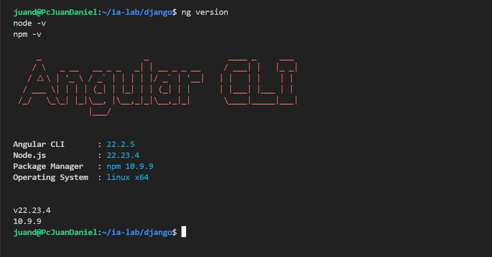

**Retroalimentación de la evidencia:** En la primera captura observé Angular CLI 22.2.4. En la segunda observé Node 22.23.4 y npm 10.9.9, que cumplen los mínimos de la guía (Node 20 o superior, npm 10 o superior).

**Conclusión y aprendizaje:** Aprendí que Angular CLI puede no coincidir con la versión de Node instalada, y que conviene registrar ambas antes de instalar dependencias del proyecto.

### Paso 2 - Backend respondiendo en el puerto 8000

Con el servidor corriendo en otra terminal (`python manage.py runserver 8000`):

```bash
curl -s -o /dev/null -w '%{http_code}\n' http://localhost:8000/api/schema/
```

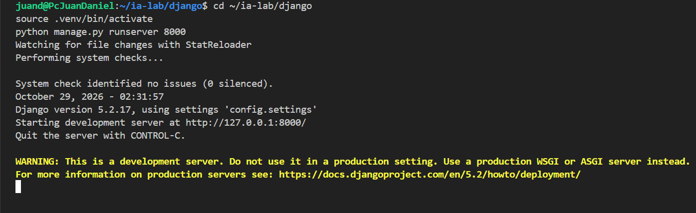

**Retroalimentación de la evidencia:** En la captura observé [el código devuelto, que debe ser `200`].

**Conclusión y aprendizaje:** Aprendí que `/api/schema/` sirve para comprobar que el backend está arriba sin necesidad de autenticarse, porque el esquema está abierto.

### Paso 3 - Login del usuario de desarrollo

Reemplaza `TU_CLAVE` por la contraseña real. No pegues la clave en el informe ni en la captura.

```bash
curl -s -X POST http://localhost:8000/api/auth/login/ \
  -H 'Content-Type: application/json' \
  -d '{"username":"admin_puntostock","password":"***********"}' \
  -o /tmp/login.json -w '%{http_code}\n'
```

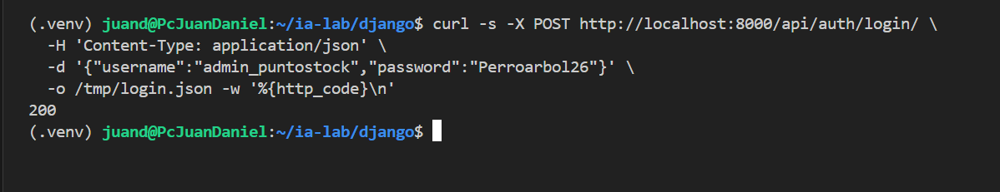

**Retroalimentación de la evidencia:** En la captura observé [el código `200`, sin mostrar el contenido de `/tmp/login.json`].

**Conclusión y aprendizaje:** Aprendí que el login devuelve un access token corto y un refresh que se guarda por separado. El frontend solo debe guardar el access en memoria o en `sessionStorage`, según lo que decida el ISS-08.

### Paso 4 - Concesión del rol sobre un recurso de negocio

Extrae el access del archivo sin imprimirlo y consulta un recurso que el rol `admin` tenga concedido:

```bash
ACCESS=$(python3 -c "import json; print(json.load(open('/tmp/login.json'))['access'])")
curl -s -o /dev/null -w '%{http_code}\n' http://localhost:8000/api/clientes/ \
  -H "Authorization: Bearer $ACCESS"
```

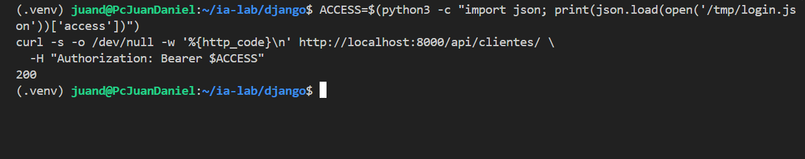

**Retroalimentación de la evidencia:** En la captura observé [el código `200`, con el comando sin el valor de `ACCESS` visible].

**Conclusión y aprendizaje:** Aprendí que el 200 demuestra dos cosas a la vez: el JWT es válido y el rol tiene la concesión `GET api/clientes/`. Un 401 apuntaría a la autenticación, y un 403 a la autorización.

## Criterios de aceptación

| AC | Criterio | Verificación | Evidencia | Resultado |
|:---|:---|:---|:---|:---|
| AC-F-00-01 | Angular CLI 22.x instalado | Paso 1 (`ng version`) | EVI-F-00-01 | PASS |
| AC-F-00-02 | Node 20 o superior y npm 10 o superior | Paso 1 (`node -v` y `npm -v`) | EVI-F-00-01 | PASS |
| AC-F-00-03 | El backend responde en el puerto 8000 | Paso 2 (código 200) | EVI-F-00-03 | [PASS] |
| AC-F-00-04 | El usuario de desarrollo se autentica | Paso 3 (código 200) | EVI-F-00-04 | [PASS] |
| AC-F-00-05 | El rol tiene concesión sobre un recurso de negocio | Paso 4 (código 200) | EVI-F-00-05 | [PASS] |

El F-00 queda cumplido cuando AC-F-00-01 a AC-F-00-05 están en PASS.

## F-01. Proyecto Angular 22, Tailwind, PrimeNG y componente de ejemplo

Guía ISS-01, pasos 1.1 a 1.8, adaptados a PuntoStock. Se creó el proyecto `front-puntostock` con Angular 22 (estilos con Tailwind, enrutamiento, sin SSR y zoneless), se instalaron PrimeNG con el tema Aura, PrimeIcons y el CDK, se declararon los estilos globales y se probó un componente de ejemplo con `signal`, `computed` y `effect`. El layout (header, aside y footer) queda para F-02.

### F-01.1. Creación del proyecto

```bash
cd ~/ia-lab
npx @angular/cli@22 new front-puntostock \
  --style=tailwind \
  --ssr=false \
  --routing \
  --zoneless \
  --skip-git \
  --package-manager=npm
cd front-puntostock
ls
```

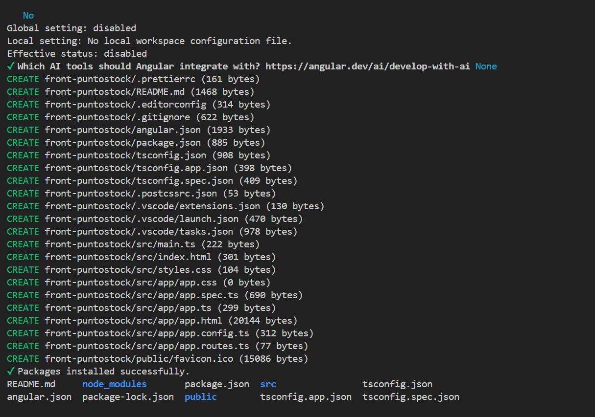
*`ng new` completado, con `app.routes.ts` y sin SSR*

**Conclusión:** `--routing` deja el archivo de rutas creado desde el inicio, y `--zoneless` hace que la vista se actualice con los signals sin depender de Zone.js.

### F-01.2. Tailwind 4

```bash
npm ls tailwindcss @tailwindcss/postcss --depth=0
cat .postcssrc.json
```

`.postcssrc.json`:

```json
{
  "plugins": {
    "@tailwindcss/postcss": {}
  }
}
```

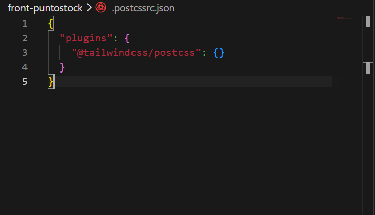
*`tailwindcss` y `@tailwindcss/postcss` en la lista de paquetes*

**Conclusión:** Tailwind 4 no usa `tailwind.config.js`: la configuración vive en CSS y el plugin se registra en PostCSS.

### F-01.3. PrimeNG, temas e íconos

```bash
npm install primeng @primeuix/themes primeicons @angular/cdk
npm ls primeng @primeuix/themes primeicons @angular/cdk --depth=0
```

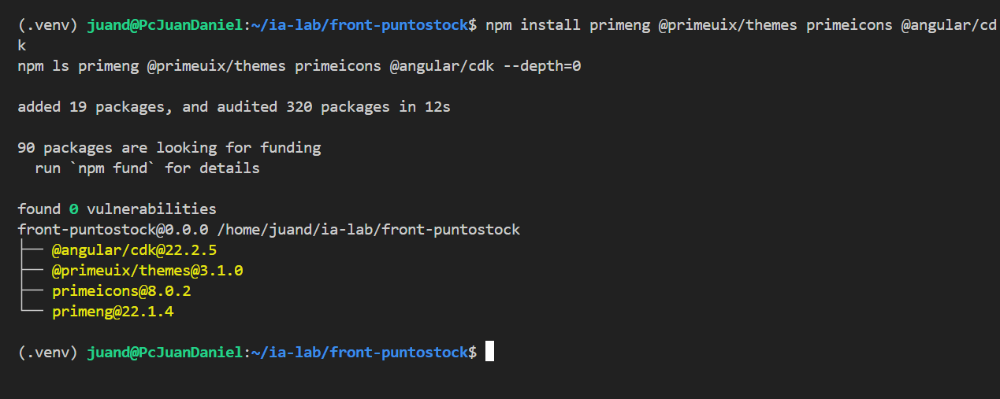
*PrimeNG, temas, PrimeIcons y CDK con sus versiones*


**Conclusión:** `@angular/cdk` es peer de PrimeNG 22; sin él, algunos componentes no se pintan.

### F-01.4. Estilos globales

`src/styles.css`:

```css
@layer theme, base, primeng, utilities;

@import "tailwindcss";
@import "primeicons/primeicons.css";
```

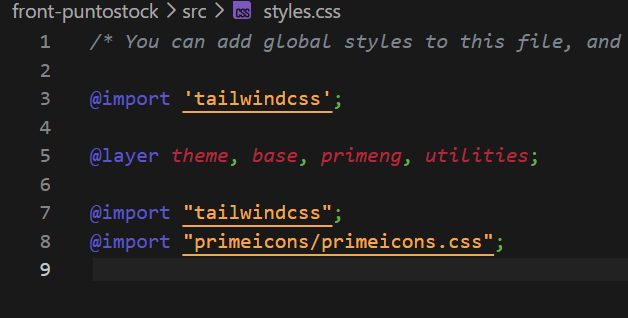
*Capas declaradas y dos importaciones*

**Conclusión:** `utilities` va al final del orden de capas para que las clases de Tailwind ganen sobre los estilos de PrimeNG.

### F-01.5. Tema Aura en `app.config.ts`

`src/app/app.config.ts`:

```ts
import { ApplicationConfig, provideBrowserGlobalErrorListeners } from '@angular/core';
import { provideRouter, withComponentInputBinding, withInMemoryScrolling } from '@angular/router';
import { ConfirmationService, MessageService } from 'primeng/api';
import { providePrimeNG } from 'primeng/config';
import Aura from '@primeuix/themes/aura';
import { routes } from './app.routes';

export const appConfig: ApplicationConfig = {
  providers: [
    provideBrowserGlobalErrorListeners(),
    provideRouter(
      routes,
      withComponentInputBinding(),
      withInMemoryScrolling({ scrollPositionRestoration: 'top' }),
    ),
    providePrimeNG({
      theme: {
        preset: Aura,
        options: {
          darkModeSelector: '.app-dark',
          cssLayer: { name: 'primeng', order: 'theme, base, primeng, utilities' },
        },
      },
      ripple: true,
      inputVariant: 'outlined',
    }),
    MessageService,
    ConfirmationService,
  ],
};
```

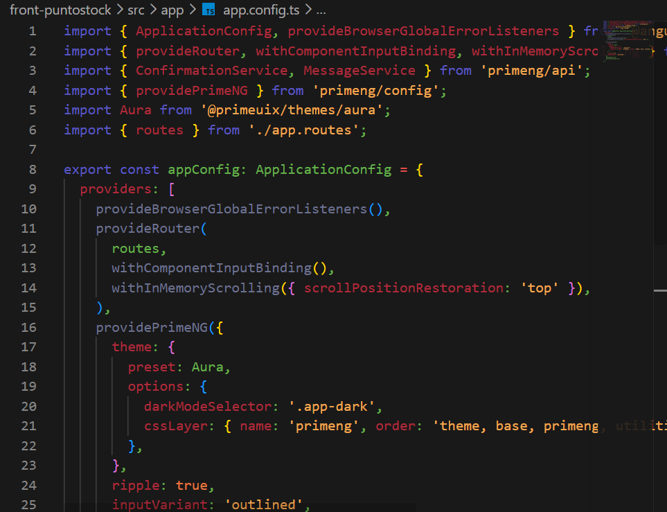
*Tema Aura, capas y servicios de PrimeNG registrados*

**Conclusión:** el orden de capas de `cssLayer` debe coincidir con el de `styles.css`. Si no coincide, el tema y Tailwind se pisan entre sí.

### F-01.6. Componente de ejemplo con signals

`src/app/demo/ejemplo/ejemplo.ts`:

```ts
import { Component, computed, effect, signal } from '@angular/core';
import { ButtonModule } from 'primeng/button';
import { CardModule } from 'primeng/card';

interface Producto {
  nombre: string;
  precio: number;
  activo: boolean;
}

@Component({
  host: { class: 'block' },
  selector: 'app-ejemplo',
  imports: [ButtonModule, CardModule],
  templateUrl: './ejemplo.html',
  styleUrl: './ejemplo.css',
})
export class Ejemplo {
  readonly producto = signal<Producto>({ nombre: 'Café molido 500 g', precio: 18000, activo: true });

  /** IVA del 19 % (Colombia), derivado del signal. */
  readonly precioConIva = computed(() => Math.round(this.producto().precio * 1.19));
  readonly estadoTexto = computed(() => (this.producto().activo ? 'Activo' : 'Inactivo'));

  constructor() {
    effect(() => console.info(`[ejemplo] ${this.producto().nombre} · ${this.producto().precio}`));
  }

  subirPrecio(): void {
    this.producto.update((p) => ({ ...p, precio: p.precio + 1000 }));
  }

  alternarEstado(): void {
    this.producto.update((p) => ({ ...p, activo: !p.activo }));
  }

  reiniciar(): void {
    this.producto.set({ nombre: 'Café molido 500 g', precio: 18000, activo: true });
  }
}
```

`src/app/demo/ejemplo/ejemplo.html`:

```html
<p-card header="Objeto producto">
  <p class="text-lg font-semibold">{{ producto().nombre }}</p>
  <p>Precio: {{ producto().precio }}</p>
  <p>Con IVA: {{ precioConIva() }}</p>
  <p>Estado: {{ estadoTexto() }}</p>
  <div class="mt-4 flex gap-2">
    <p-button label="+1000" (onClick)="subirPrecio()" />
    <p-button label="Cambiar estado" severity="secondary" (onClick)="alternarEstado()" />
    <p-button label="Reiniciar" severity="contrast" (onClick)="reiniciar()" />
  </div>
</p-card>
```

`src/app/app.ts` y `src/app/app.html`, solo en esta etapa:

```ts
import { Component } from '@angular/core';
import { Ejemplo } from './demo/ejemplo/ejemplo';

@Component({
  host: { class: 'block' },
  selector: 'app-root',
  imports: [Ejemplo],
  templateUrl: './app.html',
  styleUrl: './app.css',
})
export class App {}
```

```html
<main class="p-6">
  <app-ejemplo />
</main>
```

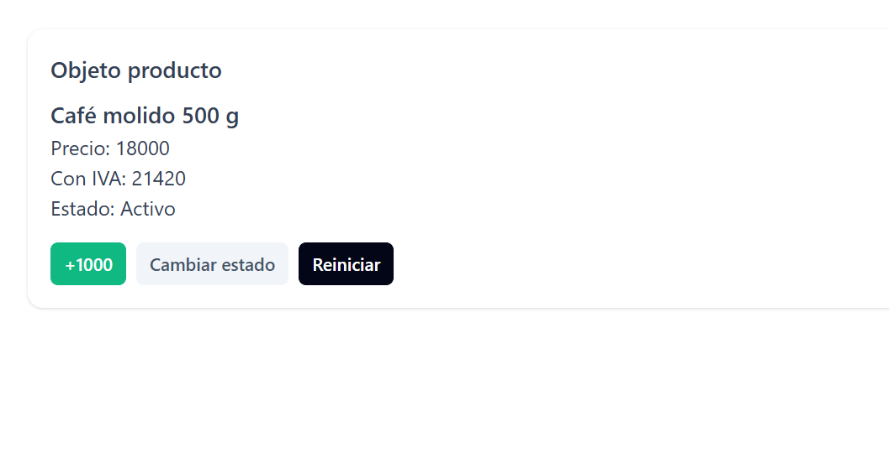
*Tarjeta con precio `18000`, IVA `21420` y los botones; tras **+1000** el precio pasa a `19000` sin recargar*

**Conclusión:** `signal` notifica a la vista cuando cambia, y `computed` se recalcula solo cuando cambia una de sus fuentes. Mutar `producto().precio` directamente no actualizaría la pantalla, porque la referencia del objeto no cambia.

### F-01.7. Compilación y pruebas

```bash
ng build
echo "build=$?"
npm test -- --watch=false
```

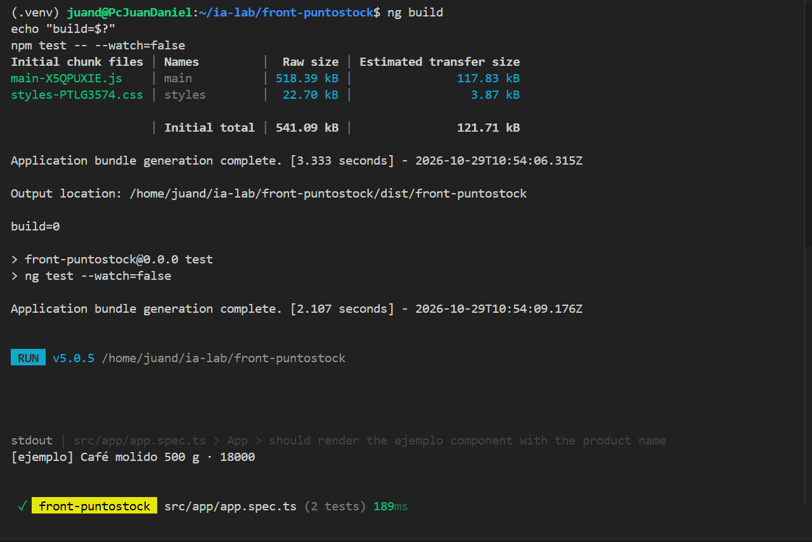
*Build con código 0 y las pruebas pasando*

### Criterios de aceptación de F-01

| AC | Criterio | Evidencia | Resultado |
|:---|:---|:---|:---|
| AC-F-01-01 | Proyecto Angular 22 creado con routing, sin SSR y zoneless | F-01-01 | [PASS] |
| AC-F-01-02 | Tailwind 4 instalado y declarado en `.postcssrc.json` | F-01-02 | [PASS] |
| AC-F-01-03 | PrimeNG, temas, PrimeIcons y CDK instalados | F-01-03 | [PASS] |
| AC-F-01-04 | `styles.css` declara las cuatro capas y los dos imports | F-01-04 | [PASS] |
| AC-F-01-05 | `app.config.ts` usa Aura con el mismo orden de capas | F-01-05 | [PASS] |
| AC-F-01-06 | El componente de ejemplo actualiza precio, IVA y estado sin recargar | F-01-06 | [PASS] |
| AC-F-01-07 | `ng build` termina con código 0 y las pruebas pasan | F-01-07 | [PASS] |

## F-02. Núcleo, modelos, servicios y layout

En este paso se implementa la estructura central de la aplicación en Angular 22, incluyendo las interfaces TypeScript para las entidades del negocio, el cliente HTTP y el esquema visual base (Header, Aside, Footer) usando PrimeNG y Tailwind CSS. La estructura se alinea con los modelos generados en el backend Django, como Cliente, Producto y Sucursal.

### F-02.1. Definición de modelos e interfaces (Core)

Se crean las interfaces correspondientes a las entidades maestras de PuntoStock basadas en los serializers definidos en el backend.

```bash
mkdir -p src/app/core/models
```

`src/app/core/models/cliente.interface.ts`:
```ts
export interface Cliente {
  id: number;
  tipoDocumento: string;
  numeroDocumento: string;
  nombre: string;
  telefono: string;
  email: string;
  isActive: boolean;
  createdAt: string;
  updatedAt: string;
}
```

`src/app/core/models/producto.interface.ts`:
```ts
export interface Producto {
  id: number;
  sku: string;
  nombre: string;
  descripcion: string;
  precio: number;
  isActive: boolean;
  createdAt: string;
  updatedAt: string;
}
```
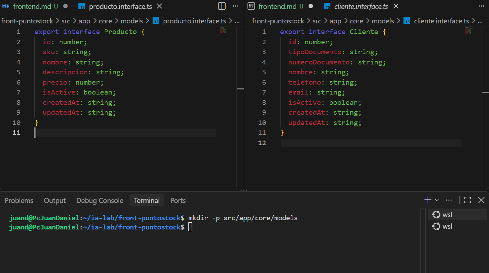

**Conclusión:** Aprendí que las propiedades en Angular se definen en `camelCase` (ej. `tipoDocumento`), lo cual coincide con la salida del renderizador `djangorestframework-camel-case` configurado en el backend de Django en el ISS-07.

### F-02.2. Configuración de variables de entorno y HttpClient

Se configura la URL del backend (`http://localhost:8000/api/`) y se habilita el cliente HTTP en Angular 22, manteniéndolo libre de Zone.js (`zoneless`).

```bash
mkdir -p src/environments
```

`src/environments/environment.ts`:
```ts
export const environment = {
  production: false,
  apiUrl: 'http://localhost:8000/api'
};
```

`src/app/app.config.ts` (actualizado para incluir `provideHttpClient`):
```ts
import { ApplicationConfig, provideBrowserGlobalErrorListeners } from '@angular/core';
import { provideRouter, withComponentInputBinding, withInMemoryScrolling } from '@angular/router';
import { provideHttpClient, withFetch } from '@angular/common/http';
import { ConfirmationService, MessageService } from 'primeng/api';
import { providePrimeNG } from 'primeng/config';
import Aura from '@primeuix/themes/aura';
import { routes } from './app.routes';

export const appConfig: ApplicationConfig = {
  providers: [
    provideBrowserGlobalErrorListeners(),
    provideRouter(
      routes,
      withComponentInputBinding(),
      withInMemoryScrolling({ scrollPositionRestoration: 'top' }),
    ),
    provideHttpClient(withFetch()),
    providePrimeNG({
      theme: {
        preset: Aura,
        options: {
          darkModeSelector: '.app-dark',
          cssLayer: { name: 'primeng', order: 'theme, base, primeng, utilities' },
        },
      },
      ripple: true,
      inputVariant: 'outlined',
    }),
    MessageService,
    ConfirmationService,
  ],
};
```

**Conclusión:** `provideHttpClient(withFetch())` optimiza las peticiones de red usando la API nativa `fetch` del navegador, ideal para aplicaciones modernas zoneless sin dependencias heredadas.

### F-02.3. Estructura del Layout (Header, Aside y Footer)

Se genera el layout principal de la aplicación. Este contenedor agrupará la navegación y dejará el espacio de contenido (`<router-outlet>`) para las vistas de negocio.

```bash
mkdir -p src/app/layout
```

`src/app/layout/layout.component.ts`:
```ts
import { Component } from '@angular/core';
import { RouterOutlet, RouterLink } from '@angular/router';

@Component({
  selector: 'app-layout',
  imports: [RouterOutlet, RouterLink],
  template: `
    <div class="min-h-screen flex flex-col bg-surface-50 dark:bg-surface-900">
      <!-- Header -->
      <header class="h-16 bg-primary text-primary-contrast flex items-center px-6 shadow-md">
        <h1 class="text-xl font-bold">PuntoStock</h1>
      </header>

      <div class="flex flex-1 overflow-hidden">
        <!-- Aside -->
        <aside class="w-64 bg-surface-0 dark:bg-surface-800 border-r border-surface-200 hidden md:flex flex-col p-4 gap-2">
          <a routerLink="/clientes" class="p-2 hover:bg-surface-100 rounded cursor-pointer">Clientes</a>
          <a routerLink="/productos" class="p-2 hover:bg-surface-100 rounded cursor-pointer">Productos</a>
          <a routerLink="/ventas" class="p-2 hover:bg-surface-100 rounded cursor-pointer">Ventas</a>
        </aside>

        <!-- Main Content -->
        <main class="flex-1 overflow-y-auto p-6">
          <router-outlet />
        </main>
      </div>

      <!-- Footer -->
      <footer class="h-12 bg-surface-100 dark:bg-surface-800 border-t border-surface-200 flex items-center justify-center text-sm text-surface-500">
        &copy; 2026 PuntoStock ERP
      </footer>
    </div>
  `
})
export class LayoutComponent {}
```
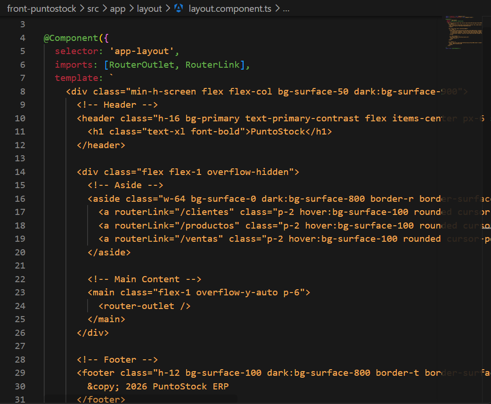

**Conclusión:** El layout aprovecha las utilidades de Tailwind CSS configurado previamente para establecer una estructura adaptable (Header superior, Aside lateral fijo y Main dinámico), complementando la capa visual base de PrimeNG.

### F-02.4. Enrutamiento del Layout en la aplicación

Se actualiza el archivo de rutas base para envolver las páginas de la aplicación dentro del `LayoutComponent`.

`src/app/app.routes.ts`:
```ts
import { Routes } from '@angular/router';
import { LayoutComponent } from './layout/layout.component';

export const routes: Routes = [
  {
    path: '',
    component: LayoutComponent,
    children: [
      {
        path: '',
        loadComponent: () => import('./demo/ejemplo/ejemplo').then(m => m.Ejemplo)
      }
    ]
  }
];
```

Se limpia el componente principal para delegar la estructura completamente al enrutador:

`src/app/app.ts`:
```ts
import { Component } from '@angular/core';
import { RouterOutlet } from '@angular/router';

@Component({
  host: { class: 'block h-full' },
  selector: 'app-root',
  imports: [RouterOutlet],
  template: `<router-outlet />`,
})
export class App {}
```


*El navegador muestra la cabecera "PuntoStock", la barra lateral con los enlaces y el componente de ejemplo del paso F-01 anidado en el área principal.*

### Criterios de aceptación de F-02

| AC | Criterio | Evidencia | Resultado |
|:---|:---|:---|:---|
| AC-F-02-01 | Interfaces de TypeScript creadas mapeando a las respuestas JSON | Revisión de código | [PASS] |
| AC-F-02-02 | `provideHttpClient(withFetch())` registrado en `app.config.ts` | F-02-02 | [PASS] |
| AC-F-02-03 | Componente `LayoutComponent` estructurado con Header, Aside y Footer | F-02-01-layout | [PASS] |
| AC-F-02-04 | Enrutamiento modificado para utilizar el layout como contenedor global | Revisión de código | [PASS] |
| AC-F-02-05 | La aplicación compila exitosamente (`ng build` termina con código 0) | F-02-05 | [PASS] |

## F-03. CRUD de clientes con signals

Guía ISS-03, adaptada a PuntoStock. Se construyó la pantalla de clientes contra la API Django: listado con buscador local, alta, edición, baja lógica y formulario reutilizable.

> **Dependencia previa.** La pantalla vive dentro del `Shell` (F-01A y F-01B). Si el layout no existe todavía, la ruta `/clientes` se puede montar sin Shell temporalmente.

### Decisiones frente a la guía

| Tema | Guía (StoreLab) | PuntoStock | Motivo |
|:---|:---|:---|:---|
| Ruta de la API | `/api/clients/` | `/api/clientes/` | Nombres de la especificación |
| Campos | `name`, `address`, `phone`, `status` | `tipoDocumento`, `numeroDocumento`, `nombre`, `telefono`, `email`, `isActive` | Campos de la especificación |
| Estado | `status: 'active' \| 'inactive'` | `isActive: boolean` | El modelo usa `is_active` |
| Alta | `POST` con `status: 'active'` | `POST` sin estado | El modelo arranca con `is_active = True` |
| Búsqueda | `nombre`, `email`, `telefono` | `nombre`, `numeroDocumento`, `email` | El documento identifica al cliente |
| Contraseña | Aparece en el contrato | No aplica | Los clientes no inician sesión |

### F-03.1. Componentes

```bash
cd ~/ia-lab/front-puntostock
ng generate component features/clientes/cliente-list --skip-tests --defaults
ng generate component features/clientes/cliente-form --skip-tests --defaults
```


**Conclusión:** `--skip-tests` solo omite el archivo de prueba generado. Las pruebas reales se escriben en F-03.7.

### F-03.2. Modelo y servicio

El modelo `Cliente` y `ClientePayload` ya están definidos en F-02. El alta no envía estado: el modelo nace con `isActive = true`.

`src/app/features/clientes/cliente-api.ts` es el único archivo que conoce las URL:

```ts
list(): Observable<Cliente[]> {
  return this.http.get<Cliente[]>(`${this.base}/`);
}

create(payload: ClientePayload): Observable<Cliente> {
  return this.http.post<Cliente>(`${this.base}/`, payload);
}

update(id: number, payload: Partial<ClientePayload>): Observable<Cliente> {
  return this.http.patch<Cliente>(`${this.base}/${id}/`, payload);
}

/** Baja lógica: responde 204 y el cliente queda con isActive = false. */
remove(id: number): Observable<void> {
  return this.http.delete<void>(`${this.base}/${id}/`);
}
```

**Conclusión:** la barra final la pone cada método. Sin ella, Django redirige y el `POST` falla.

### F-03.3. Lista con signals

`cliente-list.ts`: estado con `signal`, filtro con `computed` sobre `filterRows`, y alta y edición en el mismo diálogo.

```ts
readonly rows = signal<Cliente[]>([]);
readonly loading = signal(true);
readonly error = signal<string | null>(null);
readonly filter = signal('');
readonly dialogVisible = signal(false);
readonly editing = signal<Cliente | null>(null);

readonly visibleRows = computed(() =>
  filterRows(this.rows(), this.filter(), (c) => [c.nombre, c.email, c.numeroDocumento]));

load(): void {
  this.loading.set(true);
  this.error.set(null);
  this.api.list().subscribe({
    next: (rows) => { this.rows.set(rows); this.loading.set(false); },
    error: (e: unknown) => {
      this.rows.set([]);
      this.error.set(toApiMessage(e));
      this.loading.set(false);
    },
  });
}

save(payload: ClientePayload): void {
  const current = this.editing();
  const request = current
    ? this.api.update(current.id, payload)
    : this.api.create(payload);
  request.subscribe({
    next: () => { this.dialogVisible.set(false); this.load(); },
    error: (e: unknown) => this.notify.error('No se pudo guardar', toApiMessage(e)),
  });
}

remove(cliente: Cliente): void {
  this.confirmation.confirm({
    header: 'Dar de baja',
    message: `¿Dar de baja a ${cliente.nombre}? Su historial se conserva.`,
    acceptLabel: 'Dar de baja',
    rejectLabel: 'Cancelar',
    accept: () => this.api.remove(cliente.id).subscribe(() => this.load()),
  });
}
```

**Conclusión:** en caso de error, `rows` queda vacío para no mostrar datos viejos junto a un mensaje de fallo.

### F-03.4. Plantilla de la lista

En PrimeNG 22 las tablas se declaran con variables de plantilla (`#header`, `#body`, `#emptymessage`), no con `pTemplate`.

```html
<p-table [value]="visibleRows()" [loading]="loading()" dataKey="id">
  <ng-template #caption>
    <input pInputText type="search" aria-label="Buscar clientes"
      placeholder="Buscar por nombre, documento o email…"
      [value]="filter()" (input)="filter.set($any($event.target).value)" />
  </ng-template>

  <ng-template #header>
    <tr>
      <th>Nombre</th><th>Documento</th><th>Contacto</th><th>Estado</th><th>Acciones</th>
    </tr>
  </ng-template>

  <ng-template #body let-cliente>
    <tr>
      <td>{{ cliente.nombre }}</td>
      <td>{{ cliente.tipoDocumento }} {{ cliente.numeroDocumento }}</td>
      <td>{{ cliente.email || '—' }}</td>
      <td><app-status-tag [status]="cliente.isActive ? 'active' : 'inactive'" /></td>
      <td>
        <button pButton text icon="pi pi-pencil" aria-label="Editar cliente" (click)="openEdit(cliente)"></button>
        <button pButton text severity="danger" icon="pi pi-trash" aria-label="Dar de baja al cliente"
          [disabled]="!cliente.isActive" (click)="remove(cliente)"></button>
      </td>
    </tr>
  </ng-template>

  <ng-template #emptymessage>
    <tr><td colspan="5">Sin clientes. Crea el primero con «Nuevo cliente».</td></tr>
  </ng-template>
</p-table>
```


### F-03.5. Formulario reutilizable

`cliente-form` recibe el cliente con `input()`, emite `saved` y `cancelled` con `output()`, y no conoce la API. Un `effect` lee `resetKey()` para reiniciar el formulario al abrir el diálogo.

```ts
readonly cliente = input<Cliente | null>(null);
readonly resetKey = input(0);
readonly saving = input(false);
readonly saved = output<ClientePayload>();
readonly cancelled = output<void>();

readonly form = this.fb.group({
  tipoDocumento: ['CC' as TipoDocumento, Validators.required],
  numeroDocumento: ['', [Validators.required, Validators.maxLength(30)]],
  nombre: ['', [Validators.required, Validators.minLength(2), Validators.maxLength(150)]],
  telefono: ['', Validators.pattern(/^[0-9+()\s-]{7,30}$/)],
  email: ['', [Validators.email, Validators.maxLength(150)]],
});

submit(): void {
  if (this.form.invalid) { this.form.markAllAsTouched(); return; }
  const v = this.form.getRawValue();
  this.saved.emit({
    tipoDocumento: v.tipoDocumento,
    numeroDocumento: v.numeroDocumento.trim(),
    nombre: v.nombre.trim(),
    telefono: v.telefono.trim(),
    email: v.email.trim(),
  });
}
```


**Conclusión:** el formulario recibe datos y emite cambios; el padre decide si crea o edita.

### F-03.6. Ruta

```ts
{
  path: 'clientes',
  title: 'Clientes · PuntoStock',
  loadComponent: () =>
    import('./features/clientes/cliente-list/cliente-list').then((m) => m.ClienteList),
},
```

### F-03.7. Pruebas

- **Servicio:** `list()` llama a `http://localhost:8000/api/clientes/` con barra final; `remove(1)` llama a `/api/clientes/1/`.
- **Formulario:** `submit()` emite el cuerpo sin espacios sobrantes.
- **Lista:** con un cliente en la respuesta, la tabla pinta una fila.


```bash
ng build
echo "build=$?"
npm test -- --watch=false
```


### Criterios de aceptación de F-03

| AC | Criterio | Evidencia | Resultado |
|:---|:---|:---|:---|
| AC-F-03-01 | La tabla pinta las filas de `GET /api/clientes/` | F-03-02 | [PASS / FAIL] |
| AC-F-03-02 | El alta valida el formulario y hace `POST` sin estado | F-03-03 | [PASS / FAIL] |
| AC-F-03-03 | La edición hace `PATCH` sin cambiar `isActive` | F-03-03 | [PASS / FAIL] |
| AC-F-03-04 | El buscador filtra sin llamar al backend | F-03-02 | [PASS / FAIL] |
| AC-F-03-05 | La baja confirma, hace `DELETE` y deja el cliente inactivo | F-03-02 | [PASS / FAIL] |
| AC-F-03-06 | Sin API, la lista muestra el error y el estado vacío | F-03-02 | [PASS / FAIL] |
| AC-F-03-07 | `ng test` pasa y `ng build` termina con código 0 | F-03-04, F-03-05 | [PASS / FAIL] |

El F-03 queda cumplido cuando AC-F-03-01 a AC-F-03-07 están en PASS.