## Mysql

### 1. Create — Insertar un nuevo cliente

Omitimos el campo id por ser autoincremental y asignamos los datos correspondientes a la tabla `customer`.

``` mysql
INSERT INTO customer (document_type, document_number, name, phone, email) 
VALUES ("CC", "1043680256", "Jaider Quintero", "3122589615", "jq@gmail.com");
```

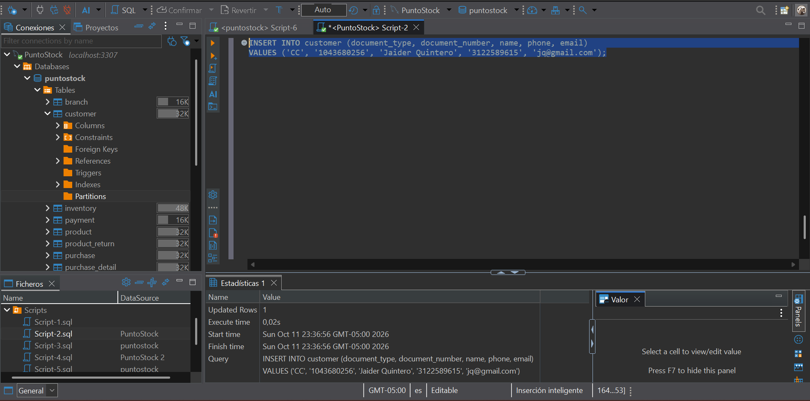

### 2. Read — Consultas básicas de lectura

#### 2.0 Consultar todos los clientes

Muestra todos los campos y registros de la tabla `customer`.

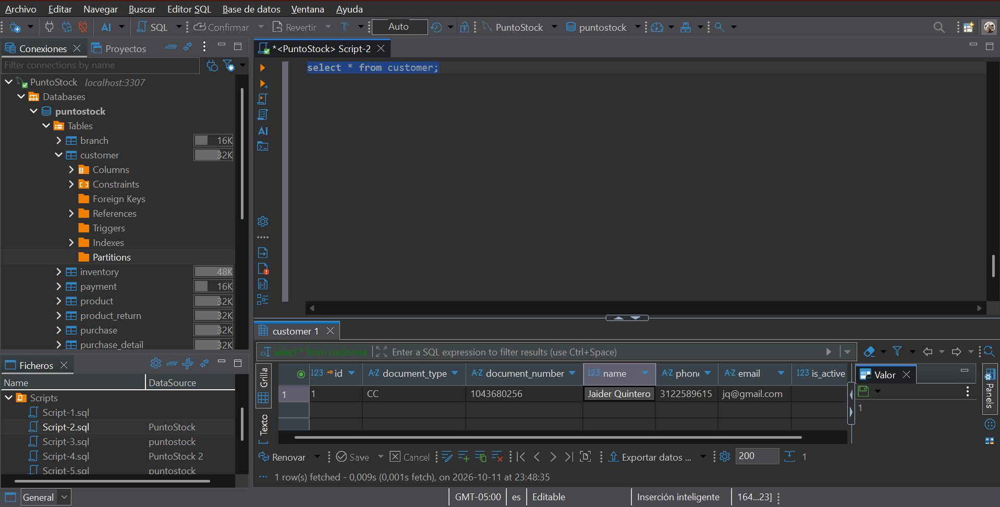

#### 2.1. Seleccionar columnas específicas

Evita traer columnas innecesarias proyectando únicamente `name`, `phone` y `email`.

``` mysql
SELECT name, phone, email 
FROM customer;
```

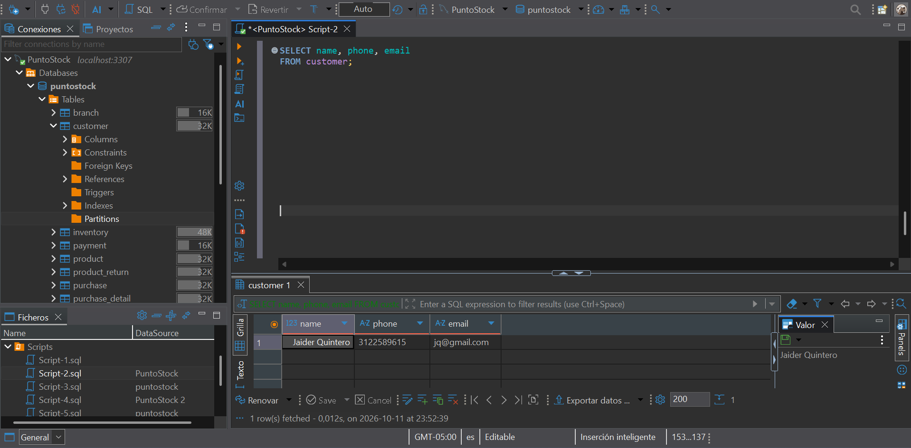

#### 2.2. Uso de alias de tabla

Misma selección introduciendo el alias `C` para simplificar la sintaxis.

``` mysql
SELECT * 
FROM customer AS C, sale AS S
WHERE C.id = S.customer_id;
```

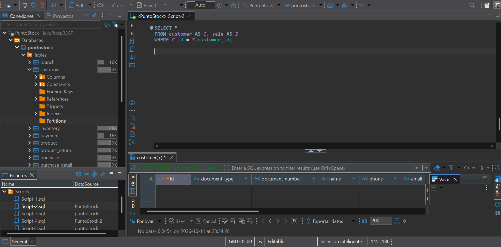

#### 2.2. Uso de alias de tabla

Misma selección introduciendo el alias `C` para simplificar la sintaxis.

``` mysql
SELECT C.name, C.phone, C.email
FROM customer AS C;
```

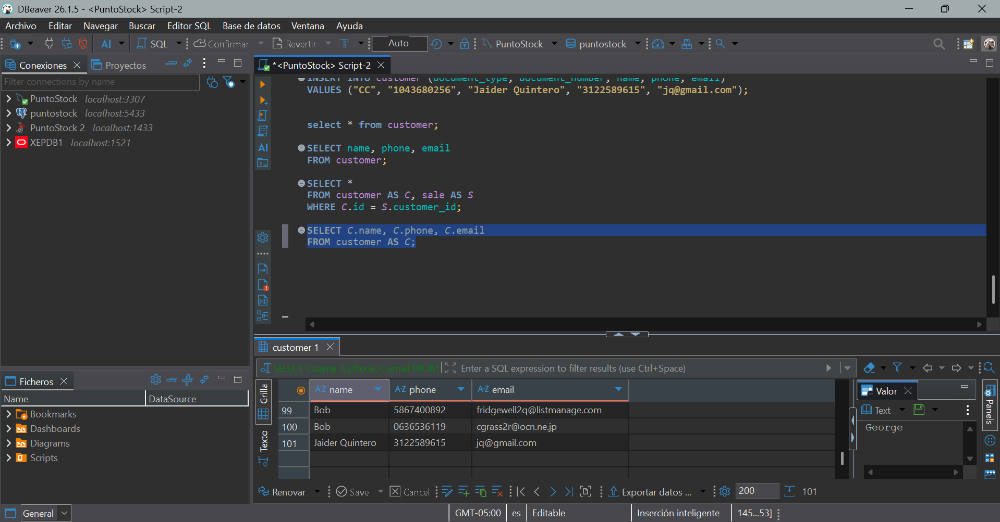

### 3. Consultar varias tablas (JOINs entre Clientes y Ventas)

#### Forma 1: Join implícito (en la cláusula WHERE)

Combina `customer` y `sale` usando los campos de llave primaria y foránea en el `WHERE`.

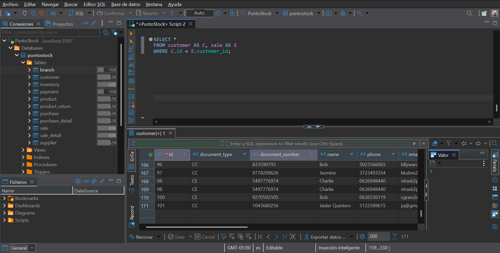

#### Forma 2: Join explícito (cláusula JOIN ON)

Misma combinación utilizando la sintaxis estándar `JOIN ... ON`.

``` mysql
SELECT C.name, C.email, S.*
FROM customer AS C
JOIN sale AS S ON (C.id = S.customer_id);
```

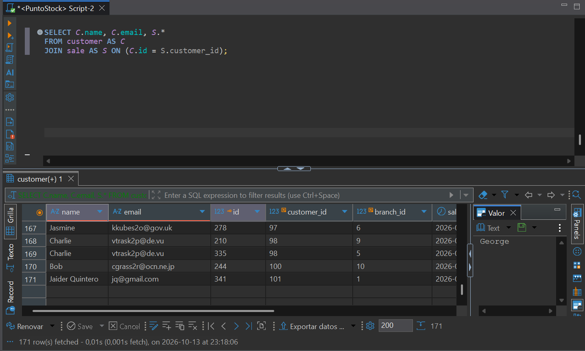

### 4. Condiciones y Operadores en Consultas

#### 4.1. Filtro por fecha específica

#### Forma 1 (Implícita)

``` mysql
SELECT C.name, C.email, S.*
FROM customer AS C, sale AS S
WHERE C.id = S.customer_id AND S.sale_date = "2026-05-18 19:19:29";
```

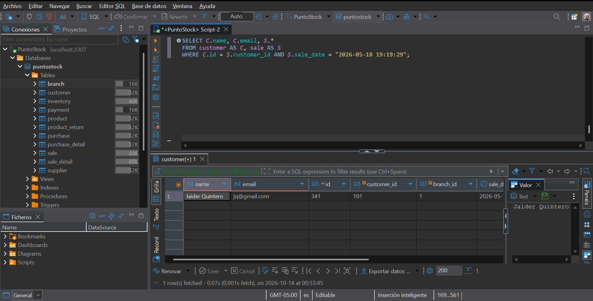

#### Forma 2 (Explícita)

``` mysql
SELECT C.name, C.email, S.*
FROM customer AS C
JOIN sale AS S ON (C.id = S.customer_id)
WHERE S.sale_date = "2026-05-18 19:19:29";
```

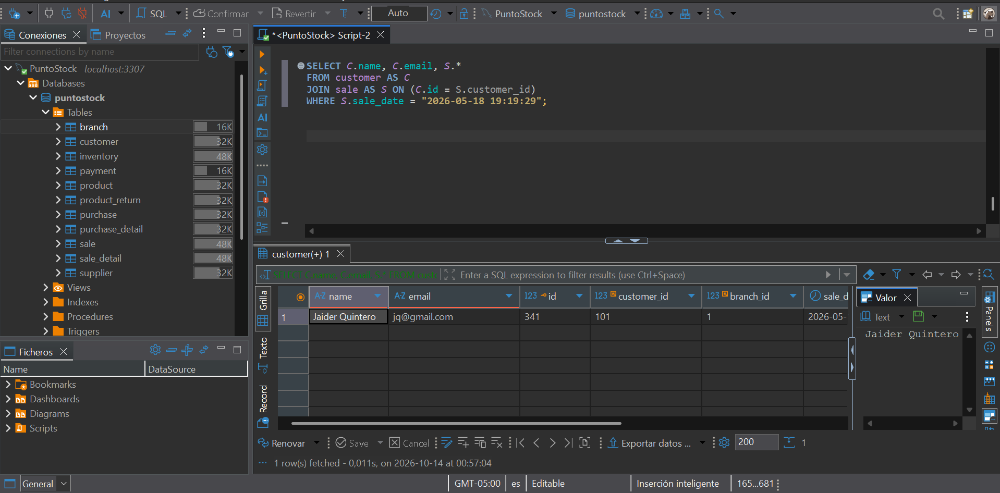

#### 4.2. Operador LIKE (Búsquedas de texto)

Emails que inician con 'm'

``` mysql
SELECT *
FROM customer AS C
WHERE C.email LIKE 'm%';
```

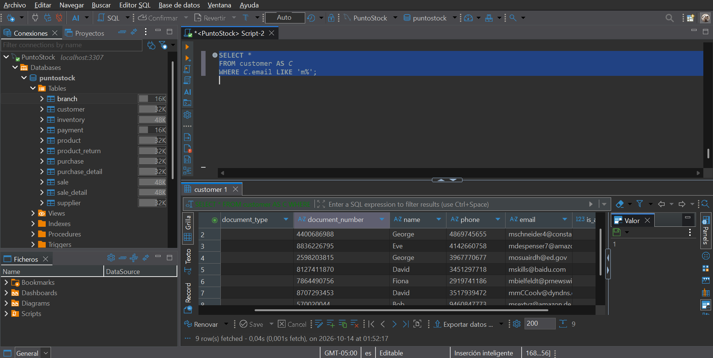

#### 4.3. Consulta multi-tabla (Línea continua de 4 tablas con Rango y Ordenamiento)

Para consultar clientes, ventas y productos, es indispensable incluir la tabla intermedia `sale_detail` para mantener la línea continua relacional.

#### Forma 1 (Implícita)

``` mysql
SELECT C.*, S.*, SD.*, P.*
FROM customer AS C, sale AS S, sale_detail AS SD, product AS P
WHERE C.id = S.customer_id
  AND S.id = SD.header_id
  AND P.id = SD.item_id
  AND S.sale_date BETWEEN "2026-01-01" AND "2026-06-30"
ORDER BY S.sale_date ASC;
```

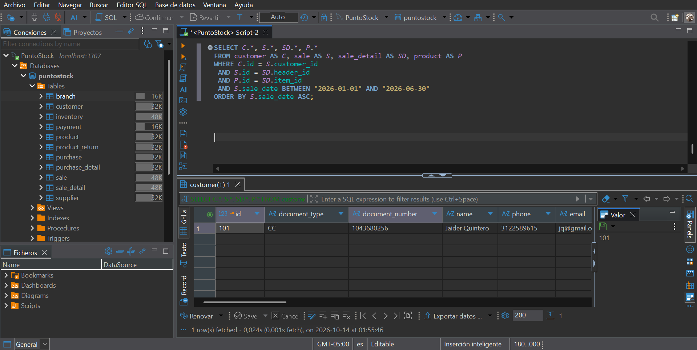

#### Forma 2 (Explícita)

``` mysql
SELECT *
FROM customer AS C
JOIN sale AS S ON (C.id = S.customer_id)
JOIN sale_detail AS SD ON (S.id = SD.header_id)
JOIN product AS P ON (P.id = SD.item_id)
WHERE S.sale_date BETWEEN "2026-01-01" AND "2026-06-30"
ORDER BY S.sale_date ASC;
```

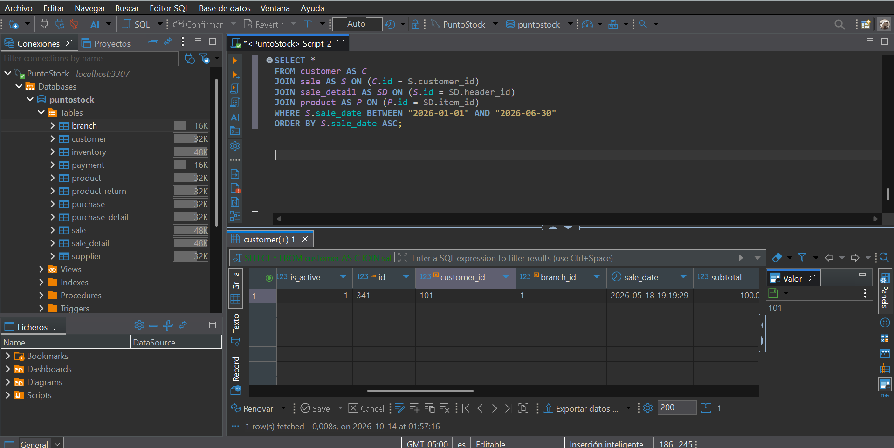

### 5. Consultas de Agrupamiento (GROUP BY, HAVING)

Calcula la suma total, cantidad de compras y ticket promedio por cliente en un periodo determinado.

#### Forma 1 (Implícita)

``` mysql
SELECT C.id, C.name, SUM(S.total) AS TotalSuma, COUNT(S.customer_id) AS CuentaTotal, AVG(S.total) AS Promedio
FROM customer AS C, sale AS S
WHERE C.id = S.customer_id
 AND S.sale_date BETWEEN "2026-01-01" AND "2026-06-30"
GROUP BY C.id, C.name
ORDER BY TotalSuma DESC;
```

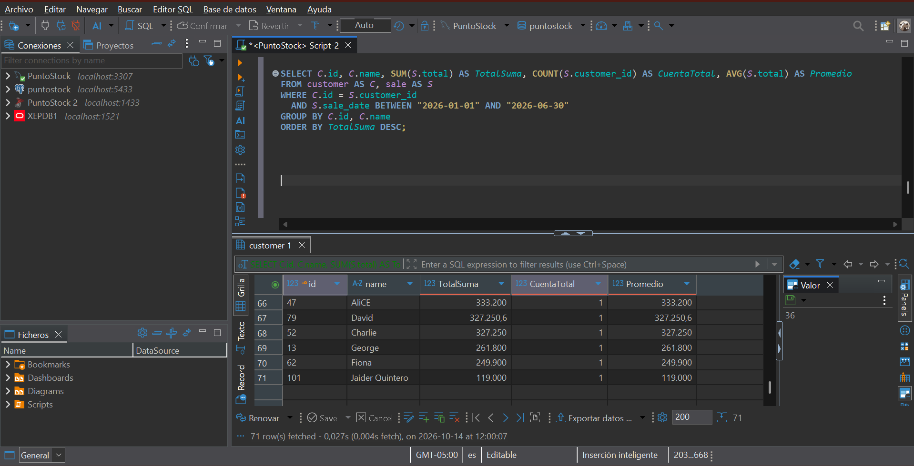

#### Forma 2 (Explícita)

``` mysql
SELECT C.id, C.name, SUM(S.total) AS TotalSuma, COUNT(S.customer_id) AS CuentaTotal, AVG(S.total) AS Promedio
FROM customer AS C
JOIN sale AS S ON (C.id = S.customer_id) WHERE S.sale_date BETWEEN "2026-01-01" AND "2026-06-30"
GROUP BY C.id, C.name
ORDER BY TotalSuma DESC;
```

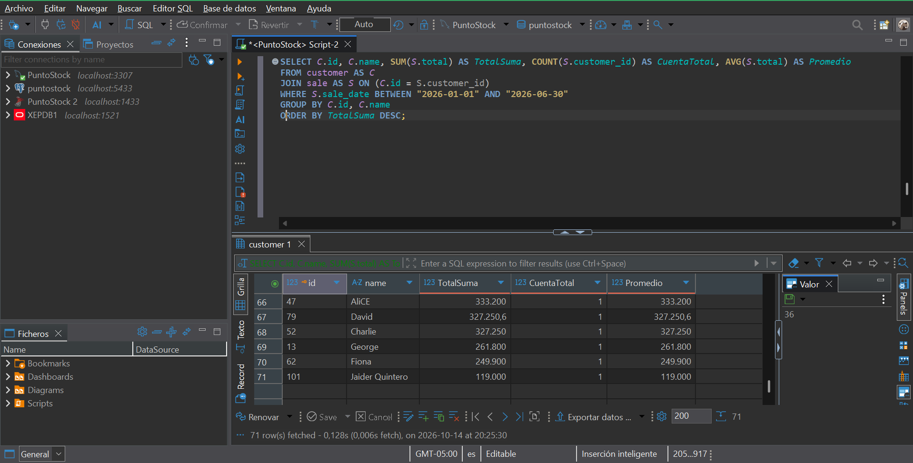

### Agrupamiento con condición de filtro HAVING

Filtra los resultados agrupados para mostrar únicamente clientes con 2 o más compras realizas.

#### Forma 1 (Implícita)

``` mysql
SELECT C.id, C.name, SUM(S.total) AS TotalSuma, COUNT(S.customer_id) AS CuentaTotal, AVG(S.total) AS Promedio
FROM customer AS C, sale AS S
WHERE C.id = S.customer_id
  AND S.sale_date BETWEEN "2026-01-01" AND "2026-06-30"
GROUP BY C.id, C.name HAVING CuentaTotal >= 2
ORDER BY TotalSuma DESC;
```

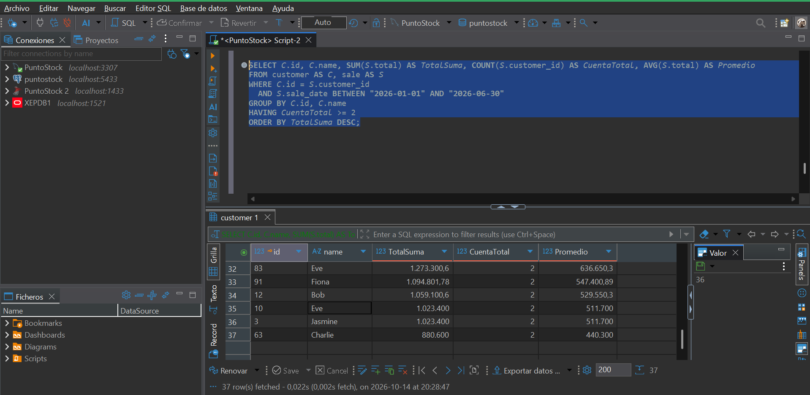

#### Forma 2 (Explícita)

``` mysql
SELECT C.id, C.name, SUM(S.total) AS TotalSuma, COUNT(S.customer_id) AS CuentaTotal, AVG(S.total) AS Promedio
FROM customer AS C 
JOIN sale AS S ON (C.id = S.customer_id) 
WHERE S.sale_date BETWEEN "2026-01-01" AND "2026-06-30" 
GROUP BY C.id, C.name HAVING CuentaTotal >= 2 
ORDER BY TotalSuma DESC;
```

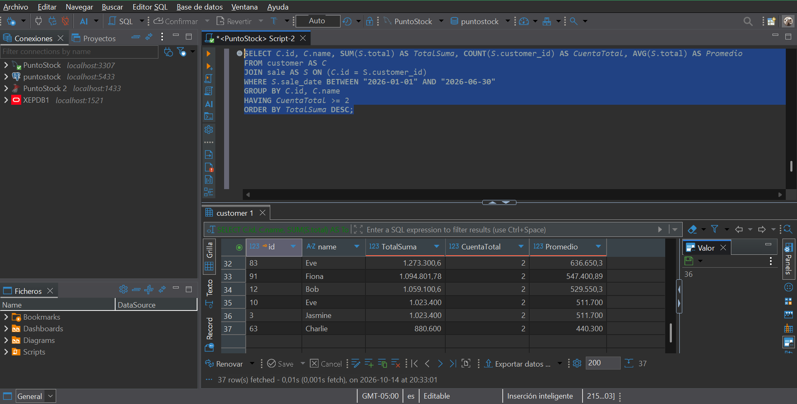

### 6. Subconsultas (Diferencia de Conjuntos $A - B$)

Obtiene los clientes registrados a los que **no** se les ha registrado ninguna venta dentro de un rango de fechas determinado.

#### Forma 1 (Mediante NOT IN)

``` mysql
SELECT * 
FROM customer AS C 
WHERE C.id NOT IN ( 
    SELECT S.customer_id 
    FROM sale AS S 
    WHERE S.sale_date BETWEEN "2026-01-01" AND "2026-06-30" );
```

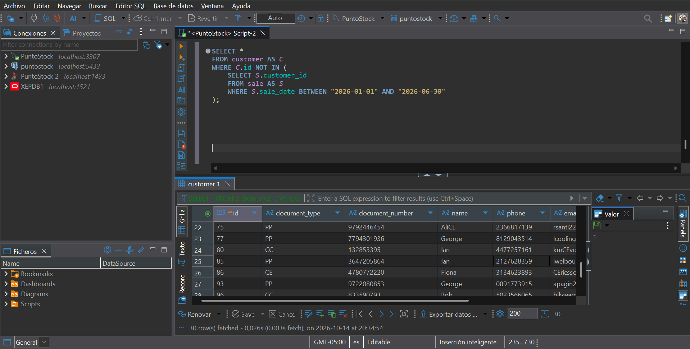

#### Forma 2 (Mediante LEFT JOIN y IS NULL)

``` mysql
SELECT C.* FROM customer AS C LEFT JOIN sale AS S ON (C.id = S.customer_id AND S.sale_date BETWEEN "2026-01-01" AND "2026-06-30") WHERE S.customer_id IS NULL;
```

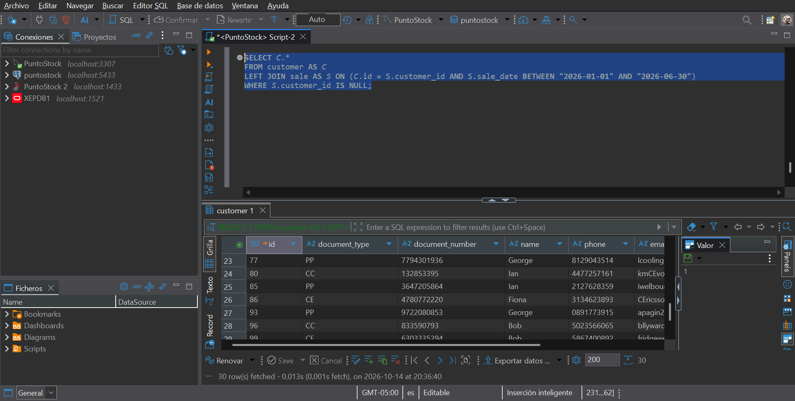

## POSTGRES

### 1. Create — Insertar un nuevo cliente

Omitimos el campo `id` por ser autoincremental (`SERIAL`) y asignamos los datos correspondientes usando comillas simples.

``` postgres
INSERT INTO customer (document_type, document_number, name, phone, email)
VALUES ('CC', '1043680256', 'Jaider Quintero', '3122589615', '[jq@gmail.com](mailto:jq@gmail.com){.email}');
```

### 2. Read — Consultas básicas de lectura

#### 2.0. Consultar todos los clientes

Muestra todos los campos y registros de la tabla `customer`.

``` postgres
SELECT * FROM customer;
```

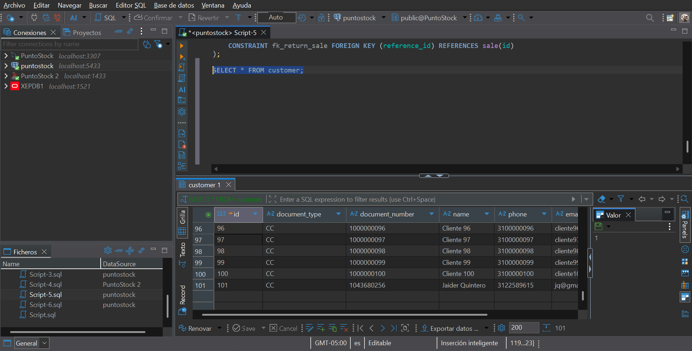

#### 2.1. Seleccionar columnas específicas

Proyecta únicamente `name`, `phone` y `email`.

``` postgres
SELECT name, phone, email FROM customer;
```

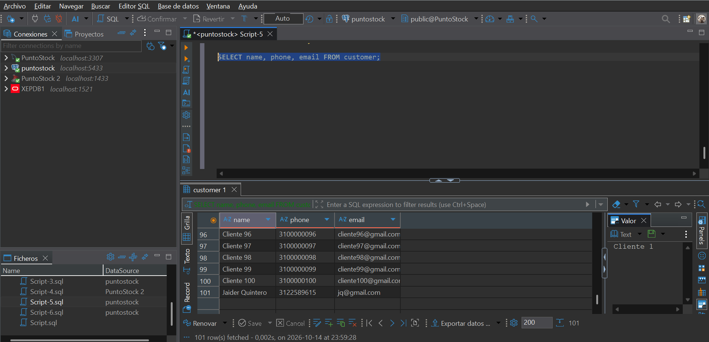

#### 2.2. Uso de alias de tabla

Misma selección introduciendo el alias `C` para la tabla `customer`.

``` postgres
SELECT C.name, C.phone, C.email FROM customer AS C;
```

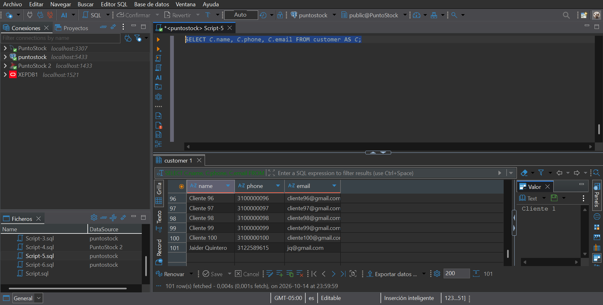

### 3. Consultar varias tablas (JOINs entre Clientes y Ventas)

#### Forma 1: Join implícito (cláusula WHERE)

Combina `customer` y `sale` mediante la condición de clave foránea en el `WHERE`.

``` postgres
SELECT C.name, C.email, S.*
FROM customer AS C, sale AS S
WHERE C.id = S.customer_id;
```

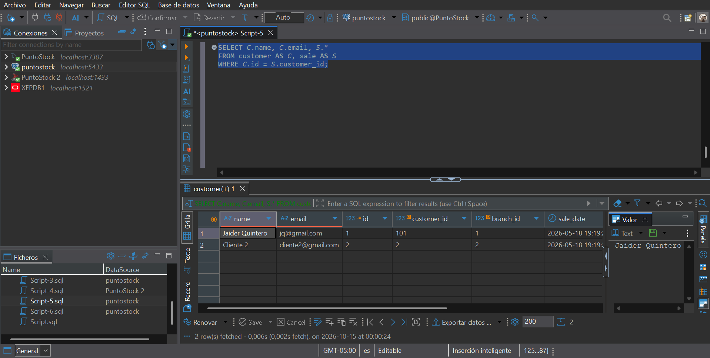

#### Forma 2: Join explícito (cláusula JOIN ON)

Misma combinación utilizando la sintaxis estándar `JOIN ... ON`.

``` postgres
SELECT C.name, C.email, S.* 
FROM customer AS C 
JOIN sale AS S ON (C.id = S.customer_id);
```

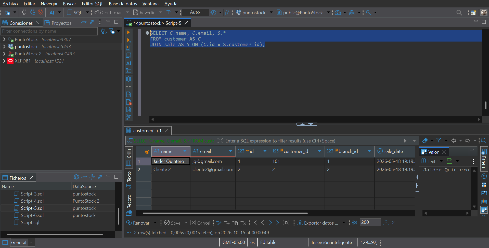

### 4. Condiciones y Operadores en Consultas

#### 4.1. Filtro por fecha específica

#### Forma 1 (Implícita)

``` postgres
SELECT C.name, C.email, S.* 
FROM customer AS C, sale AS S 
WHERE C.id = S.customer_id AND S.sale_date = '2026-05-18 19:19:29';
```

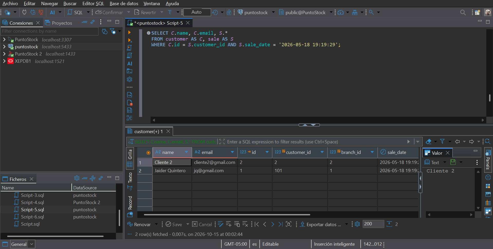

#### Forma 2 (Explícita)

``` postgres
SELECT C.name, C.email, S.* 
FROM customer AS C 
JOIN sale AS S ON (C.id = S.customer_id) 
WHERE S.sale_date = '2026-05-18 19:19:29';
```

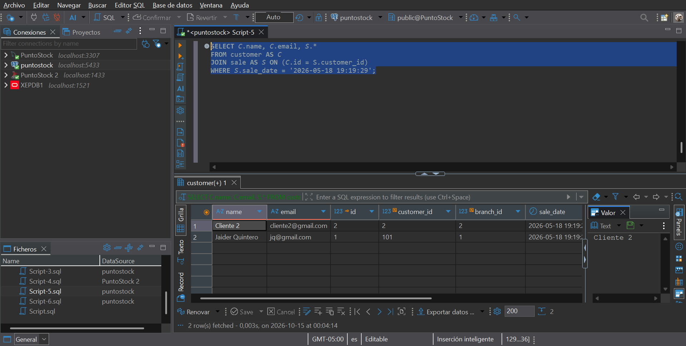

#### 4.2. Operador LIKE (Búsquedas de texto)

Emails que inician con 'm'

``` postgres
SELECT * FROM customer AS C WHERE C.email LIKE 'm%';
```

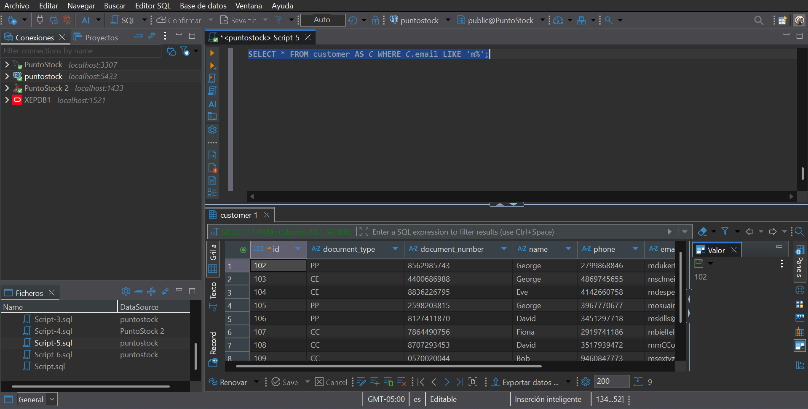

Emails que contengan el dominio 'gmail' (Usando el operador de concatenación `||` nativo de PostgreSQL)

``` postgres
SELECT * FROM customer AS C WHERE C.email LIKE '%' || 'gmail' || '%';
```

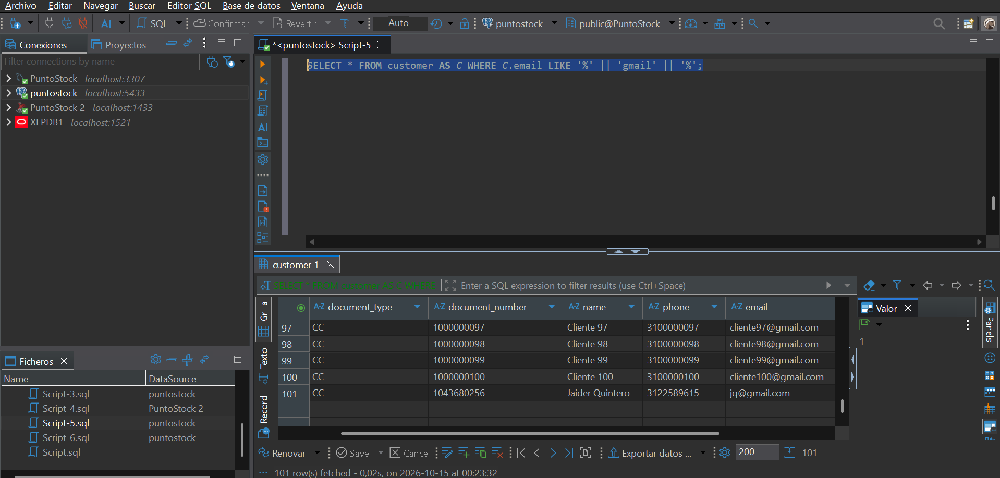

#### 4.3. Consulta multi-tabla (Línea continua de 4 tablas con Rango y Ordenamiento)

#### Forma 1 (Implícita)

``` postgres
SELECT C.*, S.*, SD.*, P.* 
FROM customer AS C, sale AS S, sale_detail AS SD, product AS P 
WHERE C.id = S.customer_id AND S.id = SD.header_id AND P.id = SD.item_id AND S.sale_date BETWEEN '2026-01-01' AND '2026-06-30' 
ORDER BY S.sale_date ASC;
```

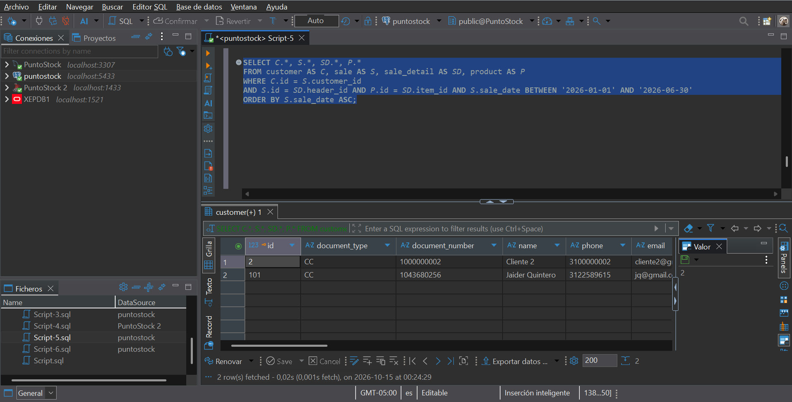

#### Forma 2 (Explícita)

``` postgres
SELECT * 
FROM customer AS C 
JOIN sale AS S ON (C.id = S.customer_id) 
JOIN sale_detail AS SD ON (S.id = SD.header_id) 
JOIN product AS P ON (P.id = SD.item_id) 
WHERE S.sale_date BETWEEN '2026-01-01' AND '2026-06-30' ORDER BY S.sale_date ASC;
```

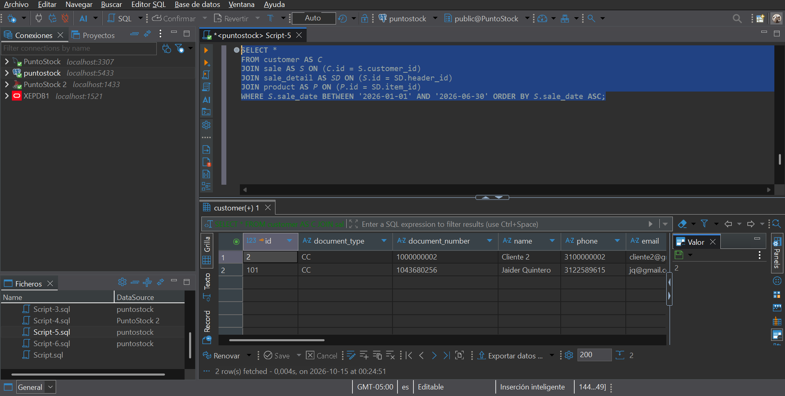

### 5. Consultas de Agrupamiento (GROUP BY, HAVING)

#### Agrupamiento básico (SUM, COUNT, AVG)

#### Forma 1 (Implícita)

``` postgres
SELECT C.id, C.name, SUM(S.total) AS TotalSuma, 
COUNT(S.customer_id) AS CuentaTotal, AVG(S.total) AS Promedio 
FROM customer AS C, sale AS S 
WHERE C.id = S.customer_id 
  AND S.sale_date BETWEEN '2026-01-01' AND '2026-06-30' 
GROUP BY C.id, C.name 
ORDER BY TotalSuma DESC;
```

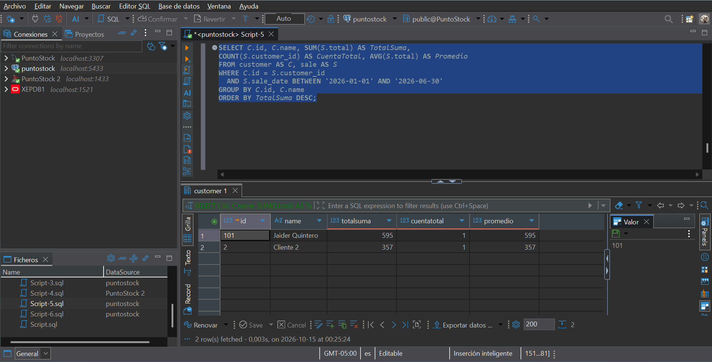

#### Forma 2 (Explícita)

``` postgres
SELECT C.id, C.name, SUM(S.total) AS TotalSuma, COUNT(S.customer_id) AS CuentaTotal, AVG(S.total) AS Promedio 
FROM customer AS C JOIN sale AS S ON (C.id = S.customer_id) 
WHERE S.sale_date BETWEEN '2026-01-01' 
  AND '2026-06-30' GROUP BY C.id, C.name 
ORDER BY TotalSuma DESC;
```

#### Agrupamiento con condición de filtro HAVING

*(Nota: En PostgreSQL se evalúa `COUNT(S.customer_id) >= 2` directamente en el `HAVING`).*

#### Forma 1 (Implícita)

``` postgres
SELECT C.id, C.name, SUM(S.total) AS TotalSuma, COUNT(S.customer_id) AS CuentaTotal, AVG(S.total) AS Promedio 
FROM customer AS C, sale AS S 
WHERE C.id = S.customer_id 
  AND S.sale_date BETWEEN '2026-01-01' AND '2026-06-30' GROUP BY C.id, C.name HAVING COUNT(S.customer_id) >= 2 ORDER BY TotalSuma DESC;
```

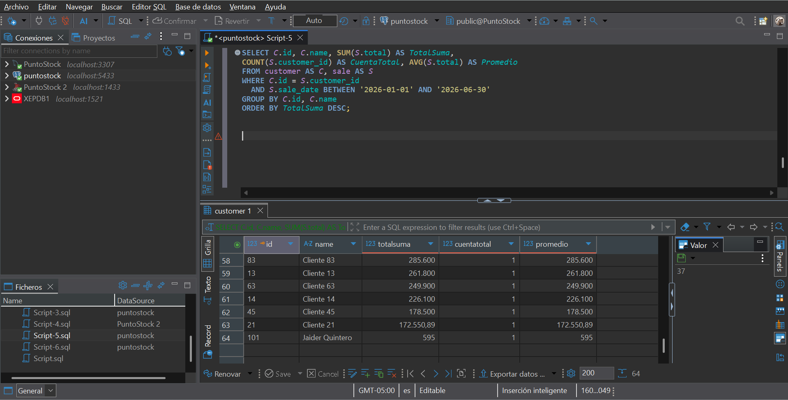

#### Forma 2 (Explícita)

``` postgres
SELECT C.id, C.name, SUM(S.total) AS TotalSuma, COUNT(S.customer_id) AS CuentaTotal, AVG(S.total) AS Promedio 
FROM customer AS C 
JOIN sale AS S ON (C.id = S.customer_id) 
WHERE S.sale_date BETWEEN '2026-01-01' AND '2026-06-30' 
GROUP BY C.id, C.name 
HAVING COUNT(S.customer_id) >= 2 
ORDER BY TotalSuma DESC;
```

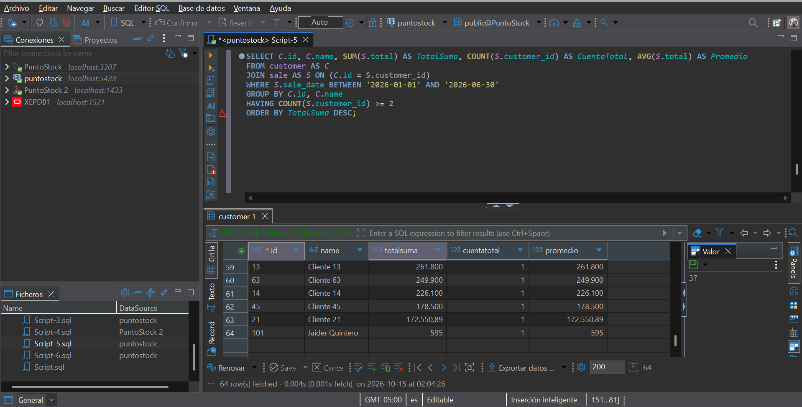

### 6 . Subconsultas (Diferencia de Conjuntos $A - B$)

#### Forma 1 (Mediante NOT IN)

``` postgres
SELECT * 
FROM customer AS C 
WHERE C.id NOT IN ( 
  SELECT S.customer_id 
  FROM sale AS S 
  WHERE S.sale_date BETWEEN '2026-01-01' AND '2026-06-30' );
```

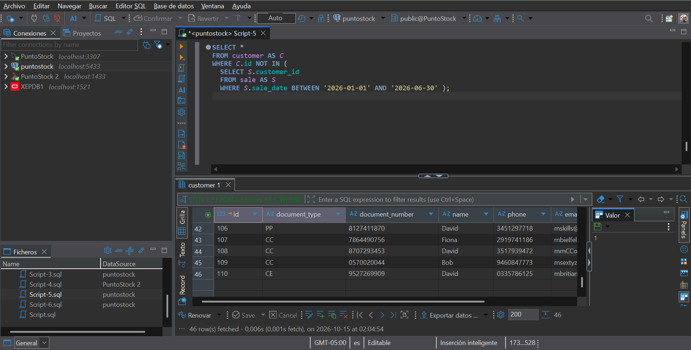

#### Forma 2 (Mediante LEFT JOIN y IS NULL)

``` postgres
SELECT C.* 
FROM customer AS C 
LEFT JOIN sale AS S ON (C.id = S.customer_id AND S.sale_date BETWEEN '2026-01-01' AND '2026-06-30') 
WHERE S.customer_id IS NULL;
```

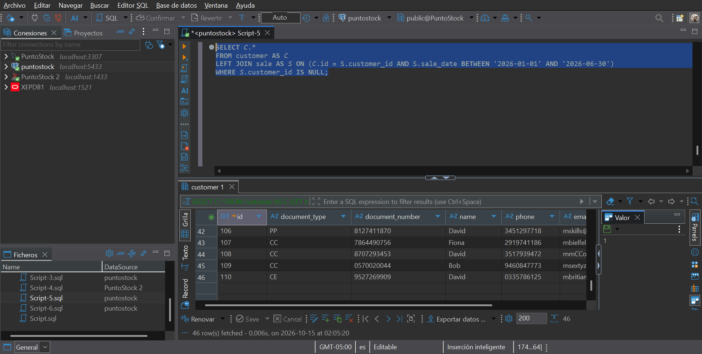

### SQLSERVER

### 1. Create — Insertar un nuevo cliente

Omitimos el campo `id` por ser autoincremental (`IDENTITY`) y asignamos los datos correspondientes en la tabla `customer`.

``` sqlserver
INSERT INTO customer (document_type, document_number, name, phone, email) VALUES ('CC', '1043680256', 'Jaider Quintero', '3122589615', '[jq@gmail.com](mailto:jq@gmail.com){.email}');
```

### 2. Read — Consultas básicas de lectura

#### 2.0. Consultar todos los clientes

Muestra todos los campos y registros de la tabla `customer`.

``` sqlserver
SELECT * FROM customer;
```

#### 2.1. Seleccionar columnas específicas

Evita traer columnas innecesarias proyectando únicamente `name`, `phone` y `email`.

``` sqlserver
SELECT name, phone, email FROM customer;
```

#### 2.2. Uso de alias de tabla

Misma selección introduciendo el alias `C` para simplificar la sintaxis.

``` sqlserver
SELECT C.name, C.phone, C.email FROM customer AS C;
```

### 3. Consultar varias tablas (JOINs entre Clientes y Ventas)

#### Forma 1: Join implícito (en la cláusula WHERE)

Combina `customer` y `sale` usando los campos de clave primaria y foránea en el `WHERE`.

``` sqlserver
SELECT C.name, C.email, S.\* FROM customer AS C, sale AS S WHERE C.id = S.customer_id;
```

#### Forma 2: Join explícito (cláusula JOIN ON)

Misma combinación utilizando la sintaxis estándar `JOIN ... ON`.

``` sqlserver
SELECT C.name, C.email, S.\* FROM customer AS C JOIN sale AS S ON (C.id = S.customer_id);
```

### 4. Condiciones y Operadores en Consultas

#### 4.1. Filtro por fecha específica

#### Forma 1 (Implícita)

``` sqlserver
SELECT C.name, C.email, S.\* FROM customer AS C, sale AS S WHERE C.id = S.customer_id AND S.sale_date = '2026-05-18 19:19:29';
```

#### Forma 2 (Explícita)

``` sqlserver
SELECT C.name, C.email, S.\* FROM customer AS C JOIN sale AS S ON (C.id = S.customer_id) WHERE S.sale_date = '2026-05-18 19:19:29';
```

#### 4.2. Operador LIKE (Búsquedas de texto)

Emails que inician con 'm'

``` sqlserver
SELECT * FROM customer AS C WHERE C.email LIKE 'm%';
```

Emails que contengan el dominio 'gmail' (Usando el operador `+` de T-SQL o la función `CONCAT`)

``` sqlserver
-- Opción 1: Operador + (Sintaxis T-SQL) SELECT * FROM customer AS C WHERE C.email LIKE '%' + 'gmail' + '%';

-- Opción 2: Función CONCAT SELECT * FROM customer AS C WHERE C.email LIKE CONCAT('%', 'gmail', '%');
```

#### 4.3. Consulta multi-tabla (Línea continua de 4 tablas con Rango y Ordenamiento)

#### Forma 1 (Implícita)

``` sqlserver
SELECT C.*, S.*, SD.*, P.* FROM customer AS C, sale AS S, sale_detail AS SD, product AS P WHERE C.id = S.customer_id AND S.id = SD.header_id AND P.id = SD.item_id AND S.sale_date BETWEEN '2026-01-01' AND '2026-06-30' ORDER BY S.sale_date ASC;
```

#### Forma 2 (Explícita)

``` sqlserver
SELECT * FROM customer AS C JOIN sale AS S ON (C.id = S.customer_id) JOIN sale_detail AS SD ON (S.id = SD.header_id) JOIN product AS P ON (P.id = SD.item_id) WHERE S.sale_date BETWEEN '2026-01-01' AND '2026-06-30' ORDER BY S.sale_date ASC;
```

### 5. Consultas de Agrupamiento (GROUP BY, HAVING)

#### Agrupamiento básico (SUM, COUNT, AVG)

#### Forma 1 (Implícita)

``` sqlserver
SELECT C.id, C.name, SUM(S.total) AS TotalSuma, COUNT(S.customer_id) AS CuentaTotal, AVG(S.total) AS Promedio FROM customer AS C, sale AS S WHERE C.id = S.customer_id AND S.sale_date BETWEEN '2026-01-01' AND '2026-06-30' GROUP BY C.id, C.name ORDER BY TotalSuma DESC;
```

#### Forma 2 (Explícita)

``` sqlserver
SELECT C.id, C.name, SUM(S.total) AS TotalSuma, COUNT(S.customer_id) AS CuentaTotal, AVG(S.total) AS Promedio FROM customer AS C JOIN sale AS S ON (C.id = S.customer_id) WHERE S.sale_date BETWEEN '2026-01-01' AND '2026-06-30' GROUP BY C.id, C.name ORDER BY TotalSuma DESC;
```

#### Agrupamiento con condición de filtro HAVING

#### Forma 1 (Implícita)

``` sqlserver
SELECT C.id, C.name, SUM(S.total) AS TotalSuma, COUNT(S.customer_id) AS CuentaTotal, AVG(S.total) AS Promedio FROM customer AS C, sale AS S WHERE C.id = S.customer_id AND S.sale_date BETWEEN '2026-01-01' AND '2026-06-30' GROUP BY C.id, C.name HAVING COUNT(S.customer_id) \>= 2 ORDER BY TotalSuma DESC;
```

Forma 2 (Explícita)

``` sqlserver
SELECT C.id, C.name, SUM(S.total) AS TotalSuma, COUNT(S.customer_id) AS CuentaTotal, AVG(S.total) AS Promedio FROM customer AS C JOIN sale AS S ON (C.id = S.customer_id) WHERE S.sale_date BETWEEN '2026-01-01' AND '2026-06-30' GROUP BY C.id, C.name HAVING COUNT(S.customer_id) \>= 2 ORDER BY TotalSuma DESC;
```

### 6. Subconsultas (Diferencia de Conjuntos $A - B$)

Obtiene los clientes registrados a los que no se les ha registrado ninguna venta dentro de un rango de fechas determinado.

#### Forma 1 (Mediante NOT IN)

``` sqlserver
SELECT * FROM customer AS C WHERE C.id NOT IN ( SELECT S.customer_id FROM sale AS S WHERE S.sale_date BETWEEN '2026-01-01' AND '2026-06-30' );
```

#### Forma 2 (Mediante LEFT JOIN e IS NULL)

``` sqlserver
SELECT C.* FROM customer AS C LEFT JOIN sale AS S ON (C.id = S.customer_id AND S.sale_date BETWEEN '2026-01-01' AND '2026-06-30') WHERE S.customer_id IS NULL;
```
